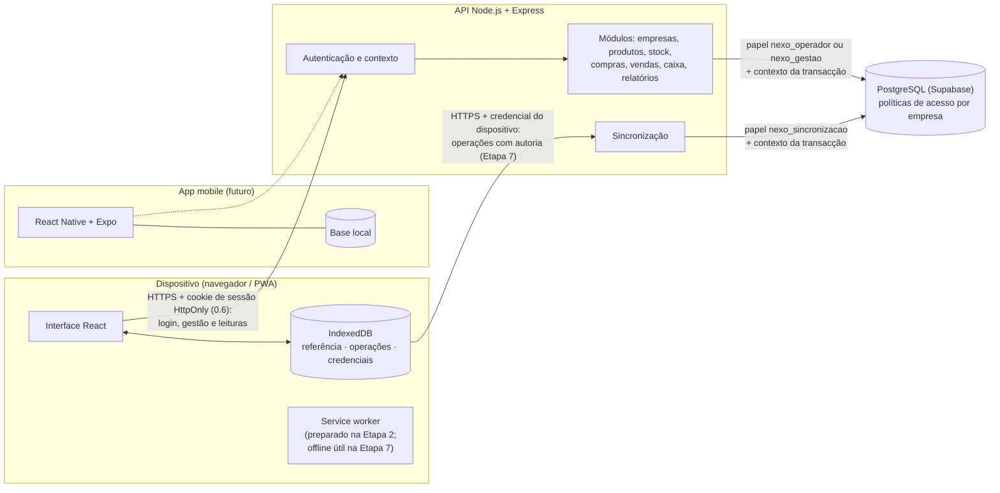

# Nexo — Arquitectura da Etapa 1

Versão 0.6 · 8 de Outubro de 2026 · Estado: **proposta para validação — não aprovada no seu conjunto.** Estão aprovadas **H-01** (02/10/2026, secções 3 e 19.7) e **H-02**, com as decisões de autenticação e recuperação do proprietário (08/10/2026, secção 3.8)

Base: `docs/Nexo_Especificacao_Etapa_0.md`, versão 0.6. A especificação continua em validação: **nenhuma sugestão ou decisão em aberto é tratada aqui como aprovada**. Onde este documento escolhe uma opção, marca-a como **proposta** e indica a decisão de que depende (H-xx).

Este documento propõe o modelo de dados e os contratos. **Não foram criadas migrações definitivas** nem executada nenhuma migração numa base real. O teste de isolamento da secção 19 foi **executado num projecto Supabase de desenvolvimento** a 02/10/2026 (22/22). Cobre um esquema mínimo, não o modelo completo nem a API.

Versões anteriores: `docs/versoes/Nexo_Arquitectura_Etapa_1_v0.1.md`, `docs/versoes/Nexo_Arquitectura_Etapa_1_v0.2.md`, `docs/versoes/Nexo_Arquitectura_Etapa_1_v0.3.md`, `docs/versoes/Nexo_Arquitectura_Etapa_1_v0.4.md`, `docs/versoes/Nexo_Arquitectura_Etapa_1_v0.5.md`.

---

## Alterações da versão 0.6 (Etapa 3: autenticação e empresas)

Regista as decisões de 08/10/2026 (especificação 0.6) e o que a Etapa 3 implementou. Detalhe e testes: `docs/Nexo_Entrega_Etapa_3.md`. **Não aprova nenhuma outra proposta.**

| # | O que mudou | Onde |
|---|---|---|
| 1 | **Sem Supabase Auth.** Os funcionários não têm e-mail (H-02) e o login do Supabase Auth exige e-mail ou telefone. A autenticação passa a ser da própria API: código da empresa + nome de utilizador + código secreto, sessão num cookie HttpOnly, validada na base em cada pedido | 1, 2.1, **3.8**, 6.1 |
| 2 | `nexo_autenticacao` criado já na Etapa 3 (migração 0005). Passa a ser dono das funções de identidade que correm antes do contexto. Na Etapa 7 será também dono de `autenticar_registo` | 3.1, 3.8 |
| 3 | `utilizadores` passa a ser a conta **por empresa**, com a função (junta "utilizador" e "membro"). Tabelas novas: `utilizador_filiais`, `credenciais_acesso`, `sessoes`, `contactos_recuperacao`, `tokens_email`, `registo_auditoria`. `convites` sai do modelo | 4.3 |
| 4 | Recursos da API da Etapa 3: `/autenticacao/*`, `/empresa`, `/filiais/{id}`, `/utilizadores/*`, `/auditoria` | 6.2 |

## Alterações da versão 0.5 (implementação da Etapa 2)

Só regista o que a Etapa 2 implementou; não aprova nenhuma outra proposta. Detalhe em `docs/Nexo_Entrega_Etapa_2.md`.

| # | O que mudou | Onde |
|---|---|---|
| 1 | Marca da transacção revista antes de ser generalizada: `pid:início`, uma só definição por transacção, só dentro de um papel de execução. Limites documentados | 3.2 |
| 2 | Novo papel `nexo_diagnostico` (dono de `nexo.estado_base()`); `nexo_autenticacao` só será criado com `autenticar_registo` (Etapa 7) | 3.1 |
| 3 | Base das rotas: `/api/v1` | 6.1 |
| 4 | Estado das partes da Etapa 2 | 18.2 |

## Alterações da versão 0.4 (decisão H-01)

| # | O que mudou | Onde |
|---|---|---|
| 1 | **H-01 aprovada** pelo proprietário do projecto em 02/10/2026, com cinco requisitos. Nenhuma outra proposta é aprovada por esta decisão | 1, 3.1, 3.5, 14, 18.2, **19.7** |

---

## Alterações da versão 0.3 (resultado do teste H-01)

| # | O que mudou | Onde |
|---|---|---|
| 1 | Resultado do teste de isolamento no Supabase de desenvolvimento: 22/22, zero fugas, esquema e papéis de teste removidos | 0, 14, 16, 18.2, **19** |
| 2 | Correcção em `01_preparar.sql`: `GRANT CREATE` temporário ao dono da função antes de `ALTER FUNCTION … OWNER`, seguido de `REVOKE CREATE`. Levar para a migração definitiva | 3.4, 19.3 |
| 3 | Modo de ligação usado: Session pooler (5432) para preparação e T01–T20; Transaction pooler (6543) para P01–P02 | 19.2 |
| 4 | Recomendação para fechar H-01, **para decisão do proprietário do projecto** | 19.5 |

---

## Alterações da versão 0.2 (revisão da Etapa 1)

| # | Tema | O que mudou | Onde |
|---|---|---|---|
| 1 | Protecção dos custos | Os valores de custo saem de `movimentos_stock`, `itens_compra`, `itens_recepcao` e `itens_devolucao` para tabelas de custo próprias. O operador corre com um papel de base de dados **sem privilégio** nessas tabelas. Matriz do que cada função consulta, regras da API e testes | 3.1, **3.7** (nova), 4.3, 5, 6, 10 |
| 2 | Imutabilidade das operações | `operacoes_sync` guarda só o facto recebido, sem estado. O estado passa para `processamento_operacoes`. Tentativas, decisões e aplicações ficam em tabelas próprias, só de inserção. Algoritmo reescrito | 4.3, **8**, 9 |
| 3 | Idempotência | Deixa de existir `ja_aplicada`. A resposta devolve o **estado real** e indica se foi repetição. Sete casos tratados, incluindo pedidos concorrentes e resposta perdida | 7.3, **8.3** |
| 4 | Custo efectivo | Questão 12.1 resolvida como proposta na especificação 0.4 (D.3.11). Modelo de `acertos_imputacoes` ajustado | 4.3, 12 |
| 5 | Roteiro | Referências à Etapa 2 e à Etapa 7 corrigidas; separados os cinco temas de offline; propostas de ordem com motivo e impacto | 1, 11, **17** (nova) |
| 6 | Contagem | `retoma_local` sai do contrato activo; campos reservados identificados; nova operação `confirmacao_retoma` | 4.3, 7.1, 13 |
| 7 | Contagem cega | Verificada no protótipo e corrigida (ver 0) | 0, 15 |
| 8 | H-23 | Continua pendente. O que pode avançar e o que depende da decisão | **18** (nova) |
| 9 | Autenticação do registo | Explicado como `nexo.autenticar_registo` lê o registo antes do contexto, com FORCE activo e sem acesso genérico | 3.4 |
| 10 | Teste de isolamento (H-01) | Preparado em `backend/testes/isolamento/`; verificado localmente em PGlite. (Executado no Supabase na 0.3) | **19** (nova) |

---

## 0. Âmbito e entregas da Etapa 1

| Entrega | Onde | Estado |
|---|---|---|
| Protótipo web navegável com dados fictícios | `frontend/` (index.html) | Implementado; sem servidor, sem autenticação real e com sincronização **simulada** |
| Arquitectura, modelo de dados, contratos | Este documento | Proposta |
| Prova técnica de autoria por assinatura (H-23) | `frontend/prova-assinatura.html`, `backend/src/prova/` | Executada em Edge e Chrome no Windows; resultados em `docs/Nexo_Prova_Assinatura_Etapa_1.md`; **H-23 pendente** |
| Teste da interface (32 passos) | `frontend/testes/fluxo/` | Executado neste computador (secção 16) |
| Verificação numérica do custo efectivo | `backend/testes/custo/` | Executada (`npm test`) |
| Teste de isolamento no Supabase (H-01) | `backend/testes/isolamento/` | **Executado** a 02/10/2026 pelo proprietário do projecto, num projecto de desenvolvimento: 22/22 (secção 19) |

**Correcções ao protótipo nesta revisão:**

- **Contagem cega:** o numerário esperado aparecia à operadora no **Painel** ("Caixa: numerário esperado"). Ao gestor, continuava visível **por trás da janela** de fecho. Agora:
  1. o esperado não aparece em nenhum ecrã durante a contagem;
  2. a contagem é **registada** antes de o esperado ser mostrado;
  3. a diferença aparece depois;
  4. a justificação é pedida quando há diferença.

  Uma recontagem acrescenta-se à primeira, que continua visível ao gestor. A mensagem de erro de uma retirada acima do esperado deixou de revelar o esperado à operadora. Continua **proposta** (H-15).
- **Pausa de contagem:** o dispositivo regista a confirmação da pausa e a confirmação da retoma como operações. Só retoma com o aviso do servidor; o texto indica a retoma local como futura, fora do MVP.

---

## 1. Visão geral



Princípios que orientam as escolhas:

1. A web e a app mobile **só falam com a API**, incluindo para a autenticação (0.6: sem Supabase Auth; secção 3.8). O Supabase é só a base de dados.
2. Há **dois caminhos de escrita**:
   - **Gestão** (produtos, compras, contagens, utilizadores, relatórios): pedidos REST online, com a sessão do utilizador (0.6: cookie HttpOnly; antes, JWT).
   - **Balcão** (vendas, pagamentos, cancelamentos, movimentos de caixa): **operações** no formato da secção 7, aplicadas no servidor por uma única função de aplicação. Proposta: na Etapa 6 as operações chegam online com o JWT; na Etapa 7 passam também a chegar pelo canal do dispositivo (secção 17, proposta P-1).
3. O servidor é a fonte de verdade. O dispositivo guarda uma cópia de referência e a sua fila de operações.

---

## 2. Comunicação web → API → base de dados

### 2.1 Pedidos de utilizador (online) — revisto na 0.6

```mermaid
sequenceDiagram
  participant W as Web
  participant P as API
  participant D as PostgreSQL
  W->>P: POST /v1/autenticacao/entrar (código da empresa, utilizador, código secreto)
  P->>D: nexo.parametros_acesso(…) → parâmetros e sal (nunca o resumo)
  P->>P: scrypt do código introduzido
  P->>D: nexo.iniciar_sessao(…, resumo calculado, SHA-256 do token novo)
  D-->>P: ok + ids (a base compara o resumo)
  P-->>W: 200 + Set-Cookie (token de 256 bits, HttpOnly, SameSite=Strict)
  W->>P: GET /v1/utilizadores (cookie; X-Nexo-Cliente nas escritas)
  P->>D: nexo.validar_sessao(SHA-256 do token) → empresa, conta, função, filiais
  P->>P: autorização por função (matriz B) antes de tocar na base
  P->>D: BEGIN; SET LOCAL ROLE nexo_operador | nexo_gestao;<br/>nexo.definir_contexto(…)
  P->>D: SELECT … (privilégios do papel + políticas por empresa e por função)
  P->>D: COMMIT
  P-->>W: 200 JSON
```

1. A API valida o token **na base** em cada pedido (`nexo.validar_sessao`): sessão não revogada, não expirada, sem inactividade excessiva e conta activa. A base devolve a empresa, a conta, a função e as filiais permitidas.
2. A empresa e a função vêm **só** dessa resposta. Um `X-Nexo-Empresa` diferente da sessão é recusado (`403 empresa_nao_permitida`). `X-Nexo-Filial` só pode escolher uma filial permitida (`403 filial_nao_permitida`).
3. **A função escolhe o papel da base de dados**: operador → `nexo_operador`; proprietário ou gestor → `nexo_gestao` (secção 3.1).
4. A autorização por função (matriz B) é verificada na API **antes** de tocar na base.
5. Cada pedido corre numa transacção com o contexto definido (3.2). Os privilégios do papel e as políticas são a segunda e a terceira barreira. As políticas de escrita de identidade exigem também a função de proprietário no contexto.

### 2.2 Sincronização (dispositivo, Etapa 7)

1. O dispositivo envia um lote com a **credencial do registo** (`Authorization: Nexo-Dispositivo <segredo>`).
2. A API obtém (registo, empresa, filial, estado) pela função restrita `nexo.autenticar_registo` (3.4). A empresa **deriva da credencial**, nunca do conteúdo.
3. Cada operação é processada **numa transacção própria** com o papel `nexo_sincronizacao` e o contexto (empresa, filial, registo, autor verificado), segundo o algoritmo da secção 8.
4. A resposta indica o **estado real** de cada operação (7.3).

### 2.3 Avisos de controlo e dados de referência

- `GET /v1/sync/avisos` (credencial do dispositivo): só avisos que restringem (revogação, suspensão, utilizador desactivado, PIN alterado) e avisos de **pausa e retoma de vendas**. Não devolve dados da empresa (D.12.2).
- `GET /v1/referencia?desde=<cursor>` (JWT de um utilizador com sessão no dispositivo): catálogo, preços, stock, regras, versão de permissões. **Nunca inclui custos** para o operador. Para P/G depende de H-28, cuja proposta foi revista (3.7.6).

---

## 3. Isolamento por empresa e políticas de acesso

### 3.1 Papéis na base de dados (H-01, aprovada em 02/10/2026)

A decisão aprova o princípio: papéis próprios sem BYPASSRLS, contexto local por transacção, RLS forçado e referências limitadas à mesma empresa (19.7). A lista concreta de papéis abaixo é o desenho testado; pode ganhar papéis nas migrações, sempre com os mesmos princípios.

| Papel | Tem login? | Ignora as políticas? | Uso |
|---|---|---|---|
| `nexo_proprietario_esquema` | Não em execução | Dono das tabelas; mesmo assim sujeito às políticas, porque todas as tabelas levam `FORCE ROW LEVEL SECURITY` | Só migrações |
| `nexo_api` | Sim (ligação da API) | Não (`NOBYPASSRLS`, `NOINHERIT`) | Só pode `SET ROLE` para os três papéis de execução. Sem privilégios directos nas tabelas. `EXECUTE` em `nexo.autenticar_registo` |
| `nexo_operador` | Não | Não | Pedidos online de membros com função **operador**. **Sem nenhum privilégio nas tabelas de custo** (3.7) |
| `nexo_gestao` | Não | Não | Pedidos online de **proprietário e gestor**. As diferenças entre os dois (configuração, funções, contas) verificam-se na API e, nas tabelas administrativas, por política com `nexo.funcao` |
| `nexo_sincronizacao` | Não | Não | Aplicação de operações de balcão (secção 8) |
| `nexo_autenticacao` | Não, e **sem membros** | Não | **(0.6) Criado na migração 0005.** Dono das funções de identidade que correm antes do contexto (3.8) e, na Etapa 7, de `nexo.autenticar_registo` (3.4). Ninguém pode assumir este papel |
| `nexo_diagnostico` (0.5) | Não | Não | Dono da função `nexo.estado_base()`, que dá à API a versão das migrações sem acesso à tabela de controlo. Criado na migração 0001 |
| `service_role`, `postgres` (Supabase) | — | **Sim** | **Não usados** em pedidos nem na sincronização. Só em tarefas administrativas explícitas, auditadas e fora do caminho dos pedidos |

**Mudança da 0.2:** o antigo `nexo_utilizador` divide-se em `nexo_operador` e `nexo_gestao`. Com um só papel, a protecção dos custos dependia de uma política com `nexo.funcao` em cada tabela de custo. Uma consulta nova que esquecesse a junção certa, ou uma tabela sem essa política, podia devolver custos. Com dois papéis, o **privilégio** da tabela recusa ao operador qualquer acesso (`permission denied`), seja qual for a consulta.

**Porque não usar a credencial de serviço:** no Supabase, `service_role` tem `BYPASSRLS`, e o dono das tabelas também ignora as políticas se estas não forem forçadas. Uma API que use essas credenciais **não tem as políticas activas**: qualquer erro de filtro devolveria dados de outra empresa. Por isso os pedidos correm com papéis sem esse privilégio (teste T01 da secção 19).

**Esquema próprio:** as tabelas ficam num esquema `nexo` que a Data API do Supabase não expõe, sem privilégios para `anon` e `authenticated`.

### 3.2 Contexto por transacção

Cada pedido ou operação corre assim (proposta; SQL ilustrativo):

```sql
BEGIN;
SET LOCAL ROLE nexo_operador;                 -- ou nexo_gestao, nexo_sincronizacao
SELECT nexo.definir_contexto($empresa, $filial, $utilizador, $funcao, $registo);
-- … consultas e escritas …
COMMIT;
```

`nexo.definir_contexto` chama `set_config(…, true)` para cada valor e grava também uma **marca da transacção**: `nexo.marca = pg_backend_pid() || ':' || extract(epoch from now())` (0.5; na prova H-01 era só o instante). As funções usadas nas políticas (`nexo.empresa_actual()`, `nexo.registo_actual()`…) só devolvem um valor se a marca corresponder à transacção **actual**. `definir_contexto` recusa uma segunda definição na mesma transacção e recusa ser chamada fora de um papel de execução. O que a marca protege e os seus limites estão em `docs/Nexo_Entrega_Etapa_2.md`, secção 5.

- `SET LOCAL` e `set_config(…, true)` valem só dentro da transacção. Isto é compatível com o *pooler* do Supabase em modo transacção. **Nunca** se usa `SET` de sessão.
- **Defesa contra fugas no pool:** se algum código definir por erro um valor ao nível da sessão, esse valor pode passar para a transacção de outro cliente na mesma ligação do pool. A marca não corresponde ao início dessa transacção, e as políticas negam tudo (testes T05, T20 e P02).
- Os valores vêm **só** da sessão validada pela base (0.6; antes: JWT verificado e membro) ou da credencial e da autoria verificadas. Um único *middleware* define-os; nenhum módulo os pode alterar.
- Se o contexto faltar, as funções devolvem `NULL` e as políticas **negam tudo** (T04).

### 3.3 Políticas (exemplos ilustrativos)

```sql
ALTER TABLE produtos ENABLE ROW LEVEL SECURITY;
ALTER TABLE produtos FORCE ROW LEVEL SECURITY;

-- Todos lêem o catálogo da sua empresa; só a gestão escreve.
GRANT SELECT ON produtos TO nexo_operador, nexo_gestao, nexo_sincronizacao;
GRANT INSERT, UPDATE ON produtos TO nexo_gestao;
CREATE POLICY produtos_ler ON produtos FOR SELECT TO nexo_operador, nexo_gestao, nexo_sincronizacao
  USING (empresa_id = nexo.empresa_actual());
CREATE POLICY produtos_gestao ON produtos FOR INSERT TO nexo_gestao
  WITH CHECK (empresa_id = nexo.empresa_actual());

-- Custos: o operador não tem privilégio nenhum; a gestão lê os da sua empresa.
GRANT SELECT ON custos_item_venda TO nexo_gestao;
GRANT INSERT ON custos_item_venda TO nexo_sincronizacao;
CREATE POLICY custos_item_venda_gestao ON custos_item_venda FOR SELECT TO nexo_gestao
  USING (empresa_id = nexo.empresa_actual());

-- Vendas criadas pela sincronização: empresa e registo têm de ser os da credencial.
CREATE POLICY vendas_sincronizacao_inserir ON vendas FOR INSERT TO nexo_sincronizacao
  WITH CHECK (empresa_id = nexo.empresa_actual() AND registo_id = nexo.registo_actual());
```

Regras gerais:

- **Todas** as tabelas com dados de empresa têm `ENABLE` + `FORCE ROW LEVEL SECURITY`. Sem política, o acesso é negado por defeito.
- **Nenhum papel tem `UPDATE` ou `DELETE`** nas tabelas de factos (movimentos, vendas, itens, pagamentos, operações recebidas, acertos, tentativas, decisões, aplicações, auditoria). As únicas actualizações previstas são as colunas de estado de `processamento_operacoes` (secção 8), os saldos em cache e as sessões de caixa.
- Os privilégios por tabela vêm primeiro (que tabelas cada papel toca); as políticas vêm depois (que linhas).

### 3.4 Autenticação do registo antes de conhecer a empresa

**O problema.** A sincronização só sabe a empresa depois de identificar o registo pela credencial. Mas `registos_dispositivo` tem `FORCE ROW LEVEL SECURITY`, e sem contexto as políticas não devolvem nenhuma linha.

**A solução proposta** é uma função `SECURITY DEFINER` com um dono dedicado e uma política explícita para esse dono:

```sql
CREATE ROLE nexo_autenticacao NOLOGIN NOBYPASSRLS;           -- sem membros
GRANT USAGE ON SCHEMA nexo TO nexo_autenticacao;
GRANT SELECT (id, empresa_id, filial_id, estado, credencial_hash)
  ON registos_dispositivo TO nexo_autenticacao;               -- só estas colunas
CREATE POLICY registos_autenticacao ON registos_dispositivo
  FOR SELECT TO nexo_autenticacao USING (true);

CREATE FUNCTION nexo.autenticar_registo(p_hash bytea)
  RETURNS TABLE (registo_id uuid, empresa_id uuid, filial_id uuid, estado text)
  LANGUAGE sql STABLE SECURITY DEFINER SET search_path = pg_catalog, pg_temp AS $$
    SELECT r.id, r.empresa_id, r.filial_id, r.estado
      FROM nexo.registos_dispositivo r
     WHERE r.credencial_hash = p_hash AND octet_length(p_hash) = 32
$$;
GRANT CREATE ON SCHEMA nexo TO nexo_autenticacao;      -- exigido por ALTER … OWNER (0.3)
ALTER FUNCTION nexo.autenticar_registo(bytea) OWNER TO nexo_autenticacao;
REVOKE CREATE ON SCHEMA nexo FROM nexo_autenticacao;   -- retirado logo a seguir
REVOKE ALL ON FUNCTION nexo.autenticar_registo(bytea) FROM PUBLIC;
GRANT EXECUTE ON FUNCTION nexo.autenticar_registo(bytea) TO nexo_api;
```

**Porque não contradiz o FORCE ROW LEVEL SECURITY:**

- `FORCE` sujeita às políticas **também o dono da tabela**. A função não corre como dono da tabela: corre como `nexo_autenticacao`, que é outro papel.
- Esse papel também está sujeito às políticas. Lê o registo porque existe uma **política explícita** para ele, visível em `pg_policies` e verificada nos testes.
- Nenhum papel envolvido tem `BYPASSRLS`.

**Porque não abre acesso genérico:**

1. A única forma de agir como `nexo_autenticacao` é chamar esta função. O papel não tem login nem membros, e nenhum papel da API consegue `SET ROLE` para ele (teste T18).
2. A função só devolve a linha cujo resumo é igual ao resumo de um segredo de 256 bits. Não permite listar registos nem procurar por outro critério.
3. Devolve só quatro colunas, sem dados de negócio. O privilégio por coluna impede o papel de ler as restantes, mesmo que a função fosse alterada.
4. `nexo_api` só tem `EXECUTE` na função. Não lê a tabela directamente (T03), e o operador não pode executar a função (T18).
5. O `search_path` é fixo e o nome da tabela vai qualificado, o que evita a substituição de objectos.

O segredo tem pelo menos 256 bits aleatórios e só o seu resumo SHA-256 é guardado. A API limita a frequência de pedidos com credencial desconhecida (401).

### 3.5 O que as políticas protegem e o que não protegem

| Protegem contra | Não protegem contra |
|---|---|
| Consultas sem filtro de empresa, identificadores trocados, junções mal feitas | Uma API comprometida que defina o contexto de outra empresa: o contexto é definido pela API |
| Referências entre empresas, com as chaves estrangeiras compostas (4.1). As políticas **não** verificam referências: uma chave simples aceitaria um produto de outra empresa (controlo T09) | Erros de autorização **dentro** da mesma empresa (limites, filiais): estes verificam-se na API |
| Escritas da sincronização fora do registo da credencial | Uso da credencial de serviço, que por isso fica fora dos caminhos de pedido |
| Leitura de custos pelo operador, por privilégio (3.7) | Custos guardados no dispositivo (3.7.6) |

**Alternativa considerada para H-01:** chamar a base pelo PostgREST com o JWT do utilizador, de modo que as políticas usem `auth.uid()` verificado pela própria base. Isto é mais forte nas leituras online, porque a API não consegue forjar o contexto sem o segredo do JWT. Mas as escritas atómicas em várias tabelas exigiriam funções RPC, e a sincronização não tem JWT de utilizador. **Proposta:** ligação directa com papéis e contexto por transacção nos dois caminhos, e testes automáticos de isolamento em cada módulo. **H-01 aprovada em 02/10/2026 com esta opção**; o PostgREST com RPC fica registado como considerado e não adoptado.

### 3.8 Autenticação de utilizadores antes do contexto (0.6, Etapa 3)

**Problema.** O login e a validação da sessão acontecem antes de se conhecer a empresa, e todas as tabelas têm `FORCE ROW LEVEL SECURITY`. A solução segue o mesmo padrão de 3.4: funções `SECURITY DEFINER` com o dono dedicado `nexo_autenticacao` e políticas explícitas para esse dono. Não há leitura genérica de credenciais e o RLS nunca é desligado.

| Função (0007) | Executa | Devolve |
|---|---|---|
| `parametros_acesso(empresa, utilizador)` | `nexo_api` | Parâmetros e sal do scrypt. **Nunca o resumo** |
| `iniciar_sessao(empresa, utilizador, resumo, resumo_token, duração, inactividade)` | `nexo_api` | `ok` / `invalido` / `desactivado` e ids. "desactivado" só depois de o resumo estar certo |
| `validar_sessao(resumo_token)` | `nexo_api` | Sessão, empresa, conta, função, nome, filiais permitidas |
| `terminar_sessao`, `registar_empresa`, `confirmar_email`, `pedir_recuperacao`, `concluir_recuperacao`, `reenviar_activacao`, `corrigir_email_activacao` | `nexo_api` | O mínimo de cada operação. Desde a 0008: as contas do registo nascem **pendentes** (trigger); `iniciar_sessao` devolve `pendente` sem criar sessão; `confirmar_email` activa a conta |
| `parametros_acesso_proprios`, `alterar_codigo_proprio` | operador, gestão | Só a própria conta (contexto) |
| `definir_codigo`, `revogar_sessoes`, `definir_email_recuperacao`, `reenviar_confirmacao_email` | gestão | Exigem o proprietário **confirmado na base**, não só no contexto |
| `suporte_emitir_recuperacao` | `nexo_proprietario` (só o administrador das migrações) | Recuperação assistida, fora dos pedidos |

Propriedades:

- **O resumo do código secreto nunca sai da base.** A API calcula o scrypt do código introduzido com os parâmetros e o sal, e a função compara-o. Uma API comprometida pode tentar códigos *online*, como qualquer cliente, mas não obtém resumos para atacar *offline*.
- **Tokens só como SHA-256.** Os de sessão vão no cookie; os dos links de e-mail vão no fragmento `#`, que o navegador não envia ao servidor.
- **Os papéis de execução não têm nenhum privilégio** em `credenciais_acesso`, `sessoes` e `tokens_email` (verificação do catálogo, regra 21).
- **A matriz de quem executa cada função é verificada** no catálogo (regra 25).
- **`ContextoVerificado` só a partir de `SessaoValidada`**, que só o serviço de identidade cria com a resposta de `validar_sessao`. Um teste estático o garante.
- **Algoritmo:** scrypt N=2^15, r=8, p=3 (32 MiB), sal de 16 bytes, resumo de 32 bytes. Os parâmetros são guardados com cada resumo, para poderem subir. Cerca de 0,5 s por cálculo no computador de desenvolvimento.
- **Sessões:** proposta de 12 h no máximo e 4 h de inactividade. Revogadas ao sair, ao desactivar a conta, ao redefinir o código e na recuperação. Alterar o próprio código revoga as outras sessões.
- **Tentativas repetidas:** limites em memória, por IP e por conta (para todas as contas, existam ou não). A resposta não revela se a conta existe. Num só processo, sem partilha entre instâncias (limitação; ver a entrega da Etapa 3).

**Alternativas não adoptadas:**

- **Supabase Auth:** exige e-mail ou telefone. Para os funcionários (H-02) teria de se inventar endereços ou usar a API administrativa com `service_role` na API, o que contraria H-01.
- **Devolver o resumo à API para comparar lá:** expunha os resumos a quem controlasse a ligação `nexo_api`.

### 3.6 Preparação para filiais

- Todas as tabelas de coisas que acontecem num local têm `filial_id`, e as chaves compostas incluem-no quando é relevante (saldos, sessões, contagens).
- `utilizador_filiais` (0.6; antes `membro_filiais`) indica em que filiais cada conta trabalha; o proprietário tem todas. No piloto há uma filial e todos os membros a têm.
- As políticas podem ganhar um filtro de filial (`filial_id = ANY(nexo.filiais_permitidas())`) sem mudar o esquema.
- Os códigos (`F01`, `C01`) são únicos por filial. O número do comprovativo já inclui a filial.

### 3.7 Protecção dos custos (0.2)

#### 3.7.1 Onde havia custos visíveis ao operador (revisão da 0.1)

| Onde | Na 0.1 | Na 0.2 |
|---|---|---|
| `movimentos_stock` | `custo_unitario`, `valor` na tabela que o operador lê | Colunas retiradas. Passam para `valorizacao_movimentos` (tabela de custo) |
| `itens_compra`, `itens_recepcao` | `custo_unitario`. O operador regista quantidades recebidas (B.3), por isso lê estas tabelas | Colunas retiradas. Passam para `custos_itens_compra` e `custos_itens_recepcao` |
| `itens_devolucao` | `custo_estornado` | Passa para `custos_itens_devolucao` |
| `valorizacao_stock`, `custos_item_venda`, `acertos_*`, `correccoes_custo_recepcao` | Já separadas, protegidas por política com `nexo.funcao` | Protegidas por **privilégio** (o operador não tem nenhum) e por política de empresa |
| `pagamentos_fornecedor`, `movimentos_financeiros`, `compras` (totais) | Revelam o valor das compras | Sem privilégio para o operador |
| `alertas` (venda abaixo do custo, venda sem custo, possível perda) | Referências com valores | Sem privilégio para o operador |
| `conflitos.evidencias`, `registo_auditoria.antes/depois` (jsonb) | Podem conter custos (correcções, acertos) | Sem privilégio para o operador |
| `/v1/referencia` | Custos para P/G no dispositivo (H-28) | Nunca para o operador. A proposta de H-28 foi revista (3.7.6) |
| Resposta de `confirmar recepção` (6.3) | `custoUnitario` | Só P/G chamam a rota (B.3) |
| Respostas da sincronização | Não definido | **Nunca** incluem custos, para nenhuma função: vão para o dispositivo |
| Mensagens de erro e avisos | Não definido | Nunca incluem custos nem margens para o operador (o aviso "abaixo do custo" de D.4.6 só existe para P/G) |
| `sessoes_caixa.esperado` | — | Não é um custo, mas segue a mesma regra: o operador só o recebe depois de registar a contagem (H-15) |

#### 3.7.2 Regra

1. **Os valores de custo vivem só em tabelas de custo.** Lista fechada: `valorizacao_stock`, `valorizacao_movimentos`, `custos_item_venda`, `custos_itens_compra`, `custos_itens_recepcao`, `custos_itens_devolucao`, `acertos_custo`, `acertos_imputacoes`, `correccoes_custo_recepcao`.
2. **O papel `nexo_operador` não tem nenhum privilégio** nessas tabelas nem nas financeiras e administrativas da tabela 3.7.3. Uma consulta que as toque, mesmo por junção ou subconsulta, falha com `permission denied` (T10).
3. **As tabelas que o operador lê não têm colunas de custo** (T11, T12). Um teste automático do catálogo percorre todas as colunas legíveis por `nexo_operador` e falha se alguma tiver nome de custo (`custo`, `valor`, `margem`, `cmv`). Uma coluna genérica que precise desse nome, por exemplo `valor` num pagamento, entra numa lista de excepções revista.
4. **A API tem esquemas de resposta por função** (`ProdutoOperador`, `ProdutoGestao`…), com propriedades adicionais proibidas. É a terceira barreira, não a primeira.
5. **Falha fechada:** se uma rota do operador tocar por engano numa tabela de custo, o pedido falha com erro interno, registado, sem devolver dados.

#### 3.7.3 O que cada função pode consultar

L = lê · E = escreve · — = sem acesso (na base e na API). As linhas são sempre só da empresa (e da filial) do contexto.

| Dados | Proprietário | Gestor | Operador | Sincronização |
|---|---|---|---|---|
| Catálogo, preços, quantidades em stock | L E | L E | L | L |
| Movimentos de stock (quantidade, motivo, documento, autor) | L E | L E | L | L E |
| Valor dos movimentos, custo médio, valor do stock | L E | L E | — | L E |
| Custo registado, custo efectivo, acertos, correcções de custo | L E | L E | — | L E |
| Compras e recepções: fornecedor, produtos, quantidades | L E | L E | L; E das quantidades recebidas (B.3) | — |
| Custos de compras e recepções | L E | L E | — | — |
| Pagamentos a fornecedores, contas, movimentos financeiros | L E | L E | — | E (pagamentos pelo caixa) |
| Vendas, itens, pagamentos (preço, desconto, líquido) | L | L | L; a API limita às suas, do dia (B.4) | E |
| Custos dos itens devolvidos | L | L | — | — |
| Sessão de caixa: fundo, movimentos | L | L | L (a sua) | E |
| Sessão de caixa: esperado e diferença | L | L | Só depois de registar a contagem (H-15) | — |
| Relatórios e exportações | L | L | — | — |
| Alertas, conflitos, quarentena, auditoria | L | L (auditoria só operacional, B.1) | Só o estado das suas operações | E |
| Membros, registos de dispositivo | L E | L E (operadores) | Só o próprio | Só via `autenticar_registo` |

#### 3.7.4 Recursos relacionados na API

| Rota | Operador recebe |
|---|---|
| `GET /v1/produtos`, `/v1/produtos/{id}` | Nome, preços, quantidades. Sem custo nem margem |
| `GET /v1/stock/movimentos?produto=&documento=` | Quantidade, tipo, motivo, documento, autor, datas. Sem custo unitário nem valor |
| `GET /v1/vendas/{id}` e comprovativo | Linhas com preço, desconto e líquido. Sem custo registado nem efectivo |
| `GET /v1/compras/{id}/recepcoes/{rid}` | Produtos e quantidades a registar. Sem custo |
| `GET /v1/referencia` | Sem custos em nenhuma entidade |
| `GET /v1/sessoes-caixa/{id}` | Fundo e movimentos; esperado só depois da contagem registada |
| `GET /v1/relatorios/*`, exportações, `/v1/alertas`, `/v1/conflitos`, `/v1/auditoria`, `/v1/compras` (lista com totais), `/v1/pagamentos-fornecedor`, `/v1/stock/valorizacao`, `/v1/acertos` | **403** antes de tocar na base |
| Parâmetros como `?incluir=custos`, `?campos=custo_unitario`, `?expandir=` | Ignorados ou 400; nunca alargam a resposta |

#### 3.7.5 Testes

**Na base de dados** (secção 19; preparados, executados só localmente em PGlite):

| Teste | Verifica |
|---|---|
| T10 | O operador recebe `permission denied` em `custos_item_venda`, `valorizacao_movimentos` e numa junção com custos |
| T11 | `movimentos_stock` não tem `custo_unitario` nem `valor` |
| T12 | Nenhuma coluna legível pelo operador tem nome de custo (pelo catálogo) |
| T13 | Com custos-sentinela (1234567, 2222222, 7654321), nenhuma linha legível pelo operador contém esses valores |
| T14 | A gestão lê os custos da sua empresa e não os da outra |

**Na API** (propostos para as Etapas 3 a 6; ainda não há API):

| Teste | Verifica |
|---|---|
| C-API-1 | Para cada rota `GET` acessível ao operador, com dados-sentinela: nenhuma chave de custo (`custo*`, `valor*Stock`, `margem`, `cmv`, `acerto*`) e nenhum valor-sentinela em nenhum ponto da resposta |
| C-API-2 | As rotas de 3.7.4 marcadas 403 devolvem 403 ao operador |
| C-API-3 | As respostas da sincronização não têm custos, para nenhuma função |
| C-API-4 | Parâmetros que tentem pedir custos não alargam a resposta |
| C-API-5 | Uma rota do operador alterada para tocar numa tabela de custo falha fechada (erro, sem dados) |
| C-API-6 | Mensagens de erro e avisos ao operador não contêm custos nem margens |
| C-API-7 | O esquema de resposta do operador recusa propriedades adicionais |

**Na interface** (executado): o teste de fluxo verifica que o operador não vê "custo" nem "margem" em produtos, painel e comprovativo. Isto confirma só a interface do protótipo, que guarda todos os dados fictícios no navegador. **Não é protecção.**

#### 3.7.6 Custos no dispositivo (H-28, proposta revista)

A base local pertence ao **dispositivo** e não ao utilizador. Se um gestor descarregar custos num balcão onde também trabalha um operador, este consegue lê-los com as ferramentas do navegador. Esconder os custos na interface não os protege. A prova técnica mostrou também que uma cópia do perfil do navegador leva os dados consigo.

**Proposta revista:** não guardar custos em dispositivos onde operadores registam operações. Nesses dispositivos, a margem estimada de P/G só aparece online, obtida no momento e sem ficar guardada. **H-28 continua em aberto** (etapa-limite 7).

---

## 4. Modelo de dados proposto

### 4.1 Convenções

| Tema | Proposta |
|---|---|
| Chaves primárias | `uuid`. Os registos criados no dispositivo trazem o seu `uuid` (D.5.1); os criados no servidor usam `gen_random_uuid()` |
| Empresa | `empresa_id uuid NOT NULL` em todas as tabelas de negócio |
| Referências dentro da empresa | As tabelas referenciadas têm `UNIQUE (empresa_id, id)`. As chaves estrangeiras são **compostas**, por exemplo `(empresa_id, produto_id) → produtos (empresa_id, id)`. Uma linha da empresa A nunca pode apontar para um produto da empresa B, mesmo com um identificador certo (T08; controlo T09) |
| Dinheiro | `bigint` em centavos, com `CHECK` de sinal onde aplicável |
| Quantidades | `numeric(14,3)`; a unidade indica se aceita fracções (verificado na API e com `CHECK` por *trigger*) |
| Custo médio | `numeric(18,4)` em centavos |
| Custos | Só nas tabelas de custo (3.7.2) |
| Datas | `timestamptz`. Nas operações de dispositivo: `hora_declarada`, `hora_recepcao`, `data_referencia` (D.10) |
| Estados | `text` com `CHECK (estado IN (…))`; sem tipos enumerados, para facilitar migrações |
| Imutabilidade | As tabelas de factos têm um *trigger* que recusa `UPDATE`/`DELETE`, e nenhum papel tem esses privilégios. Os estados derivados (venda cancelada ou devolvida, operação aplicada ou anulada) vêm de tabelas de eventos ou de `processamento_operacoes`, nunca da edição do facto |
| Auditoria | `criado_em`, `criado_por` em todas as tabelas; `registo_auditoria` para actos administrativos (D.15.5) |

### 4.2 Diagrama de relações (principais)

```mermaid
erDiagram
  EMPRESAS ||--|{ FILIAIS : tem
  EMPRESAS ||--|{ MEMBROS : tem
  UTILIZADORES ||--o{ MEMBROS : "é"
  MEMBROS ||--o{ MEMBRO_FILIAIS : trabalha
  FILIAIS ||--o{ MEMBRO_FILIAIS : inclui
  EMPRESAS ||--o{ VERSOES_PERMISSOES : publica
  FILIAIS ||--o{ REGISTOS_DISPOSITIVO : prepara
  REGISTOS_DISPOSITIVO ||--o{ CONTACTOS_DISPOSITIVO : regista
  REGISTOS_DISPOSITIVO ||--o{ AUTORIAS_REGISTO : aloja
  MEMBROS ||--o{ AUTORIAS_REGISTO : possui

  EMPRESAS ||--o{ PRODUTOS : cataloga
  CATEGORIAS ||--o{ PRODUTOS : agrupa
  UNIDADES ||--o{ PRODUTOS : mede
  PRODUTOS ||--o{ SALDOS_STOCK : "por filial"
  PRODUTOS ||--o{ VALORIZACAO_STOCK : "custo por filial"
  PRODUTOS ||--o{ MOVIMENTOS_STOCK : sofre
  MOVIMENTOS_STOCK ||--|| VALORIZACAO_MOVIMENTOS : "custo"
  MOVIMENTOS_STOCK ||--o{ ACERTOS_CUSTO : origina
  ACERTOS_CUSTO ||--|{ ACERTOS_IMPUTACOES : reparte
  ITENS_VENDA ||--o{ ACERTOS_IMPUTACOES : recebe
  ITENS_DEVOLUCAO ||--o{ ACERTOS_IMPUTACOES : reverte

  FORNECEDORES ||--o{ COMPRAS : fornece
  COMPRAS ||--|{ ITENS_COMPRA : contem
  ITENS_COMPRA ||--|| CUSTOS_ITENS_COMPRA : custo
  COMPRAS ||--o{ RECEPCOES : "recebida por"
  RECEPCOES ||--|{ ITENS_RECEPCAO : contem
  ITENS_RECEPCAO ||--|| CUSTOS_ITENS_RECEPCAO : custo
  ITENS_RECEPCAO ||--o{ CORRECCOES_CUSTO_RECEPCAO : corrige
  COMPRAS ||--o{ PAGAMENTOS_FORNECEDOR : paga

  REGISTOS_DISPOSITIVO ||--o{ SESSOES_CAIXA : abre
  SESSOES_CAIXA ||--o{ CONTAGENS_FECHO : conta
  SESSOES_CAIXA ||--o{ VENDAS : regista
  VENDAS ||--|{ ITENS_VENDA : contem
  ITENS_VENDA ||--|| CUSTOS_ITEM_VENDA : custo
  VENDAS ||--|{ PAGAMENTOS_VENDA : paga
  VENDAS ||--o| CANCELAMENTOS : "pode ter"
  VENDAS ||--o{ DEVOLUCOES : "pode ter"
  DEVOLUCOES ||--|{ ITENS_DEVOLUCAO : contem
  ITENS_DEVOLUCAO ||--|| CUSTOS_ITENS_DEVOLUCAO : custo
  SESSOES_CAIXA ||--o{ MOVIMENTOS_CAIXA : contem
  METODOS_PAGAMENTO }o--|| CONTAS_FINANCEIRAS : usa
  CONTAS_FINANCEIRAS ||--o{ MOVIMENTOS_FINANCEIROS : regista
  CATEGORIAS_DESPESA ||--o{ DESPESAS : classifica

  FILIAIS ||--o{ CONTAGENS : realiza
  CONTAGENS ||--|{ LINHAS_CONTAGEM : contem
  CONTAGENS ||--|| PAUSAS_VENDAS : exige
  PAUSAS_VENDAS ||--o{ CONFIRMACOES_PAUSA : recebe

  REGISTOS_DISPOSITIVO ||--o{ OPERACOES_SYNC : envia
  REGISTOS_DISPOSITIVO ||--o{ SEQUENCIAS_REGISTO : reserva
  OPERACOES_SYNC ||--|| PROCESSAMENTO_OPERACOES : "estado actual"
  OPERACOES_SYNC ||--o{ TENTATIVAS_OPERACAO : "recebida em"
  OPERACOES_SYNC ||--o{ DECISOES_OPERACAO : "decidida por"
  OPERACOES_SYNC ||--o| APLICACOES_OPERACAO : "aplicada uma vez"
  OPERACOES_SYNC ||--o{ AUTORIZACOES : inclui
  OPERACOES_SYNC ||--o| CONFLITOS : gera
  EMPRESAS ||--o{ ALERTAS : tem
  EMPRESAS ||--o{ REGISTO_AUDITORIA : regista
```



### 4.3 Tabelas, chaves, restrições e índices

Colunas comuns omitidas: `empresa_id`, `criado_em`, `criado_por`. "UK" = restrição de unicidade; "FK" = chave estrangeira composta com `empresa_id`. As tabelas marcadas **custo** estão na lista fechada de 3.7.2.

#### Identidade, empresa e dispositivos

| Tabela | Colunas principais | Restrições | Índices |
|---|---|---|---|
| `empresas` | id, nome, nuit, tipo, moeda, fuso, regras (jsonb versionado) | `CHECK (tipo = 'loja')` no MVP | — |
| `filiais` | id, nome, codigo, proximo_numero_registo | UK (empresa_id, codigo) | — |
| `utilizadores` **(0.6)** | id, nome_utilizador, nome, funcao, estado, criado_por, desactivado_em | UK (empresa_id, nome_utilizador); `CHECK funcao IN (…)`; *trigger*: pelo menos um proprietário activo (D.1.3), com bloqueio por empresa. Conta **por empresa** (H-02); o verificador do PIN entra na Etapa 7 | — |
| `utilizador_filiais` **(0.6)** | utilizador_id, filial_id | PK (empresa_id, utilizador_id, filial_id); FK compostas | — |
| `credenciais_acesso` **(0.6)** | utilizador_id, algoritmo, parametros, sal, resumo, versao, origem | PK (empresa_id, utilizador_id). Só `nexo_autenticacao` | — |
| `sessoes` **(0.6)** | id, utilizador_id, resumo_token, expira_em, inactividade, ultimo_uso_em, revogada_em, motivo | UK (resumo_token). Só `nexo_autenticacao` | (empresa_id, utilizador_id) activas |
| `contactos_recuperacao` **(0.6)** | utilizador_id, email (confirmado), email_pendente | Só proprietários; a gestão lê só a própria linha | — |
| `tokens_email` **(0.6)** | finalidade, origem (email/suporte), resumo_token, email, expira_em, usado_em, invalidado_em | UK (resumo_token). Só `nexo_autenticacao` | — |
| `versoes_permissoes` | numero, conteudo (jsonb), publicada_em | PK (empresa_id, numero) | — |
| `registos_dispositivo` | id, filial_id, codigo, nome, credencial_hash, estado, substitui_id, revogado_em, suspenso_em, ultima_sequencia, versao_permissoes_confirmada, sequencia_confirmacao | UK (filial_id, codigo); UK (credencial_hash). O código vem de `filiais.proximo_numero_registo` e **nunca é reutilizado** (D.5.3) | (empresa_id, filial_id, estado) |
| `contactos_dispositivo` | registo_id, hora_servidor, sequencia_declarada, pendentes_numero, pendentes_valor, desvio_relogio_ms, versao_app | FK registo | (registo_id, hora_servidor DESC); base de T_antes (D.10.3) |
| `autorias_registo` | id, membro_id, registo_id, tipo (`chave` / `sessao_local`), chave_publica_jwk, estado, encerrada_apos_sequencia | UK parcial (membro_id, registo_id) WHERE estado = 'activa' | (registo_id, estado) |

`autorias_registo` serve as duas opções de H-23. **Isso não resolve H-23** (secção 18).

#### Catálogo, stock e custo

| Tabela | Colunas principais | Restrições | Índices |
|---|---|---|---|
| `categorias`, `unidades` | id, nome, (fraccionavel) | UK (empresa_id, nome) | — |
| `produtos` | id, nome, categoria_id, unidade_id, codigo, codigo_barras, preco_venda, stock_minimo, taxa_iva (prevista, H-05), estado | UK (empresa_id, codigo); UK parcial (empresa_id, codigo_barras) WHERE codigo_barras IS NOT NULL; `CHECK preco_venda > 0`; FK categoria/unidade | (empresa_id, estado); pesquisa por nome (`pg_trgm`, a avaliar) |
| `historico_precos` | produto_id, preco_anterior, preco_novo | imutável | (produto_id, criado_em) |
| `saldos_stock` | filial_id, produto_id, quantidade, ultima_ordem | PK (filial_id, produto_id); **cache** recalculável; sem valores | — |
| `valorizacao_stock` **custo** | filial_id, produto_id, valor, custo_medio | PK (filial_id, produto_id) | — |
| `movimentos_stock` | id, filial_id, produto_id, tipo, quantidade, ordem_aplicacao, documento_tipo, documento_id, motivo, operacao_id, hora_declarada, hora_recepcao, data_referencia | imutável; `CHECK tipo IN (…)` (D.2.3); `ordem_aplicacao` de uma sequência. **Sem colunas de custo (0.2)** | (empresa_id, filial_id, produto_id, ordem_aplicacao); (documento_tipo, documento_id); (empresa_id, filial_id, data_referencia) |
| `valorizacao_movimentos` **custo** (0.2) | movimento_id, custo_unitario, valor, custo_medio_depois, valor_stock_depois | PK (movimento_id); FK movimento; imutável | — |
| `acertos_custo` **custo** | id, produto_id, filial_id, tipo (`imputado` / `correccao`), valor, causa_movimento_id, correccao_id, data_geracao | imutável | (empresa_id, data_geracao) |
| `acertos_imputacoes` **custo** | acerto_id, destino (`cmv` / `perdas` / `stock`), item_venda_id \| movimento_id, estorno_tipo e estorno_id (cancelamento ou item de devolução, nas reversões), quantidade, valor (com sinal) | imutável; *trigger*: Σ valor por acerto = valor do acerto | (item_venda_id); (estorno_id) |
| `correccoes_custo_recepcao` **custo** | item_recepcao_id, custo_antigo, custo_novo, erro_total, parte_stock, acerto_id, motivo | imutável | (item_recepcao_id) |

**Custo efectivo de um item de venda (especificação 0.4, D.3.6 e D.3.11):** `custos_item_venda.custo_registado` + Σ `acertos_imputacoes.valor` com destino `cmv` desse item. As **reversões** ligadas a estornos (linhas negativas com `estorno_id`) contam no CMV, mas não reduzem o custo efectivo: correspondem à parte já estornada. É uma **vista de gestão** (só `nexo_gestao` e `nexo_sincronizacao`), não uma coluna.

#### Compras

| Tabela | Colunas principais | Restrições | Índices |
|---|---|---|---|
| `fornecedores` | id, nome, nuit, telefone, estado | UK parcial (empresa_id, nuit) WHERE nuit IS NOT NULL | — |
| `compras` | id, filial_id, fornecedor_id, data, documento, estado | `CHECK estado IN ('rascunho','encomendada','parcial','recebida','fechada','cancelada')` | (empresa_id, filial_id, data) |
| `itens_compra` | compra_id, produto_id, quantidade | `CHECK quantidade > 0`. **Sem custo (0.2)** | (compra_id) |
| `custos_itens_compra` **custo** (0.2) | item_compra_id, custo_unitario | PK (item_compra_id); `CHECK custo_unitario > 0` | — |
| `recepcoes` | id, compra_id, estado, confirmada_em, confirmada_por, operacao_confirmacao_id | UK (operacao_confirmacao_id): a confirmação é única (D.5.4). Uma vez confirmada, é imutável | (compra_id) |
| `itens_recepcao` | recepcao_id, item_compra_id, quantidade | imutável depois de confirmada. **Sem custo (0.2)** | (recepcao_id) |
| `custos_itens_recepcao` **custo** (0.2) | item_recepcao_id, custo_unitario | PK (item_recepcao_id); imutável depois de confirmada | — |
| `pagamentos_fornecedor` | id, compra_id, conta_id, valor, data, referencia | `CHECK valor > 0`; sem privilégio para o operador | (compra_id) |

#### Vendas

| Tabela | Colunas principais | Restrições | Índices |
|---|---|---|---|
| `vendas` | id (do dispositivo), filial_id, registo_id, sessao_id, autor_id, numero, subtotal, desconto, total, operacao_id, hora_declarada, hora_recepcao, data_referencia, marcas (jsonb) | UK (empresa_id, numero); UK (operacao_id); imutável; `CHECK total = subtotal - desconto` | (empresa_id, filial_id, data_referencia); (sessao_id) |
| `itens_venda` | id, venda_id, produto_id, descricao, quantidade, preco, desconto, liquido | imutável; `CHECK liquido >= 0` | (venda_id); (empresa_id, produto_id) |
| `custos_item_venda` **custo** | item_venda_id, custo_registado | PK (item_venda_id); imutável | — |
| `pagamentos_venda` | id, venda_id, metodo_id, valor, entregue, troco, referencia | imutável; `CHECK valor > 0`; troco só em numerário (*trigger*) | (venda_id) |
| `autorizacoes` | id, operacao_id, tipo, pedida_por, autorizador_id, valor, motivo, versao_permissoes, resultado_revalidacao | imutável | (operacao_id) |
| `cancelamentos` | venda_id, operacao_id, motivo, autor_id, autorizacao_id | PK (venda_id): no máximo um | — |
| `devolucoes` | id, venda_id, numero, motivo, reembolso, metodo_id | UK (empresa_id, numero) | (venda_id) |
| `itens_devolucao` | id, devolucao_id, item_venda_id, quantidade, liquido, destino | *trigger*: acumulado ≤ vendido (D.6.1.3). **Sem custo (0.2)** | (item_venda_id) |
| `custos_itens_devolucao` **custo** (0.2) | item_devolucao_id, custo_estornado | PK (item_devolucao_id); imutável; *trigger*: Σ estornado do item ≤ custo efectivo | — |

#### Caixa e finanças

| Tabela | Colunas principais | Restrições | Índices |
|---|---|---|---|
| `contas_financeiras` | id, filial_id, nome, tipo, saldo_inicial | — | — |
| `metodos_pagamento` | id, nome, conta_id, exige_referencia, estado | UK (empresa_id, nome) | — |
| `sessoes_caixa` | id (do dispositivo), filial_id, registo_id, responsavel_id, operadores_autorizados (H-13), aberta_em, fundo, estado, fechada_em, esperado, contado, diferenca, justificacao, sessao_anterior_id | UK parcial (registo_id) WHERE estado = 'aberta': **uma sessão aberta por dispositivo** | (empresa_id, filial_id, aberta_em) |
| `contagens_fecho` (0.2, H-15) | sessao_id, ordem, contado, autor_id, contada_em | PK (sessao_id, ordem); imutável: a primeira contagem nunca é substituída | — |
| `movimentos_caixa` | id, sessao_id, tipo, valor, destino, documento_tipo, documento_id, autor_id, autorizacao_id | imutável | (sessao_id) |
| `movimentos_financeiros` | id, conta_id, tipo, valor, data_referencia, documento_tipo, documento_id, contrapartida_id | imutável; sem privilégio para o operador | (conta_id, data_referencia) |
| `categorias_despesa`, `despesas` | categoria_id, descricao, valor, conta_id, sessao_id, estado, anulacao (motivo, por, em) | anulação só por registo próprio; `CHECK valor > 0` | (empresa_id, data) |

#### Contagem física (especificação 0.4)

| Tabela | Colunas principais | Restrições | Índices |
|---|---|---|---|
| `contagens` | id, filial_id, ambito, estado, aprovada_por | `CHECK estado IN ('preparacao','a_espera_da_pausa','em_curso','aprovada','cancelada')` | (filial_id, estado) |
| `pausas_vendas` | id, contagem_id, filial_id, estado, pedida_em, iniciada_em, terminada_em | UK parcial (filial_id) WHERE estado IN ('pedida','activa'): **uma pausa activa por filial** | — |
| `confirmacoes_pausa` | pausa_id, registo_id, sequencia_pausa, confirmada_em, **sequencia_retoma**, retoma_confirmada_em | PK (pausa_id, registo_id); `sequencia_retoma > sequencia_pausa` | — |
| `linhas_contagem` | contagem_id, produto_id, teorico, contado, diferenca, contado_por, historico | UK (contagem_id, produto_id) | — |

**Reservado para o futuro (fora do MVP, não criado):** em `confirmacoes_pausa`, as colunas `retoma_tipo` (`servidor` / `local`) e `retoma_autorizador_id`; o tipo de operação `retoma_local`; a recontagem obrigatória depois de retoma local (`linhas_contagem.recontagem_obrigatoria`). Entram de forma aditiva, se a retoma local vier a ser aprovada.

#### Sincronização, conflitos e auditoria (reescrito na 0.2)

A 0.1 dizia que `operacoes_sync` era imutável, mas o algoritmo actualizava `operacoes_sync.resultado`. A 0.2 separa **o facto recebido**, **o estado** e **o histórico**:

| Tabela | O que guarda | Mutável? | Colunas principais | Restrições | Índices |
|---|---|---|---|---|---|
| `operacoes_sync` | **O facto:** o envelope e o conteúdo originais, tal como chegaram na primeira recepção válida | **Não** (*trigger* + sem privilégios) | id (do dispositivo), registo_id, sequencia, tipo, versao_formato, autor_declarado, conteudo_assinado (texto exacto), resumo_conteudo (sha256), autoria (jsonb), resumo_autoria, autoria_id (chave ou sessão usada), autoria_verificada, versao_permissoes, hora_declarada, desvio_ms, hora_recepcao, t_antes, data_referencia, tardia | PK (empresa_id, id): **idempotência**; FK registo | (registo_id, sequencia) — **não único**: a unicidade está em `sequencias_registo` |
| `sequencias_registo` | Que operação ocupou cada sequência de cada registo | Não | registo_id, sequencia, operacao_id | PK (registo_id, sequencia): **detecção de clonagem** (D.5.6). A segunda operação com a mesma sequência fica guardada em `operacoes_sync`, mas não ocupa a sequência | — |
| `processamento_operacoes` | **O estado actual** de cada operação | **Sim, só as colunas de estado**, com transições verificadas por *trigger* | operacao_id, estado, motivo, alertas, aplicacao_id, decisao_id, versao, actualizado_em | PK (empresa_id, operacao_id); `CHECK estado IN ('aplicada','aplicada_com_alerta','conflito','quarentena','anulada')` | (empresa_id, estado) WHERE estado IN ('conflito','quarentena') |
| `tentativas_operacao` | Cada recepção **depois da primeira**: repetições e envios divergentes | Não | id, operacao_id, registo_id_envio, recebida_em, tipo (`repeticao` / `conteudo_divergente` / `autoria_divergente` / `outro_registo`), conteudo_recebido (quando diverge), autoria_recebida, estado_devolvido | — | (operacao_id, recebida_em) |
| `decisoes_operacao` | Cada decisão humana ou reavaliação automática | Não | id, operacao_id, tipo (`aceitar` / `aplicar_com_correccao` / `aceitar_e_compensar` / `anular` / `reavaliacao_automatica`), correccao (jsonb), nota, decidido_por, estado_anterior, estado_novo, causa_decisao_id | nota obrigatória nas decisões humanas | (operacao_id) |
| `aplicacoes_operacao` | O registo de que os efeitos foram aplicados | Não | operacao_id, decisao_id (NULL na aplicação directa), aplicada_em, ordem_aplicacao | PK (empresa_id, operacao_id): **no máximo uma aplicação por operação** | — |
| `conflitos` | Detalhe para o ecrã do gestor | Só `estado` (aberto/decidido) | operacao_id, motivo, evidencias (jsonb), estado | PK (operacao_id) | (empresa_id, estado) |
| `alertas` | Avisos que não bloqueiam | Só `estado`, `resolucao` | id, tipo, referencias (jsonb), estado, resolucao | — | (empresa_id, estado, tipo) |
| `pedidos_idempotentes` | Pedidos online com `Idempotency-Key` | Não | chave, utilizador_id, rota, resumo_pedido, resposta | PK (empresa_id, chave) | (criado_em) |
| `registo_auditoria` | Actos administrativos e decisões | Não | id, autor_id, accao, entidade, entidade_id, antes, depois, origem | — | (empresa_id, criado_em); (entidade, entidade_id) |

**Transições permitidas em `processamento_operacoes`** (verificadas por *trigger*):

| De | Para | Exige |
|---|---|---|
| (nova linha) | `aplicada`, `aplicada_com_alerta` | `aplicacao_id` preenchido |
| (nova linha) | `conflito`, `quarentena` | motivo |
| `conflito`, `quarentena` | `aplicada`, `aplicada_com_alerta` | `decisao_id` e `aplicacao_id` |
| `conflito`, `quarentena` | `anulada` | `decisao_id` |
| `conflito` | `conflito` (outro motivo, por reavaliação) | `decisao_id` de tipo `reavaliacao_automatica` |
| `aplicada`, `aplicada_com_alerta`, `anulada` | — | Estados finais. Uma correcção posterior é um facto novo (devolução, ajuste, anulação de despesa) |

Todos os efeitos de balcão (`vendas`, `movimentos_stock`, `pagamentos_venda`, `movimentos_caixa`…) têm `operacao_id` e referem a aplicação. A PK de `aplicacoes_operacao` e as UK `(operacao_id)` das tabelas de efeitos impedem aplicar duas vezes.

---

## 5. Dados de referência e operações locais (dispositivo)

Base IndexedDB **por empresa e registo**: `nexo-<empresa_id>-<codigo_registo>`. Proposta (implementação na Etapa 7; a Etapa 2 só prepara o esquema, secção 17):

| Grupo | Lojas (object stores) | Regra |
|---|---|---|
| **Referência** (substituível) | `catalogo`, `precos`, `stock`, `metodos`, `regras`, `permissoes`, `membros_locais` (nome, função, verificador de PIN), `cursor` | Chega de `/v1/referencia`. Pode ser apagada e descarregada de novo sem perder nada. **Sem custos** em dispositivos usados por operadores (3.7.6) |
| **Operações** (preciosas) | `fila` (operações com autoria), `vendas_locais`, `sessao_caixa`, `sequencias` (comprovativo e operação) | Nunca apagadas antes de resposta definitiva (D.11.7). Uma venda grava venda, itens, pagamentos, fila e sequências **numa só transacção IndexedDB** |
| **Credenciais** | `credencial_registo`, `tokens` (por utilizador), `autorias` (chaves ou sessões locais, conforme H-23) | Apagadas por utilizador ao terminar sessão; nunca junto com a fila |
| **Controlo** | `pausa` (sequência de pausa e de retoma), `relogio` (desvio, último contacto), `app` (versão do esquema local) | — |

A separação permite, por exemplo, que um novo catálogo substitua a loja `catalogo` sem tocar em `fila`. No código, o acesso às lojas de operações passa por um único módulo, que não expõe nenhuma função "apagar tudo".

---

## 6. Contrato inicial da API

### 6.1 Convenções

- Base `https://<api>/api/v1` (0.5), JSON UTF-8, datas ISO 8601 em UTC, dinheiro em **centavos inteiros**, quantidades como texto decimal (`"1.250"`) para não perder precisão.
- Autenticação (0.6): cookie de sessão HttpOnly (utilizador). `X-Nexo-Empresa` e `X-Nexo-Filial` são opcionais e só confirmam ou escolhem dentro da sessão. Pedidos que alteram dados levam `X-Nexo-Cliente: web`. A sincronização continua com `Authorization: Nexo-Dispositivo <segredo>`.
- **Respostas por função:** cada rota tem esquemas de resposta por função (3.7.2). O operador nunca recebe custos.
- Escritas online não repetíveis levam `Idempotency-Key: <uuid>`. A mesma chave com o mesmo pedido devolve a resposta guardada, com `"repeticao": true`. Com um pedido diferente devolve `409 idempotencia_conflito`.
- Erros sempre no formato:

```json
{ "erro": { "codigo": "permissao_negada", "mensagem": "A função Operador não pode alterar preços.", "detalhes": {} } }
```

| HTTP | Código de erro (exemplos) |
|---|---|
| 400 | `pedido_invalido`, `validacao` (com `detalhes.campos`) |
| 401 | `nao_autenticado`, `sessao_terminada`, `credenciais_invalidas`, `credencial_desconhecida` |
| 403 | `permissao_negada`, `empresa_nao_permitida`, `filial_nao_permitida`, `conta_desactivada`, `propria_conta`, `pedido_nao_confiavel`, `registo_revogado` |
| 429 | `demasiadas_tentativas` (com `Retry-After`) |
| 404 | `nao_encontrado` (também para recursos de outra empresa: nunca se revela que existem) |
| 409 | `idempotencia_conflito`, `estado_invalido` (ex.: confirmar recepção cancelada; decidir um conflito já decidido), `pausa_activa` |
| 422 | `regra_negocio` (ex.: pagamentos ≠ total) |
| 503 | `indisponivel` (o dispositivo tenta de novo mais tarde) |

### 6.2 Recursos

| Método e rota | Quem | Descrição |
|---|---|---|
| `POST /v1/autenticacao/registo` **(0.6)** | Público | Cria empresa, filial `F01` e a conta do proprietário **pendente**, **sem sessão**; a conta fica activa com a confirmação do e-mail (C.1). Reenvio e correcção do e-mail: `POST /v1/autenticacao/activacao/reenviar` · `/activacao/email`. Os métodos de pagamento ficam para a etapa respectiva |
| `POST /v1/autenticacao/entrar` · `/sair` · `GET /sessao` **(0.6)** | Público · com sessão | Login, saída, sessão actual |
| `POST /v1/autenticacao/codigo` **(0.6)** | Todos | Alterar o próprio código (exige o actual) |
| `POST /v1/autenticacao/email` · `/email/reenviar` · `/email/confirmar` **(0.6)** | P · P · público | E-mail de recuperação |
| `POST /v1/autenticacao/recuperacao` · `/recuperacao/concluir` **(0.6)** | Público | Recuperação do proprietário (C.1.4) |
| `GET /v1/empresa` · `PATCH /v1/empresa` · `PATCH /v1/filiais/{id}` **(0.6)** | Todos · P · P | Empresa e filial |
| `GET/POST /v1/utilizadores`, `GET/PATCH /v1/utilizadores/{id}`, `POST …/desactivar` · `…/reactivar`, `PUT …/codigo` **(0.6)** | P | Contas (H-02); nunca a própria |
| `GET /v1/auditoria` **(0.6)** | P | Actos administrativos |
| `POST /v1/dispositivos` | P/G | Prepara um registo novo e devolve a credencial **uma única vez** |
| `POST /v1/dispositivos/{id}/revogar` · `/suspender` | P/G | D.11.6 |
| `POST /v1/dispositivos/{id}/autorias` | Utilizador no dispositivo | Regista a autoria (chave pública ou sessão local) — **depende de H-23** |
| `GET /v1/referencia?desde={cursor}` | Utilizador | Alterações de referência desde o cursor (sem custos para o operador) |
| `POST /v1/sync/operacoes` | Dispositivo | Lote de operações (7) |
| `POST /v1/sync/estado` | Dispositivo | Sequência, pendentes, versões |
| `GET /v1/sync/avisos` | Dispositivo | Avisos de controlo |
| `GET/POST /v1/produtos`, `PATCH /v1/produtos/{id}` | Todos lêem; P/G escrevem | Catálogo (preço alterado → `historico_precos`) |
| `GET /v1/stock/movimentos` | Todos (operador sem custos) | Movimentos de um produto ou documento |
| `GET /v1/stock/valorizacao` | P/G | Valor e custo médio |
| `POST /v1/stock/ajustes` | P/G | Ajuste com motivo |
| `POST /v1/contagens` · `/{id}/pausa` · `/{id}/linhas` · `/{id}/aprovar` · `/{id}/cancelar` | P/G (linhas: todos) | D.7 |
| `GET/POST /v1/fornecedores`, `/v1/compras` | P/G | Compras em rascunho |
| `GET /v1/compras/{id}/recepcoes/{rid}` | P/G; operador (quantidades, sem custo) | Recepção a registar |
| `POST /v1/compras/{id}/recepcoes/{rid}/confirmar` | P/G | Com `Idempotency-Key`; aumenta o stock uma vez |
| `POST /v1/compras/{id}/pagamentos` | P/G | Pagamento a fornecedor |
| `POST /v1/recepcoes/itens/{id}/correccao-custo` | P/G | D.3.7, D.3.11 |
| `POST /v1/devolucoes` | P/G (O com autorização) | Online (proposta H-08) |
| `GET/POST /v1/despesas`, `POST /v1/despesas/{id}/anular` | P/G | D.8.7 |
| `GET /v1/sessoes-caixa/{id}` · `POST /v1/sessoes-caixa/{id}/contagens` | Todos (esperado ao operador só depois da contagem) | Fecho com contagem cega (H-15) |
| `GET /v1/relatorios/{resultado,fluxo,saldos,vendas,caixa,stock}?de=&ate=` | P/G | Relatórios de gestão com os indicadores de D.9.3 |
| `GET /v1/conflitos`, `POST /v1/conflitos/{operacaoId}/decisao` | P/G | Secção 8.4 |

### 6.3 Exemplos

**Preparar dispositivo**

```http
POST /v1/dispositivos
Authorization: Bearer eyJ…
X-Nexo-Empresa: 7b0e…
Idempotency-Key: 5d1c…
Content-Type: application/json

{ "filialId": "a41f…", "nome": "Balcão 1" }
```

```json
201
{
  "registo": { "id": "c9e2…", "codigo": "C01", "filialCodigo": "F01", "estado": "activo" },
  "credencial": "nd_4p7Q…(mostrada uma única vez)",
  "versaoPermissoes": 7,
  "servidorAgora": "2026-09-30T13:40:00.000Z"
}
```

**Confirmar recepção** (P/G; a segunda chamada com a mesma chave devolve a mesma resposta, sem novos movimentos)

```http
POST /v1/compras/cp-2/recepcoes/r-1/confirmar
Idempotency-Key: 8f0a…
```

```json
200
{ "recepcao": { "id": "r-1", "estado": "confirmada", "confirmadaEm": "2026-09-30T14:02:11Z" },
  "movimentos": [ { "produtoId": "p-04", "quantidade": "15.000", "custoUnitario": 26500 } ],
  "repeticao": false }
```

**Movimentos de stock pedidos por um operador** (o mesmo pedido de um gestor inclui `custoUnitario` e `valor`)

```json
GET /v1/stock/movimentos?produto=p-04
200
{ "movimentos": [ { "id": "…", "tipo": "recepcao", "quantidade": "15.000", "motivo": null,
                    "documento": { "tipo": "recepcao", "id": "r-1" }, "dataReferencia": "2026-09-30T14:02:11Z" } ] }
```

**Relatório de gestão** (P/G)

```json
GET /v1/relatorios/resultado?de=2026-10-01&ate=2026-10-31
200
{
  "natureza": "gestao_provisorio",
  "calculadoEm": "2026-11-02T08:10:00Z",
  "valores": { "vendasLiquidas": 10000000, "cmv": 7000000, "acertosCusto": 1100, "despesas": 1200000, "perdas": 100000, "resultado": 1700000 },
  "indicadores": {
    "pendentesDeclarados": [ { "registo": "C02", "ultimoContacto": "2026-11-01T15:10:00Z", "numero": 4, "valor": 112000 } ],
    "operacoesTardias": { "numero": 6, "valor": 156000 },
    "correccoesAuditadas": [ { "tipo": "anulacao_despesa", "em": "2026-11-04T09:00:00Z", "por": "u-carlos", "auditoriaId": "…" } ]
  }
}
```

---

## 7. Formato das operações offline

### 7.1 Envelope de uma operação (versão de formato 1)

```json
{
  "id": "0b9f6c1e-7c3a-4f7e-9a51-3c2d8e0f4a11",
  "versaoFormato": 1,
  "tipo": "venda",
  "registo": "c9e2…",
  "sequencia": 131,
  "autor": "u-ana",
  "autorizacoes": [
    { "tipo": "desconto", "autorizador": "u-carlos", "valor": 5.0, "motivo": "Cliente habitual", "autoria": { "…": "…" } }
  ],
  "horaDeclarada": "2026-09-30T11:02:10.512+02:00",
  "desvioRelogioMs": -4200,
  "versaoPermissoes": 7,
  "dependeDe": [ "id da operação de abertura da sessão" ],
  "conteudo": {
    "vendaId": "…", "sessaoId": "…", "numero": "F01-C01-2026-000153",
    "linhas": [ { "itemId": "…", "produtoId": "p-01", "quantidade": "2.000", "preco": 45000, "desconto": 4500 } ],
    "pagamentos": [ { "pagamentoId": "…", "metodo": "numerario", "valor": 102600, "entregue": 150000, "troco": 47400 } ],
    "subtotal": 108000, "desconto": 5400, "total": 102600
  },
  "autoria": { "tipo": "assinatura", "chaveId": "…", "assinatura": "base64url(r||s)" }
}
```

| Campo | Regra |
|---|---|
| `id` | UUID gerado no dispositivo; chave de idempotência |
| `versaoFormato` | O servidor suporta pelo menos a versão actual e a anterior (secção 11) |
| `registo`, `sequencia` | A sequência é contínua e crescente por registo, e nunca se repete (D.4.5, D.5.5) |
| `autor`, `autorizacoes` | Verificados pela autoria e pelas permissões (D.13.6). O formato de `autoria` **depende de H-23** (secção 18) |
| `horaDeclarada`, `desvioRelogioMs` | Indícios para a data de referência (D.10). Não decidem aceitação nem custo |
| `dependeDe` | Identificadores de operações que têm de estar aplicadas antes (ex.: abertura de sessão antes da venda; venda antes do cancelamento) |
| `conteudo` | Específico do tipo. **Nunca inclui custos**: se vierem, são ignorados (D.3.1) |
| `autoria` | Mostrada junto ao envelope para facilitar a leitura. Na transmissão (7.2), o envelope **sem** `autoria` viaja como o texto exacto que foi assinado (`conteudoAssinado`), e a `autoria` vai ao lado. O servidor verifica esses bytes e só depois interpreta o JSON (como na prova técnica) |

**Tipos activos na versão 1 (MVP):** `abertura_caixa`, `venda`, `cancelamento`, `movimento_caixa` (reforço, retirada, despesa), `passagem_turno`, `fecho_caixa`, `confirmacao_pausa` e `confirmacao_retoma` (0.2).

`confirmacao_retoma` regista, na sequência do dispositivo, o momento em que este recebeu o aviso de retoma do servidor. É o limite superior da janela de D.7.5: uma venda com sequência entre `confirmacao_pausa` e `confirmacao_retoma` vai para conflito "operação durante contagem".

**Fora do contrato activo:** `retoma_local` (retoma por PIN sem rede, especificação D.7.6). É uma possibilidade futura, fora do MVP. O servidor do MVP **não a aceita**: se receber uma, guarda-a em conflito "tipo_nao_suportado", sem a aplicar.

### 7.2 Lote

```json
POST /v1/sync/operacoes
Authorization: Nexo-Dispositivo nd_4p7Q…
{ "registo": "c9e2…", "sequenciaActual": 140, "pendentes": { "numero": 10, "valor": 1840000 },
  "operacoes": [ { "conteudoAssinado": "{…texto exacto…}", "autoria": { … } } ] }
```

### 7.3 Resultado por operação (reescrito na 0.2)

Cada resultado indica o **estado real** da operação com esse `id` no servidor e se este envio foi uma **repetição**. Não existe `ja_aplicada`: uma repetição devolve o estado que a operação tem, seja ele qual for.

```json
200
{
  "servidorAgora": "2026-09-30T12:00:03Z",
  "resultados": [
    { "id": "0b9f…", "sequencia": 131, "estado": "aplicada_com_alerta", "repeticao": false,
      "alertas": ["revisao_obrigatoria:desconto_acima_do_limite_actual"], "dataReferencia": "2026-09-30T09:02:14Z" },
    { "id": "7a10…", "sequencia": 128, "estado": "aplicada", "repeticao": true,
      "recebidaEm": "2026-09-30T09:02:14Z", "aplicadaEm": "2026-09-30T09:02:14Z" },
    { "id": "1c2d…", "sequencia": 132, "estado": "conflito", "repeticao": true,
      "motivo": "permissoes:excepcao_autonoma_fora_do_limite" },
    { "id": "5e6f…", "sequencia": 125, "estado": "anulada", "repeticao": true,
      "decisao": { "tipo": "anular", "em": "2026-09-30T10:15:00Z" } },
    { "id": "9d8c…", "sequencia": 134, "estado": "rejeitada", "motivo": "mesmo_id_conteudo_diferente" },
    { "id": "2e3f…", "sequencia": 133, "estado": "em_espera", "motivo": "dependencia_pendente", "tentarDepoisMs": 5000 }
  ]
}
```

| `estado` | Significado | Estado no dispositivo | Sai da fila? |
|---|---|---|---|
| `aplicada`, `aplicada_com_alerta` | Efeitos aplicados (directamente ou por decisão) | Confirmado | Sim |
| `conflito`, `quarentena` | Guardada no servidor, sem efeitos, à espera de decisão | Conflito | Sim (fica guardada no servidor) |
| `anulada` | O gestor decidiu não aplicar. Preservada | Anulada pelo gestor | Sim |
| `em_espera` | Dependência ainda não aplicada. **Nada foi gravado** | Pendente | Não |
| `rejeitada` | **Este envio** foi recusado; a operação guardada com esse `id` (se existir) não mudou. Motivos: `mesmo_id_conteudo_diferente`, `mesmo_id_autoria_diferente`, `id_de_outro_registo`, `autoria_invalida` | Conflito (envio rejeitado) | Não: fica **bloqueada** na fila, sem reenvio automático, para o gestor exportar e decidir no dispositivo |
| erro HTTP 5xx, rede | Não se sabe se foi gravada | Pendente | Não (reenvio seguro, secção 8) |

`repeticao: true` indica que a operação já existia antes deste envio. O dispositivo decide pelo `estado`; `repeticao` só serve para registo e diagnóstico.

---

## 8. Gravação atómica, imutabilidade e idempotência (reescrito na 0.2)

### 8.1 No dispositivo

Uma venda é gravada numa **única transacção IndexedDB** `readwrite` sobre `vendas_locais`, `fila` e `sequencias`. Se o aparelho desligar a meio, a transacção não é concluída e não fica nada parcial (D.4.1, F3). O número do comprovativo e a sequência saem da mesma transacção, por isso nunca se repetem.

### 8.2 No servidor, por operação

Três camadas, cada uma com a sua tabela:

| Camada | Tabela | Pode mudar? |
|---|---|---|
| Facto recebido: envelope e conteúdo originais | `operacoes_sync` (+ `sequencias_registo`) | Nunca |
| Estado de processamento | `processamento_operacoes` | Só por transições permitidas (4.3) |
| Histórico: tentativas, decisões, aplicação | `tentativas_operacao`, `decisoes_operacao`, `aplicacoes_operacao` | Nunca (só inserção) |

Algoritmo:

```text
Lote:
 0. Autenticar o registo pela credencial (3.4). Desconhecido → 401 para o lote, nada gravado.

Para cada operação, por ordem de sequência:
 1. Verificar a autoria sobre os bytes de conteudoAssinado (assinatura ou sessão local, H-23),
    sem ainda decidir nada. Interpretar o JSON. Calcular resumo_conteudo e resumo_autoria.
    Calcular T_antes, a data de referência e a marca "tardia" (D.10), a partir da hora de recepção.
 2. BEGIN; SET LOCAL ROLE nexo_sincronizacao; definir_contexto(empresa, filial, registo da credencial).
 3. INSERT INTO operacoes_sync (…) ON CONFLICT (empresa_id, id) DO NOTHING RETURNING id.
    Não inseriu → é uma repetição ou um envio divergente → 8.3. COMMIT. Fim.
 4. Empresa ou registo no conteúdo diferentes dos da credencial → estado conflito
    "empresa_ou_registo_diferente". Registar processamento; COMMIT. Fim.
 5. INSERT INTO sequencias_registo (registo_id, sequencia, operacao_id) ON CONFLICT DO NOTHING.
    Sequência já ocupada por outra operação → estado conflito "numeracao_duplicada";
    suspender o registo (D.5.6). COMMIT. Fim. (A operação fica guardada; não ocupa a sequência.)
 6. Registo revogado ou suspenso → estado quarentena. COMMIT. Fim. Nada é aplicado.
 7. Autoria inválida ou chave encerrada antes desta sequência → conflito "autoria_nao_verificavel".
    Tipo não suportado (ex.: retoma_local) → conflito "tipo_nao_suportado". COMMIT. Fim.
    Caso contrário: nexo.utilizador_id = autor verificado.
 8. Dependências: alguma sem aplicação → ROLLBACK (nem o facto fica) e responder em_espera.
    Alguma em conflito, quarentena ou anulada → conflito "dependencia_em_conflito". COMMIT. Fim.
 9. Permissões (D.13.6), pausa de contagem (D.7.5), sessão de caixa (D.11.6).
    Falha → conflito com o motivo. COMMIT. Fim.
10. Aplicar (8.4, função única de aplicação):
    INSERT INTO aplicacoes_operacao (empresa_id, operacao_id, decisao_id = NULL, ordem_aplicacao);
    SELECT … FROM saldos_stock … ORDER BY produto_id FOR UPDATE (ordem fixa, sem bloqueios mútuos);
    inserir venda, itens, pagamentos, movimentos, valorização, custos registados,
    movimentos de caixa e financeiros, coberturas de stock negativo (D.3.5).
11. INSERT INTO processamento_operacoes (estado aplicada | aplicada_com_alerta, aplicacao_id). COMMIT.
```

Em todos os caminhos com `COMMIT`, o facto e o seu estado são gravados **na mesma transacção**: não existe facto sem estado nem estado sem facto. Se algum passo falhar por erro inesperado, faz-se `ROLLBACK`: nada fica gravado e o dispositivo tenta de novo. Como tudo está na mesma transacção, **não existe venda sem movimentos nem movimentos sem venda**.

### 8.3 Repetições e envios divergentes

Quando o `INSERT` do passo 3 não insere, já existe uma operação com esse `id` **nesta empresa**. Antes de a tratar como repetição válida, o servidor verifica, por esta ordem:

1. **Ligação ao registo:** o registo da credencial é o mesmo da operação guardada.
2. **Conteúdo:** `resumo_conteudo` igual. Como o dispositivo guarda e reenvia exactamente os mesmos bytes, uma repetição legítima tem o mesmo resumo.
3. **Autoria:** `resumo_autoria` igual (a assinatura ECDSA não é determinística, mas o dispositivo reenvia a assinatura guardada), e a verificação criptográfica do passo 1 passou com a chave registada na primeira recepção. O encerramento posterior da chave não afecta uma operação já recebida.

| # | Caso | Detecção | Resposta | Grava | Efeitos |
|---|---|---|---|---|---|
| 1 | Mesmo `id`, mesmo conteúdo, mesma autoria, mesmo registo | As três verificações passam | `repeticao: true` + **estado actual** de `processamento_operacoes` (e `aplicadaEm` ou `decisao`, se houver) | `tentativas_operacao` (repetição) | Nenhum |
| 2 | Mesmo `id`, conteúdo diferente | `resumo_conteudo` diferente | `rejeitada`, `mesmo_id_conteudo_diferente` | Tentativa com o **conteúdo divergente completo** (evidência) + alerta de prioridade alta. O original fica intacto | Nenhum |
| 2b | Mesmo `id` e conteúdo, autoria diferente | `resumo_autoria` diferente | `rejeitada`, `mesmo_id_autoria_diferente` | Idem. **O autor nunca muda** | Nenhum |
| 2c | Mesmo `id` enviado por outro registo da mesma empresa | Registo diferente | `rejeitada`, `id_de_outro_registo`. **Não revela o estado do original** | Tentativa + alerta (possível clonagem) | Nenhum |
| 3 | Mesma sequência, `id` diferente | Passo 5: sequência já ocupada | `conflito`, `numeracao_duplicada`, `repeticao: false` | A nova operação fica guardada; registo suspenso (D.5.6) | Nenhum |
| 4 | Repetição de uma operação em conflito ou quarentena | Caso 1 com estado `conflito`/`quarentena` | `repeticao: true`, estado `conflito`/`quarentena` e o motivo. **Nunca "aplicada"** | Tentativa | Nenhum |
| 5 | Repetição depois da decisão do gestor | Caso 1 com estado `aplicada` (por decisão) ou `anulada` | `repeticao: true`, estado actual e `decisao: {tipo, em}` | Tentativa | Nenhum |
| 6 | Pedidos concorrentes com o mesmo `id` | O segundo `INSERT` espera pelo índice único do primeiro. Se o primeiro fizer `COMMIT`, o segundo cai no caso 1 e lê o estado já gravado. Se fizer `ROLLBACK` (ex.: `em_espera`), o segundo insere e processa normalmente | Conforme o caso | — | **Um só conjunto** |
| 6b | Pedidos concorrentes com a mesma sequência e `id` diferentes | O mesmo mecanismo, na PK de `sequencias_registo` | O segundo cai no caso 3 | — | Um só |
| 6c | Decisão do gestor em paralelo com uma repetição | A decisão bloqueia `processamento_operacoes … FOR UPDATE`. A repetição lê sem bloquear e devolve o último estado confirmado | Estado antes ou depois da decisão, nunca intermédio | — | Nenhum da repetição |
| 7 | Efeito confirmado no servidor, resposta perdida na rede (F1) | Caso 1 com estado `aplicada` | `repeticao: true`, `aplicada`, `aplicadaEm` | Tentativa | Nenhum: a PK de `aplicacoes_operacao` e as UK `(operacao_id)` impedem duplicar |

Uma operação com o mesmo `id` noutra **empresa** não colide: a chave é `(empresa_id, id)`, e o servidor não revela nada entre empresas.

### 8.4 Aplicar mais tarde uma operação em conflito

`POST /v1/conflitos/{operacaoId}/decisao` com `{ "decisao": "aceitar" | "aplicar_com_correccao" | "aceitar_e_compensar" | "anular", "nota": "…", "correccao": {…}, "versaoEsperada": 3 }`:

```text
1. BEGIN; SET LOCAL ROLE nexo_gestao; contexto do gestor.
2. SELECT … FROM processamento_operacoes WHERE operacao_id = … FOR UPDATE.
   Estado não é conflito/quarentena, ou versao ≠ versaoEsperada → ROLLBACK; 409 estado_invalido.
3. INSERT INTO decisoes_operacao (tipo, nota, correccao, decidido_por, estado_anterior).
4. Se a decisão aplica:
   SET LOCAL ROLE nexo_sincronizacao; contexto do registo ORIGINAL da operação.
   Executar a mesma função de aplicação do passo 10 (8.2) sobre o conteúdo ORIGINAL lido de
   operacoes_sync, mais a correcção guardada na decisão (por exemplo, outra sessão de caixa).
   INSERT INTO aplicacoes_operacao (operacao_id, decisao_id) → a PK impede uma segunda aplicação.
   O autor é o autor original; o gestor fica como decisor. "Aceitar e compensar" acrescenta o
   ajuste de compensação (D.7.7), ligado à decisão.
   Se a validação de negócio falhar → ROLLBACK; 422, e a operação continua em conflito.
5. UPDATE processamento_operacoes SET estado, decisao_id, aplicacao_id, versao = versao + 1.
6. registo_auditoria. COMMIT.
7. Reavaliar as dependentes em conflito "dependencia_em_conflito", cada uma na sua transacção,
   pelos passos 7 a 11 de 8.2, com uma decisão de tipo "reavaliacao_automatica" ligada a esta.
```

**Porque não se edita o facto nem se aplica duas vezes:**

- O conteúdo original nunca é alterado; a correcção fica na decisão.
- A aplicação é um registo próprio com PK por operação.
- O `FOR UPDATE` e a `versao` serializam decisões concorrentes.
- Uma decisão só é aceite em estados sem aplicação.

### 8.5 Pedidos online

Os pedidos com `Idempotency-Key` guardam em `pedidos_idempotentes` (chave, resumo do pedido, resposta), na **mesma transacção** do efeito. Uma repetição devolve a resposta guardada com `"repeticao": true`. A confirmação de recepção tem ainda `UK (operacao_confirmacao_id)` como garantia na própria base.

---

## 9. Dependências, conflitos e quarentena

- **Ordem:** o dispositivo envia por sequência. O servidor aceita lotes fora de ordem, mas só aplica uma operação quando as suas `dependeDe` estão aplicadas; se não estiverem, responde `em_espera` e não grava nada.
- **Dependência em conflito:** se uma dependência estiver em conflito, quarentena ou anulada, a operação dependente passa também a conflito, com o motivo `dependencia_em_conflito`. Quando o gestor decide a primeira, as dependentes são reavaliadas (8.4, passo 7).
- **Quarentena** (registo revogado ou suspenso, D.11.6): a operação é guardada em `operacoes_sync` com o conteúdo completo, com estado `quarentena` em `processamento_operacoes` e as evidências em `conflitos` (contactos anteriores, pendentes declarados, sequências). **Nada é aplicado.**
- **Decisão do gestor:** secção 8.4. Tudo fica em `decisoes_operacao` e `registo_auditoria`.
- **Alertas** (não bloqueiam): stock negativo, preço diferente, produto inactivo, hora ajustada, revisão obrigatória, venda sem custo, possível perda, envio divergente.

---

## 10. Protecção dos dados locais ao trocar de utilizador ou empresa

| Situação | Comportamento proposto |
|---|---|
| Troca de utilizador (mesma empresa) | Bloqueio do ecrã e desbloqueio por PIN. Nada é apagado. As operações seguintes levam o novo autor (D.8.2) |
| Terminar sessão | Apaga os tokens e a autoria desse utilizador **neste** registo. A fila fica intacta, e as operações já criadas continuam válidas (D.11.4) |
| Outra empresa | Só depois de **desvincular** o registo, e só com a fila vazia. A desvinculação apaga a base `nexo-<empresa>-<registo>` inteira |
| Operador | Nunca recebe custos na referência (filtrado na API e no papel da base). **Custos de P/G não ficam guardados em dispositivos usados por operadores** (3.7.6, H-28) |
| Resultado da prova técnica | Uma **cópia da pasta do perfil** do navegador, na mesma máquina e na mesma conta do Windows, continuou a usar a chave "não exportável". Os dados locais **não estão protegidos** contra quem tenha acesso ao perfil. Noutro computador ainda não foi testado. A cifra local continua em aberto (H-11) |

---

## 11. Actualização da aplicação sem perder operações

1. **Service worker:** preparado na **Etapa 2** (registo, política de actualização, cache da aplicação sem dados). O funcionamento offline com dados é da **Etapa 7** (secção 17). Em ambos:
   - a versão nova instala-se e fica **à espera**;
   - só é activada num momento seguro: sem venda em curso, depois de tentar enviar a fila, com um aviso "Actualização pronta" e confirmação do utilizador;
   - nunca se força `skipWaiting` a meio de uma venda.
2. **Esquema IndexedDB:** as migrações em `onupgradeneeded` são **aditivas** (novas lojas ou índices). A loja `fila` nunca é removida nem recriada. Uma migração que precise de transformar operações escreve uma cópia e só remove a original depois de a cópia ser confirmada.
3. **Formato das operações:** cada operação leva `versaoFormato`. O servidor aceita **pelo menos a versão actual e a anterior**. Uma operação gravada antes da actualização é enviada no seu formato original, sem conversão no dispositivo.
4. **Versão mínima:** o servidor pode recusar **operações novas** de uma aplicação demasiado antiga (`426 actualizacao_necessaria`), mas **nunca** recusa as já existentes num formato suportado.
5. **Recurso:** exportação de pendentes para ficheiro (D.11.7, ponto 4) antes de qualquer procedimento manual.

---

## 12. Questões de modelo para validar

1. **Acertos em cancelamentos e devoluções (ajuste 2 da Etapa 1):** **resolvido como proposta** na especificação 0.4 (D.3.6, D.3.7 e D.3.11). O custo efectivo inclui os acertos imputados e as partes de correcções de compra. As correcções posteriores a um estorno revertem a parte das unidades estornadas. A4 e A5 foram retiradas. A regra foi verificada numericamente contra a repetição dos movimentos (`backend/testes/custo/`, 11 testes, secção 16). **O cálculo financeiro não foi implementado.** Continua em aberto:
   - aprovação da regra (H-29). Bloqueia só a correcção de custo (Etapa 5) e o cálculo dos estornos (Etapa 6);
   - exemplo e teste de cobertura seguida de correcção com devolução parcial (D.3.11, ponto 2), antes da Etapa 6;
   - prazo máximo para corrigir o custo de uma recepção (D.3.11, ponto 3).
2. **Custos no dispositivo (H-28):** proposta revista (3.7.6); a escolha muda o filtro de `/v1/referencia` e o que o dispositivo guarda.
3. **Autoria (H-23):** pendente; ver secção 18.

---

## 13. Ajustes da Etapa 1 em relação à especificação

| Ajuste | Tratamento |
|---|---|
| 1. Durante a contagem os dispositivos ficam bloqueados até à retoma do servidor | Implementado assim no protótipo (simulado). **(0.2)** A especificação 0.4 passa a retoma local para fora do MVP. O contrato activo não tem `retoma_local`; os campos reservados estão listados em 4.3 |
| 2. Cancelamentos e devoluções consideram os acertos | Regra corrigida na especificação 0.4 (secção 12.1); o protótipo não implementa acertos nem devoluções |
| 3. Sem fecho mensal obrigatório | O modelo não tem tabela de períodos; os relatórios são de gestão e provisórios (`natureza: gestao_provisorio`) |
| 4. Decisões dependentes da loja com a etapa-limite | Secção 14 |

---

## 14. Decisões pendentes

**Bloqueiam a arquitectura** (classificação da especificação, H.1):

| # | Decisão | Proposta | Estado depois da revisão |
|---|---|---|---|
| H-01 | Acesso da API à base e políticas | Papéis `nexo_operador`, `nexo_gestao` e `nexo_sincronizacao`, contexto por transacção com marca, sem credencial de serviço nos pedidos | **Aprovada** pelo proprietário do projecto em 02/10/2026, com os requisitos de 19.7. Teste no Supabase de desenvolvimento: 22/22, zero fugas |
| H-02 | Identidade dos operadores | Conta própria no Supabase Auth | **Aprovada em 08/10/2026 com outra opção (0.6):** contas por empresa criadas pelo proprietário, sem e-mail; autenticação da própria API (3.8) |
| H-04 / H-21 | Custo médio e ordem de aplicação | Como na especificação | Modelo de tabelas revisto (4.3). Bloqueia a Etapa 4 |
| H-23 | Autoria por assinatura | **Sem recomendação automática** | **Pendente.** Proposta de classificação: bloqueia a Etapa 7, não a Etapa 2 (secção 18) |

**Bloqueiam só um módulo:**

| # | Tema | Etapa-limite | Valida |
|---|---|---|---|
| H-10 | Conversão de embalagens | 4 Catálogo e stock | Loja |
| H-12 | Importação inicial | 4 | Loja |
| H-24 | Duração aceitável da pausa de contagem (agora sem retoma local) | 4 | Loja |
| H-29 | Aproximações de custo e custo efectivo com correcções (proposta revista na 0.4) | 5 Compras (e 6, estornos) | Proj. |
| H-07 | Vendas a crédito | 6 Vendas | Loja |
| H-13 | Gaveta partilhada / modo de caixa | 6 | Loja |
| H-06 | Stock insuficiente | 6 | Loja |
| H-14 | Prazo de devolução | 6 | Loja |
| H-18 | Limites de desconto | 6 | Loja |
| H-03 | Janela offline (72 h) | 7 Offline | Loja |
| H-08 | Devoluções offline | 7 | Loja |
| H-26 | PIN e sessão local | 7 | Loja |
| H-28 | Custos no dispositivo (proposta revista) | 7 | Proj. |
| H-09 | Contas financeiras | 8 Caixa | Loja |
| H-15 | Contagem cega | 8 | Loja |
| H-16 | Impressão | Piloto | Loja |

**Outras, do proprietário do projecto:** H-05 (IVA, com contabilista), H-11 (cifra local), H-25; as propostas de ordem P-1 e P-2 (secção 17); o prazo das correcções de custo (D.3.11); e a eventual retoma local no futuro.

---

## 15. Limitações conhecidas

**Protótipo**

- **Sem servidor, sem autenticação e sem sincronização real.** O interruptor Online/Offline é uma simulação. Os estados pendente, confirmado e conflito são atribuídos no navegador.
- Os dados ficam em `localStorage` e não em IndexedDB. Não há service worker: **não abre sem rede** como PWA.
- **Todos os dados fictícios, incluindo custos, estão no navegador.** A interface esconde os custos do operador, mas qualquer pessoa com as ferramentas do navegador os lê. A protecção real é a da secção 3.7, que não existe no protótipo.
- Os custos e indicadores financeiros são fictícios e calculados no navegador. Não há devoluções, acertos de custo, contagem física (só a pausa simulada), passagem de turno nem transferência de responsabilidade.
- A contagem cega do protótipo esconde o valor calculado. A operadora continua a ver o fundo, os movimentos e as suas vendas, e pode fazer a conta à mão; o mesmo acontece no produto.
- O PIN de demonstração é comparado em claro. A autorização não é revalidada.
- As rotas são simples, por hash. A biblioteca de rotas, a gestão de estado e a biblioteca de formulários ficam para a Etapa 2.

**Prova técnica**

- Chaves do servidor em memória: reiniciar a API apaga-as.
- Testada só em Edge 154 e Chrome 122 sem interface, no Windows 10 deste computador. Faltam os aparelhos reais da loja (Android, eventualmente iOS) e um segundo computador para o teste de cópia de perfil.
- Fora de `localhost` a Web Crypto exige HTTPS: por `http://IP-da-rede` o teste falha (confirmado).

---

## 16. Como verificar

Ver `README.md`, secção "Verificar". Testes desta revisão:

| Teste | Comando | Estado |
|---|---|---|
| Lint e build do frontend | `npm run lint`, `npm run build` (frontend) | Executado |
| Tipos do backend | `npm run typecheck` (backend) | Executado |
| Assinaturas (6) e custo efectivo (11) | `npm test` (backend) | Executado: 17/17 |
| Fluxo da interface (32 passos) | `npm run teste:fluxo` (frontend, com `npm run dev` a correr) | Executado: 32/32, em Edge 154 sem interface, neste computador. Instruções em `frontend/testes/fluxo/README.md` |
| Isolamento na base (T01–T20) | `backend/testes/isolamento/` | **Executado no Supabase de desenvolvimento** a 02/10/2026 pelo proprietário do projecto (Session pooler, 5432): 20/20. Antes, localmente em PGlite: 20/20 |
| Isolamento no pool (P01–P02) | `backend/testes/isolamento/executar.mjs` | **Executado** a 02/10/2026 (Transaction pooler, 6543): 2/2, zero fugas |
| Testes da API sobre custos (C-API-1 a 7) | — | **Propostos**; não há API |

---

## 17. Alinhamento com o roteiro (0.2)

O roteiro (`Documentos/Nexo_Etapas_de_Desenvolvimento.docx`) diz:

- **Etapa 2:** "Preparar a PWA e a base local sem activar ainda todos os fluxos offline."
- **Etapa 3:** autenticação, empresas e isolamento.
- **Etapa 6:** vendas online.
- **Etapa 7:** guardar localmente e sincronizar, com IDs únicos e reenvio idempotente, estados, limpeza ao trocar de conta e limites de sessão.
- **Etapa 10:** revê a protecção dos dados locais.

### 17.1 Referências corrigidas

| Onde (0.1) | Dizia | Correcção |
|---|---|---|
| Diagrama da secção 1 | "Service worker (Etapa 2)" | Preparado na Etapa 2; offline útil na Etapa 7 |
| Secção 11.1 | "Service worker (Etapa 2)", com toda a política | A política de actualização entra na Etapa 2 (sem dados); o uso offline, na Etapa 7 |
| Secção 1, princípio 2 | Operações de balcão por `/v1/sync/operacoes` também online | Implicava credencial do dispositivo e autoria (Etapa 7) já na Etapa 6. Ver proposta P-1 |
| Secção 14 | "Têm de estar fechadas antes de a Etapa 2 criar migrações" (todas as de arquitectura) | Cada decisão bloqueia partes concretas (secção 18.2) |
| `README.md` | "Antes da Etapa 2 é preciso decidir H-01, H-02, H-04/H-21 e H-23" | Idem |

### 17.2 Os cinco temas de "offline", separados

| Tema | Etapa do roteiro | Entra | Não entra |
|---|---|---|---|
| **Preparação da estrutura para offline** | 2 | Manifesto da PWA; tipos do envelope de operação; módulo de base local com o esquema v1 (lojas criadas, vazias) e testes da migração do esquema; módulo único de acesso às lojas de operações | Fila em uso, envio, credencial |
| **IndexedDB e fila persistente** | 7 | Gravação atómica venda + fila + sequências; referência local; protecção da fila; exportação de pendentes | — |
| **Service worker e abertura sem rede** | 2 prepara; 7 completa | Etapa 2: registo do service worker, cache da aplicação (sem dados), política de actualização da secção 11; a aplicação abre sem rede e diz "sem dados locais". Etapa 7: abrir sem rede **e vender** com os dados locais | Na Etapa 2, nenhum dado de negócio em cache |
| **Sincronização real** | 7 | `/v1/sync/operacoes` com a credencial do dispositivo, reenvio, estados, dois caixas offline, avisos, pausa | A lógica de aplicação e idempotência no servidor pode começar na Etapa 6 (P-1) |
| **Autenticação e autorização** | Online: 3. Offline: 7. Revisão: 10 | Etapa 3: contas, membros, funções, políticas. Etapa 7: preparação do dispositivo, credencial, PIN, autoria (H-23), permissões offline (D.13). Etapa 10: cifra e protecção local (H-11) | — |

### 17.3 Propostas de ordem (para decisão; não aplicadas)

| # | Proposta | Motivo | Impacto |
|---|---|---|---|
| P-1 | Na Etapa 6, as vendas online usam **o mesmo envelope e a mesma função de aplicação** do servidor, com `processamento_operacoes`, enviadas por `POST /v1/vendas` com o JWT do utilizador (autoria "sessão online"). A Etapa 7 acrescenta só o canal do dispositivo | O princípio 2 (um só caminho para os factos de balcão) sem antecipar a credencial do dispositivo nem H-23 | A Etapa 6 fica um pouco maior; a Etapa 7 reutiliza a lógica já testada. Não muda a ordem do roteiro |
| P-2 | Antecipar para a Etapa 6 o **registo do dispositivo** (sem credencial offline) e uma **sessão de caixa mínima** (abrir e fechar) | A numeração `F01-C01-…` precisa de um registo, e "sem sessão aberta não se vende" (G.7.1). O roteiro põe o caixa na Etapa 8 | A Etapa 6 cresce e a 8 fica com reforço, retirada, despesas, passagem de turno e revisão. Alternativa sem mudar a ordem: na Etapa 6 vender sem sessão, com a regra suspensa até à 8 |

Nenhuma destas propostas foi aplicada. Nenhuma funcionalidade de etapas seguintes foi implementada nesta revisão.

---

## 18. Autoria offline (H-23): o que avança e o que espera (0.2)

**H-23 continua pendente.** Não foi adoptada a assinatura, nem a autoria declarada, nem a cifra da chave com o PIN. O modelo admitir as duas opções (`autorias_registo.tipo`) **não resolve a decisão**: continua a ser preciso escolher, com os resultados dos aparelhos da loja.

### 18.1 Limitações observadas (prova técnica)

- A assinatura prova o **uso da chave** naquele perfil de navegador.
- **Não prova a introdução do PIN** nem a presença da pessoa. No teste 8, uma assinatura pedida sem desbloqueio foi aceite pelo servidor.
- A **cópia do perfil funcionou** na mesma máquina e na mesma conta do Windows: a chave "não exportável" continuou a assinar operações aceites.
- **O resultado noutro computador ainda não foi testado**, nem noutra conta do Windows.
- Por `http://IP` a Web Crypto não está disponível: é preciso HTTPS.

### 18.2 O que cada decisão pendente impede na Etapa 2

| Parte da Etapa 2 (roteiro) | Pode avançar? | O que impede ou condiciona |
|---|---|---|
| Repositório | Sim | **Feito:** Git com remoto no GitHub |
| Frontend base (rotas, estado, formulários, estrutura) | Sim | Escolha de bibliotecas; não depende de H-xx |
| Backend base (erros, registo de eventos, configuração) | Sim | — |
| Qualidade de código (lint, tipos, testes, CI) | Sim | — |
| Migrações: ferramenta e primeira migração (esquema `nexo`, papéis, `definir_contexto`) | **Feito na Etapa 2**, com os requisitos de 19.7 | Migrações 0001–0004 e verificação do catálogo **aplicadas no nexo-dev** pelo proprietário a 06/10/2026 (PostgreSQL 17.11); `test:base` 12/12. `autenticar_registo` fica para a Etapa 7 |
| Migrações das tabelas de negócio | Não são da Etapa 2 | Entram por módulo: H-02 antes da 3; H-04/H-21 antes da 4; H-29 antes da 5 e 6; H-23 e H-28 antes da 7 |
| Variáveis de ambiente de exemplo | Sim, sem segredos | — |
| Ambientes de desenvolvimento | Feito, excepto HTTPS no telemóvel | Local e nexo-dev verificados (06/10/2026). HTTPS para telemóvel documentado (mkcert), **pendente** (necessário antes dos testes de H-23 nos aparelhos) |
| PWA e base local preparadas (17.2) | **Feito na Etapa 2** | Service worker e manifesto; esquema IndexedDB v1 sem a loja `autorias` (H-23) e sem custos (H-28); contratos da fila sem implementação |
| Guia de execução | Sim | — |

### 18.3 O que depende de H-23

| Onde | O quê |
|---|---|
| Etapa 7 | Formato final de `autoria` no envelope; verificação no servidor (8.2, passos 1 e 7); ciclo de vida das chaves ou sessões locais; `POST /v1/dispositivos/{id}/autorias`; textos de autoria na interface e na auditoria; critérios G.2.3, G.2.4, F11, F27 e F28 |
| Etapa 10 | Protecção dos dados locais (H-11): depende do que o dispositivo guarda para a autoria |
| Etapas 2 a 6 | **Nada**, se a proposta P-1 for aceite (a Etapa 6 usa a sessão online como autoria). Sem P-1, a Etapa 6 teria de antecipar a autoria offline |

**Para fechar H-23**, faltam os testes da secção 6 da prova técnica: telemóvel Android (e iOS, se a loja o usar), reinício real do aparelho, limpeza de dados pelo menu do navegador, e cópia do perfil para **outro computador**. Depois, decisão explícita do proprietário do projecto.

---

## 19. Teste de isolamento no Supabase (H-01) — **executado a 02/10/2026**

### 19.1 Resultado

| Item | Valor |
|---|---|
| Data | 02/10/2026 |
| Quem executou | Proprietário do projecto |
| Ambiente | Projecto Supabase **de desenvolvimento** (não produção) |
| Região | eu-west-1 |
| Versão do PostgreSQL | PostgreSQL 17.11 (confirmada no SQL Editor do projecto nexo-dev) |
| Resultado | **22/22 verificações OK**: T01–T20, P01 e P02. **Zero fugas** |
| Limpeza | Esquema `nexo_iso` e papéis `nexo_iso_*` removidos depois do teste |
| Saída completa | `docs/Nexo_Teste_Isolamento_H01_2026-10-02.md` (inserida; os 22 resultados conferidos) |

O teste foi executado pelo proprietário do projecto; a saída completa que forneceu está no ficheiro indicado. Em P02, 200 das 300 transacções sem contexto **herdaram** o valor residual de sessão, o que confirma que o Transaction pooler passa estado entre clientes. A marca da transacção anulou-o em todas (zero fugas).

### 19.2 Ligações usadas

| Fase | Ligação | Porta | Utilizador |
|---|---|---|---|
| Preparação (`00`–`02`) | Session pooler | 5432 | administrador do projecto |
| Testes T01–T20 (`03_testes.sql`) | Session pooler | 5432 | `nexo_iso_api` |
| Testes P01 e P02 (concorrência e contexto residual) | **Transaction pooler** | 6543 | `nexo_iso_api` |

O README previa a ligação directa para as duas primeiras fases. O Session pooler mantém uma ligação de servidor por cliente durante a sessão, por isso serve os mesmos testes. O modo de transacção, onde as fugas de contexto podem acontecer, foi o usado em P01 e P02.

### 19.3 Correcção feita durante a execução

Para executar o script no Supabase, o proprietário do projecto teve de dar ao papel `nexo_iso_autenticacao` o privilégio `CREATE` no esquema antes do `ALTER FUNCTION … OWNER TO nexo_iso_autenticacao`. É coerente com a regra do PostgreSQL: para um utilizador que não é superutilizador mudar o dono de um objecto, o novo dono tem de ter `CREATE` no esquema do objecto. A verificação local em PGlite não detectou o problema, porque aí o administrador é superutilizador.

Correcção em `backend/testes/isolamento/01_preparar.sql`:

```sql
GRANT CREATE ON SCHEMA nexo_iso TO nexo_iso_autenticacao;
ALTER FUNCTION nexo_iso.autenticar_registo(bytea) OWNER TO nexo_iso_autenticacao;
REVOKE CREATE ON SCHEMA nexo_iso FROM nexo_iso_autenticacao;
```

O privilégio dura só durante a mudança de dono: depois do `REVOKE`, o papel volta a ter apenas `USAGE` no esquema e `SELECT` nas colunas de `registos_dispositivo`. A mesma sequência entra na migração definitiva (secção 3.4).

### 19.4 O que o teste cobre e o que não cobre

| Cobre (no Supabase de desenvolvimento) | **Não cobre** |
|---|---|
| Papéis de execução sem BYPASSRLS; login NOINHERIT; ENABLE + FORCE (T01–T03) | **As tabelas futuras.** O esquema é **mínimo** (9 tabelas de teste). Cada migração definitiva tem de repetir estes testes para todas as tabelas |
| Pedidos sem contexto e contexto sem marca negados (T04, T05) | **A autorização da API**: funções dentro da mesma empresa, limites, filiais, esquemas de resposta (C-API-1 a 7, propostos) |
| Leitura, escrita e mudança de empresa recusadas; chaves compostas (T06–T09) | A verificação do JWT e da credencial pela API, e o *middleware* que define o contexto |
| Operador sem acesso a custos por privilégio, por colunas e por valores-sentinela (T10–T14) | Os papéis `service_role` e `postgres` em uso pela aplicação (por desenho, não usados) |
| Sincronização limitada à empresa e ao registo; sem acesso administrativo (T15, T16) | Desempenho das políticas com volumes reais |
| `autenticar_registo` sem contexto e sem acesso genérico (T17, T18) | Filtro por filial (preparado, não testado) |
| Contexto não passa entre transacções, na mesma ligação (T19, T20) e no Transaction pooler com concorrência e valor residual de sessão (P01, P02) | Outra região, outra versão do PostgreSQL ou mudanças futuras do pooler |

### 19.5 Recomendação para fechar H-01 (aceite em 02/10/2026, ver 19.7)

**Recomendo fechar H-01 adoptando a proposta testada**:

- a API liga-se com um papel de login próprio (`nexo_api`, NOINHERIT, NOBYPASSRLS);
- cada transacção faz `SET LOCAL ROLE` para `nexo_operador`, `nexo_gestao` ou `nexo_sincronizacao`;
- o contexto vai em `set_config(…, true)`, com a marca da transacção;
- todas as tabelas têm políticas com ENABLE + FORCE e chaves estrangeiras compostas;
- os custos ficam em tabelas sem privilégio para o operador;
- a credencial de serviço fica fora dos caminhos de pedido.

**Porquê:** o teste mostrou, no Supabase e no modo de pooler que a API vai usar, as propriedades de que o desenho depende: isolamento entre empresas, negação sem contexto, nenhuma fuga no pool (incluindo com estado de sessão residual) e custos fora do alcance do operador. A alternativa PostgREST + RPC (3.5) não traz vantagem que compense a falta de transacções em várias tabelas e a falta de JWT na sincronização.

**Condições propostas para o fecho** (a registar com a decisão):

1. ~~Registar a saída completa e a versão do PostgreSQL~~ (feito: PostgreSQL 17.11). Uma mudança de versão maior do PostgreSQL no projecto obriga a repetir o teste, porque as regras de papéis mudam entre versões (por exemplo, o privilégio exigido por `ALTER … OWNER`).
2. **A API usa o Transaction pooler (6543)** e só `SET LOCAL` / `set_config(…, true)`. Um teste automático falha se o código chamar `set_config(…, false)` ou `SET` de sessão.
3. **Os testes T01–T20 passam a fazer parte das migrações**, generalizados a todas as tabelas: verificação pelo catálogo de ENABLE + FORCE, de colunas de custo legíveis pelo operador e de chaves estrangeiras sem `empresa_id`. A Etapa 2 cria esta verificação; cada etapa seguinte acrescenta as suas tabelas.
4. **A correcção de 19.3** (`GRANT CREATE` temporário) entra na primeira migração.
5. **A autorização da API continua por provar**: os testes C-API (3.7.5) e os de G.1.2 e G.1.4 ficam como critérios da Etapa 3.

**O que fechar H-01 não faz:**

- **não aprova a arquitectura**, que continua proposta;
- **não inicia a Etapa 2**, que também depende de criar o repositório remoto e de a entrevista à loja não alterar o modelo de identidade (H-02);
- **não fecha** H-02, H-04/H-21 nem H-23.

A decisão era do proprietário do projecto e está registada em 19.7.

### 19.6 Ficheiros

Em `backend/testes/isolamento/`, separados das migrações definitivas (esquema de teste `nexo_iso`, papéis `nexo_iso_*`):

| Ficheiro | Conteúdo |
|---|---|
| `00_limpar.sql` | Apaga o esquema e os papéis de teste |
| `01_preparar.sql` | Papéis sem BYPASSRLS, contexto com marca, tabelas mínimas com chaves compostas, ENABLE + FORCE, privilégios e políticas, `autenticar_registo` (com a correcção de 19.3) |
| `02_dados.sql` | Duas empresas fictícias com custos-sentinela |
| `03_testes.sql` | T01–T20, a correr ligado como `nexo_iso_api` |
| `executar.mjs` | Execução completa (preparar, testar, pool P01–P02, limpar), a partir de variáveis de ambiente |
| `README.md` | Requisitos, passos, resultados esperados, limitações |

**Verificação local anterior** (30/09/2026, PGlite 0.5.8 / PostgreSQL 18.3, superutilizador): 20/20, e falhas nos testes certos com três fragilidades introduzidas de propósito. Não detectou a falta de `CREATE` (19.3) nem testou o pooler.

### 19.7 Decisão H-01 — **aprovada pelo proprietário do projecto em 02/10/2026**

**Decisão:** a API acede ao PostgreSQL através de **papéis próprios sem BYPASSRLS**, com **contexto local por transacção**, **RLS forçado** e **referências entre dados limitadas à mesma empresa**.

**Requisitos que acompanham a decisão** (obrigatórios nas etapas seguintes):

| # | Requisito | Quando | Como se verifica |
|---|---|---|---|
| R1 | **Repetir e ampliar os testes de isolamento nas migrações**, para todas as tabelas: ENABLE + FORCE, papéis sem BYPASSRLS, chaves estrangeiras com `empresa_id`, nenhuma coluna de custo legível pelo operador, sem contexto → nada | Primeira migração (Etapa 2) e cada migração seguinte | Verificação automática pelo catálogo e testes por tabela, a correr a cada migração |
| R2 | **Testar a autorização da API**: funções dentro da mesma empresa, empresa do cabeçalho validada pelo membro, esquemas de resposta por função (C-API-1 a 7, G.1.2, G.1.4) | Etapa 3 | Critérios de aceitação da Etapa 3 |
| R3 | **Não usar a credencial de serviço nos pedidos** (`service_role`, `postgres`) | Sempre | A configuração da API só tem a ligação de `nexo_api`; um teste falha se o código de pedidos referir outra |
| R4 | **Preservar a protecção contra contexto residual**: só `SET LOCAL` / `set_config(…, true)` e marca da transacção nas funções das políticas | Sempre | Testes T05, T19, T20 e P02 nas migrações; teste que falha com contexto de sessão no código |
| R5 | **Incluir a correcção da transferência de propriedade da função**: `GRANT CREATE` temporário ao novo dono antes de `ALTER FUNCTION … OWNER`, seguido de `REVOKE CREATE` | Primeira migração | Revisão da migração e T18 |

**O que esta decisão não faz:**

- não aprova a arquitectura no seu conjunto nem nenhuma outra proposta em aberto (H-02, H-04/H-21, H-23, H-28, H-29, P-1, P-2…);
- não inicia a Etapa 2.
