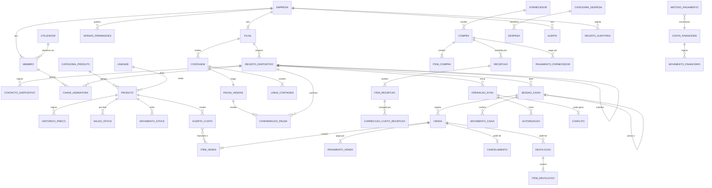

# Nexo — Especificação da Etapa 0 (MVP para lojas)

Versão 0.6 · 8 de Outubro de 2026 · Estado: **base de trabalho em validação — Etapa 0 não concluída**

Documentos de referência: `Documentos/NEXO_Plano_Plataforma_Gestao_Comercial_Financeira.docx`, `Documentos/Nexo_Etapas_de_Desenvolvimento.docx`, `Documentos/Nexo_Estrutura_Web_Mobile_API.docx`. Versões anteriores: `docs/versoes/`.

---

## Estado da Etapa 0

A Etapa 0 **não está concluída**:

- Continuam abertas três das cinco decisões que **bloqueiam a arquitectura** (H.1). **H-01 foi aprovada** em 02/10/2026 e **H-02** em 08/10/2026.
- A entrevista à loja piloto ainda não foi feita.
- As escolhas que dependem da loja continuam a ser **propostas**, não decisões aprovadas: janela offline de 72 horas (H-03), crédito (H-07), embalagens (H-10), gaveta partilhada (H-13) e a duração das pausas de contagem (H-24), entre outras.
- A versão 0.4 resulta da revisão da Etapa 1. Corrige regras; não aprova decisões.
- A versão 0.5 regista **só** a aprovação de H-01. As restantes propostas continuam em aberto.
- A versão 0.6 regista **só** as decisões do proprietário do projecto de 08/10/2026 para a Etapa 3: H-02 (acesso dos funcionários), autenticação e recuperação do proprietário, e registo público de empresas.

## Histórico de versões

| Versão | Resumo |
|---|---|
| 0.1 | Primeira especificação completa (A–H). |
| 0.2 | Credencial do dispositivo limitada, assinatura por utilizador, quatro datas, custo no servidor, correcção das devoluções avariadas, contagem com barreira, numeração sem reutilização, papéis no caixa, permissões offline. |
| 0.3 | Revisão focada do MVP sobre a 0.2. |
| 0.4 | Correcções da revisão da Etapa 1 (abaixo): custo efectivo com as correcções de compra, retoma da contagem só pelo servidor, custos fora do alcance do operador, H-23 sem resolução implícita. |
| 0.5 | Registo da decisão H-01, aprovada pelo proprietário do projecto em 02/10/2026 (abaixo). |
| 0.6 | Registo das decisões de 08/10/2026: H-02, autenticação e recuperação do proprietário, registo público (abaixo). |

## Alterações da versão 0.6

Decisões do proprietário do projecto de 08/10/2026, tomadas para a Etapa 3. **Não aprovam nenhuma outra proposta em aberto.** Implementação: `docs/Nexo_Entrega_Etapa_3.md`.

| # | Tema | O que mudou | Onde |
|---|---|---|---|
| 1 | **H-02 aprovada [D]** | Os funcionários não precisam de e-mail. Entram com **código da empresa + nome de utilizador + código secreto de acesso**. A conta é criada pelo proprietário, que lhes dá o código que vão usar. Não há código temporário nem mudança obrigatória no primeiro acesso. O código secreto funciona como palavra-passe: não é um identificador público nem um PIN numérico curto | H.1, A.3, B.1, C.1.2, E.1, F.2 |
| 2 | **Autenticação do proprietário [D]** | O proprietário entra pelo mesmo mecanismo (código da empresa + nome de utilizador + código secreto) | C.1 |
| 3 | **Recuperação do proprietário [D]** | E-mail de recuperação obrigatório, a confirmar. "Esqueci o código de acesso" envia para esse e-mail um link de utilização única e com prazo, que só permite definir um código novo. A redefinição invalida o anterior e termina todas as sessões. A resposta não revela se a conta existe. Sem acesso ao e-mail: recuperação assistida pelo suporte, depois de confirmar identidade e vínculo, auditada e fora dos pedidos normais. Substitui a proposta de depender de outro proprietário | C.1.4 (nova), E.1 |
| 4 | **Registo público [D]** | Qualquer visitante pode criar uma empresa e ficar proprietário, com limite de pedidos por origem. A conta só fica activa depois de confirmar o e-mail (revisão de 08/10/2026) | C.1 |
| 5 | PIN e desbloqueio local | **Continuam para a Etapa 7.** Quando forem implementados, o desbloqueio local, online e offline, usa o mesmo PIN. Nada disto foi implementado na Etapa 3 | D.13 |
| 6 | Gestor e contas | Por H-02, as contas são criadas pelo proprietário. A proposta da 0.5 de o gestor convidar e desactivar operadores deixa de se aplicar; voltar a dar-lhe esse papel exige nova decisão | B.1, E.2 |

## Alterações da versão 0.5

| # | Tema | O que mudou | Onde |
|---|---|---|---|
| 1 | **H-01 aprovada [D]** | Decisão do proprietário do projecto, 02/10/2026, com base no teste de isolamento no Supabase de desenvolvimento (22/22; `docs/Nexo_Teste_Isolamento_H01_2026-10-02.md`). Requisitos associados registados em H.1. **Não aprova nenhuma outra proposta em aberto.** | Estado da Etapa 0, H.1, H.5 |

## Alterações da versão 0.4

| # | Tema | O que mudou | Onde |
|---|---|---|---|
| 1 | Custo efectivo | Passa a incluir **todos** os acertos atribuídos ao item, incluindo as correcções do custo de compra. Cancelamentos e devoluções revertem a parte do item, também quando a correcção chega **depois** do estorno. Retiradas as aproximações A4 e A5. Exemplos verificados contra a repetição dos movimentos com o custo correcto. | D.3.1, D.3.6, D.3.7, D.3.9, D.3.10, **D.3.11** (nova), D.9.2, G.3, G.5, H-29 |
| 2 | Contagem física | A retoma das vendas **depende sempre do servidor**. A retoma local por PIN passa a possibilidade **futura, fora do MVP**. O dispositivo confirma a retoma com a sua sequência. | B.2, C.6.2, D.7.5, D.7.6, D.11.1, E.4, F.2, F.3, G.8, G.11 (F23), H-24, Anexo |
| 3 | Custos e operador | Os custos ficam só em tabelas próprias, fora do alcance do operador na base e na API (arquitectura 3.7). Proposta de H-28 revista: a base local é do dispositivo, não do utilizador. | C.1.2, B.2, F.2, F.3, G.3.12, H-28 |
| 4 | Contagem cega | Critério detalhado. Continua **proposta** (H-15). | G.7.3 |
| 5 | H-23 | O modelo admitir as duas opções **não** resolve a decisão; é precisa decisão explícita. | H.1, H.5 |

## Alterações da versão 0.3

| # | Tema | O que mudou | Onde |
|---|---|---|---|
| 1 | Contagem física | **Simplificada:** pausa nas vendas da filial, todos os dispositivos sincronizados antes de começar, contagem e aprovação antes de retomar. **Adiadas:** contagem com loja aberta, hora de corte por linha e reconciliação automática. | C.6.2, D.7, B.2, E, F, G.8 |
| 2 | Relatórios e períodos | **Retirado o fecho mensal obrigatório.** Os relatórios são **de gestão**, sempre provisórios, com operações pendentes, operações tardias e correcções auditadas indicadas. Não há resultados contabilísticos definitivos. Deixa de existir a data contabilística. | D.3, D.9, D.10, B.1, E, F, G.9 |
| 3 | Assinatura por utilizador | Passa a ser uma **hipótese técnica a validar na Etapa 1**, com alternativa definida. Distinguem-se o uso da chave, o desbloqueio por PIN e a identidade humana. **Uma chave não exportável não garante que só é usada depois de um PIN válido.** | D.12.4, H-23, G.2 |
| 4 | Custos | Revista a correcção de custo de compras: a repartição entre stock e consumo passa a ser **exacta para o custo médio** (a regra da 0.2 estava errada). Definido o **custo efectivo** do item de venda, usado em cancelamentos e devoluções. **Aproximações identificadas.** Exemplo encadeado com compras sucessivas, venda offline atrasada, acerto e devolução parcial. | D.3, D.6, G.3, G.5 |
| 5 | Decisões | Separadas as decisões que **bloqueiam a arquitectura** das que **bloqueiam só um módulo** (com a etapa do roteiro em que têm de estar fechadas). | H |
| — | Critérios de aceitação | Actualizados nas secções G.2, G.3, G.5, G.8, G.9 e G.11. | G |

---

## Como ler este documento

| Etiqueta | Significado |
|---|---|
| **[D]** Definido | Consta do pedido da Etapa 0 (incluindo as correcções pedidas para a 0.2) ou dos documentos de visão. Só muda com decisão do proprietário do projecto. |
| **[S]** Sugestão | Proposta desta especificação. Precisa de validação (entrevista à loja piloto, decisão do proprietário do projecto ou protótipo técnico) antes de ser implementada. |

Convenções:

- **[S]** Moeda: metical (MZN). Os valores monetários guardam-se em **centavos inteiros** (1 624,50 MZN = 162 450 centavos). O custo médio guarda-se com precisão superior ao centavo (4 casas decimais) e os valores resultantes arredondam-se ao centavo.
- **[S]** Fuso horário: `Africa/Maputo` (UTC+2, sem hora de Verão).
- **[S]** Quantidades com até 3 casas decimais, só em unidades fraccionáveis.
- **Termos:**
  - **Dispositivo** (ou registo de dispositivo): uma preparação de um navegador para uma filial. Cada preparação é um registo novo.
  - **Sessão de caixa:** o período entre a abertura e o fecho da gaveta de um dispositivo.
  - **Operação:** um registo criado no dispositivo e enviado ao servidor.
  - **Autor:** o utilizador que criou uma operação.
  - **Autorizador:** quem introduziu o PIN para permitir uma excepção.
  - **Responsável da sessão:** quem responde pelo dinheiro da gaveta.

---

## A. Resumo do produto e limites do MVP

### A.1 Produto

O Nexo é uma plataforma multiempresa de gestão comercial, financeira e de stock para pequenos estabelecimentos em Moçambique. **[D]** A primeira versão é uma aplicação web (React + TypeScript, PWA) para **lojas**, com uma API (Node.js + Express) e uma base central PostgreSQL no Supabase. A futura app mobile (React Native + Expo) usará a mesma API e a mesma base. Bares e farmácias entram depois de validado o núcleo comum.

O problema que o MVP resolve: o dono de uma pequena loja precisa de saber, ao fim de cada dia, **quanto vendeu, quanto ganhou, quanto dinheiro deveria ter na gaveta e que produtos estão a acabar**, mesmo quando a internet falha durante o dia.

### A.2 Utilizadores do piloto

| Perfil | Situação típica |
|---|---|
| Proprietário | Dono da loja. Pode não estar presente todos os dias e consulta resultados, muitas vezes pelo telemóvel. |
| Gestor | Encarregado da loja. Faz compras e contagens, autoriza excepções e revê o fecho do dia. Numa loja muito pequena pode ser o próprio proprietário. |
| Operador | Atende ao balcão, vende, recebe pagamentos e responde pela sua sessão de caixa. |

### A.3 Âmbito do MVP

| Módulo | Incluído no MVP | Origem |
|---|---|---|
| Empresas e utilizadores | Registo do proprietário, criação da empresa, contas de funcionários criadas pelo proprietário (H-02, 0.6), funções proprietário/gestor/operador, **uma filial** (modelo preparado para várias), registo de dispositivos | [D] ([S] dispositivos) |
| Produtos e stock | Produtos, categorias, unidades, preço de venda, stock mínimo, entradas, saídas, ajustes, contagem física, histórico com data/motivo/responsável | [D] |
| Compras | Fornecedores, compras, recepção de mercadoria (aumenta o stock uma única vez), pagamentos a fornecedores | [D] |
| Vendas | Carrinho, descontos autorizados, pagamentos (vários métodos, registo manual), histórico, devoluções e cancelamentos que preservam o original | [D] |
| Caixa e despesas | Abertura, reforço, retirada, fecho, comparação entre esperado e contado, despesas por categoria | [D] |
| Relatórios | Vendas, CMV, margens, despesas e resultado; lucro, fluxo de caixa e saldos separados; valores pendentes de sincronização | [D] |
| Offline | Catálogo local e vendas sem rede; fila idempotente; estados pendente/confirmado/conflito; divergências de stock resolvidas pelo gestor | [D] |

### A.4 Fora do MVP

| Fora do âmbito | Nota |
|---|---|
| Factura fiscal, certificação de software, comunicação com a Autoridade Tributária | **[D]** O documento emitido é um **comprovativo interno**. |
| Integração automática com M-Pesa, e-Mola, mKesh, POS ou bancos | **[D]** Os pagamentos registam-se manualmente. |
| Várias filiais em funcionamento, transferências entre filiais | **[D]** O modelo já tem filial. |
| App mobile nativa | **[D]** Etapa posterior. |
| Bares e farmácias | **[D]** |
| Vendas a crédito / contas de clientes | **[S]** Decisão em aberto, a validar com a loja (H-07). |
| Conversão de embalagens | **[S]** Decisão em aberto, a validar com a loja (H-10). |
| Clientes identificados, fidelização, promoções automáticas | **[S]** |
| Lotes, validades, números de série, variantes | **[S]** |
| Devolução ao fornecedor como documento próprio | **[S]** No MVP faz-se com ajuste de stock com motivo específico. |
| Discriminação de IVA | **[S]** H-05. |
| Leitura de código de barras pela câmara | **[S]** Os leitores USB são suportados. |
| Anexos (fotos de facturas, recibos) | **[S]** |
| Fecho de períodos, relatórios contabilísticos definitivos | **[D]** (0.3) Só relatórios de gestão provisórios (D.9). Ver H-22. |
| Contagem física com a loja a vender | **[D]** (0.3) No MVP a contagem exige pausa nas vendas (D.7). |

### A.5 Princípios do MVP

1. **[D]** Nenhum registo financeiro ou de stock é apagado. As correcções são registos novos que referenciam o original.
2. **[D]** O servidor é a fonte de verdade e revalida tudo o que recebe, incluindo operações feitas offline.
3. **[D]** Os dados estão isolados por empresa, com autorização na API **e** políticas na base de dados. **Nenhuma credencial, incluindo a do dispositivo, contorna estas políticas.**
4. **[D]** O custo das vendas é calculado **só no servidor**. O custo que o dispositivo conhece é uma estimativa local.
5. **[D]** Os relatórios são **de gestão**: podem mudar com operações tardias e correcções, e dizem-no. Não substituem a contabilidade.
6. **[D]** A hora declarada pelo dispositivo nunca decide sozinha a aceitação de uma operação.
7. **[S]** O stock é a soma dos movimentos, e o saldo guardado é uma cache que se pode recalcular.
8. **[S]** Uma venda física feita offline nunca é rejeitada por falta de stock: regista-se e sinaliza-se a diferença.
9. **[S]** Em caso de dúvida, o sistema preserva o registo e pede decisão humana em vez de o descartar ou aplicar às cegas.
10. **[S]** Onde o MVP usa uma aproximação (custos, datas), ela está escrita neste documento e é visível nos relatórios.

---

## B. Matriz de permissões por função

Legenda:

- ✅ permitido
- 🔑 permitido com autorização no momento: PIN de quem tem a permissão **e já fez autenticação online neste dispositivo** (D.13)
- ⚙️ permitido até um limite configurável
- ❌ não permitido
- 📴 funciona offline

As funções são **[D]**. A distribuição das permissões é **[S]** e deve ser confirmada na entrevista.

### B.1 Empresa, utilizadores e dispositivos

| Acção | Proprietário | Gestor | Operador | Offline |
|---|---|---|---|---|
| Editar dados da empresa e da filial | ✅ | ❌ | ❌ | ❌ |
| Criar, desactivar e reactivar contas; definir ou redefinir o código secreto de um funcionário **(0.6, H-02)** | ✅ | ❌ | ❌ | ❌ |
| Alterar função de um utilizador; transferir propriedade | ✅ | ❌ | ❌ | ❌ |
| Preparar um dispositivo | ✅ | ✅ | ❌ | ❌ |
| Revogar um dispositivo; decidir operações em quarentena | ✅ | ✅ | ❌ | ❌ |
| Definir limites de desconto, política de stock e modo de caixa | ✅ | ❌ | ❌ | ❌ |
| Configurar métodos de pagamento e contas financeiras | ✅ | ❌ | ❌ | ❌ |
| Consultar registo de auditoria | ✅ | ✅ (só operacional) | ❌ | ❌ |
| Alterar o próprio código secreto (PIN: Etapa 7) | ✅ | ✅ | ✅ | ❌ |
| Registar e confirmar o e-mail de recuperação **(0.6)** | ✅ | — | — | ❌ |

### B.2 Produtos e stock

| Acção | Proprietário | Gestor | Operador | Offline |
|---|---|---|---|---|
| Consultar catálogo, preços e stock | ✅ | ✅ | ✅ | 📴 |
| Ver custo e margem | ✅ | ✅ | ❌ | 📴 só a **estimativa local**, se H-28 o admitir (D.3.1) |
| Criar/editar produtos, categorias, unidades, preços | ✅ | ✅ | ❌ | ❌ |
| Desactivar produto | ✅ | ✅ | ❌ | ❌ |
| Entrada/saída avulsa, ajuste de stock | ✅ | ✅ | ❌ | ❌ |
| Iniciar contagem com pausa de vendas da filial (D.7) | ✅ | ✅ | ❌ | ❌ |
| Introduzir quantidades numa contagem | ✅ | ✅ | ✅ | ❌ |
| Aprovar ou cancelar contagem (retoma as vendas) | ✅ | ✅ | ❌ | ❌ |
| Retoma local num dispositivo sem rede após a contagem (D.7.6) | — | — | — | **(0.4) Fora do MVP**, possibilidade futura |
| Suspender um dispositivo inacessível para poder iniciar a contagem | ✅ | ✅ | ❌ | ❌ |
| Resolver divergências de stock | ✅ | ✅ | ❌ | ❌ |

### B.3 Compras

| Acção | Proprietário | Gestor | Operador | Offline |
|---|---|---|---|---|
| Gerir fornecedores; criar/editar compra | ✅ | ✅ | ❌ | ❌ |
| Registar quantidades recebidas | ✅ | ✅ | ✅ | ❌ |
| Confirmar recepção | ✅ | ✅ | ❌ | ❌ |
| Corrigir custo de recepção confirmada (D.3.7) | ✅ | ✅ | ❌ | ❌ |
| Registar pagamento a fornecedor | ✅ | ✅ | ❌ | ❌ |
| Cancelar compra sem recepções confirmadas | ✅ | ✅ | ❌ | ❌ |

### B.4 Vendas

| Acção | Proprietário | Gestor | Operador | Offline |
|---|---|---|---|---|
| Registar venda na sessão de que é responsável | ✅ | ✅ | ✅ | 📴 |
| Registar venda na sessão de outro responsável (D.8.3) | ✅ | ✅ | ❌ (modo pessoal) | 📴 |
| Desconto dentro do limite | ⚙️ (sem limite) | ⚙️ (20%) | ⚙️ (0%) | 📴 |
| Desconto acima do limite | ✅ | 🔑 proprietário | 🔑 | 📴 |
| Vender com stock insuficiente | ✅ | ✅ | 🔑 (conforme política) | 📴 |
| Consultar histórico de vendas | ✅ | ✅ | Só as suas, do dia | 📴 (local) |
| Reimprimir comprovativo | ✅ | ✅ | ✅ (sessão actual) | 📴 |
| Cancelar venda (mesma sessão aberta) | ✅ | ✅ | 🔑 | 📴 |
| Registar devolução | ✅ | ✅ | 🔑 | ❌ |

### B.5 Caixa e despesas

| Acção | Proprietário | Gestor | Operador | Offline |
|---|---|---|---|---|
| Abrir sessão de caixa (fica responsável) | ✅ | ✅ | ✅ | 📴 |
| Passagem de turno (D.8.4) | ✅ | ✅ | ✅ (com PIN de quem entra) | 📴 |
| Transferir responsabilidade de sessão com responsável ausente | ✅ | ✅ | ❌ | 📴 |
| Reforço e retirada | ✅ | ✅ | 🔑 | 📴 |
| Fechar a sessão de que é responsável (contagem cega) | ✅ | ✅ | ✅ | 📴 |
| Ver valor esperado antes de contar | ✅ | ✅ | ❌ | 📴 |
| Rever fecho; forçar fecho de sessão de outro dispositivo | ✅ | ✅ | ❌ | ❌ |
| Despesa paga pelo caixa | ✅ | ✅ | 🔑 | 📴 |
| Despesa paga por outra conta; categorias de despesa | ✅ | ✅ | ❌ | ❌ |

### B.6 Relatórios e sincronização

| Acção | Proprietário | Gestor | Operador | Offline |
|---|---|---|---|---|
| Relatórios de gestão (lucro, margens, fluxo, saldos) | ✅ | ✅ | ❌ | ❌ |
| Resumo de vendas do dia (sem custos) | ✅ | ✅ | ✅ (só as suas) | 📴 |
| Estado de sincronização do próprio dispositivo | ✅ | ✅ | ✅ | 📴 |
| Pendentes, conflitos e quarentena de todos os dispositivos | ✅ | ✅ | ❌ | ❌ |
| Resolver conflitos e revisões obrigatórias | ✅ | ✅ | ❌ | ❌ |
| Exportar dados (CSV) | ✅ | ✅ | ❌ | ❌ |

**Regras transversais**

- **[D]** Todas as permissões são verificadas **na API**. As políticas da base de dados impedem o acesso a dados de outra empresa mesmo que a API tenha um erro.
- **[D]** A credencial do dispositivo **não tem função nem permissões próprias** (D.12). Uma operação só é aceite se o seu autor, verificado pela assinatura, tiver a permissão.
- **[S]** Uma autorização 🔑 regista quem pediu, quem autorizou, o motivo e o valor, e é **assinada pelo autorizador** (D.12.4).
- **[S]** No MVP, um utilizador tem uma única função por empresa e um dispositivo pertence a uma única empresa.

---

## C. Fluxos

📴 = o passo funciona sem rede.

### C.1 Cadastro do proprietário e da empresa

**Pré-condição:** internet **[D]**.

1. **(0.6) [D]** O registo é público. O proprietário indica a empresa (nome e **código da empresa**, único, que todos usam para entrar), o seu nome, o nome de utilizador, o **e-mail de recuperação** e o código secreto. A empresa, a filial `F01` e a conta de proprietário são criadas numa só operação, com a conta **pendente**: não há sessão nem acesso até o proprietário confirmar o e-mail pelo link recebido. O link pode ser reenviado (com limites), e o e-mail corrigido com o código secreto. Depois da confirmação, o login é o normal (C.1.4).
2. **Assistente de configuração**, que se pode retomar mais tarde:
   1. **Empresa:** nome comercial, NUIT (opcional), telefone, endereço; tipo = *Loja*.
   2. **Filial:** "Filial principal", com código curto `F01`.
   3. **Métodos de pagamento e contas:** numerário (obrigatório), M-Pesa, e-Mola, mKesh, cartão/POS, transferência. Cada método liga-se a uma conta financeira (D.8.9).
   4. **Categorias e unidades** pré-definidas e editáveis.
   5. **Regras:** limites de desconto, política de stock insuficiente, modo de caixa (H-13).
   6. **Produtos:** criar ou importar por CSV (H-12). Este passo é opcional.
   7. **PIN pessoal** (D.13.5).
3. *"Este aparelho vai ser usado para vender?"* Se sim, segue-se **C.1.1**.

**C.1.1 Preparar dispositivo** (internet obrigatória) **[D]**

1. Um proprietário ou gestor autenticado online dá um nome ao dispositivo (ex.: "Balcão 1").
2. O servidor cria um **novo registo de dispositivo** com um código **nunca antes usado na filial** (ex.: `C01`; se este navegador for preparado de novo, receberá `C02`, `C03`…) (D.5.3).
3. O servidor emite a **credencial do dispositivo**, que só serve para transporte (D.12.2). O dispositivo guarda o segredo e o servidor guarda apenas o seu resumo criptográfico.
4. A aplicação descarrega, **com a sessão do utilizador que está a preparar**, os dados de balcão: catálogo, preços, stock, custo de referência (só se H-28 o admitir; ver a proposta revista na 0.4), métodos de pagamento, regras e a versão actual das permissões.
5. Segue **C.1.3** para o utilizador que está a preparar.
6. A aplicação pede armazenamento persistente ao navegador **[S]** e mostra "Dispositivo `C01` pronto".

**C.1.2 Criar a conta de um funcionário** **(0.6, H-02) [D]**

1. O proprietário indica o nome, o nome de utilizador (único dentro da empresa; pode repetir-se noutra empresa), a função, as filiais permitidas e o código secreto.
2. Combina o código com o funcionário pessoalmente. O funcionário entra com o código da empresa, o nome de utilizador e esse código, sem e-mail. Não há código temporário nem mudança obrigatória no primeiro acesso; pode mudá-lo quando quiser.
3. O código não pode ser consultado depois. Se o funcionário o esquecer, o proprietário define um novo, e as sessões abertas dessa conta terminam.
4. Os registos identificam a **conta** usada. Como o proprietário conhece o código que definiu, não provam qual pessoa física o introduziu.
5. O PIN de balcão é da Etapa 7 (D.13).

**C.1.4 Recuperar o acesso do proprietário** **(0.6) [D]**

1. Em "Esqueci o código de acesso", o proprietário indica o código da empresa e o nome de utilizador. A resposta é sempre a mesma, exista ou não a conta.
2. Se a conta for de um proprietário activo com e-mail confirmado, recebe um link de utilização única e com prazo.
3. O link só permite definir um código novo; o anterior nunca é mostrado. A redefinição invalida o código anterior e termina todas as sessões da conta.
4. Há limite de tentativas. Os códigos e os links nunca ficam nos registos de eventos.
5. Sem acesso ao e-mail: recuperação assistida pelo suporte, depois de confirmar a identidade e o vínculo ao negócio. Fica auditada e acontece fora dos pedidos normais da API.
6. Os funcionários não usam este fluxo: o proprietário redefine-lhes o código (C.1.2).

**C.1.3 Primeira entrada de um utilizador num dispositivo** (internet obrigatória) **[S]**

1. O utilizador faz **autenticação online** (palavra-passe) no dispositivo já preparado.
2. O servidor confirma que é membro activo da empresa do dispositivo e que a sua filial é a do dispositivo.
3. **Hipótese a validar na Etapa 1 (H-23):** o dispositivo gera uma **chave de assinatura** para o par utilizador+dispositivo. A parte privada não é exportável e a pública é registada no servidor (D.12.4). Se a hipótese falhar, aplica-se a alternativa de D.12.4.5.
4. O dispositivo recebe o verificador do PIN desse utilizador (D.13.5) e a versão actual das permissões.
5. A partir daqui o utilizador pode desbloquear este dispositivo com o PIN, mesmo offline, até que um dos eventos de D.13.2 exija nova autenticação online.

### C.2 Compra e recepção de mercadoria

1. O gestor cria a compra (fornecedor, data, n.º do documento do fornecedor, linhas com produto, quantidade e custo). Estado: **Rascunho**. Opcionalmente passa a **Encomendada**.
2. **Recepção:** regista as quantidades realmente recebidas (a recepção pode ser parcial) e confirma ou corrige o custo de cada linha.
3. O gestor carrega em **Confirmar recepção**. O pedido leva um identificador de operação (D.5.4).
4. Numa **única transacção** o servidor:
   - marca a recepção como **Confirmada** (imutável);
   - cria um movimento de entrada por linha;
   - actualiza o custo médio, com acertos se houver stock negativo (D.3.5);
   - actualiza o estado da compra.
5. Uma repetição do pedido devolve o mesmo resultado **sem novos movimentos**.
6. **Pagamentos** a qualquer momento: *Por pagar*, *Parcialmente paga* ou *Paga*. Um pagamento feito pelo caixa gera uma saída da sessão aberta.
7. **Correcções depois de confirmar:**
   - de **custo**: registo "correcção de custo de recepção" (D.3.7);
   - de **quantidade**: ajuste de stock com motivo "Correcção de recepção", valorizado ao custo dessa recepção (D.3.8).
   - A recepção original nunca muda; passa a mostrar as correcções associadas.
8. **Cancelamento** só sem recepções confirmadas. Com recepções, a compra pode ser **fechada** com o saldo marcado "não entregue".

### C.3 Venda (online ou 📴 offline)

**Pré-condições:** dispositivo activo; utilizador desbloqueado (D.13); sessão de caixa aberta no dispositivo em que o utilizador pode vender (D.8.3).

1. 📴 Procurar produtos (nome, código, código de barras) e adicioná-los ao carrinho com o preço do catálogo local.
2. 📴 Ajustar quantidades. Se ultrapassarem o stock local, aplica-se a política de D.4.2.
3. 📴 Desconto opcional. Acima do limite, pede-se o PIN do autorizador e o motivo.
4. 📴 Pagamento com um ou mais métodos. No numerário calcula-se o troco.
5. 📴 **Concluir:** numa única transacção local grava-se a venda, os itens, os pagamentos, as autorizações e a entrada na fila. A operação é **assinada pelo autor**, e cada autorização pelo respectivo autorizador. Só depois aparece "Venda concluída".
6. 📴 Comprovativo com o número local (D.5.3) e a **hora declarada**.
7. 📴 O stock local, o valor esperado do caixa e a margem estimada (só visível a P/G) são actualizados.
8. Estado **Pendente** → **Confirmado** quando o servidor responde (C.8). O custo da venda é o que o servidor atribuir (D.3).

**Venda suspensa [S]:** o carrinho fica em espera só no dispositivo. Não é enviado nem mexe no stock, e é descartado no fecho da sessão, com aviso.

### C.4 Devolução (online) **[S]**

1. O utilizador encontra a venda original (**Confirmada**, dentro do prazo) e escolhe as linhas e quantidades. Cada quantidade fica limitada ao vendido menos o já devolvido.
2. Para cada linha indica o destino: **Revendável** ou **Avariado**.
3. Indica o motivo. O reembolso é o valor líquido por unidade × quantidade (D.4.5).
4. Método de reembolso: por defeito o original. O numerário sai da sessão aberta.
5. O gestor autoriza, ou introduz o PIN se for um operador a registar.
6. O servidor grava a **Devolução**, com número próprio, e os seus efeitos (D.6.3). A venda original **não é alterada** e passa a mostrar "Devolvida parcialmente/totalmente".
7. Emite-se um comprovativo de devolução.

### C.5 Cancelamento de venda (📴)

1. Só na **sessão de caixa aberta em que a venda foi feita** e no mesmo dispositivo.
2. Motivo obrigatório. É preciso o PIN do gestor se quem cancela for operador.
3. A venda fica **Cancelada** (visível, com motivo, autor e autorizador). Geram-se estornos de stock e de caixa.
4. Se a venda ainda estava pendente, seguem as duas operações, pela ordem certa.

### C.6 Ajuste de stock e contagem física

**C.6.1 Ajuste individual** (online, gestor)

1. O gestor indica a nova quantidade ou a variação, e um motivo obrigatório: *Quebra/avaria*, *Furto/perda*, *Consumo interno*, *Oferta*, *Validade expirada*, *Correcção de recepção*, *Correcção de erro de registo*, *Stock inicial*, *Outro* (com texto).
2. O sistema mostra o impacto em quantidade e em valor ao custo médio actual e pede confirmação.
3. Gera um movimento de ajuste com quantidade anterior e posterior.

**C.6.2 Contagem física com pausa nas vendas** (online) **[D]** princípio / **[S]** detalhe

1. **Preparar:** o gestor cria a contagem, total ou parcial (categoria ou lista de produtos). Estado: **Preparação**. Qualquer que seja o âmbito, a pausa abrange as vendas de **toda a filial** (D.7.1).
2. **Pedir pausa:** o gestor carrega em "Pausar vendas e começar". O servidor:
   - publica um aviso de **pausa** para todos os dispositivos activos da filial;
   - bloqueia na filial todos os movimentos de stock online (recepções, ajustes, entradas e saídas avulsas).
3. **Em cada dispositivo**, ao receber o aviso:
   - não deixa concluir novas vendas nem cancelamentos. O carrinho em curso pode ficar suspenso;
   - envia toda a fila;
   - **confirma a pausa** ao servidor, indicando a sua sequência actual, **só quando a fila estiver vazia**. O ecrã mostra "Vendas em pausa: contagem de stock em curso".
4. **Começar:** a contagem passa a **Em curso** só quando **todos** os dispositivos activos da filial tiverem confirmado a pausa com zero pendentes. O ecrã do gestor mostra o estado de cada dispositivo ("confirmado", "à espera", "sem contacto desde 09:40").
   - Se um dispositivo não responder, o gestor pode esperar, cancelar a contagem, ou **suspender esse dispositivo** (D.5.6). As operações que ele enviar depois vão para quarentena (D.11.6).
5. **Contar:** os utilizadores introduzem as quantidades contadas. O stock teórico é o saldo actual, que **não muda** durante a pausa. Recontagens substituem a linha e mantêm o histórico.
6. **Aprovar:** o gestor revê as diferenças e aprova. Numa transacção geram-se os ajustes "Contagem física", a contagem passa a **Aprovada** e **as vendas são retomadas**: é publicado o aviso de retoma e os movimentos online voltam a ser permitidos. **(0.4)** Cada dispositivo só volta a vender depois de receber o aviso, e confirma a retoma com a sua sequência (D.7.5).
7. **Cancelar:** não gera movimentos e também retoma as vendas.
8. **Dispositivo que perdeu a rede durante a pausa:** fica em pausa até voltar a ter rede e receber o aviso de retoma. **(0.4)** No MVP não há retoma local: a retoma depende sempre do servidor (D.7.6).

**Adiado para depois do MVP [D]:** contagem com a loja a vender, hora de corte por linha e reconciliação automática de movimentos atrasados (descritos na versão 0.2).

### C.7 Sessão de caixa (📴)

1. **Abertura:** um utilizador abre a sessão do dispositivo e passa a ser o **responsável**. Indica o fundo contado; se for diferente do deixado no último fecho, deixa uma nota. Só pode haver uma sessão aberta por dispositivo.
2. **Durante a sessão:** vendas, cancelamentos, reembolsos em numerário, reforços, retiradas (com destino), despesas pagas pelo caixa. Cada operação regista a sessão, o **autor** e, se houver, o **autorizador** (D.8.2).
3. **Troca de utilizador sem mudar de responsável:** o ecrã bloqueia e outro utilizador desbloqueia com PIN. Pode vender se as regras de D.8.3 o permitirem. A sessão e o responsável não mudam.
4. **Passagem de turno** (D.8.4):
   1. o responsável que sai conta o numerário em contagem cega;
   2. o sistema fecha a sessão com diferença e justificação;
   3. o utilizador que entra confirma o valor com o seu PIN e abre nova sessão com esse fundo.
5. **Fecho do dia:**
   1. contagem cega do numerário e, opcionalmente, totais dos outros métodos;
   2. cálculo do esperado (D.8.6) e da diferença;
   3. justificação obrigatória se houver diferença;
   4. resumo imprimível. Se houver operações pendentes, o resumo mostra "Valores provisórios: N operações por sincronizar".
6. **Revisão (online):** o gestor marca o fecho como **Revisto**. Um fecho com operações em conflito dessa sessão só pode ser revisto depois de resolvidas.
7. **Fecho forçado (online):** se o dispositivo se perder ou avariar com a sessão aberta. As operações dessa sessão recebidas depois entram em **conflito** (D.11.6).

### C.8 Sincronização

**C.8.1 Envio (dispositivo → servidor)**

1. Sempre que há rede, periodicamente e ao abrir a aplicação, o dispositivo envia a fila **por ordem de sequência**, em lotes, autenticado **só com a credencial do dispositivo**.
2. Cada operação leva:
   - identificador único e tipo;
   - registo do dispositivo e sequência;
   - autor e autorizadores, com as respectivas assinaturas;
   - hora declarada e desvio do relógio conhecido (D.10.2);
   - versão das permissões usada (D.13.3);
   - versão do formato e conteúdo.
3. O servidor verifica cada operação pela ordem de D.12.5 e responde por operação:

| Resposta | Significado | No dispositivo |
|---|---|---|
| `aplicada` | Gravada agora | **Confirmado** |
| `já_aplicada` | Reenvio de algo já gravado | **Confirmado** |
| `aplicada_com_alerta` | Gravada, com divergência ou revisão obrigatória (stock negativo, hora ajustada, permissões desactualizadas) | **Confirmado** + aviso |
| `conflito` | Recebida e **guardada**, não aplicada; aguarda decisão | **Conflito** |
| erro temporário | Nada gravado | **Pendente**; nova tentativa com espera crescente |
| credencial desconhecida | Não é possível associar a uma empresa; nada gravado | **Pendente**; aviso "Dispositivo não reconhecido"; a fila fica intacta e pode ser exportada (D.11.7) |

4. Uma operação que depende de outra pendente ou em conflito fica **em espera**.
5. No mesmo contacto o dispositivo envia o **estado**: sequência actual, número e valor de pendentes, versão da aplicação e versão de permissões em uso.

**C.8.2 Recepção (servidor → dispositivo)**

1. **Com a credencial do dispositivo** recebe apenas **avisos de controlo**, que se aplicam de imediato:
   - **de segurança**, que só restringem: dispositivo revogado ou suspenso, utilizador desactivado, PIN alterado, nova versão de permissões disponível;
   - **de pausa e retoma de vendas** para contagem física (C.6.2). Indicam apenas a contagem e o estado; não trazem dados da empresa.
2. **Com a sessão online de um utilizador** (renovada automaticamente quando há rede) recebe os dados de balcão: alterações de catálogo, preços, stock, custo de referência e a nova versão das permissões. Ao aplicar uma nova versão de permissões, o dispositivo **confirma a recepção** indicando a sua sequência actual (D.13.3).

**C.8.3 Resolução (gestor, online)**

1. **Sincronização › Conflitos e alertas** mostra, para todos os dispositivos da filial, os conflitos, a quarentena, as revisões obrigatórias e as divergências.
2. Para cada operação: o conteúdo completo, as três datas (D.10), a verificação da autoria (D.12.4), o motivo e as evidências (ex.: pendentes declarados antes de uma revogação).
3. Acções possíveis:
   - **Aceitar** (aplicar como está; a data de referência mantém-se e o relatório do período correspondente passa a indicar uma correcção posterior, D.9.4);
   - **Aplicar com correcção** (ex.: associar a outra sessão), registando a correcção;
   - **Anular** com motivo. A operação fica "anulada pelo gestor" e **nunca é apagada**.
4. A decisão fica no registo de auditoria e chega ao dispositivo de origem.

### C.9 Consulta de um relatório de gestão (online) **[S]**

Não existe fecho de período no MVP **[D]** (0.3).

1. O proprietário ou gestor escolhe o relatório e o intervalo de datas.
2. O servidor calcula-o **no momento**, com as operações aplicadas até então.
3. O cabeçalho mostra "Relatório de gestão — provisório", com a data e hora do cálculo e três indicadores (D.9.3):
   - **pendentes declarados** por dispositivo;
   - **operações tardias** incluídas;
   - **correcções auditadas** que afectam o intervalo.
4. O utilizador pode exportar (CSV/PDF). O ficheiro leva a data e hora do cálculo e os mesmos indicadores. Um relatório exportado **não é actualizado**: consultado mais tarde, o mesmo intervalo pode dar valores diferentes, e a lista de correcções mostra porquê.

---

## D. Regras de negócio

### D.1 Empresa, filial e utilizadores

| # | Regra | Origem |
|---|---|---|
| D.1.1 | Os registos operacionais pertencem a uma empresa, e os que acontecem num local (stock, vendas, caixa, compras, despesas) também a uma filial. | [D] |
| D.1.2 | Uma filial por empresa no piloto. A interface não mostra o selector de filial. | [D] |
| D.1.3 | Há sempre pelo menos um proprietário activo. | [S] |
| D.1.4 | Os utilizadores são desactivados, nunca apagados. | [S] |
| D.1.5 | Desactivar um utilizador termina as suas sessões online e invalida o seu PIN em todos os dispositivos no **próximo contacto** de cada um (C.8.2). Operações feitas antes desse contacto tratam-se por D.13.6. | [S] |
| D.1.6 | **(0.6)** O login identifica a empresa pelo **código da empresa** (não é segredo e não concede acesso). O nome de utilizador é único dentro da empresa e pode repetir-se noutras. O servidor confirma sempre a conta, o estado e a função. | [D] H-02 |
| D.1.7 | **(0.6)** Os códigos secretos guardam-se só como resumo de uma função lenta própria para palavras-passe. Nunca podem ser consultados, nem pelo proprietário nem pelo suporte. Redefinir o código de uma conta termina as suas sessões. | [D] H-02 / [S] parâmetros |
| D.1.8 | **(0.6)** Ninguém altera a função, as filiais ou o estado da própria conta (sem auto-promoção nem auto-desactivação). O código de um proprietário recupera-se pelo e-mail confirmado ou pelo suporte, nunca por outro proprietário. | [S] |

### D.2 Produtos e stock

| # | Regra | Origem |
|---|---|---|
| D.2.1 | Campos obrigatórios do produto: nome, categoria, unidade, preço de venda, stock mínimo, estado. Código interno e código de barras são opcionais e únicos na empresa. | [D] campos / [S] unicidade |
| D.2.2 | O stock de um produto numa filial é a **soma dos seus movimentos**. Cada movimento tem tipo, quantidade, valor, motivo, autor, documento de origem e as datas de D.10. | [D] / [S] |
| D.2.3 | Tipos de movimento: entrada por compra; entrada avulsa; stock inicial; saída por venda; estorno de venda; entrada por devolução; **perda por devolução avariada**; saída avulsa; ajuste (+/−); ajuste por contagem; **correcção de recepção**. Os acertos de custo não são movimentos de quantidade (D.3). | [S] |
| D.2.4 | Alerta de stock baixo quando stock ≤ mínimo (mínimo 0 = sem alerta). | [D] |
| D.2.5 | Produto inactivo: não aparece no balcão e mantém histórico. Para desactivar com stock ≠ 0 é preciso confirmação explícita. | [S] |
| D.2.6 | Unidades não fraccionáveis só admitem quantidades inteiras. | [S] |
| D.2.7 | Alterações de preço de venda ficam em histórico. | [S] |

### D.3 Custo dos produtos e das vendas

#### D.3.1 Custos e acertos **[D]** distinção / **[S]** regras

| Conceito | Onde | Como se obtém | Para que serve |
|---|---|---|---|
| **Custo local estimado** | Dispositivo | Último custo médio recebido na sincronização. | Margem **estimada** mostrada a P/G no dispositivo. **Nunca é enviado.** O servidor ignora qualquer campo de custo numa operação. |
| **Custo registado** | Servidor, por item de venda | Custo médio da filial **no momento em que o servidor aplica** a venda (D.3.2.2). | Base do CMV. **Nunca é reescrito.** |
| **Acerto imputado** | Servidor, ligado a itens de venda concretos | Cobertura de stock negativo (D.3.5). | Corrige o custo dos itens que ficaram a descoberto. |
| **Custo efectivo do item** | Servidor | **(0.4)** Custo registado + **todos** os acertos atribuídos ao item: imputados por cobertura (D.3.5) e partes de correcções de compra (D.3.7), incluindo as reversões ligadas a estornos (D.3.11). | Valor usado para **estornar** o CMV em cancelamentos e devoluções (D.3.6). |
| **Acerto de correcção** | Servidor, ligado aos movimentos e itens afectados | Correcção de custo de uma compra (D.3.7). | Reparte o erro entre stock, CMV e perdas. **(0.4)** A parte de cada venda é **imputada ao item** e entra no seu custo efectivo (retira a aproximação A4). |

**Não existe custo definitivo no MVP [D]** (0.3). O CMV de um intervalo é sempre o valor **actual**: pode mudar com operações tardias e acertos, e o relatório indica-o (D.9).

Todo o acerto é um registo próprio e auditável: produto, quantidade, custo usado, custo correcto, valor, causa, data em que foi gerado, autor (ou "automático") e ligação aos movimentos envolvidos.

#### D.3.2 Regras de custeio **[S]** (H-04, H-21)

| # | Regra |
|---|---|
| D.3.2.1 | Método: **custo médio ponderado** por produto e filial. |
| D.3.2.2 | O custo médio evolui pela **ordem de aplicação no servidor**, não pela hora declarada pelos dispositivos. Não há reavaliação retroactiva de vendas já aplicadas. Cada movimento recebe um número de ordem de aplicação, o que permite recalcular o saldo e o custo de forma reproduzível. |
| D.3.2.3 | Entradas com custo (recepção, stock inicial, entrada avulsa com custo) com stock anterior > 0: novo custo médio = (valor anterior + valor da entrada) ÷ (quantidade anterior + quantidade da entrada). |
| D.3.2.4 | Saídas (venda, perda, ajuste negativo) saem ao custo médio actual e não o alteram. |
| D.3.2.5 | Ajustes positivos sem custo próprio entram ao custo médio actual. Um estorno de cancelamento ou uma devolução entram ao **custo efectivo** do item de venda original (D.3.6). |
| D.3.2.6 | Um produto que nunca teve entrada com custo tem custo médio 0. As vendas desse produto ficam marcadas "**sem custo**" e aparecem em alerta até haver uma entrada, que gera o acerto (D.3.5). |

#### D.3.3 Porque a ordem de aplicação é aceitável

Com custo médio, a ordem em que chegam vendas e compras **muda a repartição** do valor entre o CMV e o stock, mas **não cria nem perde valor**. A regra é determinística, auditável e independente dos relógios dos dispositivos.

**Exemplo — compra aplicada antes de uma venda offline anterior**

> Stock de *Óleo 1 L*: 10 un a 50,00 (valor 500,00).
> 09:00 — O Balcão 1 (offline) vende 5 un. A margem estimada no dispositivo usa 50,00 (custo local estimado).
> 10:00 — O servidor aplica uma recepção de 10 un a 62,00: custo médio = (500 + 620) ÷ 20 = **56,00**.
> 11:00 — Chega a venda das 09:00. Custo registado = 5 × 56,00 = **280,00**. Stock: 15 un × 56,00 = **840,00**.
> Conservação: entradas 500 + 620 = 1 120 = CMV 280 + stock 840. ✔
> Se a venda tivesse chegado antes da compra: CMV 250 e stock 870. O total é o mesmo (1 120); só muda a repartição (30,00).

#### D.3.4 Custo local não é autoridade

> O dispositivo mostrou margem estimada de (171,00 − 50,00) por unidade. O servidor atribuiu 56,00. O relatório mostra a margem com 56,00. O ecrã do dispositivo actualiza a estimativa na próxima sincronização e nunca alimenta relatórios.

#### D.3.5 Stock negativo e cobertura **[S]**

1. Uma saída que deixa o stock negativo sai ao custo médio actual (ou 0, "sem custo"). O saldo passa a ter quantidade e **valor negativos**.
2. Quando chega uma entrada com o stock negativo, esta **cobre primeiro** as unidades em falta ao custo da entrada. A diferença entre o valor ao custo da entrada e o valor negativo registado gera um **acerto imputado**.
3. O acerto é imputado às **saídas que puseram o stock abaixo de zero**, pela ordem de aplicação, até à quantidade coberta. Num item de venda soma-se ao custo efectivo; numa perda ou ajuste vai para perdas.
4. As unidades restantes ficam ao custo da entrada, que passa a ser o novo custo médio.
5. O acerto conta no CMV (ou nas perdas) na **data em que é gerado** (A6).

**Exemplo**

> Stock: 2 un a 50,00 (valor 100,00).
> Chega a venda offline V3, de 5 un: custo registado 5 × 50,00 = **250,00**. Stock: −3 un, valor −150,00. Gera-se a divergência de stock (D.4.3).
> Recepção de 10 un a 60,00 (valor 600,00):
> — cobertura de 3 un a 60,00 = 180,00; valor registado 150,00 → **acerto imputado +30,00 à V3** (custo efectivo 280,00, ou seja 56,00/un);
> — stock: 7 un a **60,00** = 420,00.
> Conservação: entradas 100 + 600 = 700 = CMV (250 + 30) + stock 420. ✔

#### D.3.6 Cancelamentos e devoluções depois de acertos **[S]**

1. O estorno de um cancelamento e a entrada de uma devolução usam o **custo efectivo** do item de venda: custo registado + **todos** os acertos atribuídos ao item (cobertura e correcção de compra). **(0.4)**
2. Numa devolução parcial usa-se o custo efectivo **médio por unidade** do item (A3). O acumulado estornado nunca excede o custo efectivo do item.
3. **(0.4)** Os acertos de correcção de compra **fazem parte** do custo efectivo. Se a correcção chega **depois** de um estorno, a própria correcção reverte a parte correspondente às unidades estornadas (D.3.11). A regra da 0.3 (A4) deixava resíduos no CMV.

**Exemplo — cancelamento depois de uma cobertura** (continua o exemplo D.3.5)

> A V3 ainda está na sessão aberta, e a operadora cancela-a por engano de registo.
> Estorno de 5 un ao custo efectivo **280,00**: stock 12 un, valor 420 + 280 = **700,00** (custo médio 58,33).
> CMV da V3: 250 + 30 − 280 = **0,00**. ✔ Stock 700,00 = compras 100 + 600. ✔
> **Se o estorno usasse só o custo registado (250,00)**, ficariam 30,00 de CMV de uma venda que não existe e o stock ficaria subavaliado (670,00). ✘
> Variante: devolução de 2 das 5 un → entrada a 2 × 56,00 = **112,00** (média por unidade do item).

#### D.3.7 Correcção de custo de uma compra **[S]** (substitui a regra da 0.2)

A regra da 0.2 (unidades em stock = mínimo(quantidade recebida, stock actual)) **estava errada** para custo médio: atribuía ao stock uma parte do erro que já tinha saído nas vendas. A nova regra reproduz exactamente o custo médio sem reescrever registos.

1. Regista-se a **correcção de custo** da linha da recepção: custo antigo, custo novo, motivo e autor. A recepção original não muda.
2. Erro total **E** = quantidade recebida × (custo novo − custo antigo).
3. Percorrem-se, pela ordem de aplicação, os movimentos do produto **desde a recepção**. Cada saída de *q* unidades, com *Q* unidades em stock antes dela, leva a parte **e = E_restante × q ÷ Q**, e o erro restante diminui nessa parte. As entradas com custo próprio não mudam o erro restante. **(0.4)** Os estornos (cancelamentos e devoluções) de itens que receberam parte **devolvem** essa parte ao erro restante, na proporção das unidades estornadas (tabela em D.3.11).
4. O que sobra no fim (**E_stock**) ajusta o **valor do stock** (e o custo médio). As partes das saídas formam o **acerto de correcção**: as das vendas vão para o CMV e são **imputadas aos itens** (entram no custo efectivo, 0.4); as das perdas e ajustes vão para perdas. O acerto guarda a parte de cada movimento, para auditoria.
5. Se o stock chegou a ≤ 0 depois da recepção, o erro restante passou a 0 nesse momento: tudo foi consumido. **(0.4)** Uma devolução posterior de unidades que receberam parte volta a trazer erro para o stock (exemplo E1 do teste automático).
6. Se a recepção cobriu stock negativo (D.3.5), a parte do erro correspondente às unidades cobertas é imputada às mesmas saídas descobertas.
7. O acerto é datado no dia em que a correcção é feita (A6).

#### D.3.8 Correcção de quantidade de uma recepção

Faz-se por ajuste de stock com motivo "Correcção de recepção", valorizado ao **custo unitário dessa recepção** (com a correcção de custo, se houver). O custo médio é recalculado.

#### D.3.9 Exemplo encadeado **[S]**

*Óleo 1 L*, preço de venda 180,00, sem descontos, stock inicial 0.

| # | Quando (referência) | Acontecimento | Cálculo no servidor | Stock depois |
|---|---|---|---|---|
| 1 | 01/Out 08:00 | Recepção R1: 10 un a 50,00 | Entrada 500,00 | 10 un · 500,00 · cm 50,00 |
| 2 | 01/Out 09:00 | Venda V1 (Balcão 1, online): 4 un | Custo registado 4 × 50 = **200,00** | 6 un · 300,00 · cm 50,00 |
| 3 | 01/Out 09:30 | Venda V2 (Balcão 2, **offline**): 5 un | Ainda não chegou ao servidor | — |
| 4 | 01/Out 10:00 | Recepção R2: 14 un a 60,00 | (300 + 840) ÷ 20 = **57,00** | 20 un · 1 140,00 · cm 57,00 |
| 5 | recebida 01/Out 11:00 | Chega a V2 (referência 09:30) | Custo registado 5 × 57 = **285,00** (A1) | 15 un · 855,00 · cm 57,00 |
| 6 | 03/Out | Correcção do custo de R1: 50,00 → 52,00 | E = 10 × 2 = 20,00. V1: 20 × 4/10 = **8,00** (resta 12,00). R2 não muda. V2: 12 × 5/20 = **3,00** (resta 9,00). **E_stock = 9,00**; acerto de correcção CMV = **11,00** | 15 un · 864,00 · cm 57,60 |
| 7 | 05/Out | Devolução parcial da V2: 2 un revendáveis | Reembolso 360,00. Custo efectivo V2 = (285 + 3) ÷ 5 = 57,60/un → CMV −**115,20** (0.4) | 17 un · 979,20 · cm 57,60 |

**Verificação**

- **Conservação:** entradas (500 + 840 + correcção 20) = 1 360,00 = CMV (200 + 285 + 11 − 115,20 = **380,80**) + stock **979,20**. ✔
- **O passo 6 é exacto:** repetindo tudo com R1 a 52,00 (na ordem de aplicação), V1 = 208,00, cm após R2 = 57,60, V2 = 288,00, stock = 864,00. CMV +11,00 e stock +9,00, igual ao calculado. ✔ A regra da 0.2 teria posto 20,00 no stock (erro de 11,00).
- **O passo 7 é exacto (0.4):** repetindo tudo, a devolução entra a 57,60/un (115,20), igual ao sistema. Na 0.3 (aproximação A4) entrava a 57,00 e ficavam **1,20** no CMV.
- **Aproximação A1 no passo 5:** pela ordem física (V2 antes de R2), a V2 custaria 250,00 e não 285,00. Os 35,00 ficam no CMV em vez de no stock; o total conserva-se.

**Relatório de gestão do produto por data de referência**

| Data | Vendas | Devoluções | CMV | Acertos | Margem |
|---|---|---|---|---|---|
| 01/Out | 1 620,00 (9 un) | — | 485,00 | — | 1 135,00 |
| 03/Out | — | — | — | +11,00 (correcção R1) | −11,00 |
| 05/Out | — | −360,00 | −115,20 | — | −244,80 |
| **Total** | **1 620,00** | **−360,00** | **369,80** | **+11,00** | **879,20** |

O relatório de 01/Out consultado a 02/Out mostra margem 1 135,00. Consultado depois de 03/Out, o dia 01/Out **não muda**: o acerto aparece a 03/Out e é listado como correcção relacionada com vendas de 01/Out (D.9.4).

#### D.3.10 Aproximações assumidas no MVP **[S]** (H-21, H-29)

| # | Aproximação | Efeito | Ordem de grandeza | Como fica visível |
|---|---|---|---|---|
| A1 | Custo pela ordem de aplicação, não pela ordem física | Uma venda offline atrasada pode custar mais ou menos do que custaria na ordem física | Diferença entre custos de compras próximas × unidades atrasadas (35,00 no exemplo) | Detalhe da venda mostra a data de referência e a hora de recepção; o relatório indica as operações tardias (D.9.3) |
| A2 | Custo médio ponderado | Não identifica as unidades físicas | Inerente ao método | Definição no ecrã |
| A3 | Acertos repartidos igualmente pelas unidades do item | A devolução parcial usa a média por unidade. **(0.4)** Para as partes de correcção é exacto (a parte é proporcional às unidades); a convenção só pesa nos acertos de cobertura (D.3.5), porque as unidades cobertas não se identificam | Pequena; o total estornado de um item nunca excede o seu custo efectivo | Detalhe da devolução |
| ~~A4~~ | **Retirada na 0.4.** O acerto de correcção de compra entra no custo efectivo (D.3.11) | — | — | — |
| ~~A5~~ | **Retirada na 0.4.** Os estornos entre a recepção e a correcção revertem a parte do item no percurso da correcção (D.3.11) | — | — | — |
| A6 | Acertos datados quando são gerados | A margem de dias anteriores não é corrigida | Valor do acerto | Linha "acertos de custo" e lista de correcções |
| A7 | Arredondamento ao centavo | Resíduos de cêntimos ficam no valor do stock | < 0,01 por movimento | — |

Estas aproximações são aceitáveis para **gestão** de uma pequena loja. Não servem para contabilidade de custos certificada (A.5, princípio 5).

#### D.3.11 Acertos, cancelamentos e devoluções: repartição sem duplicação **[S]** (0.4, H-29)

**Regras do percurso da correcção** (D.3.7), pela ordem de aplicação desde a recepção corrigida. *E_r* é o erro restante e *Q* a quantidade em stock.

| Movimento encontrado | Efeito em *E_r* e *Q* | Destino da parte |
|---|---|---|
| Entrada com custo próprio (compra, ajuste positivo) | *Q* aumenta; *E_r* igual | — |
| Venda de *q* un | *e* = *E_r* × *q* ÷ *Q*; *E_r* −= *e*; *Q* −= *q* | CMV, **imputada ao item** (entra no custo efectivo) |
| Perda ou ajuste negativo de *q* un | Igual à venda | Perdas |
| Cancelamento de um item que recebeu a parte *e* | *E_r* += *e*; *Q* += *q* | −*e* no CMV (a parte volta ao stock) |
| Devolução revendável de *d* das *q* un do item | *E_r* += *e* × *d* ÷ *q*; *Q* += *d* | −*e* × *d* ÷ *q* no CMV |
| Devolução avariada de *d* un (entrada e perda ao mesmo custo, D.6.2) | *E_r* e *Q* iguais | −*e* × *d* ÷ *q* no CMV e o mesmo valor em perdas |
| Estorno de um item vendido **antes** da recepção corrigida | *Q* aumenta; *E_r* igual | — (o item não recebeu parte) |
| Fim do percurso | *E_stock* = *E_r* | Valor do stock |

- **Sem duplicação:** Σ partes no CMV + Σ partes em perdas + *E_stock* = *E*. Cada centavo do erro fica num só destino. A parte que passa para perdas sai do CMV no mesmo acerto.
- **Correcção antes do estorno:** a parte já está no custo efectivo do item, e o estorno usa-o directamente (D.3.6).
- **Correcção depois do estorno:** a correcção grava a parte do item **e** a reversão ligada ao cancelamento ou à devolução. O estorno original não é alterado.
- **Datas:** todas as partes, incluindo as reversões, contam na data em que a correcção é feita (A6).
- **Exactidão:** o resultado é igual ao de repetir todos os movimentos com o custo correcto, pela ordem de aplicação (teste automático em `backend/testes/custo/`), com o arredondamento ao centavo de A7.

**Exemplos.** Base: passos 1 a 5 de D.3.9 (stock 15 un · 855,00 · cm 57,00; V1 4 un com custo registado 200,00; V2 5 un com 285,00). Correcção de R1 de 50,00 para 52,00: *E* = 20,00. Entradas totais depois da correcção: 1 360,00.

**A — Venda, correcção e cancelamento** (supondo a V2 ainda na sessão aberta)

> Correcção: V1 +8,00; V2 +3,00 (custo efectivo 288,00); *E_stock* 9,00 → stock 15 un · 864,00.
> Cancelamento da V2: estorno ao custo efectivo **288,00** → stock 20 un · **1 152,00** (cm 57,60). CMV: 200 + 285 + 11 − 288 = **208,00**. CMV líquido da V2: 285 + 3 − 288 = **0,00**.
> Repetição com R1 a 52,00 e sem a V2: V1 208,00; stock 20 un a 57,60 = 1 152,00. ✔ Conservação: 1 360 = 208 + 1 152. ✔
> Com a regra da 0.3: estorno 285,00, stock 1 149,00 e 3,00 de CMV de uma venda cancelada. ✘

**B — Venda, correcção e devolução parcial** (passo 7 de D.3.9)

> Devolução de 2 un da V2: 2 × 57,60 = **115,20** → stock 17 un · **979,20** (cm 57,60). CMV **380,80**. ✔ Igual à repetição.

**C — Devolução de produto avariado** (2 un da V2, depois da correcção)

> Vendas líquidas −360,00; CMV −**115,20**; perdas +**115,20**; stock 15 un · **864,00** inalterado (entrada e perda de 115,20).
> CMV total 380,80; perdas 115,20. Conservação: 1 360 = 380,80 + 115,20 + 864. ✔ O custo das 2 un aparece **uma só vez**, em perdas.

**D — Correcção recebida depois da devolução**

> 05/Out: devolução de 2 un da V2 **antes** da correcção. Custo efectivo 57,00/un → entrada **114,00**; stock 17 un · 969,00; CMV 371,00.
> 06/Out: correcção de R1. Percurso: V1 **8,00** (resta 12,00); R2 é entrada; V2 **3,00** (resta 9,00); devolução de 2 das 5 un da V2: reversão **−1,20** (resta 10,20). *E_stock* = **10,20**.
> Acerto de correcção: CMV +8,00 + 3,00 − 1,20 = **+9,80**; stock **+10,20** → 17 un · **979,20** (cm 57,60). 9,80 + 10,20 = 20,00. ✔
> CMV total 371,00 + 9,80 = **380,80**: o mesmo que no exemplo B, com a ordem trocada. ✔
> A V2 fica com custo efectivo 288,00 (57,60/un), dos quais 115,20 já estornados (114,00 + 1,20). Uma devolução das 3 un restantes entra a 172,80: total estornado 288,00 = custo efectivo. ✔
> Variantes com o estorno antes da correcção: **cancelamento** → reversão −3,00, *E_stock* 12,00, stock 20 un · 1 152,00, CMV 208,00 (= A) ✔; **avariada** → −1,20 no CMV e +1,20 em perdas, *E_stock* 9,00, stock 15 un · 864,00, perdas 115,20 (= C) ✔.

**O que continua por decidir ou verificar** (bloqueia só o indicado)

1. **Aprovação da regra (H-29).** É uma proposta, não validada pelo proprietário do projecto nem por contabilista. Bloqueia só a implementação da **correcção de custo de compras** (Etapa 5) e do **cálculo dos estornos** em cancelamentos e devoluções (Etapa 6). O resto dessas etapas pode avançar.
2. **Cobertura seguida de correcção (D.3.7, ponto 6) com devolução parcial.** A análise indica que a regra se compõe (a parte das unidades cobertas é imputada ao mesmo item), mas não há ainda exemplo numérico nem teste automático. Tem de existir antes de implementar os estornos (Etapa 6).
3. **Antiguidade das correcções.** O percurso relê os movimentos do produto desde a recepção. Para correcções muito antigas pode ser longo. Proposta a decidir: prazo máximo para corrigir o custo de uma recepção (por exemplo 90 dias). Não muda o modelo.

### D.4 Vendas, descontos e stock insuficiente

| # | Regra | Origem |
|---|---|---|
| D.4.1 | A venda é uma operação lógica única (itens, pagamentos, autorizações, movimentos de stock e de caixa). Grava-se tudo ou nada, localmente e no servidor. | [D] |
| D.4.2 | Stock insuficiente, política por defeito "Avisar e pedir autorização": acima do stock local, o operador precisa de 🔑. Alternativas: "Só avisar", ou "Bloquear" (esta só online). | [S] (H-06) |
| D.4.3 | O servidor **nunca rejeita uma venda por falta de stock**: aplica-a e cria uma **divergência de stock**. | [D] / [S] |
| D.4.4 | Limites de desconto por função sobre o subtotal: operador 0%, gestor 20%, proprietário sem limite. Acima do limite é preciso 🔑 e motivo. | [D] / [S] valores |
| D.4.5 | O desconto sobre o total reparte-se pelas linhas na proporção do seu valor. O arredondamento vai para a linha maior. Assim se define o **valor líquido por unidade**. | [S] |
| D.4.6 | Preço final abaixo do custo estimado: aviso (sem bloqueio) a P/G. | [S] |
| D.4.7 | Soma dos pagamentos = total; só o numerário admite troco. | [S] |
| D.4.8 | Não há venda a crédito: a venda só se conclui paga. **Em aberto (H-07).** | [S] |
| D.4.9 | Preço alterado no servidor durante a desconexão: a venda aplica-se **com o preço cobrado** e fica marcada "preço diferente". | [S] |
| D.4.10 | Produto desactivado durante a desconexão: a venda aplica-se e gera alerta. | [S] |

**Exemplo — venda com desconto e dois métodos**

| Linha | Qtd | Preço | Valor | Desconto repartido (5%) | Líquido |
|---|---|---|---|---|---|
| Arroz 5 kg | 3 | 450,00 | 1 350,00 | 67,50 | 1 282,50 |
| Óleo 1 L | 2 | 180,00 | 360,00 | 18,00 | 342,00 |
| **Total** | | | **1 710,00** | **85,50** | **1 624,50** |

> A operadora Ana tem limite de 0%. O gestor Carlos introduz o PIN e o motivo "Cliente habitual". A autorização fica assinada por Carlos e a venda por Ana.
> Pagamento: M-Pesa 624,50 + numerário (entregue 1 500,00, recebido 1 000,00, troco 500,00).

**Exemplo — dois caixas offline vendem o último artigo**

> O stock é 1 un. O Balcão 1 e o Balcão 2, ambos offline, vendem 1 un cada. Os dois sincronizam: **ambas as vendas são aplicadas**, o stock fica −1 e abre-se uma divergência.
> O gestor conta 0 un, conclui que havia 1 un não registada e faz um ajuste de +1 ("Correcção de erro de registo"). O stock fica 0.
> O custo: ver D.3.5 (a próxima entrada cobre a unidade em falta).

### D.5 Identificadores, idempotência e numeração

| # | Regra | Origem |
|---|---|---|
| D.5.1 | Todo o registo criado num dispositivo recebe um **identificador universal único gerado no dispositivo**, e o servidor usa-o. | [D] |
| D.5.2 | Idempotência: cada identificador de operação é aceite **uma vez por empresa**. Mesmo identificador e mesmo conteúdo → `já_aplicada`. Mesmo identificador e conteúdo diferente → `conflito`. | [D] / [S] |
| D.5.3 | **Número do comprovativo:** `{filial}-{registo do dispositivo}-{ano}-{sequência}` (ex.: `F01-C02-2026-000153`). **Cada preparação cria um registo novo com código nunca reutilizado na filial**, mesmo que seja o mesmo navegador ou computador. A sequência recomeça em 1 em cada registo novo e em cada ano. Como o código nunca se repete, limpar os dados ou preparar de novo **não pode reproduzir** um número anterior. | [D] / [S] |
| D.5.4 | Confirmação de recepção, correcção de custo, pedido de pausa, aprovação de contagem e fecho de caixa levam identificador de operação, para que um duplo clique não repita o efeito. | [D] (recepção) / [S] |
| D.5.5 | O servidor garante que são únicos: (empresa, número de comprovativo), (registo, sequência de operação) e (empresa, identificador de operação). | [S] |
| D.5.6 | **Detecção de clonagem ou restauro:** se o servidor recebe, do mesmo registo, uma sequência ou número de comprovativo já usado com outro identificador, **ambas** as operações ficam preservadas. A nova entra em conflito ("numeração duplicada"), o registo passa a **Suspenso** e as operações seguintes ficam em quarentena até decisão do gestor. | [S] |
| D.5.7 | **Lacunas:** quando um registo é substituído (nova preparação) ou revogado, o servidor compara a última sequência recebida com os pendentes declarados no último contacto e mostra "possível perda de N operações (valor V)". | [S] |

**Exemplo — dados do navegador limpos**

> O Balcão 1 (`C01`) emitiu até `F01-C01-2026-000153`. O servidor recebeu até 000150, e no último contacto o dispositivo declarou 3 pendentes (valor 2 340,00). Alguém limpa os dados do navegador.
> A aplicação já não tem credencial e obriga a nova preparação, que cria o registo `C04`. A primeira venda é `F01-C04-2026-000001`, sem colisão possível.
> Em Dispositivos: `C01` fica "Substituído por `C04`", com o aviso "Possível perda: 3 operações, 2 340,00 MZN (000151–000153)".

### D.6 Devoluções, cancelamentos e perdas

#### D.6.1 Regras gerais

| # | Regra | Origem |
|---|---|---|
| D.6.1.1 | A devolução e o cancelamento não alteram nem apagam a venda original. | [D] |
| D.6.1.2 | Cancelamento: venda inteira, só na sessão aberta em que foi feita e no mesmo dispositivo. Estorna receita, CMV, stock e pagamentos. | [S] |
| D.6.1.3 | Devolução: pode ser parcial. O acumulado por linha nunca excede o vendido. Prazo por defeito de 7 dias (H-14). | [S] |
| D.6.1.4 | Reembolso = valor líquido por unidade × quantidade. | [S] |
| D.6.1.5 | Uma venda cancelada não se devolve; uma venda com devoluções não se cancela. | [S] |
| D.6.1.6 | Troca = devolução + nova venda. | [S] |
| D.6.1.7 | Os efeitos contam na **data da devolução**, não na data da venda. | [S] |

#### D.6.2 Correcção em relação à 0.1 **[D]**

Na versão 0.1, a devolução avariada mantinha o custo da unidade no CMV **e** somava-o às perdas, o que contava o mesmo custo duas vezes. A regra passa a ser:

1. **Toda a devolução estorna o CMV** das unidades devolvidas, ao **custo efectivo do item de venda** (D.3.6), qualquer que seja o destino.
2. **Revendável:** a unidade entra no stock ao mesmo custo.
3. **Avariada:** a unidade entra (entrada por devolução) e sai logo (perda por devolução avariada) ao mesmo custo. O stock fica igual e o custo aparece **uma única vez**, como **perda**.

#### D.6.3 Exemplos numéricos

Venda de 3/Out: 2 × *Óleo 1 L* a 180,00, desconto total 5% → líquido **171,00/un**. Custo registado pelo servidor: **54,00/un**, sem acertos imputados (custo efectivo 54,00/un).
No dia da venda: vendas líquidas 342,00; CMV 108,00; margem 234,00; caixa +342,00; stock −2.

A 6/Out o cliente devolve 1 un e recebe o reembolso em numerário. Antes da devolução o stock do produto é 10 un a 56,00 (560,00).

| Efeito a 6/Out | A) Revendável | B) Avariada | Erro da 0.1 (avariada) |
|---|---|---|---|
| Vendas líquidas | −171,00 | −171,00 | −171,00 |
| CMV | −54,00 | −54,00 | 0,00 |
| Margem bruta | −117,00 | −117,00 | −171,00 |
| Perdas de stock | 0,00 | +54,00 | +54,00 |
| **Resultado** | **−117,00** | **−171,00** | **−225,00** ✘ |
| Movimentos de stock | +1 entrada por devolução | +1 entrada por devolução, −1 perda | — |
| Stock (quantidade) | 10 → 11 | 10 → 10 | — |
| Valor do stock | 560,00 → 614,00 (custo médio 55,82) | 560,00 → 560,00 | — |
| Caixa (numerário) | −171,00 | −171,00 | −171,00 |

**Verificação pelo ciclo completo:**

- **A) Revendável:** recebido 342 − reembolso 171 = 171 em caixa; saiu 1 un de custo 54 → lucro real **117**. Pelo sistema: 342 − 108 (3/Out) − 171 + 54 (6/Out) = **117**. ✔
- **B) Avariada:** caixa 171; saíram 2 un de custo 108 (uma ficou com o cliente, outra destruída) → lucro real **63**. Pelo sistema: 342 − 108 − 171 + 54 − 54 = **63**. ✔
- **Erro da 0.1:** 342 − 108 − 171 − 54 = 9, ou seja, 54 a menos do que o real.

### D.7 Contagem física

| # | Regra | Origem |
|---|---|---|
| D.7.1 | Uma contagem física exige **pausa nas vendas de toda a filial**, do início à aprovação ou cancelamento. Durante a pausa ficam bloqueados: vendas, cancelamentos e movimentos de stock online (recepções, ajustes, entradas e saídas avulsas). Continuam permitidas as operações de caixa que não mexem no stock: reforço, retirada, despesa pelo caixa, fecho de caixa. | [D] pausa / [S] âmbito |
| D.7.2 | A contagem só começa quando **todos** os dispositivos activos da filial confirmaram a pausa **com a fila vazia**. O servidor regista, para cada dispositivo, a **sequência de pausa** (a sequência actual na confirmação). Assim, todas as vendas anteriores à contagem já estão no servidor. Dispositivos suspensos ou revogados não contam. | [D] sincronização / [S] mecanismo |
| D.7.3 | Durante a pausa o stock da filial não muda. **Stock teórico** = saldo no início da contagem. **Diferença** = contado − teórico. | [S] |
| D.7.4 | A aprovação gera um ajuste "Contagem física" por cada linha com diferença, ao custo médio actual, e retoma as vendas. Linhas não contadas não são ajustadas. O cancelamento não gera movimentos e também retoma as vendas. | [D] / [S] |
| D.7.5 | **Controlo no servidor:** uma operação de stock (venda, cancelamento) de um dispositivo com sequência **acima da sua sequência de pausa** e **abaixo da sua sequência de retoma** (a confirmação que o dispositivo envia quando recebe o aviso de retoma do servidor, 0.4) foi criada durante a pausa. Isso não deveria acontecer, e a operação vai para **conflito** "operação durante contagem", preservada. A regra não depende do relógio. | [S] |
| D.7.6 | **(0.4) Retoma só pelo servidor.** No MVP, um dispositivo só volta a vender depois de receber o aviso de retoma do servidor. Um dispositivo sem rede durante a pausa **continua em pausa** até voltar a ter rede, mesmo que a contagem já tenha sido aprovada noutro aparelho. Continuam possíveis as operações de caixa que não mexem no stock (D.7.1). A **retoma local por PIN** (0.3) passa a possibilidade **futura, fora do MVP**; o servidor do MVP não a aceita. | [D] (0.4) |
| D.7.7 | **Nenhum movimento é descartado** por causa de uma contagem. Operações de um dispositivo suspenso para a contagem vão para quarentena. Ao aceitá-las, o gestor escolhe entre "aceitar" e "aceitar e compensar a contagem" (ajuste de quantidade oposta com motivo "Venda anterior à contagem"), porque só ele sabe se a mercadoria já faltava quando se contou. | [D] / [S] |
| D.7.8 | Recontagens substituem a quantidade da linha e mantêm o histórico. | [S] |
| D.7.9 | Para manter as pausas curtas, recomenda-se contar **por categorias**, em dias diferentes, ou fora do horário de atendimento. A duração aceitável é a validar com a loja (H-24). | [S] |

**Exemplo — contagem normal**

> *Arroz 5 kg*: o servidor tem 20 un. O Balcão 2 tem 3 operações pendentes, entre elas uma venda de 3 un de arroz.
> 18:00 — O gestor pede a pausa. O Balcão 1 confirma de imediato (sequência de pausa 300). O Balcão 2 envia as 3 pendentes (o arroz fica em 17) e confirma (sequência 512).
> 18:03 — Contagem **em curso**. A Ana conta 16 un. Teórico 17 → diferença **−1**.
> 18:40 — Aprovação: ajuste −1 ("Contagem física"). Stock **16**. As vendas são retomadas nos dois balcões. ✔

**Exemplo — dispositivo desligado (cenário de falha)**

> 18:00 — O Balcão 3 está desligado numa gaveta e a contagem não pode começar. O gestor **suspende** o Balcão 3 (auditado) e a contagem começa com os outros dois.
> Dia seguinte — O Balcão 3 é ligado e envia 2 vendas de arroz feitas na véspera às 17:50. Vão para **quarentena** (registo suspenso).
> O gestor verifica que as vendas foram feitas antes da contagem, quando a mercadoria já tinha saído, e escolhe **"aceitar e compensar a contagem"**: vendas aplicadas (−2) e ajuste +2 "Venda anterior à contagem". O stock contado mantém-se. ✔
> Se escolhesse só "aceitar", o stock ficaria 2 un abaixo do real. Por isso a escolha é explícita e fica auditada.

**Exemplo — rede perdida durante a pausa (cenário de falha)**

> 18:20 — O Balcão 2 (sequência de pausa 512) perde a rede. Durante a pausa regista uma despesa pelo caixa (seq. 513), o que é permitido.
> 18:40 — O gestor aprova noutro aparelho. O Balcão 2 não recebe a retoma e **continua em pausa**: não vende.
> 19:30 — A rede volta. O Balcão 2 envia a seq. 513, recebe o aviso de retoma e confirma-o (seq. 514). Só depois vende (seq. 515 em diante). ✔
> Se a seq. 513 fosse uma **venda** (entre a pausa, 512, e a retoma, 514), iria para **conflito** "operação durante contagem" (D.7.5).
> **(0.4)** Consequência a validar com a loja (H-24): enquanto a rede não voltar, esse balcão não vende.

### D.8 Caixa, operadores, contas e despesas

#### D.8.1 Premissa física

Um dispositivo corresponde a uma gaveta e tem no máximo **uma sessão aberta**. Todo o numerário movimentado nesse dispositivo pertence a essa sessão, seja quem for que opere. **[S]**

#### D.8.2 Três papéis em cada operação **[S]**

| Papel | Quem é | Responde por |
|---|---|---|
| **Responsável da sessão** | Quem abriu a sessão ou a recebeu numa passagem de turno | Diferença entre o esperado e o contado no fecho |
| **Autor** | Utilizador desbloqueado no momento da operação, que a assina | A operação (vendas por vendedor, auditoria) |
| **Autorizador** | Quem introduziu o PIN para uma excepção, e a assina | A excepção autorizada |

O desbloqueio e o bloqueio do ecrã não mudam a sessão nem o responsável. Só mudam o autor das operações seguintes.

#### D.8.3 Quem pode vender numa sessão aberta **[S]** (H-13 em aberto)

| Modo | Regra |
|---|---|
| **Caixa pessoal** (proposta por defeito) | Vendem o **responsável** e qualquer **proprietário/gestor** (a venda fica marcada "vendida por X na sessão de Y"). Outro operador tem de fazer passagem de turno. |
| **Caixa partilhado** (alternativa em validação) | Na abertura, o responsável indica os operadores autorizados a vender na sessão. Todos vendem com o seu PIN; o responsável continua a ser só um. |

#### D.8.4 Passagem de turno e transferência **[S]**

1. **Passagem de turno:** o responsável que sai conta às cegas e fecha a sessão. O que entra confirma o valor contado com o seu PIN e abre nova sessão com esse fundo. As duas confirmações ficam assinadas. Funciona offline.
2. **Responsável ausente** (doença, saída imprevista): um gestor ou proprietário **transfere a responsabilidade**. Conta o numerário, fecha a sessão em nome do ausente (marcada "fechada por transferência") e abre nova. A diferença fica associada à sessão do ausente para revisão.
3. As operações feitas antes da passagem pertencem à sessão anterior; as feitas depois, à nova. A ordem decide-se pela **sequência do dispositivo**, não pela hora declarada.

**Exemplo**

> 08:00 — A Ana abre `C01` com 2 000,00 e é a responsável.
> 10:40 — A Ana bloqueia o ecrã; o gestor Carlos desbloqueia e vende 1 un. Autor: Carlos. Sessão: a da Ana. A venda fica marcada "vendida por Carlos".
> 13:00 — Chega o Bruno. Passagem de turno: a Ana conta 9 800,00 (esperado 9 800,00, diferença 0) e fecha. O Bruno confirma com PIN e abre com 9 800,00.
> 18:00 — O Bruno fecha e responde pela diferença da sua sessão. O relatório de vendas por vendedor mostra Ana, Carlos e Bruno separadamente.

#### D.8.5 Outras regras de caixa

| # | Regra | Origem |
|---|---|---|
| D.8.5.1 | Não há vendas sem sessão aberta no dispositivo. | [S] |
| D.8.5.2 | Uma diferença de fecho ≠ 0 exige justificação e nunca se corrige editando movimentos. | [D] / [S] |
| D.8.5.3 | Nos métodos sem numerário, o fecho mostra o total esperado por método. A conferência é opcional. | [S] |

#### D.8.6 Valor esperado em numerário **[D]** comparar / **[S]** fórmula

Esperado = fundo de abertura + vendas em numerário − estornos em numerário − reembolsos em numerário + reforços − retiradas − despesas pelo caixa − pagamentos a fornecedores pelo caixa.

| Movimento | Valor (MZN) |
|---|---|
| Fundo de abertura | 2 000,00 |
| Vendas em numerário | + 15 400,00 |
| Reforço | + 1 000,00 |
| Retirada para o cofre | − 5 000,00 |
| Despesa: transporte | − 300,00 |
| Reembolso de devolução | − 450,00 |
| **Esperado** | **12 650,00** |
| **Contado** | **12 500,00** |
| **Diferença** | **− 150,00 (falta)**, justificação "troco dado a mais" |

#### D.8.7 Despesas

| # | Regra | Origem |
|---|---|---|
| D.8.7.1 | Despesa: data, categoria, descrição, valor, conta, autor. Categorias por defeito: Renda, Energia e água, Salários, Transporte, Comunicações, Manutenção, Impostos e taxas, Outros. | [D] / [S] |
| D.8.7.2 | Não se edita. Corrige-se com anulação (com motivo, visível) e novo registo. | [S] |

#### D.8.8 Retiradas

Uma retirada indica o destino. Para outra conta é uma **transferência interna**; para o proprietário é um **levantamento**. Nenhuma das duas é despesa. **[S]**

#### D.8.9 Contas financeiras

Cada método de pagamento aponta para uma conta. Saldo = saldo inicial + entradas − saídas. **[S]** (H-09)

### D.9 Relatórios de gestão

#### D.9.1 Natureza **[D]** (0.3)

1. Os relatórios do MVP são **relatórios de gestão**: ajudam o dono a acompanhar a loja. **Não** são demonstrações contabilísticas nem fiscais, e **não há fecho de período**.
2. Todos são **provisórios**. O cabeçalho mostra sempre: "Relatório de gestão — provisório. Os valores podem mudar quando chegarem operações de aparelhos que estiveram sem rede, ou quando forem feitas correcções. Não substitui a contabilidade." e a data e hora do cálculo.
3. São calculados no servidor, no momento da consulta, **só com operações aplicadas**. No dispositivo, os totais do dia separam **Confirmado** e **Pendente**.

#### D.9.2 Definições **[S]**

| Indicador | Definição | Data usada |
|---|---|---|
| **Vendas líquidas** | Vendas brutas − descontos − devoluções. As canceladas não contam. | Referência da venda; devoluções pela sua data |
| **CMV** | Σ custo registado das vendas − Σ custo efectivo estornado (cancelamentos e devoluções) + acertos imputados e de correcção das vendas, **incluindo as reversões ligadas a estornos (0.4, D.3.11)** | Cada registo pela sua data (acertos: data em que foram gerados, A6) |
| **Margem bruta** | Vendas líquidas − CMV | — |
| **Perdas e ganhos de stock** | Ajustes negativos e positivos, diferenças de contagem, perdas por devolução avariada, acertos de correcção que recaem sobre perdas | Data do movimento |
| **Resultado de gestão** | Margem bruta − despesas − perdas + ganhos | — |
| **Fluxo de caixa** | Entradas − saídas de dinheiro por conta financeira. As transferências internas anulam-se. | Data do pagamento |
| **Saldos** (a uma data) | Saldo de cada conta financeira; valor do stock (Σ quantidade × custo médio); dívida a fornecedores | — |

Lucro, fluxo de caixa e saldos são relatórios **separados**, com as definições visíveis **[D]**.

#### D.9.3 Indicadores obrigatórios em cada relatório **[D]** / **[S]** detalhe

| Indicador | O que mostra |
|---|---|
| **Pendentes declarados** | Para cada dispositivo activo: hora do último contacto e número e valor de operações pendentes que declarou. Aviso: "Podem existir vendas ainda não sincronizadas depois de HH:MM no Balcão 2." |
| **Operações tardias** | Operações incluídas no intervalo cuja hora de recepção é **posterior ao fim do dia** da sua data de referência: número, valor e lista. |
| **Correcções auditadas** | Registos criados **depois do fim do intervalo** que alteraram os seus valores (D.9.4): número, efeito e ligação ao registo de auditoria. Inclui também os acertos de custo gerados depois, relativos a vendas do intervalo, que aparecem no intervalo em que foram gerados. |

#### D.9.4 Correcções posteriores **[S]**

1. Nada é reescrito. Um relatório muda só porque passaram a existir registos novos:
   - operações tardias;
   - aceitação ou anulação de conflitos e de quarentena;
   - anulação de despesas;
   - devoluções;
   - acertos de custo;
   - ajustes.
2. Cada um fica no registo de auditoria com autor, data e motivo.
3. Quem consulta vê **porque** um dia ou um mês mudou desde a última consulta.

#### D.9.5 Exportação **[S]**

O relatório pode ser exportado (CSV/PDF) com a data e hora do cálculo e os indicadores de D.9.3. O ficheiro é uma fotografia desse momento e não é actualizado.

**Exemplo — o mesmo dia consultado duas vezes**

> 01/Out, 20:00 — O proprietário consulta o dia 01/Out: vendas líquidas 18 400,00. Aviso: "Balcão 2: último contacto 15:10, 4 pendentes declaradas (1 120,00)".
> 02/Out, 08:30 — O Balcão 2 volta à rede e envia 6 vendas de 01/Out (1 560,00; duas foram feitas depois do último contacto).
> 02/Out, 09:00 — Nova consulta de 01/Out: vendas líquidas **19 960,00**; "Operações tardias: 6 (1 560,00)"; sem pendentes declarados.
> 04/Out — O gestor anula uma despesa de 01/Out registada em duplicado (300,00). Consultado de novo, o dia 01/Out mostra o resultado +300,00 e "Correcções auditadas: 1 — anulação de despesa em 04/Out por Carlos".

**Exemplo — lucro ≠ fluxo de caixa**

> Outubro: vendas líquidas 100 000; CMV 70 000 → margem 30 000. Despesas 12 000; perdas 1 000 → **resultado 17 000**.
> Pagamentos a fornecedores 85 000; levantamento do proprietário 5 000 → **fluxo** = 100 000 − 85 000 − 12 000 − 5 000 = **−2 000**.
> Houve lucro e o dinheiro diminuiu, porque a diferença ficou em stock.

### D.10 Datas e relógio **[D]** distinção / **[S]** regras

#### D.10.1 As três datas de cada operação

A data contabilística da 0.2 foi retirada com o fecho de períodos (0.3).

| Data | Origem | Confiança | Usada para |
|---|---|---|---|
| **Hora declarada** | Relógio do dispositivo no momento da criação | Baixa: pode estar errada ou ser manipulada | Comprovativo; indício para a data de referência |
| **Hora de recepção** | Relógio do servidor quando recebe a operação pela primeira vez | Alta | Ordem de aplicação e custo (D.3.2.2), revogação (D.11.6), idempotência, operações tardias (D.9.3) |
| **Data de referência** | Calculada pelo servidor (D.10.4) | Validada | "Quando aconteceu": todos os relatórios de gestão (D.9.2), sessões |

#### D.10.2 Desvio do relógio

Em cada contacto o servidor devolve a sua hora e o dispositivo calcula o **desvio** (a diferença entre o seu relógio e o do servidor). Cada operação leva a hora declarada e o desvio conhecido nesse momento. A **hora declarada corrigida** é a hora declarada menos o desvio. Um desvio superior a 15 min mostra um aviso permanente: "Acerte a hora deste aparelho". **[S]**

#### D.10.3 Limites que não dependem do relógio do dispositivo

Em cada contacto o servidor regista a hora do servidor e a **sequência** actual do dispositivo. Para uma operação com sequência *s*:

- **T_antes** = hora do último contacto em que a sequência declarada era menor do que *s* (a operação ainda não existia);
- **T_depois** = hora de recepção da operação.

A operação foi necessariamente criada entre **T_antes** e **T_depois**.

#### D.10.4 Cálculo da data de referência

1. Se T_antes − 5 min ≤ hora declarada corrigida ≤ T_depois + 5 min, e ela não for anterior à data de referência da operação de sequência anterior (menos 5 min): **data de referência = hora declarada corrigida**.
2. Caso contrário: data de referência = o limite mais próximo (T_antes ou T_depois); a operação é aplicada com alerta "**hora ajustada**" (`aplicada_com_alerta`) e o gestor pode revê-la **só dentro de [T_antes, T_depois]**.
3. A data de referência **nunca** decide aceitar operações depois de uma revogação (D.11.6) nem decide o custo (D.3.2.2).

**Exemplo**

> Último contacto do Balcão 2: sexta às 18:00, com sequência 410. Volta a ligar-se segunda às 08:00 e envia as operações 411–470.
> Uma venda declarada domingo às 10:00 fica dentro dos limites → referência = domingo 10:00.
> Uma venda declarada 01/01/2020 (a pilha do relógio falhou) fica fora dos limites → referência = sexta 18:00 (T_antes), com alerta "hora ajustada".

### D.11 Funcionamento offline

#### D.11.1 O que funciona offline

| Funciona offline 📴 | Exige internet |
|---|---|
| Consultar catálogo, preços, stock local | Registo, autenticação online, preparação do dispositivo **[D]** |
| Venda, pagamentos, desconto e excepções com 🔑 | Produtos, preços, categorias |
| Cancelar venda da sessão aberta | Compras, recepções, pagamentos a fornecedores |
| Abrir/fechar caixa, passagem de turno, reforço, retirada | Ajustes e contagens |
| Despesa paga pelo caixa | Devoluções (H-08) |
| Desbloqueio por PIN de utilizadores já autenticados neste dispositivo | Gestão de utilizadores, PIN, dispositivos, regras |
| Histórico local (30 dias) e resumo do dia | Relatórios de gestão, conflitos |
| — | Pedir pausa, contar e aprovar contagens; **(0.4)** retomar as vendas depois de uma contagem (só pelo aviso do servidor, D.7.6) |

Durante uma **pausa de contagem** (D.7.1), nenhum dispositivo da filial conclui vendas nem cancelamentos, com ou sem rede.

#### D.11.2 Estados visíveis **[D]**

| Estado | Significado |
|---|---|
| **Pendente** | Gravada no dispositivo, sem resposta definitiva do servidor (inclui "a enviar" e "à espera de dependência"). |
| **Confirmado** | Aplicada pelo servidor. Pode ter aviso (alerta ou revisão obrigatória). |
| **Conflito** | Recebida e guardada pelo servidor, mas não aplicada. Inclui a **quarentena** de dispositivos revogados ou suspensos. |

O cabeçalho mostra sempre: ligação, pendentes, conflitos, último contacto e tempo restante da janela offline.

#### D.11.3 Janela offline **[S]** (H-03, a validar com a loja piloto)

| Elemento | Proposta |
|---|---|
| Janela do dispositivo | **72 h** desde o último contacto bem-sucedido com o servidor |
| Aviso | A partir de 48 h |
| No fim da janela | Não se criam novas operações; consulta e envio continuam possíveis |
| Bloqueio por inactividade | 10 min → é preciso o PIN |

#### D.11.4 Troca de conta e fim de sessão **[S]**

1. **Trocar utilizador (mesma empresa):** bloquear e desbloquear com outro PIN (D.8.2). Nada é apagado.
2. **Terminar sessão:** apaga neste dispositivo os tokens online e a chave de assinatura do utilizador, que terá de voltar a autenticar-se online. **Não apaga** a fila de operações **[D]**: as operações já assinadas continuam válidas e são enviadas. O fim de sessão é comunicado ao servidor no contacto seguinte, com a sequência actual. A partir dessa sequência, qualquer operação com a chave antiga é conflito.
3. **Outra empresa:** para associar o dispositivo a outra empresa é preciso **desvinculá-lo**, o que só se permite com zero pendentes. A desvinculação apaga os dados locais da empresa anterior.

#### D.11.5 Recuperação de falhas **[S]**

| Situação | Comportamento |
|---|---|
| Aparelho desliga a meio de uma venda | Venda não concluída: o carrinho perde-se, sem registo parcial. Venda concluída: fica gravada. |
| Rede cai a meio do envio | O dispositivo reenvia; o servidor responde `já_aplicada`. |
| Servidor indisponível | Novas tentativas: 5 s, 15 s, 1 min, 5 min, depois a cada 15 min, sem limite. |
| Relógio errado | D.10: aviso de desvio; data de referência limitada; custo e revogação não dependem do relógio. |
| Dados do navegador limpos | É preciso nova preparação com um **registo novo** (D.5.3). O servidor mostra a possível perda (D.5.7). |
| Dados restaurados de uma cópia antiga ou navegador clonado | Sequências ou números repetidos → registo **suspenso** e quarentena (D.5.6). |
| Actualização da aplicação com pendentes | A nova versão lê e envia o formato antigo; a migração nunca apaga a fila. |
| Dispositivo perdido ou roubado | Revogação (D.11.6). |

#### D.11.6 O que vai para conflito ou quarentena **[S]**

Nunca se decide pela hora declarada. Critérios:

1. **Registo de dispositivo revogado:** toda a operação com **hora de recepção posterior à revogação** vai para quarentena, **qualquer que seja a hora declarada**. O gestor decide com base em evidências:
   - pendentes declarados antes da revogação (número, valor, sequência máxima);
   - datas de referência dentro dos limites de D.10.3;
   - assinaturas válidas.

   Operações recebidas antes da revogação são tratadas normalmente.
2. **Registo suspenso** por numeração duplicada (D.5.6): quarentena.
3. **Sessão de caixa fechada à força:** operações dessa sessão recebidas depois do fecho forçado.
4. **Assinatura inválida** ou chave desconhecida ou encerrada (D.12).
5. **Conteúdo diferente** com o mesmo identificador (D.5.2).
6. **Empresa ou filial no conteúdo diferentes das da credencial** (D.12.5).
7. **Permissões:** os casos de D.13.6 classificados como conflito.
8. **Referência desconhecida** (ex.: cancelamento de uma venda que o servidor não tem nem está na fila).
9. **Validação não temporária** (ex.: total ≠ soma dos itens).
10. **Operação de stock durante uma contagem:** sequência entre a de pausa e a de retoma do dispositivo (D.7.5).

Aplicam-se **com alerta** (e não como conflito): stock negativo, preço diferente, produto inactivo, hora ajustada, permissões desactualizadas de boa-fé em factos de balcão (D.13.6).

**Exemplo — revogação**

> Às 14:00 o gestor revoga o Balcão 3, dado como roubado. No último contacto, às 12:30, o Balcão 3 declarou sequência 88 e 2 pendentes (valor 650,00).
> Às 16:00 alguém liga o Balcão 3 e ele envia 7 operações (seq. 89–95), todas com hora declarada 12:45 ("antes da revogação").
> **Nenhuma é aplicada.** Ficam em quarentena. O gestor vê que as seq. 89–90 coincidem em número e valor com os pendentes declarados e podem ser aceites; as seq. 91–95 não têm evidência e são anuladas com motivo. Tudo fica na auditoria.

#### D.11.7 Protecção das operações pendentes **[S]**

1. Uma entrada só sai da fila depois de uma resposta definitiva (`aplicada`, `já_aplicada`, `aplicada_com_alerta`, `conflito`). As confirmadas ficam 30 dias no histórico local.
2. Nenhuma acção do utilizador apaga a fila **[D]**.
3. A aplicação avisa ao fechar ou terminar sessão com pendentes.
4. **Exportar pendentes:** ficheiro com as operações **já assinadas**. Pode ser importado noutro dispositivo da mesma empresa só para **transporte**: o servidor verifica as assinaturas e o registo de origem, e aplica as mesmas regras (incluindo quarentena, se a origem estiver revogada).
5. Não há cifra local no MVP (H-11).

### D.12 Credencial do dispositivo e autoria **[D]** limites / **[S]** mecanismo

#### D.12.1 Princípio

- A credencial do dispositivo prova **de que registo vem** uma operação, e nada mais.
- O **autor** é o utilizador que a operação indica. É verificado pela assinatura dessa pessoa naquele dispositivo (hipótese H-23) ou, se a hipótese falhar, pela alternativa de D.12.4.5.
- **Se** o autor pode fazer a operação decide-se no servidor, pelas suas permissões na empresa do registo.
- Nenhum destes mecanismos prova **que pessoa** estava ao balcão (D.12.4.1).

#### D.12.2 O que a credencial permite (lista fechada)

1. Enviar operações criadas nesse registo, com autor verificável.
2. Enviar o estado do dispositivo (sequência, pendentes declarados, versões).
3. Consultar o resultado **das suas próprias** operações.
4. Receber **avisos de controlo** (C.8.2): de segurança, que só restringem, e de pausa ou retoma de vendas para contagem.

#### D.12.3 O que a credencial **não** permite

- Ler catálogo, stock, vendas, relatórios, utilizadores ou qualquer outro dado da empresa. Os dados de balcão só se descarregam com a sessão online de um utilizador.
- Criar ou alterar dados fora do fluxo de operações de balcão (produtos, preços, compras, utilizadores, regras).
- Enviar operações sem autor ou com autor sem chave registada nesse registo.
- Escolher a empresa ou a filial: estas **derivam da credencial**, nunca do conteúdo.
- Contornar as políticas de isolamento (D.12.6).

#### D.12.4 Autoria por assinatura — **hipótese técnica a validar na Etapa 1** (H-23)

**D.12.4.1 Três coisas diferentes [D]**

| Camada | O que é | O que pode provar | O que **não** prova |
|---|---|---|---|
| **Identidade humana** | A pessoa ao balcão | Nada no sistema a prova directamente | — |
| **Desbloqueio por PIN** | Verificação feita pela **aplicação**, só no dispositivo | Que alguém introduziu o PIN do utilizador naquele dispositivo, **desde que a aplicação não tenha sido contornada** | Quem é a pessoa (o PIN pode ser partilhado ou observado). O servidor não o consegue verificar. |
| **Uso da chave** | Assinatura com a chave privada registada para (utilizador, registo) | Que a operação foi assinada por código com acesso a essa chave, naquele perfil de navegador | Que o PIN foi introduzido. Quem era a pessoa. |

**Uma chave não exportável não garante que só é usada depois de um PIN válido.** A não-exportabilidade impede apenas extrair o material da chave. Não impede que qualquer código a correr na origem da aplicação peça assinaturas sem PIN: código alterado ou injectado, ou alguém com acesso às ferramentas do navegador num aparelho desbloqueado. O PIN é um controlo **da aplicação**, não da chave.

**D.12.4.2 Mecanismo proposto [S]**

1. A chave é criada na primeira autenticação online do utilizador nesse registo (C.1.3). A privada fica no dispositivo, marcada como não exportável; a pública fica no servidor, associada a (membro, registo).
2. A aplicação só pede assinaturas depois do desbloqueio por PIN desse utilizador. Isto é uma regra da aplicação, com os limites de D.12.4.1.
3. A assinatura cobre: identificador, tipo, registo, sequência, hora declarada, versão de permissões e resumo do conteúdo.
4. As autorizações 🔑 levam também a assinatura do autorizador, que por isso tem de ter feito autenticação online nesse dispositivo antes.
5. A chave encerra-se quando o utilizador termina a sessão no dispositivo, é desactivado, o registo é revogado ou substituído, ou o utilizador muda o PIN.

**D.12.4.3 O que se espera ganhar, se a hipótese se confirmar**

- O servidor verifica a autoria contra uma chave registada, em vez de confiar num campo declarado.
- Um segredo de credencial copiado para outro sistema, **sem** a chave, não produz operações com autor válido. Só se confirma se a cópia do perfil do navegador não levar chaves utilizáveis (teste 4).
- Encerramento de autoria por utilizador (fim de sessão, desactivação) verificável no servidor.

**D.12.4.4 Validação na Etapa 1 (prova técnica curta)**

1. Gerar e guardar chaves não exportáveis nos navegadores e aparelhos da loja piloto (H.6, pergunta 13).
2. Persistência depois de reiniciar, actualizar a aplicação e modos de poupança de energia.
3. Comportamento ao limpar os dados do navegador (a chave desaparece e é preciso nova preparação).
4. Cópia do perfil do navegador para outro computador: a chave continua utilizável ou não? O resultado fica documentado e muda a conclusão de D.12.4.3.
5. Tempo de assinatura por venda num telemóvel modesto.
6. Verificação no servidor e comportamento com chaves encerradas.

**D.12.4.5 Alternativa se a hipótese falhar: autoria declarada restrita [S]**

- A operação declara o autor. O servidor só o aceita se esse utilizador tiver uma **sessão local activa registada nesse registo**: criada na autenticação online, com o mesmo ciclo de vida da chave e limites por sequência.
- **Consequência:** quem tiver a credencial do dispositivo pode atribuir operações a qualquer utilizador com sessão local activa nesse registo. As restantes regras mantêm-se: permissões, quarentena, versões e isolamento.

**D.12.4.6 Como a autoria é apresentada [D]**

A interface e a auditoria dizem "Registada por Ana no Balcão 1 (desbloqueio por PIN)" e mostram o mecanismo de verificação. **Nunca** afirmam que a assinatura prova que foi aquela pessoa. **Limite:** quem souber o PIN de outra pessoa pode agir em nome dela nesse dispositivo.

**Considerado e não adoptado no MVP:** cifrar a chave com uma chave derivada do PIN. A assinatura passaria a depender criptograficamente do PIN, mas quem copiar os dados pode adivinhar um PIN de 6 dígitos fora da aplicação. O ganho é pequeno para a complexidade; reavaliar na Etapa 10.

#### D.12.5 Verificação no servidor, por esta ordem

1. **Credencial válida?** Se é desconhecida: rejeitar sem gravar (não se sabe a empresa). Se é de um registo revogado ou suspenso: gravar em quarentena, sem aplicar.
2. **Empresa e filial** derivadas da credencial; se o conteúdo indicar outras, é conflito.
3. **Autoria:** assinatura do autor (e dos autorizadores) com chave activa desse registo, ou encerrada numa sequência posterior à da operação. Na alternativa D.12.4.5, sessão local activa com as mesmas regras.
4. **Idempotência** (D.5.2) e **sequência/numeração** (D.5.5–D.5.6).
5. **Datas** (D.10).
6. **Permissões** do autor e dos autorizadores (D.13.6).
7. **Validação de negócio.**
8. **Aplicação** numa transacção.

#### D.12.6 Isolamento durante a sincronização

A aplicação das operações corre com um **papel próprio de sincronização** na base de dados. O contexto da transacção (empresa, filial, autor) é definido **a partir da credencial verificada e da assinatura verificada**, nunca do conteúdo. As políticas de acesso activas limitam esse papel às linhas da empresa do registo e às inserções nas tabelas operacionais (vendas, pagamentos, movimentos, sessões). Este papel **não** lê nem altera dados de outras empresas, nem tabelas administrativas. A credencial de serviço, que ignora as políticas, não é usada na sincronização. (H-01)

### D.13 PIN e permissões offline **[D]** distinção / **[S]** regras

#### D.13.1 Autenticação online vs desbloqueio local

| | Autenticação online | Desbloqueio local (PIN) |
|---|---|---|
| Onde se verifica | Servidor | Só no dispositivo |
| Prova | Identidade perante o servidor (código secreto de acesso, H-02) | Que a pessoa sabe o PIN registado neste dispositivo |
| Resultado | Sessão online; confirmação de membro activo; registo da chave de assinatura; nova versão de permissões; reinício das tentativas de PIN | Acesso à interface com as permissões da versão local; uso da chave de assinatura |
| Renova a janela offline? | Sim (é um contacto) | **Não** |
| Actualiza permissões? | Sim | **Não** |
| O servidor aceita-o como credencial? | Sim | **Nunca**: o PIN não serve para entrar pela API |

#### D.13.2 Quando é obrigatória a autenticação online

Primeira utilização do utilizador no registo; depois de terminar sessão; depois de 5 PIN errados; depois de mudar o PIN; depois do fim da janela offline; quando a chave foi encerrada; e ao fim de **14 dias** desde a última autenticação online desse utilizador nesse registo (H-26).

#### D.13.3 Versões de permissões

1. O servidor mantém uma **versão de permissões** por empresa. Muda sempre que muda um membro, uma função, um limite ou uma regra.
2. O dispositivo guarda a última versão recebida e **inclui-a em cada operação**.
3. Quando o dispositivo aplica uma versão nova, **confirma-a indicando a sua sequência actual**. O servidor regista (versão V, confirmada na sequência S).

#### D.13.4 Limites da autorização offline

1. Só podem desbloquear ou autorizar utilizadores com chave activa **neste** registo.
2. Os limites aplicados são **os da versão local**; o dispositivo não pode alargá-los.
3. Offline não se pode: criar ou alterar utilizadores, funções, limites ou PIN; desbloquear um utilizador bloqueado por tentativas; aprovar contagens ou devoluções; nem nada que D.11.1 marque como exigindo internet.
4. Toda a excepção autorizada offline é **revalidada no servidor** (D.13.6) e pode acabar em revisão ou conflito.

#### D.13.5 PIN

- **[S]** 6 dígitos (H-26).
- O dispositivo guarda só um verificador com derivação lenta e sal.
- **5 tentativas erradas** bloqueiam esse utilizador nesse dispositivo até à sua autenticação online.
- A alteração do PIN faz-se online e chega aos outros dispositivos no seu próximo contacto. **Até lá, o PIN antigo continua a funcionar nesses dispositivos**; este limite é aceite e conhecido.
- Risco: quem copiar os dados do navegador pode tentar adivinhar o PIN fora da aplicação (H-11).

#### D.13.6 Permissões retiradas durante a desconexão

O servidor avalia cada operação **sem usar a hora declarada**:

| Caso | Condição | Resultado |
|---|---|---|
| 1. Permitida | A operação é válida com as permissões **actuais** | Aplicada |
| 2. Boa-fé | Inválida com as actuais mas válida com a versão declarada, **e** o dispositivo ainda não tinha confirmado uma versão mais recente numa sequência anterior à da operação | Ver abaixo |
| 3. Inconsistente | A operação declara uma versão mais antiga do que uma que o dispositivo já tinha confirmado antes (sequência) | **Conflito** |
| 4. Registo revogado | Recebida depois da revogação | **Quarentena** (D.11.6) |

No caso 2 (boa-fé), o resultado depende do tipo de operação:

- **Factos de balcão** (venda com os seus pagamentos, abertura e fecho de caixa, passagem de turno): **aplicados com revisão obrigatória**, porque a mercadoria saiu e o dinheiro entrou fisicamente. Uma excepção incluída numa venda (desconto acima do limite, venda sem stock) fica marcada para revisão.
- **Excepções autónomas** (cancelamento, reforço, retirada, despesa pelo caixa): **conflito**, preservadas e não aplicadas até decisão.
- **Autor desactivado:** as vendas são aplicadas com revisão obrigatória de **prioridade alta**; tudo o resto é conflito.

**Exemplo**

> Às 09:00 o Balcão 1 confirma a versão de permissões V7 na sequência 120 e fica offline. Às 10:00 o proprietário reduz o limite do gestor Carlos de 20% para 5% (V8).
> Às 11:00, no Balcão 1 (ainda com V7), Carlos autoriza 15% de desconto (seq. 131) e uma retirada de 3 000,00 (seq. 132).
> Às 12:00 o dispositivo sincroniza. Nenhuma confirmação de V8 antes da seq. 131, logo é **boa-fé**:
> — venda 131: **aplicada com revisão obrigatória** ("desconto de 15% acima do limite actual de 5%");
> — retirada 132: **conflito**, até o proprietário aceitar ou anular.
> O dispositivo recebe V8 e confirma-a na seq. 133. Uma operação posterior (seq. 140) que declare V7 cai no **caso 3** e é conflito.

### D.14 Comprovativo interno (não fiscal)

| # | Regra | Origem |
|---|---|---|
| D.14.1 | Título: **"Comprovativo de venda (documento interno)"**, com a frase **"Este documento não é uma factura."** | [D] |
| D.14.2 | Conteúdo: empresa, filial, NUIT se existir, número, hora declarada, vendedor, linhas, descontos, total, pagamentos, troco, "Pendente de sincronização" quando aplicável. | [S] |
| D.14.3 | Nunca se usam "factura", "factura-recibo" ou "recibo fiscal". | [D] |
| D.14.4 | Impressão pelo navegador (58/80 mm e A4). | [S] |

### D.15 Isolamento multiempresa e auditoria

| # | Regra | Origem |
|---|---|---|
| D.15.1 | Pedidos de utilizador: autenticados e resolvidos para (utilizador, empresa, função, filial). A empresa nunca se aceita do cliente sem confirmação. | [D] |
| D.15.2 | Pedidos de sincronização: resolvidos para (registo, empresa, filial) pela credencial e para o autor pela assinatura (D.12). | [D] / [S] |
| D.15.3 | Políticas de acesso na base de dados em todas as tabelas com dados de empresa, **negando tudo por defeito**, também para o papel de sincronização. | [D] |
| D.15.4 | A web não acede directamente às tabelas; só pela API. O Supabase é usado directamente só para autenticação. | [S] (H-01) |
| D.15.5 | Auditoria de actos administrativos e de decisões: convites, funções, limites, preços, revogações, suspensões, anulações, conflitos, quarentena, pausas e retomas de vendas (incluindo retomas locais), aprovações de contagem, correcções de custo e acertos. | [S] |

---

## E. Páginas da plataforma web

P = proprietário, G = gestor, O = operador. 📴 = disponível offline.

### E.1 Acesso

| # | Página | Acesso | 📴 |
|---|---|---|---|
| 1 | Entrar (autenticação online) | Todos | ❌ |
| 2 | Criar empresa / Confirmar o e-mail de recuperação / Recuperar o acesso (só proprietários) **(0.6)** | Público | ❌ |
| 3 | ~~Aceitar convite~~ — retirado na 0.6: as contas são criadas pelo proprietário (H-02) | — | — |
| 4 | Ecrã de bloqueio / trocar utilizador (PIN) | Utilizadores com chave neste dispositivo | 📴 |

### E.2 Configuração

| # | Página | Acesso | 📴 |
|---|---|---|---|
| 5 | Assistente de configuração inicial | P | ❌ |
| 6 | Preparar este dispositivo | P G | ❌ |
| 7 | Definições: empresa e filial; métodos e contas; regras (descontos, stock, devoluções, modo de caixa, janela offline); comprovativo | P | ❌ |
| 8 | Utilizadores (funcionários) — só P desde a 0.6 (H-02) | P | ❌ |
| 9 | Dispositivos (registos activos, substituídos, suspensos e revogados; último contacto; pendentes declarados; possível perda; revogar) | P G | ❌ |
| 10 | O meu acesso (código secreto; e-mail de recuperação do P; PIN na Etapa 7) | Todos | ❌ |

### E.3 Operação

| # | Página | Acesso | 📴 |
|---|---|---|---|
| 11 | Painel | P G (O reduzido) | 📴 parcial |
| 12 | **Balcão** (procura, carrinho, desconto, pagamento, suspensas) | P G O | 📴 |
| 13 | Comprovativo | P G O | 📴 |
| 14 | Histórico de vendas | P G O (O: as suas) | 📴 local |
| 15 | Detalhe da venda (cancelar, devolver, reimprimir) | P G O | 📴 cancelar |
| 16 | Nova devolução | P G (O com PIN) | ❌ |
| 17 | Caixa › Sessão actual (abrir, reforço, retirada, despesa, **passagem de turno**, **transferir responsabilidade**, fechar) | P G O | 📴 |
| 18 | Caixa › Sessões anteriores e revisão | P G | ❌ |

### E.4 Produtos e stock

| # | Página | Acesso | 📴 |
|---|---|---|---|
| 19 | Produtos | P G (O consulta) | 📴 consulta |
| 20 | Produto (criar/editar, histórico de preço, movimentos, custo e acertos) | P G | ❌ |
| 21 | Categorias e unidades; Importar CSV | P G | ❌ |
| 22 | Movimentos de stock | P G | ❌ |
| 23 | Ajuste / entrada / saída avulsa | P G | ❌ |
| 24 | Contagens (lista) | P G | ❌ |
| 25 | Pausa e contagem: pedir pausa, estado de cada dispositivo, suspender dispositivo, introduzir quantidades | P G (O introduz) | ❌ |
| 26 | Revisão e aprovação da contagem (retoma as vendas) | P G | ❌ |
| 26a | Ecrã "Vendas em pausa" no dispositivo; **(0.4)** retoma só pelo aviso do servidor | Todos (só consulta) | 📴 |

### E.5 Compras

| # | Página | Acesso | 📴 |
|---|---|---|---|
| 27 | Fornecedores | P G | ❌ |
| 28 | Compras (lista e detalhe, correcções associadas) | P G | ❌ |
| 29 | Receber mercadoria | P G O (O não confirma) | ❌ |
| 30 | Pagamento a fornecedor; Correcção de custo de recepção | P G | ❌ |

### E.6 Finanças e relatórios

| # | Página | Acesso | 📴 |
|---|---|---|---|
| 31 | Despesas; Categorias de despesa | P G | ❌ |
| 32 | Relatórios de gestão: vendas; margens e CMV (com acertos); resultado; fluxo de caixa; saldos; caixa; stock. Todos com os indicadores de D.9.3 | P G | ❌ |
| 33 | Correcções de custo e acertos (por produto, com os movimentos afectados) | P G | ❌ |

### E.7 Sincronização e controlo

| # | Página | Acesso | 📴 |
|---|---|---|---|
| 34 | Estado deste dispositivo (pendentes, conflitos, desvio do relógio, janela restante, exportar pendentes) | P G O | 📴 |
| 35 | Conflitos e alertas (conflitos, quarentena, revisões obrigatórias, divergências, horas ajustadas) | P G | ❌ |
| 36 | Registo de auditoria | P (G parcial) | ❌ |

---

## F. Modelo conceptual

Sem SQL. Os nomes são indicativos. **[D]** Todas as entidades de negócio referem a empresa; as que acontecem num local referem também a filial. **[S]** Identificadores universais; as entidades financeiras e de stock não se editam nem se apagam.

### F.1 Diagrama

### F.2 Entidades

#### Empresa e acesso

| Entidade | Atributos principais | Notas |
|---|---|---|
| **Empresa** | nome, NUIT, contactos, tipo (loja), moeda, fuso, regras (limites de desconto, política de stock, prazo de devolução, modo de caixa, janela offline) | Raiz do isolamento |
| **Filial** | empresa, nome, código (`F01`), endereço, estado | |
| **Utilizador** (conta) **(0.6)** | empresa, nome de utilizador (único na empresa), nome, função, filiais, estado, datas | Uma conta pertence a uma empresa (H-02). Junta o "utilizador" e o "membro" da 0.5. O verificador do PIN entra na Etapa 7 |
| **Credencial de acesso** **(0.6)** | resumo do código secreto (função lenta, com sal), parâmetros, versão | Nunca o código |
| **Contacto de recuperação** **(0.6)** | e-mail confirmado, e-mail pendente | Só proprietários |
| **Versão de permissões** | empresa, número, data, conteúdo (membros activos, funções, limites, regras) | D.13.3 |
| **Registo de dispositivo** | empresa, filial, nome, **código nunca reutilizado**, resumo da credencial, estado (activo/suspenso/revogado/substituído/desvinculado), registo que substitui, data de revogação/suspensão, última sequência recebida, última versão de permissões confirmada (e sequência) | Unidade de transporte, numeração e isolamento |
| **Contacto do dispositivo** | registo, hora do servidor, sequência declarada, pendentes declarados (número, valor), desvio do relógio, versão da aplicação | Base de T_antes (D.10.3) e das evidências (D.11.6) |
| **Chave de assinatura** (hipótese H-23) | membro, registo, chave pública, criada em, estado (activa/encerrada), sequência de encerramento, motivo | D.12.4. Na alternativa D.12.4.5 passa a **sessão local** com os mesmos atributos, sem chave pública |

#### Catálogo, stock e custo

| Entidade | Atributos principais | Notas |
|---|---|---|
| **Categoria de produto**, **Unidade** | nome, estado; unidade: fraccionável | |
| **Produto** | nome, categoria, unidade, códigos, preço de venda, stock mínimo, taxa de IVA (prevista, sem uso, H-05), estado | O custo passa para o saldo por filial |
| **Histórico de preço** | produto, preço anterior e novo, autor, data | |
| **Saldo de stock** | produto, filial, quantidade, **valor**, **custo médio**, última ordem de aplicação | Cache recalculável |
| **Movimento de stock** | produto, filial, tipo (D.2.3), quantidade, **ordem de aplicação**, motivo, documento de origem, autor, registo, hora declarada, hora de recepção, data de referência | Imutável. **(0.4)** Sem custo: o custo unitário e o valor ficam na *valorização do movimento* |
| **Valorização do movimento** (0.4) | movimento, custo unitário, valor, custo médio e valor do stock depois do movimento | Imutável; só P/G e o servidor (arquitectura 3.7) |
| **Acerto de custo** | produto, filial, tipo (**imputado** por cobertura / **de correcção** de compra), data em que foi gerado, quantidade, custo usado, custo correcto, valor, destino (CMV, perdas, stock), **parte por movimento afectado**, itens de venda a que foi imputado, autor ou "automático" | D.3.1, D.3.5, D.3.7 |
| **Contagem** | filial, âmbito (total/categoria/lista), estado (preparação/à espera da pausa/em curso/aprovada/cancelada), criador, aprovador, datas | |
| **Pausa de vendas** | contagem, filial, pedida por, pedida em, iniciada em, terminada em, motivo do fim (aprovação/cancelamento) | D.7.1 |
| **Confirmação de pausa** | pausa, registo, **sequência de pausa**, confirmada em, **sequência de retoma** e hora da confirmação da retoma (0.4). Reservados para o futuro, não criados no MVP: tipo de retoma e autor da retoma local | D.7.2, D.7.5, D.7.6 |
| **Linha de contagem** | contagem, produto, teórico, quantidade contada, diferença, quem contou, quando, histórico de recontagens, recontagem obrigatória (sim/não) | |

#### Compras

| Entidade | Atributos principais |
|---|---|
| **Fornecedor** | nome, NUIT, contactos, estado |
| **Compra** | filial, fornecedor, data, documento, estado de recepção, estado de pagamento, total |
| **Item de compra** | compra, produto, quantidade, custo |
| **Recepção** | compra, data, recebido por, confirmado por, estado, identificador da operação de confirmação |
| **Item de recepção** | recepção, item de compra, quantidade, custo unitário |
| **Correcção de custo de recepção** | item de recepção, custo antigo, custo novo, erro total E, parte ao stock (E_stock), acerto de correcção associado, motivo, autor |
| **Pagamento a fornecedor** | compra, data, valor, conta, referência, autor |

#### Vendas

| Entidade | Atributos principais | Notas |
|---|---|---|
| **Venda** | filial, registo, sessão, **autor (vendedor)**, número, as três datas, subtotal, desconto, total, estado, marcas (preço diferente, stock negativo, hora ajustada, revisão obrigatória, vendida fora da própria sessão) | |
| **Item de venda** | venda, produto, descrição, quantidade, preço, descontos, valor líquido, **custo registado (servidor)**; custo efectivo = registado + todos os acertos atribuídos ao item (cobertura e correcção, 0.4; calculado) | O custo registado nunca é reescrito. **(0.4)** O custo fica numa tabela própria, só P/G (arquitectura 3.7) |
| **Pagamento de venda** | venda, método, valor, entregue, troco, referência | |
| **Autorização** | tipo, pedida por, **autorizador**, **assinatura do autorizador**, valor, motivo, versão de permissões, resultado da revalidação (ok/revisão/conflito) | |
| **Cancelamento** | venda, motivo, autor, autorização | |
| **Devolução** | venda, número, data, motivo, reembolso, método, autor, autorização | |
| **Item de devolução** | devolução, item de venda, quantidade, valor líquido, **custo estornado** (custo efectivo médio por unidade), destino (revendável/avariado) | **(0.4)** O custo estornado fica numa tabela própria, só P/G |

#### Caixa e finanças

| Entidade | Atributos principais | Notas |
|---|---|---|
| **Conta financeira** | nome, tipo, saldo inicial, estado | |
| **Método de pagamento** | nome, conta, exige referência, estado | |
| **Sessão de caixa** | filial, registo, **responsável**, **operadores autorizados** (modo partilhado), abertura, fecho, esperado, contado, diferença, justificação, estado (aberta/fechada/fechada por passagem/fechada por transferência/fechada à força/revista), sessão anterior e seguinte | |
| **Movimento de caixa** | sessão, tipo, valor, origem/destino, documento, **autor**, **autorizador** | Só numerário |
| **Movimento financeiro** | conta, data de referência, tipo, valor, documento, contrapartida | |
| **Categoria de despesa**, **Despesa** | categoria, descrição, valor, conta, sessão (se pelo caixa), autor, estado | |

#### Sincronização e controlo

| Entidade | Atributos principais | Notas |
|---|---|---|
| **Operação de sincronização** | identificador (único por empresa), registo, sequência, tipo, autor, assinaturas, versão de permissões, versão do formato, resumo e conteúdo, **hora declarada, desvio, hora de recepção, data de referência**, T_antes, tardia (sim/não), resultado (aplicada/aplicada com alerta/conflito/quarentena/anulada), ordem de aplicação, registos criados | Prova do que foi recebido |
| **Conflito** | operação, motivo (D.11.6), evidências, estado (aberto/aceite/corrigido/anulado), decisão, autor, nota | |
| **Alerta** | tipo (stock negativo, preço diferente, produto inactivo, hora ajustada, revisão obrigatória, venda sem custo, possível perda, desvio de relógio), referências, estado, resolução | |
| **Registo de auditoria** | autor, acção, entidade, valores anterior e novo, data, origem | |

### F.3 Dados no dispositivo (IndexedDB) **[S]**

- **Credenciais:** segredo da credencial do registo; tokens online por utilizador; chaves de assinatura privadas não exportáveis (hipótese H-23); verificadores de PIN.
- **Controlo:** estado de pausa de vendas (contagem, sequência de pausa, sequência de retoma).
- **Referência** (substituível): empresa e regras, filial, catálogo, stock, custo de referência (só se H-28 o admitir), métodos, versão de permissões e membros com chave neste registo, desvio do relógio, último contacto.
- **Operações locais** (nunca apagadas antes de resposta definitiva): fila assinada, vendas, itens, pagamentos, autorizações, cancelamentos, sessões e movimentos de caixa, despesas pelo caixa, sequências.
- **Estado:** carrinhos suspensos, conflitos e alertas recebidos.

---

## G. Critérios de aceitação

Formato *Dado… Quando… Então…*. Os critérios alterados ou novos estão marcados com a versão em que mudaram: **(0.2)** ou **(0.3)**.

### G.1 Empresas, utilizadores e dispositivos

1. Dado um visitante que conclui o registo e o assistente, então existe uma empresa, uma filial, numerário activo e o visitante como proprietário.
2. Dado um utilizador da empresa A, quando pede à API dados da empresa B (mesmo com o identificador certo), então não obtém nenhum dado de B.
3. Dado um acesso directo à base com a identidade de A, então só obtém linhas de A.
4. Dado um gestor que tenta convidar um gestor ou alterar uma função pela API, então é recusado.
5. O último proprietário não pode ser desactivado.
6. **(0.2)** Dado um navegador preparado duas vezes para a mesma filial, então os dois registos têm códigos diferentes, e nenhum código de registo substituído ou revogado volta a ser atribuído.

### G.2 Credencial, autoria e PIN (0.2)

1. Dada a credencial de um dispositivo, quando é usada para ler produtos, vendas, relatórios ou utilizadores, então a API recusa.
2. Dada a credencial de um dispositivo da empresa A, quando envia uma operação com a empresa B no conteúdo, então a operação entra em conflito e nada é gravado em B.
3. **(0.3)** Dada uma operação sem autoria verificável (sem assinatura válida ou, na alternativa D.12.4.5, sem sessão local activa desse autor no registo), então entra em conflito.
4. **(0.3)** Dada uma venda de Ana com autorização de Carlos, então o servidor regista Ana como autor e Carlos como autorizador depois de verificar a autoria de ambos. A auditoria diz "registada por … (desbloqueio por PIN)" e indica o mecanismo de verificação, **sem** afirmar identidade humana.
5. Dado um utilizador que nunca fez autenticação online neste dispositivo, então não consegue desbloquear nem autorizar com PIN, mesmo sabendo o PIN.
6. Dado um PIN usado para chamar a API directamente, então é recusado.
7. Dadas 5 tentativas erradas de PIN, então esse utilizador fica bloqueado nesse dispositivo até se autenticar online. Os outros utilizadores não são afectados.
8. Dado um utilizador que termina a sessão com operações pendentes assinadas por ele, então essas operações são enviadas e aplicadas. Qualquer operação posterior com a sua chave antiga é conflito.
9. Dado um desbloqueio por PIN, então a janela offline e a versão de permissões não mudam.
10. **(0.3)** A prova técnica da Etapa 1 (D.12.4.4) produz um relatório com o resultado dos 6 testes nos aparelhos da loja e a decisão: assinatura ou alternativa.
11. **(0.3)** Nenhum texto da interface, da auditoria ou da documentação afirma que uma assinatura prova que o PIN foi introduzido ou que foi uma pessoa concreta.

### G.3 Produtos, stock e custo

1. O stock recalculado a partir dos movimentos (pela ordem de aplicação) é igual ao saldo, em quantidade e em valor.
2. Não há alteração de stock sem movimento. Ajustes sem motivo são recusados.
3. Custo médio com o exemplo 10 un a 50,00 + 20 un a 56,00: resultado **54,00**.
4. **(0.2)** Dada uma operação com um campo de custo, então o servidor ignora-o e grava o custo médio da filial no momento da aplicação.
5. **(0.2)** Exemplo D.3.3: CMV da venda = **280,00**, stock = **840,00**, e entradas = CMV + stock (1 120,00).
6. **(0.3)** Exemplo D.3.5: acerto **imputado à V3** de **+30,00**, na data da recepção; custo efectivo da V3 = 280,00; stock 7 un a **60,00**; conservação verificada (700,00).
7. **(0.3)** Exemplo encadeado D.3.9, passo a passo: custos registados V1 = **200,00** e V2 = **285,00**; na correcção, partes V1 = **8,00** e V2 = **3,00**, E_stock = **9,00**, stock 864,00 (cm 57,60); na devolução, **(0.4)** CMV −**115,20**, stock 979,20 (cm 57,60). Conservação: 1 360,00 = 380,80 + 979,20.
8. **(0.3)** A correcção de custo de uma compra dá o mesmo CMV e o mesmo stock que repetir todos os movimentos com o custo correcto na ordem de aplicação (teste automático com vários cenários, incluindo stock que chega a 0 depois da recepção). A recepção original fica inalterada.
9. **(0.3)** Cada acerto de correcção guarda a parte de cada movimento afectado, e a soma das partes com E_stock é igual a E (ao centavo, resíduo no stock).
10. **(0.2)** Uma venda de um produto sem custo fica marcada "sem custo" e é acertada na primeira entrada.
11. **(0.3)** O custo registado de um item de venda nunca é alterado depois de gravado. **(0.4)** O custo efectivo é sempre o registado + todos os acertos atribuídos ao item (cobertura e correcção, com as reversões).
12. Um operador não recebe custos nem margens da API. **(0.2)** No dispositivo, a estimativa local só aparece a P/G e marcada "estimativa". **(0.4)** Também não os recebe por movimentos de stock, recepções, devoluções, alertas, exportações, relatórios, respostas da sincronização ou mensagens de erro. A base de dados recusa ao papel do operador as tabelas de custos, e as tabelas que ele lê não têm colunas de custo (arquitectura 3.7, testes com valores-sentinela).
13. **(0.3)** A página de correcções e acertos lista as aproximações A1–A7 aplicáveis a cada caso.

### G.4 Compras

1. A confirmação de recepção repetida com o mesmo identificador aumenta o stock **uma única vez**.
2. Uma recepção confirmada não se edita. As correcções são registos associados (custo ou quantidade).
3. Recepção parcial: 20 encomendadas, 12 recebidas → "Parcialmente recebida" e a seguinte propõe 8.
4. Compra de 10 000,00 com 4 000,00 pagos → "Parcialmente paga" e dívida de 6 000,00.
5. Um pagamento pelo caixa reduz o esperado da sessão.

### G.5 Vendas, devoluções e cancelamentos

1. Uma venda grava tudo ou nada.
2. Um desconto acima do limite sem PIN impede concluir a venda. Com PIN fica a autorização assinada.
3. A soma dos valores líquidos das linhas é igual ao total ao centavo.
4. Uma venda cancelada mantém-se no histórico e os estornos repõem o stock e o caixa.
5. Uma venda de uma sessão fechada não se cancela.
6. **(0.2)** Devolução revendável (D.6.3 A): vendas líquidas −171,00; CMV −54,00; perdas 0; resultado −117,00; stock +1 (+54,00); caixa −171,00.
7. **(0.2)** Devolução avariada (D.6.3 B): vendas líquidas −171,00; CMV −54,00; perdas +54,00; resultado −171,00; stock inalterado (dois movimentos); caixa −171,00. **O custo não aparece simultaneamente no CMV e nas perdas.**
8. **(0.2)** No ciclo completo dos exemplos, o resultado acumulado é 117,00 (revendável) e 63,00 (avariada).
9. Não se devolve mais do que o vendido.
10. Os comprovativos dizem "Este documento não é uma factura".
11. **(0.3)** Cancelamento depois de cobertura (D.3.6): o estorno entra a **280,00** (custo efectivo), o CMV líquido da V3 é **0,00** e o stock fica 12 un a 700,00.
12. **(0.3)** Devolução parcial de 2 das 5 un da V3: entrada a **112,00** (média de 56,00/un).
13. **(0.4)** Devolução parcial de uma venda afectada por correcção de compra (D.3.9, passo 7, e D.3.11 B): entrada ao custo efectivo **com** a correcção (**115,20**, 57,60/un); stock 17 un a 979,20; CMV 380,80. Substitui o critério da 0.3.
14. **(0.4)** D.3.11 A — cancelamento depois da correcção: estorno **288,00**; stock 20 un a **1 152,00**; CMV 208,00; CMV líquido da venda cancelada **0,00**.
15. **(0.4)** D.3.11 C — devolução avariada depois da correcção: CMV −115,20, perdas +115,20, stock 864,00 inalterado; o custo aparece **uma só vez**.
16. **(0.4)** D.3.11 D — correcção depois da devolução: partes 8,00, 3,00 e −1,20 no CMV e 10,20 no stock (soma 20,00); stock 979,20; CMV 380,80 (igual ao exemplo B). O estorno original fica inalterado.
17. **(0.4)** Para qualquer ordem entre venda, correcção, cancelamento e devolução, stock, CMV e perdas são iguais aos da repetição dos movimentos com o custo correcto, e o total estornado de um item nunca excede o seu custo efectivo (teste automático).

### G.6 Numeração (0.2)

1. Dois registos nunca produzem o mesmo número de comprovativo.
2. Dado um navegador com os dados limpos e preparado de novo, então a primeira venda usa o código do novo registo e sequência 000001, e nenhum número anterior se repete.
3. Dado um registo que envia um número de comprovativo ou sequência já usado com outro identificador, então as duas operações ficam preservadas, a nova entra em conflito e o registo fica suspenso.
4. Dado um registo substituído com pendentes declarados não recebidos, então a página Dispositivos mostra a possível perda (número, valor, intervalo de números).

### G.7 Caixa e despesas

1. Sem sessão aberta não se vende.
2. Exemplo D.8.6: esperado **12 650,00**, diferença **−150,00**, justificação obrigatória.
3. Contagem cega: o operador só vê o esperado depois de introduzir o contado. **(0.4)** Durante a contagem o esperado não aparece em nenhum ecrã do operador (nem por trás da janela de fecho, nem no painel). A contagem fica registada antes de o esperado ser mostrado; uma recontagem acrescenta-se e a primeira mantém-se visível ao gestor. Diferença ≠ 0 exige justificação. Depende de H-15 (proposta).
4. Retirada para o banco: o caixa diminui, o banco aumenta e o resultado não muda.
5. Uma despesa anulada deixa de contar e continua visível.
6. **(0.2)** Dada uma sessão aberta pela Ana (modo pessoal), quando o operador Bruno desbloqueia, então não consegue vender sem fazer passagem de turno. Quando o gestor Carlos desbloqueia e vende, então a venda fica com autor Carlos, na sessão da Ana, marcada "vendida por Carlos".
7. **(0.2)** Passagem de turno offline: a sessão da Ana fecha com a contagem dela, a do Bruno abre com esse valor, e há duas confirmações assinadas.
8. **(0.2)** As operações antes e depois da passagem ficam nas sessões certas pela ordem de sequência, mesmo com o relógio do dispositivo errado.
9. Uma operação de uma sessão fechada à força entra em conflito.

### G.8 Contagem física (0.3)

1. Dado um pedido de pausa, então nenhum dispositivo que o recebeu consegue concluir vendas ou cancelamentos, e a API recusa recepções, ajustes e movimentos avulsos da filial até à aprovação ou cancelamento.
2. A contagem só passa a "Em curso" quando todos os dispositivos activos confirmaram a pausa **com zero pendentes**. O ecrã mostra o estado de cada um.
3. Exemplo "contagem normal" (D.7): o Balcão 2 envia as 3 pendentes antes de confirmar; teórico 17, contado 16, ajuste **−1**, stock final **16**; as vendas retomam nos dois balcões.
4. Durante a pausa, reforços, retiradas, despesas pelo caixa e fecho de caixa continuam possíveis.
5. Cancelar a contagem não gera movimentos e retoma as vendas.
6. Exemplo "dispositivo desligado": a suspensão fica auditada; as vendas do Balcão 3 vão para quarentena; "aceitar e compensar a contagem" aplica −2 e +2 e o stock contado mantém-se.
7. **(0.4)** Exemplo "rede perdida": o Balcão 2 continua em pausa sem rede, mesmo depois da aprovação noutro aparelho; quando a rede volta, confirma a retoma (seq. 514) e só depois vende. Não existe retoma local no MVP.
8. Uma venda com sequência entre a de pausa e a de retoma vai para conflito "operação durante contagem", sem depender da hora declarada.
9. **(0.4)** Retirado com a retoma local (fora do MVP). Uma operação `retoma_local` recebida pelo servidor do MVP fica em conflito "tipo não suportado", preservada.
10. Nenhum movimento é descartado por causa de uma contagem.

### G.9 Relatórios

1. Com o exemplo D.9: resultado **17 000** e fluxo **−2 000**.
2. Lucro, fluxo e saldos são separados, com as definições no ecrã.
3. **(0.3)** Todos os relatórios mostram "Relatório de gestão — provisório", a data e hora do cálculo e o aviso de D.9.1. Não existe nenhum ecrã, estado ou texto que apresente valores como "definitivos" ou "fechados".
4. **(0.3)** Exemplo "o mesmo dia consultado duas vezes" (D.9.5): 18 400,00 com 4 pendentes declaradas; depois 19 960,00 com "Operações tardias: 6 (1 560,00)"; depois da anulação da despesa, "Correcções auditadas: 1", com ligação à auditoria.
5. **(0.3)** No exemplo D.3.9, o dia 01/Out mantém margem 1 135,00 depois da correcção de 03/Out; o acerto de 11,00 aparece a 03/Out e é listado como correcção relacionada no relatório de 01/Out.
6. Pendentes declarados aparecem com o nome do dispositivo e a hora do último contacto.
7. **(0.3)** Um relatório exportado mostra a data e hora do cálculo e os indicadores de D.9.3.
8. Operador sem acesso aos relatórios de lucro, margens, fluxo e saldos, nem pela interface nem pela API.
9. Fuso `Africa/Maputo`.

### G.10 Offline e sincronização

1. Um dispositivo nunca preparado não funciona offline.
2. Um dispositivo preparado vende, cancela, abre e fecha caixa e regista reforço, retirada e despesa pelo caixa sem rede.
3. Uma venda offline passa de Pendente a Confirmada sem intervenção.
4. **Reenvio:** corte depois de o servidor gravar → exactamente uma venda, um conjunto de pagamentos e um conjunto de movimentos.
5. **Dois caixas:** ambas as vendas aplicadas, stock −1, divergência aberta.
6. Um conflito nunca é apagado; as decisões ficam na auditoria.
7. As pendentes sobrevivem à troca de utilizador e ao fim de sessão.
8. Não se desvincula um dispositivo com pendentes.
9. **(0.2)** Mais de 72 h sem contacto → sem novas operações; consulta e envio possíveis. Desbloquear por PIN não prolonga a janela.
10. Fechar o separador a meio do envio não causa perda nem duplicação.
11. O mesmo identificador com conteúdo diferente dá conflito.
12. **(0.2)** Exemplo D.10.4: a venda de domingo fica com referência domingo 10:00; a venda de 2020 fica com referência sexta 18:00 e alerta "hora ajustada".
13. **(0.2)** Exemplo D.11.6: as 7 operações recebidas depois da revogação ficam em quarentena, **nenhuma aplicada**, apesar da hora declarada anterior. As evidências mostram a coincidência das seq. 89–90.
14. **(0.2)** Exemplo D.13.6: venda 131 aplicada com revisão obrigatória, retirada 132 em conflito, operação 140 com V7 em conflito.
15. **Ensaio de duração [S]:** 200 vendas offline sincronizam e os totais coincidem.

### G.11 Cenários de falha (0.2, revistos na 0.3)

| # | Cenário | Resultado esperado |
|---|---|---|
| F1 | Rede cai depois de o servidor gravar e antes de o dispositivo receber a resposta | Reenvio → `já_aplicada`; sem duplicação |
| F2 | Duplo clique em "Confirmar recepção" | Um só aumento de stock |
| F3 | Aparelho desliga durante o pagamento, antes de "Concluir" | Nenhum registo; o carrinho perde-se |
| F4 | Aparelho desliga logo depois de "Venda concluída" | Venda na fila ao reabrir; envio retomado |
| F5 | Dados do navegador limpos com 3 pendentes | Nova preparação com código novo; numeração sem colisão; possível perda mostrada com número e valor |
| F6 | Cópia antiga dos dados restaurada, ou perfil do navegador clonado | Numeração/sequência duplicada → registo suspenso; operações preservadas em conflito ou quarentena |
| F7 | Dispositivo roubado e revogado; o ladrão envia operações com hora antiga | Quarentena; nada aplicado automaticamente; decisão do gestor com evidências |
| F8 | Relógio do dispositivo em 2020 | Aviso de desvio; data de referência limitada a [T_antes, T_depois]; custo e revogação inalterados |
| F9 | Limite de desconto reduzido enquanto o dispositivo estava offline | Venda aplicada com revisão obrigatória; excepções autónomas em conflito |
| F10 | Utilizador desactivado vende offline antes de o dispositivo saber | Vendas aplicadas com revisão de prioridade alta; outras operações em conflito; PIN invalidado no contacto seguinte |
| F11 | Operação forjada só com a credencial do dispositivo (sem autoria verificável) | Conflito; nada aplicado. **(0.3)** Com a alternativa D.12.4.5, o servidor só consegue recusar autores sem sessão local activa no registo; o limite está documentado |
| F12 | Credencial da empresa A a enviar conteúdo com a empresa B | Conflito; nenhum dado gravado em B |
| F13 | Compra aplicada antes de uma venda offline anterior | Custo pela ordem de aplicação; valor conservado (D.3.3) |
| F14 | Vendas offline deixam o stock negativo; depois chega a compra | Acerto imputado às vendas descobertas; stock ao custo da entrada (D.3.5) |
| F15 | **(0.3)** Um dispositivo não responde ao pedido de pausa | A contagem não começa; o gestor espera, cancela ou suspende o dispositivo (auditado); as operações seguintes dele vão para quarentena |
| F16 | Devolução avariada | Custo só uma vez, como perda (D.6.3 B) |
| F17 | Operador tenta vender na sessão de outro (modo pessoal) | Bloqueado; é proposta a passagem de turno |
| F18 | Responsável ausente com a sessão aberta | Transferência pelo gestor com contagem; diferença atribuída à sessão do ausente |
| F19 | **(0.3)** Venda tardia de um mês já consultado ou exportado | Entra no mês da sua data de referência; o relatório passa a indicar a operação tardia; o ficheiro exportado antes mantém a sua data de cálculo |
| F20 | Credencial desconhecida (registo apagado ou inválido) | Nada gravado; fila intacta; exportação disponível; aviso "Dispositivo não reconhecido" |
| F21 | Actualização da aplicação com pendentes no formato antigo | Enviadas e aplicadas; fila intacta |
| F22 | Janela offline esgotada a meio do dia | Novas vendas bloqueadas; pendentes preservadas; envio assim que houver rede |
| F23 | **(0.3, revisto na 0.4)** Dispositivo perde a rede durante a pausa e a contagem é aprovada noutro aparelho | Fica em pausa até voltar a ter rede e receber o aviso de retoma; não há retoma local no MVP |
| F24 | **(0.3)** Venda criada durante a pausa (erro ou manipulação da aplicação) | Conflito "operação durante contagem"; preservada |
| F25 | **(0.3)** Cancelamento de uma venda que recebeu acerto por cobertura | Estorno ao custo efectivo; CMV líquido 0; nenhum resíduo de acerto |
| F26 | **(0.3)** Correcção de custo de uma compra cujo stock já chegou a 0 | E_stock = 0; todo o erro vai para o CMV ou perdas, repartido pelos movimentos |
| F27 | **(0.3)** Assinatura pedida por código sem PIN (aplicação contornada) no aparelho desbloqueado | Não é detectável pela assinatura; limite documentado em D.12.4.1; a auditoria não afirma identidade humana |
| F28 | **(0.3)** Prova técnica mostra que as chaves não persistem num navegador da loja | Adopta-se a alternativa D.12.4.5 nesse aparelho, ou em todos; decisão registada em H-23 |

---

## H. Decisões em aberto

**Todas as decisões abaixo são propostas.** Nenhuma está aprovada, a menos que o documento o diga expressamente com **[D]**.

### Classificação

- **Bloqueia a arquitectura:** se mudar depois de começar a construir, obriga a refazer o modelo de dados, o modelo de identidade ou o mecanismo de sincronização em vários módulos. Tem de estar fechada para concluir a Etapa 0.
- **Bloqueia só um módulo:** o modelo proposto suporta as alternativas, ou a mudança é aditiva. Tem de estar fechada **antes da etapa do roteiro** indicada; até lá mantém-se a proposta.
- **Ajustável no piloto:** parâmetro ou comportamento que se afina com uso real.

Quem valida: **Loja** = entrevista à loja piloto · **Proj.** = proprietário do projecto · **Téc.** = prova técnica · **Contab.** = contabilista/AT.

### H.1 Decisões que bloqueiam a arquitectura

| # | Valida | Decisão | Proposta | Porque bloqueia a arquitectura | Consequência da proposta |
|---|---|---|---|---|---|
| H-01 | Proj./Téc. | Acesso da API ao Supabase e políticas de acesso | **[D] Aprovada pelo proprietário do projecto em 02/10/2026.** A API acede ao PostgreSQL através de **papéis próprios sem BYPASSRLS**, com **contexto local por transacção**, **RLS forçado** (ENABLE + FORCE) e **referências entre dados limitadas à mesma empresa** (chaves estrangeiras compostas). Desenho: arquitectura, secções 3 e 19 | Define como todas as consultas passam o contexto de empresa e como as políticas são escritas | **Requisitos que acompanham a decisão:** (1) repetir e ampliar os testes de isolamento nas migrações, para todas as tabelas; (2) testar a autorização da API na Etapa 3; (3) não usar a credencial de serviço nos pedidos; (4) preservar a protecção contra contexto residual (marca da transacção); (5) incluir a correcção da transferência de propriedade da função (`GRANT CREATE` temporário antes de `ALTER FUNCTION … OWNER`, seguido de `REVOKE CREATE`). |
| H-02 | Loja/Proj. | Identidade dos operadores (e-mail, telefone ou conta criada pelo gestor) | **[D] Aprovada pelo proprietário do projecto em 08/10/2026 (0.6).** Funcionários sem e-mail; entram com código da empresa + nome de utilizador + código secreto de acesso; conta criada pelo proprietário, que lhes dá o código; sem código temporário nem mudança obrigatória no primeiro acesso. O código funciona como palavra-passe (não é identificador público nem PIN curto). Offline e PIN: Etapa 7, com o mesmo PIN para o desbloqueio local online e offline. *(Proposta original: conta própria no serviço de autenticação, com e-mail ou telefone.)* | Muda o modelo de utilizador, a autenticação online, a autoria (D.12) e a auditoria | Autenticação própria da API (sem e-mail para funcionários). Os registos identificam a conta usada, não a pessoa física, porque o proprietário conhece os códigos que define. |
| H-04 | Proj. | Método de custo | Custo médio ponderado por produto e filial. | Define o modelo de valor do stock, os movimentos e os acertos | Simples. Não serve para lotes (farmácias). Mudar depois obriga a recalcular o histórico. |
| H-21 | Proj. | Ordem de custeio e acertos | Ordem de aplicação no servidor; custo registado nunca reescrito; acertos explícitos, imputados ou de correcção (D.3). | Define se os custos são imutáveis ou recalculáveis, e o que se guarda por movimento | Determinístico e auditável, com as aproximações A1–A7 assumidas. A alternativa (recalcular pela ordem física) depende dos relógios e reescreve custos. |
| H-23 | Téc./Proj. | Autoria por assinatura por utilizador e dispositivo | **Hipótese** a validar na Etapa 1 (D.12.4.4), com alternativa definida (D.12.4.5). | Muda o formato das operações, o registo de chaves ou sessões locais e a verificação no servidor | **(0.4)** O modelo admitir as duas opções **não** resolve a decisão. É precisa uma decisão explícita do proprietário do projecto, com os resultados da prova e dos testes nos aparelhos da loja. Proposta de classificação: bloqueia a **Etapa 7**, não a Etapa 2 (arquitectura, secção 18). **Continua em aberto.** |

### H.2 Decisões que bloqueiam só um módulo

A etapa-limite é a do roteiro (`Documentos/Nexo_Etapas_de_Desenvolvimento.docx`) em que a decisão tem de estar fechada.

| # | Etapa-limite | Valida | Decisão | Proposta | Consequência |
|---|---|---|---|---|---|
| H-10 | 4 Catálogo e stock | **Loja** | Conversão de embalagens | Fora do MVP: compra na unidade de venda. | Recepção mais lenta se a loja comprar quase tudo à caixa. A alternativa (factor de embalagem no produto) é aditiva. |
| H-12 | 4 Catálogo e stock | Loja | Importação inicial | CSV com pré-visualização; stock inicial com custo. | Recomenda-se contagem na primeira semana. |
| H-24 | 4 Catálogo e stock | **Loja** | Contagem: duração aceitável da pausa e âmbito | Pausa de toda a filial; contagens por categoria para pausas curtas (D.7.9). | Se a loja não aceitar pausas, a contagem com a loja a vender (adiada) passa a prioridade. **(0.4)** Sem retoma local, um balcão sem rede depois da contagem não vende até a rede voltar. |
| H-05 | 4 (campo IVA) e 12 (documento fiscal) | Contab. | IVA e documento fiscal | Preços finais com IVA incluído, não discriminado; só comprovativo interno; campo da taxa de IVA previsto. | Serve o piloto. O lançamento comercial depende de parecer fiscal. |
| H-29 | 5 Compras (e 6 Vendas, estornos) | Proj. | Aproximações de custo aceites | **(0.4, revista)** A1–A3, A6 e A7 (D.3.10). As correcções de compra são imputadas aos itens de venda e revertidas em cancelamentos e devoluções (D.3.11), o que retira A4 e A5. | Exacto em relação à repetição com o custo correcto; mais registos por correcção. Bloqueia só a correcção de custo (Etapa 5) e o cálculo dos estornos (Etapa 6). Falta o exemplo de cobertura seguida de correcção (D.3.11, ponto 2). |
| H-07 | 6 Vendas | **Loja** | Vendas a crédito | Fora do MVP. | Se a loja vender muito a crédito, o crédito passa a primeira prioridade. Entra de forma aditiva (clientes, contas a receber), mas muda a regra "venda só concluída paga". |
| H-13 | 6 Vendas (a sessão de caixa é necessária para vender) | **Loja** | Gaveta partilhada / modo de caixa | "Caixa pessoal" por defeito; "caixa partilhado" configurável (D.8.3). | O modelo suporta os dois modos. Com gaveta partilhada sem passagem de turno, as diferenças deixam de ser atribuíveis a uma pessoa. |
| H-06 | 6 Vendas | Loja | Stock insuficiente | "Avisar e pedir PIN". | Muitos pedidos de PIN enquanto o stock inicial estiver errado. |
| H-14 | 6 Vendas | Loja | Prazo de devolução | 7 dias, gestor autoriza, configurável. | |
| H-18 | 6 Vendas | Loja | Limites de desconto por defeito | 0% / 20% / sem limite. | |
| H-03 | 7 Offline | **Loja** | Janela offline | **72 h**, aviso às 48 h. | É um parâmetro. Mais tempo aumenta o risco de um dispositivo perdido; menos pode parar a loja. Validar com a frequência real de falhas de rede. |
| H-08 | 7 Offline | Loja | Devoluções offline | Só online. | O cliente espera se não houver rede. |
| H-25 | 7 Offline | Proj. | Permissões retiradas offline | Factos de balcão aplicados com revisão; excepções autónomas em conflito (D.13.6). | Exige revisão diária do gestor. |
| H-26 | 7 Offline | Loja | PIN e sessão local | PIN de 6 dígitos; nova autenticação online a cada 14 dias. | Operadores sem rede durante 14 dias ficam impedidos. |
| H-28 | 7 Offline | Proj. | Custos no dispositivo | **(0.4, revista)** Não guardar custos em dispositivos onde operadores registam operações; nesses dispositivos a margem estimada de P/G só aparece online, sem ficar guardada. | A base local pertence ao dispositivo, não ao utilizador: esconder os custos na interface não os protege de um operador com acesso ao navegador. A proposta da 0.3 (guardar para P/G) deixava-os legíveis. Sem margem estimada offline nos balcões partilhados. |
| H-09 | 8 Caixa | Loja | Contas financeiras | Uma conta por método, sem reconciliação. | O saldo depende da disciplina de registo. |
| H-15 | 8 Caixa | Loja | Contagem cega | Activada para operadores. | Desactivável. |
| H-11 | 10 Segurança (rever) | Proj. | Protecção dos dados locais | Sem cifra no MVP; dados mínimos, revogação remota. | Quem copiar os dados lê o catálogo, as vendas locais e os custos, e pode tentar adivinhar PIN. |

### H.3 Ajustáveis no piloto

| # | Decisão | Proposta |
|---|---|---|
| H-16 | Impressão | Navegador, 58/80 mm e A4; testar com a impressora da loja. |
| H-17 | Retenção local | 30 dias. |
| H-19 | Arredondamento do numerário | Sem arredondamento. |
| H-20 | Idioma e formatos | pt-MZ, `1 624,50 MZN`, `dd/mm/aaaa`. |
| H-27 | Tolerâncias de relógio | 5 min nos limites; aviso com desvio > 15 min. |

### H.4 Retiradas do MVP nesta versão **[D]** (0.3)

| # | Tema | Situação |
|---|---|---|
| H-22 | Fecho de períodos e resultados definitivos | Retirado. Só relatórios de gestão provisórios (D.9). Reavaliar quando houver necessidade contabilística, com contabilista. |
| — | Contagem com a loja a vender, hora de corte por linha, reconciliação automática | Adiado (C.6.2). |

### H.5 Condição para concluir a Etapa 0 — **proposta, a aprovar pelo proprietário do projecto**

1. As 5 decisões de H.1 estão fechadas. **(0.4)** A H-23 exige uma decisão explícita (assinatura, alternativa, ou adiamento com a Etapa 7 como limite); não basta o modelo admitir as duas opções.
2. A entrevista à loja piloto foi feita e as respostas registadas. Cada decisão de H.2 marcada "Loja" tem a proposta confirmada ou revista. As que continuarem abertas mantêm a sua etapa-limite.
3. O documento foi revisto e aprovado como versão 1.0.

O roteiro pede "nenhuma decisão crítica em aberto para a primeira loja". Esta proposta considera críticas, para a Etapa 0, só as de arquitectura. Se o proprietário do projecto não a aceitar, as decisões de H.2 marcadas **Loja** também têm de ser fechadas antes de concluir.

**Estado actual:**

- **(0.6)** H-01 aprovada em 02/10/2026 e H-02 em 08/10/2026; 3 decisões de arquitectura em aberto (H-04, H-21, H-23);
- entrevista à loja por fazer;
- H-03, H-07, H-10, H-13 e H-24 continuam **propostas por validar com a loja**.

A Etapa 0 **não está concluída**.

### H.6 Perguntas para a entrevista à loja piloto

1. Quantas pessoas vendem ao mesmo tempo? Há uma gaveta por pessoa ou uma partilhada? Como se faz hoje a troca de turno? (H-13)
2. ~~Os operadores têm e-mail? (H-02)~~ Decidida em 08/10/2026. Confirmar só se os funcionários conseguem guardar o código sem o partilhar.
3. Vende a crédito? A quem, com que frequência e com que valores? (H-07)
4. Compra à caixa e vende à unidade? Em que percentagem dos produtos? (H-10)
5. Com que frequência e durante quanto tempo falha a internet? Já ficou mais de 3 dias sem rede? (H-03)
6. Quem autoriza descontos hoje, e até quanto? (H-18)
7. Aceita devoluções? Em que prazo e condições? (H-14)
8. Métodos de pagamento mais usados e proporção. (H-09)
9. Emite facturas? Com que meio? Algum cliente exige factura? (H-05)
10. Tem impressora? Qual o modelo? (H-16)
11. Como e quando conta o stock? Aceita parar as vendas durante a contagem? Quanto tempo, no máximo? Consegue contar por categorias ou fora do horário? (H-24)
12. Quantos produtos tem? Têm código de barras? (H-12)
13. Que aparelhos vai usar no balcão (computador, telemóvel, modelo, navegador)? (H-23)

---

## Anexo — Resumo de estados

| Entidade | Estados |
|---|---|
| Operação (dispositivo) | Pendente → Confirmado (com ou sem aviso) \| Conflito |
| Operação (servidor) | Aplicada \| Aplicada com alerta \| Conflito \| Quarentena → Aceite \| Corrigida \| Anulada |
| Registo de dispositivo | Activo → Suspenso → Activo \| Revogado; Activo → Substituído \| Revogado \| Desvinculado |
| Chave de assinatura (ou sessão local, D.12.4.5) | Activa → Encerrada |
| Venda | Concluída → Cancelada \| Devolvida parcialmente → Devolvida totalmente |
| Compra (recepção) | Rascunho → Encomendada → Parcialmente recebida → Recebida → Fechada; ou Cancelada |
| Compra (pagamento) | Por pagar → Parcialmente paga → Paga |
| Recepção | Rascunho → Confirmada |
| Contagem | Preparação → À espera da pausa → Em curso → Aprovada \| Cancelada (as duas retomam as vendas) |
| Pausa num dispositivo | Pedida → Confirmada → Retomada (só pelo aviso do servidor, 0.4; retoma local: futuro) |
| Sessão de caixa | Aberta → Fechada \| Fechada por passagem \| Fechada por transferência \| Fechada à força → Revista |
| Despesa | Activa → Anulada |
| Membro | Convidado → Activo → Desactivado |
