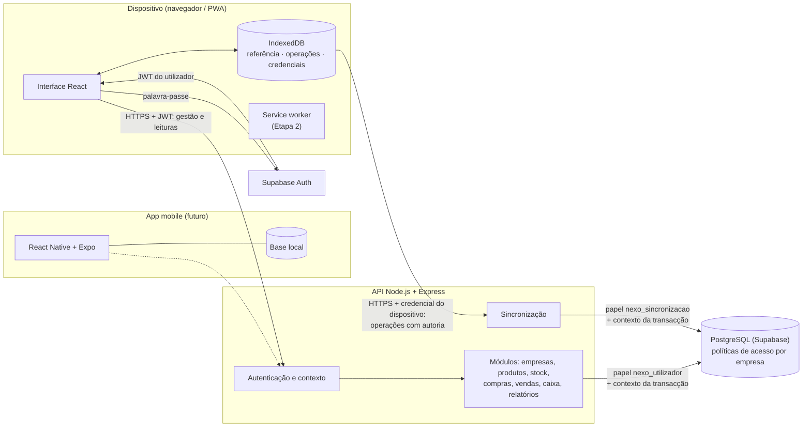
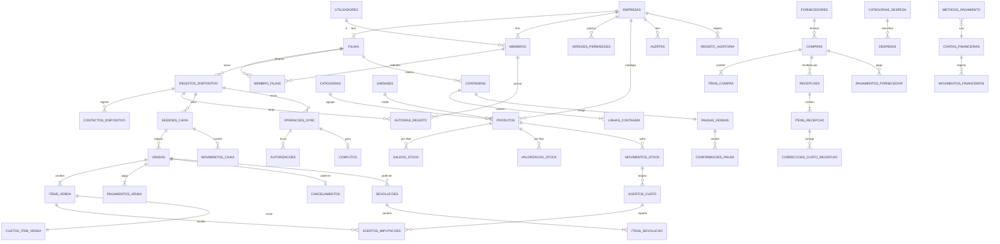

# Nexo — Arquitectura da Etapa 1

Versão 0.1 · 30 de Setembro de 2026 · Estado: **proposta para validação**

Base: `docs/Nexo_Especificacao_Etapa_0.md`, versão 0.3. A especificação continua em validação: **nenhuma sugestão ou decisão em aberto é tratada aqui como aprovada**. Onde este documento escolhe uma opção, marca-a como **proposta** e indica a decisão de que depende (H-xx).

Este documento propõe o modelo de dados e os contratos. **Não foram executadas migrações** nem criada nenhuma base de dados real.

---

## 0. Âmbito e entregas da Etapa 1

| Entrega | Onde | Estado |
|---|---|---|
| Protótipo web navegável com dados fictícios | `frontend/` (index.html) | Implementado; sem servidor, sem autenticação real e com sincronização **simulada** |
| Arquitectura, modelo de dados, contratos | Este documento | Proposta |
| Prova técnica de autoria por assinatura (H-23) | `frontend/prova-assinatura.html`, `backend/src/prova/` | Executada em Edge e Chrome no Windows; resultados em `docs/Nexo_Prova_Assinatura_Etapa_1.md` |

---

## 1. Visão geral



Princípios que orientam as escolhas:

1. A web e a app mobile **só falam com a API**. O Supabase é usado directamente apenas para autenticação (proposta H-01, especificação D.15.4).
2. Há **dois caminhos de escrita**:
   - **Gestão** (produtos, compras, contagens, utilizadores, relatórios): pedidos REST online, com o JWT do utilizador.
   - **Balcão** (vendas, pagamentos, cancelamentos, movimentos de caixa): **operações** no formato offline (secção 7), enviadas para `/v1/sync/operacoes`, **também quando há rede**. Assim há um só caminho para os factos de balcão, testado sempre da mesma maneira. Proposta.
3. O servidor é a fonte de verdade. O dispositivo guarda uma cópia de referência e a sua fila de operações.

---

## 2. Comunicação web → API → base de dados

### 2.1 Pedidos de utilizador (online)

```mermaid
sequenceDiagram
  participant W as Web
  participant A as Supabase Auth
  participant P as API
  participant D as PostgreSQL
  W->>A: e-mail/telefone + palavra-passe
  A-->>W: JWT de acesso (curta duração) + token de renovação
  W->>P: GET /v1/produtos (Authorization: Bearer JWT, X-Nexo-Empresa)
  P->>P: verifica o JWT (assinatura, validade, emissor)
  P->>D: BEGIN; SET LOCAL ROLE nexo_utilizador;<br/>set_config('nexo.empresa_id', …, true) …
  P->>D: SELECT … (políticas filtram pela empresa)
  D-->>P: linhas só da empresa
  P->>D: COMMIT
  P-->>W: 200 JSON
```

1. A API verifica o JWT e obtém o `utilizador_id`.
2. O cabeçalho `X-Nexo-Empresa` indica a empresa pretendida. A API **só aceita** a empresa se existir um **membro activo** (utilizador, empresa). É daí que obtém a função e as filiais permitidas (D.15.1). Nunca aceita a empresa só porque o cliente a indicou.
3. A autorização por função (matriz B) é verificada na API **antes** de tocar na base.
4. Cada pedido corre numa transacção com o contexto definido (secção 3.2). As políticas da base aplicam-se como segunda barreira.

### 2.2 Sincronização (dispositivo)

1. O dispositivo envia um lote com a **credencial do registo** (`Authorization: Nexo-Dispositivo <segredo>`).
2. A API obtém (registo, empresa, filial, estado) pela função restrita `nexo.autenticar_registo` (3.4). A empresa **deriva da credencial**, nunca do conteúdo.
3. Cada operação é processada **numa transacção própria** com o papel `nexo_sincronizacao` e o contexto (empresa, filial, registo, autor verificado).
4. A resposta indica o resultado de cada operação (secção 7.3).

### 2.3 Avisos de controlo e dados de referência

- `GET /v1/sync/avisos` (credencial do dispositivo): só avisos que restringem (revogação, suspensão, utilizador desactivado, PIN alterado) e avisos de **pausa/retoma de vendas**. Não devolve dados da empresa (D.12.2).
- `GET /v1/referencia?desde=<cursor>` (JWT de um utilizador com sessão no dispositivo): catálogo, preços, stock, regras, versão de permissões. É filtrado pela função: um operador nunca recebe custos. A inclusão de custos para P/G no dispositivo depende de H-28.

---

## 3. Isolamento por empresa e políticas de acesso

### 3.1 Papéis na base de dados (proposta, H-01)

| Papel | Tem login? | Ignora as políticas? | Uso |
|---|---|---|---|
| `nexo_proprietario_esquema` | Não em execução | Dono das tabelas; mesmo assim sujeito às políticas, porque todas as tabelas levam `FORCE ROW LEVEL SECURITY` | Só migrações |
| `nexo_api` | Sim (ligação da API) | Não (`NOBYPASSRLS`) | Só pode `SET ROLE` para os dois papéis abaixo; sem privilégios directos nas tabelas |
| `nexo_utilizador` | Não | Não | Pedidos de utilizador online |
| `nexo_sincronizacao` | Não | Não | Aplicação de operações de dispositivos |
| `service_role`, `postgres` (Supabase) | — | **Sim** | **Não usados** em pedidos nem na sincronização. Só em tarefas administrativas explícitas, auditadas e fora do caminho dos pedidos |

**Porque não usar a credencial de serviço:** no Supabase, `service_role` tem `BYPASSRLS`, e o dono das tabelas também ignora as políticas se estas não forem forçadas. Uma API que use essas credenciais **não tem as políticas activas**: qualquer erro de filtro devolveria dados de outra empresa. Por isso os pedidos correm com papéis sem esse privilégio. Os testes G.1.2 e G.1.3 verificam-no.

### 3.2 Contexto por transacção

Cada pedido ou operação corre assim (proposta; SQL ilustrativo, não executado):

```sql
BEGIN;
SET LOCAL ROLE nexo_utilizador;                 -- ou nexo_sincronizacao
SELECT set_config('nexo.empresa_id',  $1, true); -- true = só nesta transacção
SELECT set_config('nexo.filial_id',   $2, true);
SELECT set_config('nexo.utilizador_id', $3, true);
SELECT set_config('nexo.funcao',      $4, true);
SELECT set_config('nexo.registo_id',  $5, true); -- só na sincronização
-- … consultas e escritas …
COMMIT;
```

- `SET LOCAL` e `set_config(…, true)` valem só dentro da transacção. Isto é compatível com o *pooler* do Supabase em modo transacção. **Nunca** se usa `SET` de sessão.
- Os valores vêm **só** do JWT verificado (e do membro) ou da credencial verificada e da autoria verificada. Um único *middleware* define-os; nenhum módulo os pode alterar.
- Se o contexto faltar, `current_setting('nexo.empresa_id', true)` devolve `NULL` e as políticas **negam tudo**.

### 3.3 Políticas (exemplos ilustrativos)

```sql
-- Função auxiliar: empresa da transacção, ou NULL.
CREATE FUNCTION nexo.empresa_actual() RETURNS uuid
  LANGUAGE sql STABLE AS $$ SELECT nullif(current_setting('nexo.empresa_id', true), '')::uuid $$;

ALTER TABLE produtos ENABLE ROW LEVEL SECURITY;
ALTER TABLE produtos FORCE ROW LEVEL SECURITY;

-- Utilizador online: lê e escreve só na sua empresa.
CREATE POLICY produtos_utilizador ON produtos FOR ALL TO nexo_utilizador
  USING (empresa_id = nexo.empresa_actual())
  WITH CHECK (empresa_id = nexo.empresa_actual());

-- Sincronização: só lê o catálogo da empresa do registo (não altera produtos).
CREATE POLICY produtos_sincronizacao ON produtos FOR SELECT TO nexo_sincronizacao
  USING (empresa_id = nexo.empresa_actual());

-- Custos: tabela separada, legível só por proprietário e gestor.
CREATE POLICY custos_item_venda_gestao ON custos_item_venda FOR SELECT TO nexo_utilizador
  USING (empresa_id = nexo.empresa_actual()
         AND current_setting('nexo.funcao', true) IN ('proprietario', 'gestor'));

-- Vendas criadas pela sincronização: empresa e registo têm de ser os da credencial.
CREATE POLICY vendas_sincronizacao_inserir ON vendas FOR INSERT TO nexo_sincronizacao
  WITH CHECK (empresa_id = nexo.empresa_actual()
              AND registo_id = nullif(current_setting('nexo.registo_id', true), '')::uuid);
```

Regras gerais:

- **Todas** as tabelas com dados de empresa têm `ENABLE` + `FORCE ROW LEVEL SECURITY`. Sem política, o acesso é negado por defeito.
- `nexo_sincronizacao` tem `INSERT` nas tabelas de operações e `UPDATE` só nas colunas de estado previstas (saldos, sessões). **Não tem `DELETE`** em nenhuma tabela. `nexo_utilizador` também não tem `DELETE` nas tabelas financeiras e de stock.
- **Os custos ficam em tabelas próprias** (`custos_item_venda`, `valorizacao_stock`), para que a política por função (operador sem custos, B.2) se aplique à linha inteira sem depender de vistas.

### 3.4 Autenticação do registo antes de conhecer a empresa

Antes de saber a empresa, as políticas não deixariam ler `registos_dispositivo`. Proposta: uma função `SECURITY DEFINER`, com dono próprio, `search_path` fixo e um único propósito:

```sql
-- Recebe o resumo (hash) do segredo; devolve só o mínimo para montar o contexto.
CREATE FUNCTION nexo.autenticar_registo(p_hash bytea)
  RETURNS TABLE (registo_id uuid, empresa_id uuid, filial_id uuid, estado text)
  LANGUAGE sql SECURITY DEFINER SET search_path = nexo, pg_temp AS $$
    SELECT id, empresa_id, filial_id, estado FROM registos_dispositivo WHERE credencial_hash = p_hash
$$;
REVOKE ALL ON FUNCTION nexo.autenticar_registo(bytea) FROM PUBLIC;
GRANT EXECUTE ON FUNCTION nexo.autenticar_registo(bytea) TO nexo_api;
```

O segredo tem pelo menos 256 bits aleatórios e só o seu resumo SHA-256 é guardado. A função não devolve dados de negócio.

### 3.5 O que as políticas protegem e o que não protegem

| Protegem contra | Não protegem contra |
|---|---|
| Consultas sem filtro de empresa, identificadores trocados, junções mal feitas | Uma API comprometida que defina o contexto de outra empresa: o contexto é definido pela API |
| Referências entre empresas, com as chaves estrangeiras compostas (4.1) | Erros de autorização **dentro** da mesma empresa (função, limites): estes verificam-se na API |
| Escritas da sincronização fora do registo da credencial | Uso da credencial de serviço, que por isso fica fora dos caminhos de pedido |

**Alternativa considerada para H-01:** chamar a base pelo PostgREST com o JWT do utilizador, de modo que as políticas usem `auth.uid()` verificado pela própria base. Isto é mais forte nas leituras online, porque a API não consegue forjar o contexto sem o segredo do JWT. Mas as escritas atómicas em várias tabelas exigiriam funções RPC, e a sincronização não tem JWT de utilizador. **Proposta:** ligação directa com papéis e contexto por transacção nos dois caminhos, e testes automáticos de isolamento em cada módulo. **Decisão pendente: H-01.**

### 3.6 Preparação para filiais

- Todas as tabelas de coisas que acontecem num local têm `filial_id`, e as chaves compostas incluem-no quando é relevante (saldos, sessões, contagens).
- `membro_filiais` indica em que filiais cada membro trabalha. No piloto há uma filial e todos os membros a têm.
- As políticas podem ganhar um filtro de filial (`filial_id = ANY(nexo.filiais_permitidas())`) sem mudar o esquema.
- Os códigos (`F01`, `C01`) são únicos por filial. O número do comprovativo já inclui a filial.

---

## 4. Modelo de dados proposto

### 4.1 Convenções

| Tema | Proposta |
|---|---|
| Chaves primárias | `uuid`. Os registos criados no dispositivo trazem o seu `uuid` (D.5.1); os criados no servidor usam `gen_random_uuid()` |
| Empresa | `empresa_id uuid NOT NULL` em todas as tabelas de negócio |
| Referências dentro da empresa | As tabelas referenciadas têm `UNIQUE (empresa_id, id)`. As chaves estrangeiras são **compostas**, por exemplo `(empresa_id, produto_id) → produtos (empresa_id, id)`. Uma linha da empresa A nunca pode apontar para um produto da empresa B, mesmo com um identificador certo |
| Dinheiro | `bigint` em centavos, com `CHECK` de sinal onde aplicável |
| Quantidades | `numeric(14,3)`; a unidade indica se aceita fracções (verificado na API e com `CHECK` por *trigger*) |
| Custo médio | `numeric(18,4)` em centavos |
| Datas | `timestamptz`. Nas operações de dispositivo: `hora_declarada`, `hora_recepcao`, `data_referencia` (D.10) |
| Estados | `text` com `CHECK (estado IN (…))`; sem tipos enumerados, para facilitar migrações |
| Imutabilidade | As tabelas de factos (movimentos, vendas, itens, pagamentos, operações, acertos, auditoria) têm um *trigger* que recusa `UPDATE`/`DELETE`. Os estados derivados (venda cancelada ou devolvida) vêm de tabelas de eventos, não da edição da linha original |
| Auditoria | `criado_em`, `criado_por` em todas as tabelas; `registo_auditoria` para actos administrativos (D.15.5) |

### 4.2 Diagrama de relações (principais)



### 4.3 Tabelas, chaves, restrições e índices

Colunas comuns omitidas: `empresa_id`, `criado_em`, `criado_por`. "UK" = restrição de unicidade; "FK" = chave estrangeira composta com `empresa_id`.

#### Identidade, empresa e dispositivos

| Tabela | Colunas principais | Restrições | Índices |
|---|---|---|---|
| `empresas` | id, nome, nuit, tipo, moeda, fuso, regras (jsonb versionado) | `CHECK (tipo = 'loja')` no MVP | — |
| `filiais` | id, nome, codigo, proximo_numero_registo | UK (empresa_id, codigo) | — |
| `utilizadores` | id (= `auth.users.id`), nome, contacto | — | — |
| `membros` | id, utilizador_id, funcao, verificador_pin, estado | UK (empresa_id, utilizador_id); `CHECK funcao IN (…)`; *trigger*: pelo menos um proprietário activo (D.1.3) | (utilizador_id) |
| `membro_filiais` | membro_id, filial_id | PK (membro_id, filial_id); FK | — |
| `versoes_permissoes` | numero, conteudo (jsonb), publicada_em | PK (empresa_id, numero) | — |
| `registos_dispositivo` | id, filial_id, codigo, nome, credencial_hash, estado, substitui_id, revogado_em, suspenso_em, ultima_sequencia, versao_permissoes_confirmada, sequencia_confirmacao | UK (filial_id, codigo); UK (credencial_hash). O código vem de `filiais.proximo_numero_registo` e **nunca é reutilizado** (D.5.3) | (empresa_id, filial_id, estado) |
| `contactos_dispositivo` | registo_id, hora_servidor, sequencia_declarada, pendentes_numero, pendentes_valor, desvio_relogio_ms, versao_app | FK registo | (registo_id, hora_servidor DESC); base de T_antes (D.10.3) |
| `autorias_registo` | id, membro_id, registo_id, tipo (`chave` / `sessao_local`), chave_publica_jwk, estado, encerrada_apos_sequencia | UK parcial (membro_id, registo_id) WHERE estado = 'activa' | (registo_id, estado) |

`autorias_registo` serve as duas opções de H-23: com assinatura guarda a chave pública; na alternativa D.12.4.5 guarda só a sessão local. **A escolha não está feita** (secção 12).

#### Catálogo, stock e custo

| Tabela | Colunas principais | Restrições | Índices |
|---|---|---|---|
| `categorias`, `unidades` | id, nome, (fraccionavel) | UK (empresa_id, nome) | — |
| `produtos` | id, nome, categoria_id, unidade_id, codigo, codigo_barras, preco_venda, stock_minimo, taxa_iva (prevista, H-05), estado | UK (empresa_id, codigo); UK parcial (empresa_id, codigo_barras) WHERE codigo_barras IS NOT NULL; `CHECK preco_venda > 0`; FK categoria/unidade | (empresa_id, estado); pesquisa por nome (`pg_trgm`, a avaliar) |
| `historico_precos` | produto_id, preco_anterior, preco_novo | imutável | (produto_id, criado_em) |
| `saldos_stock` | filial_id, produto_id, quantidade, ultima_ordem | PK (filial_id, produto_id); **cache** recalculável | — |
| `valorizacao_stock` | filial_id, produto_id, valor, custo_medio | PK (filial_id, produto_id); só P/G lêem | — |
| `movimentos_stock` | id, filial_id, produto_id, tipo, quantidade, custo_unitario, valor, ordem_aplicacao, documento_tipo, documento_id, motivo, operacao_id, hora_declarada, hora_recepcao, data_referencia | imutável; `CHECK tipo IN (…)` (D.2.3); `ordem_aplicacao` de uma sequência | (empresa_id, filial_id, produto_id, ordem_aplicacao); (documento_tipo, documento_id); (empresa_id, filial_id, data_referencia) |
| `acertos_custo` | id, produto_id, filial_id, tipo (`imputado` / `correccao`), valor, destino (`cmv` / `perdas` / `stock`), causa_movimento_id, data_geracao | imutável | (empresa_id, data_geracao) |
| `acertos_imputacoes` | acerto_id, item_venda_id \| movimento_id, quantidade, valor | imutável | (item_venda_id) |
| `correccoes_custo_recepcao` | item_recepcao_id, custo_antigo, custo_novo, erro_total, parte_stock, acerto_id, motivo | imutável | (item_recepcao_id) |

#### Compras

| Tabela | Colunas principais | Restrições | Índices |
|---|---|---|---|
| `fornecedores` | id, nome, nuit, telefone, estado | UK parcial (empresa_id, nuit) WHERE nuit IS NOT NULL | — |
| `compras` | id, filial_id, fornecedor_id, data, documento, estado | `CHECK estado IN ('rascunho','encomendada','parcial','recebida','fechada','cancelada')` | (empresa_id, filial_id, data) |
| `itens_compra` | compra_id, produto_id, quantidade, custo_unitario | `CHECK quantidade > 0`, `CHECK custo_unitario > 0` | (compra_id) |
| `recepcoes` | id, compra_id, estado, confirmada_em, confirmada_por, operacao_confirmacao_id | UK (operacao_confirmacao_id): a confirmação é única (D.5.4). Uma vez confirmada, é imutável | (compra_id) |
| `itens_recepcao` | recepcao_id, item_compra_id, quantidade, custo_unitario | imutável depois de confirmada | (recepcao_id) |
| `pagamentos_fornecedor` | id, compra_id, conta_id, valor, data, referencia | `CHECK valor > 0` | (compra_id) |

#### Vendas

| Tabela | Colunas principais | Restrições | Índices |
|---|---|---|---|
| `vendas` | id (do dispositivo), filial_id, registo_id, sessao_id, autor_id, numero, subtotal, desconto, total, operacao_id, hora_declarada, hora_recepcao, data_referencia, marcas (jsonb) | UK (empresa_id, numero); UK (operacao_id); imutável; `CHECK total = subtotal - desconto` | (empresa_id, filial_id, data_referencia); (sessao_id) |
| `itens_venda` | id, venda_id, produto_id, descricao, quantidade, preco, desconto, liquido | imutável; `CHECK liquido >= 0` | (venda_id); (empresa_id, produto_id) |
| `custos_item_venda` | item_venda_id, custo_registado | PK (item_venda_id); imutável; só P/G lêem | — |
| `pagamentos_venda` | id, venda_id, metodo_id, valor, entregue, troco, referencia | imutável; `CHECK valor > 0`; troco só em numerário (*trigger*) | (venda_id) |
| `autorizacoes` | id, operacao_id, tipo, pedida_por, autorizador_id, valor, motivo, versao_permissoes, resultado_revalidacao | imutável | (operacao_id) |
| `cancelamentos` | venda_id, operacao_id, motivo, autor_id, autorizacao_id | PK (venda_id): no máximo um | — |
| `devolucoes` | id, venda_id, numero, motivo, reembolso, metodo_id | UK (empresa_id, numero) | (venda_id) |
| `itens_devolucao` | devolucao_id, item_venda_id, quantidade, liquido, custo_estornado, destino | *trigger*: acumulado ≤ vendido (D.6.1.3) | (item_venda_id) |

#### Caixa e finanças

| Tabela | Colunas principais | Restrições | Índices |
|---|---|---|---|
| `contas_financeiras` | id, filial_id, nome, tipo, saldo_inicial | — | — |
| `metodos_pagamento` | id, nome, conta_id, exige_referencia, estado | UK (empresa_id, nome) | — |
| `sessoes_caixa` | id (do dispositivo), filial_id, registo_id, responsavel_id, operadores_autorizados (H-13), aberta_em, fundo, estado, fechada_em, esperado, contado, diferenca, justificacao, sessao_anterior_id | UK parcial (registo_id) WHERE estado = 'aberta': **uma sessão aberta por dispositivo** | (empresa_id, filial_id, aberta_em) |
| `movimentos_caixa` | id, sessao_id, tipo, valor, destino, documento_tipo, documento_id, autor_id, autorizacao_id | imutável | (sessao_id) |
| `movimentos_financeiros` | id, conta_id, tipo, valor, data_referencia, documento_tipo, documento_id, contrapartida_id | imutável | (conta_id, data_referencia) |
| `categorias_despesa`, `despesas` | categoria_id, descricao, valor, conta_id, sessao_id, estado, anulacao (motivo, por, em) | anulação só por registo próprio; `CHECK valor > 0` | (empresa_id, data) |

#### Contagem física (especificação 0.3)

| Tabela | Colunas principais | Restrições | Índices |
|---|---|---|---|
| `contagens` | id, filial_id, ambito, estado, aprovada_por | `CHECK estado IN ('preparacao','a_espera_da_pausa','em_curso','aprovada','cancelada')` | (filial_id, estado) |
| `pausas_vendas` | id, contagem_id, filial_id, estado, pedida_em, iniciada_em, terminada_em | UK parcial (filial_id) WHERE estado IN ('pedida','activa'): **uma pausa activa por filial** | — |
| `confirmacoes_pausa` | pausa_id, registo_id, sequencia_pausa, confirmada_em, retoma_tipo, retoma_sequencia | PK (pausa_id, registo_id) | — |
| `linhas_contagem` | contagem_id, produto_id, teorico, contado, diferenca, contado_por, historico | UK (contagem_id, produto_id) | — |

#### Sincronização, conflitos e auditoria

| Tabela | Colunas principais | Restrições | Índices |
|---|---|---|---|
| `operacoes_sync` | id (do dispositivo), registo_id, sequencia, tipo, versao_formato, autor_id, autoria (assinatura ou sessão), versao_permissoes, conteudo (jsonb), resumo_conteudo (sha256), hora_declarada, desvio_ms, hora_recepcao, t_antes, data_referencia, tardia, resultado, motivo, ordem_aplicacao | PK (empresa_id, id): **idempotência**; UK (registo_id, sequencia): detecção de clonagem (D.5.6); `CHECK resultado IN ('aplicada','aplicada_com_alerta','conflito','quarentena','anulada','aceite_pelo_gestor')` | (registo_id, sequencia); (empresa_id, resultado) WHERE resultado IN ('conflito','quarentena') |
| `conflitos` | operacao_id, motivo, evidencias (jsonb), estado, decisao, decidido_por, nota | PK (operacao_id) | (empresa_id, estado) |
| `alertas` | id, tipo, referencias (jsonb), estado, resolucao | — | (empresa_id, estado, tipo) |
| `pedidos_idempotentes` | chave, utilizador_id, rota, resumo_pedido, resposta, expira_em | PK (empresa_id, chave) | (expira_em) |
| `registo_auditoria` | id, autor_id, accao, entidade, entidade_id, antes, depois, origem | imutável | (empresa_id, criado_em); (entidade, entidade_id) |

---

## 5. Dados de referência e operações locais (dispositivo)

Base IndexedDB **por empresa e registo**: `nexo-<empresa_id>-<codigo_registo>`. Proposta:

| Grupo | Lojas (object stores) | Regra |
|---|---|---|
| **Referência** (substituível) | `catalogo`, `precos`, `stock`, `metodos`, `regras`, `permissoes`, `membros_locais` (nome, função, verificador de PIN), `cursor` | Chega de `/v1/referencia`. Pode ser apagada e descarregada de novo sem perder nada |
| **Operações** (preciosas) | `fila` (operações com autoria), `vendas_locais`, `sessao_caixa`, `sequencias` (comprovativo e operação) | Nunca apagadas antes de resposta definitiva (D.11.7). Uma venda grava venda, itens, pagamentos, fila e sequências **numa só transacção IndexedDB** |
| **Credenciais** | `credencial_registo`, `tokens` (por utilizador), `autorias` (chaves não exportáveis, se H-23) | Apagadas por utilizador ao terminar sessão; nunca junto com a fila |
| **Controlo** | `pausa`, `relogio` (desvio, último contacto), `app` (versão do esquema local) | — |

A separação permite, por exemplo, que um novo catálogo substitua a loja `catalogo` sem tocar em `fila`. No código, o acesso às lojas de operações passa por um único módulo, que não expõe nenhuma função "apagar tudo".

---

## 6. Contrato inicial da API

### 6.1 Convenções

- Base `https://<api>/v1`, JSON UTF-8, datas ISO 8601 em UTC, dinheiro em **centavos inteiros**, quantidades como texto decimal (`"1.250"`) para não perder precisão.
- Autenticação: `Authorization: Bearer <JWT>` + `X-Nexo-Empresa: <uuid>` (utilizador), ou `Authorization: Nexo-Dispositivo <segredo>` (sincronização).
- Escritas online não repetíveis levam `Idempotency-Key: <uuid>`. A mesma chave com o mesmo pedido devolve a mesma resposta; com um pedido diferente devolve `409 idempotencia_conflito`.
- Erros sempre no formato:

```json
{ "erro": { "codigo": "permissao_negada", "mensagem": "A função Operador não pode alterar preços.", "detalhes": {} } }
```

| HTTP | Código de erro (exemplos) |
|---|---|
| 400 | `pedido_invalido`, `validacao` (com `detalhes.campos`) |
| 401 | `nao_autenticado`, `credencial_desconhecida` |
| 403 | `permissao_negada`, `empresa_nao_permitida`, `registo_revogado` |
| 404 | `nao_encontrado` (também para recursos de outra empresa: nunca se revela que existem) |
| 409 | `idempotencia_conflito`, `estado_invalido` (ex.: confirmar recepção cancelada), `pausa_activa` |
| 422 | `regra_negocio` (ex.: pagamentos ≠ total) |
| 503 | `indisponivel` (o dispositivo tenta de novo mais tarde) |

### 6.2 Recursos

| Método e rota | Quem | Descrição |
|---|---|---|
| `POST /v1/empresas` | Utilizador autenticado sem empresa | Cria empresa, filial `F01`, métodos de pagamento e o membro proprietário (C.1) |
| `GET /v1/eu` | Utilizador | Membros, empresas, função, filiais |
| `POST /v1/convites` · `POST /v1/convites/{id}/aceitar` | P/G · convidado | Convites (B.1) |
| `POST /v1/dispositivos` | P/G | Prepara um registo novo e devolve a credencial **uma única vez** |
| `POST /v1/dispositivos/{id}/revogar` · `/suspender` | P/G | D.11.6 |
| `POST /v1/dispositivos/{id}/autorias` | Utilizador no dispositivo | Regista a autoria (chave pública ou sessão local) — depende de H-23 |
| `GET /v1/referencia?desde={cursor}` | Utilizador | Alterações de referência desde o cursor |
| `POST /v1/sync/operacoes` | Dispositivo | Lote de operações (7) |
| `POST /v1/sync/estado` | Dispositivo | Sequência, pendentes, versões |
| `GET /v1/sync/avisos` | Dispositivo | Avisos de controlo |
| `GET/POST /v1/produtos`, `PATCH /v1/produtos/{id}` | Todos lêem; P/G escrevem | Catálogo (preço alterado → `historico_precos`) |
| `POST /v1/stock/ajustes` | P/G | Ajuste com motivo |
| `POST /v1/contagens` · `/{id}/pausa` · `/{id}/linhas` · `/{id}/aprovar` · `/{id}/cancelar` | P/G (linhas: todos) | D.7 |
| `GET/POST /v1/fornecedores`, `/v1/compras` | P/G | Compras em rascunho |
| `POST /v1/compras/{id}/recepcoes/{rid}/confirmar` | P/G | Com `Idempotency-Key`; aumenta o stock uma vez |
| `POST /v1/compras/{id}/pagamentos` | P/G | Pagamento a fornecedor |
| `POST /v1/recepcoes/itens/{id}/correccao-custo` | P/G | D.3.7 |
| `POST /v1/devolucoes` | P/G (O com autorização) | Online (proposta H-08) |
| `GET/POST /v1/despesas`, `POST /v1/despesas/{id}/anular` | P/G | D.8.7 |
| `GET /v1/relatorios/{resultado,fluxo,saldos,vendas,caixa,stock}?de=&ate=` | P/G | Relatórios de gestão com os indicadores de D.9.3 |
| `GET /v1/conflitos`, `POST /v1/conflitos/{operacaoId}/decisao` | P/G | Aceitar, aplicar com correcção, anular |

### 6.3 Exemplos

**Preparar dispositivo**

```http
POST /v1/dispositivos
Authorization: Bearer eyJ…
X-Nexo-Empresa: 7b0e…
Idempotency-Key: 5d1c…
Content-Type: application/json

{ "filialId": "a41f…", "nome": "Balcão 1" }
```

```json
201
{
  "registo": { "id": "c9e2…", "codigo": "C01", "filialCodigo": "F01", "estado": "activo" },
  "credencial": "nd_4p7Q…(mostrada uma única vez)",
  "versaoPermissoes": 7,
  "servidorAgora": "2026-09-30T13:40:00.000Z"
}
```

**Confirmar recepção** (a segunda chamada com a mesma chave devolve a mesma resposta, sem novos movimentos)

```http
POST /v1/compras/cp-2/recepcoes/r-1/confirmar
Idempotency-Key: 8f0a…
```

```json
200
{ "recepcao": { "id": "r-1", "estado": "confirmada", "confirmadaEm": "2026-09-30T14:02:11Z" },
  "movimentos": [ { "produtoId": "p-04", "quantidade": "15.000", "custoUnitario": 26500 } ],
  "repeticao": false }
```

**Relatório de gestão**

```json
GET /v1/relatorios/resultado?de=2026-10-01&ate=2026-10-31
200
{
  "natureza": "gestao_provisorio",
  "calculadoEm": "2026-11-02T08:10:00Z",
  "valores": { "vendasLiquidas": 10000000, "cmv": 7000000, "acertosCusto": 1100, "despesas": 1200000, "perdas": 100000, "resultado": 1700000 },
  "indicadores": {
    "pendentesDeclarados": [ { "registo": "C02", "ultimoContacto": "2026-11-01T15:10:00Z", "numero": 4, "valor": 112000 } ],
    "operacoesTardias": { "numero": 6, "valor": 156000 },
    "correccoesAuditadas": [ { "tipo": "anulacao_despesa", "em": "2026-11-04T09:00:00Z", "por": "u-carlos", "auditoriaId": "…" } ]
  }
}
```

---

## 7. Formato das operações offline

### 7.1 Envelope de uma operação (versão de formato 1)

```json
{
  "id": "0b9f6c1e-7c3a-4f7e-9a51-3c2d8e0f4a11",
  "versaoFormato": 1,
  "tipo": "venda",
  "registo": "c9e2…",
  "sequencia": 131,
  "autor": "u-ana",
  "autorizacoes": [
    { "tipo": "desconto", "autorizador": "u-carlos", "valor": 5.0, "motivo": "Cliente habitual", "autoria": { "…": "…" } }
  ],
  "horaDeclarada": "2026-09-30T11:02:10.512+02:00",
  "desvioRelogioMs": -4200,
  "versaoPermissoes": 7,
  "dependeDe": [ "id da operação de abertura da sessão" ],
  "conteudo": {
    "vendaId": "…", "sessaoId": "…", "numero": "F01-C01-2026-000153",
    "linhas": [ { "itemId": "…", "produtoId": "p-01", "quantidade": "2.000", "preco": 45000, "desconto": 4500 } ],
    "pagamentos": [ { "pagamentoId": "…", "metodo": "numerario", "valor": 102600, "entregue": 150000, "troco": 47400 } ],
    "subtotal": 108000, "desconto": 5400, "total": 102600
  },
  "autoria": { "tipo": "assinatura", "chaveId": "…", "assinatura": "base64url(r||s)" }
}
```

| Campo | Regra |
|---|---|
| `id` | UUID gerado no dispositivo; chave de idempotência |
| `versaoFormato` | O servidor suporta pelo menos a versão actual e a anterior (secção 11) |
| `registo`, `sequencia` | A sequência é contínua e crescente por registo, e nunca se repete (D.4.5, D.5.5) |
| `autor`, `autorizacoes` | Verificados pela autoria (assinatura ou sessão local, H-23) e pelas permissões (D.13.6) |
| `horaDeclarada`, `desvioRelogioMs` | Indícios para a data de referência (D.10). Não decidem aceitação nem custo |
| `dependeDe` | Identificadores de operações que têm de estar aplicadas antes (ex.: abertura de sessão antes da venda; venda antes do cancelamento) |
| `conteudo` | Específico do tipo. **Nunca inclui custos**: se vierem, são ignorados (D.3.1) |
| `autoria` | Mostrada junto ao envelope para facilitar a leitura. Na transmissão (7.2), o envelope **sem** `autoria` viaja como o texto exacto que foi assinado (`conteudoAssinado`), e a `autoria` vai ao lado. O servidor verifica esses bytes e só depois interpreta o JSON, o que evita ambiguidades de serialização (como na prova técnica) |

Tipos na versão 1: `abertura_caixa`, `venda`, `cancelamento`, `movimento_caixa` (reforço, retirada, despesa), `passagem_turno`, `fecho_caixa`, `confirmacao_pausa`, `retoma_local` (fora do protótipo; ver 13).

### 7.2 Lote

```json
POST /v1/sync/operacoes
Authorization: Nexo-Dispositivo nd_4p7Q…
{ "registo": "c9e2…", "sequenciaActual": 140, "pendentes": { "numero": 10, "valor": 1840000 },
  "operacoes": [ { "conteudoAssinado": "{…texto exacto…}", "autoria": { … } } ] }
```

### 7.3 Resultado por operação

```json
200
{
  "servidorAgora": "2026-09-30T12:00:03Z",
  "resultados": [
    { "id": "0b9f…", "sequencia": 131, "resultado": "aplicada_com_alerta", "alertas": ["revisao_obrigatoria:desconto_acima_do_limite_actual"], "dataReferencia": "2026-09-30T09:02:14Z" },
    { "id": "1c2d…", "sequencia": 132, "resultado": "conflito", "motivo": "permissoes:excepcao_autonoma_fora_do_limite" },
    { "id": "2e3f…", "sequencia": 133, "resultado": "em_espera", "motivo": "dependencia_pendente", "tentarDepoisMs": 5000 }
  ]
}
```

| Resultado | Estado no dispositivo | A operação sai da fila? |
|---|---|---|
| `aplicada`, `ja_aplicada`, `aplicada_com_alerta` | Confirmado | Sim |
| `conflito`, `quarentena` | Conflito | Sim (fica guardada no servidor) |
| `em_espera` (dependência ainda não aplicada) | Pendente | Não |
| erro HTTP 5xx, rede | Pendente | Não |

---

## 8. Gravação atómica e idempotência

### 8.1 No dispositivo

Uma venda é gravada numa **única transacção IndexedDB** `readwrite` sobre `vendas_locais`, `fila` e `sequencias`. Se o aparelho desligar a meio, a transacção não é concluída e não fica nada parcial (D.4.1, F3). O número do comprovativo e a sequência saem da mesma transacção, por isso nunca se repetem.

### 8.2 No servidor, por operação

```text
1. Autenticar o registo (3.4). Se desconhecido → 401; se revogado/suspenso → gravar em quarentena (passos 3–4) e parar.
2. BEGIN; SET LOCAL ROLE nexo_sincronizacao; contexto (empresa, filial, registo).
3. INSERT INTO operacoes_sync (…) ON CONFLICT (empresa_id, id) DO NOTHING RETURNING id
   → se não inseriu: comparar resumo_conteudo; igual → devolver o resultado guardado ("ja_aplicada");
     diferente → conflito "mesmo_id_conteudo_diferente" (D.5.2). COMMIT.
4. Verificar a unicidade (registo_id, sequencia) → se já existir com outro id: conflito "numeracao_duplicada" e suspender o registo (D.5.6).
5. Verificar a autoria (H-23) e definir nexo.utilizador_id = autor verificado.
6. Calcular T_antes, a data de referência (D.10) e a marca "tardia".
7. Verificar as dependências: se alguma não estiver aplicada → ROLLBACK e devolver "em_espera" (não é conflito).
8. Verificar as permissões com a versão declarada e as confirmações (D.13.6), a pausa de contagem (D.7.5) e a sessão (D.11.6).
9. Aplicar: SELECT … FROM saldos_stock WHERE (filial, produto) IN (…) ORDER BY produto_id FOR UPDATE
   (ordem fixa para evitar bloqueios mútuos); inserir a venda, os itens, os pagamentos, os movimentos
   (com ordem_aplicacao), os custos registados, os movimentos de caixa/financeiros e as coberturas de stock negativo (D.3.5).
10. Actualizar operacoes_sync.resultado; COMMIT.
```

Se algum passo falhar por erro inesperado, faz-se `ROLLBACK`: a operação não fica aplicada e o dispositivo tenta de novo. Como tudo está na mesma transacção, **não existe venda sem movimentos nem movimentos sem venda**.

### 8.3 Pedidos online

Os pedidos com `Idempotency-Key` guardam em `pedidos_idempotentes` (chave, resumo do pedido, resposta), na **mesma transacção** do efeito. Uma repetição devolve a resposta guardada. A confirmação de recepção tem ainda `UK (operacao_confirmacao_id)` como garantia na própria base.

---

## 9. Dependências, conflitos e quarentena

- **Ordem:** o dispositivo envia por sequência. O servidor aceita lotes fora de ordem, mas só aplica uma operação quando as suas `dependeDe` estão aplicadas; se não estiverem, responde `em_espera`.
- **Dependência em conflito:** se uma dependência estiver em conflito ou quarentena, a operação dependente passa também a conflito com o motivo `dependencia_em_conflito`. Quando o gestor decide a primeira, as dependentes são reavaliadas.
- **Quarentena** (registo revogado ou suspenso, D.11.6): a operação é guardada em `operacoes_sync` com `resultado = 'quarentena'`, o conteúdo completo e as evidências (contactos anteriores, pendentes declarados, sequências). **Nada é aplicado.**
- **Decisão do gestor:** `POST /v1/conflitos/{id}/decisao` com `aceitar` | `aplicar_com_correccao` | `anular`, e nota obrigatória. Aceitar executa os passos 8–10 de 8.2 com o contexto do gestor registado como decisor (o autor mantém-se). Tudo fica em `registo_auditoria`.
- **Alertas** (não bloqueiam): stock negativo, preço diferente, produto inactivo, hora ajustada, revisão obrigatória, venda sem custo, possível perda.

---

## 10. Protecção dos dados locais ao trocar de utilizador ou empresa

| Situação | Comportamento proposto |
|---|---|
| Troca de utilizador (mesma empresa) | Bloqueio do ecrã e desbloqueio por PIN. Nada é apagado. As operações seguintes levam o novo autor (D.8.2) |
| Terminar sessão | Apaga os tokens e a autoria desse utilizador **neste** registo. A fila fica intacta, e as operações já criadas continuam válidas (D.11.4) |
| Outra empresa | Só depois de **desvincular** o registo, e só com a fila vazia. A desvinculação apaga a base `nexo-<empresa>-<registo>` inteira |
| Operador | Nunca recebe custos na referência (filtrado na API) |
| Resultado da prova técnica | Uma **cópia da pasta do perfil** do navegador, na mesma máquina, continuou a usar a chave "não exportável". Os dados locais **não estão protegidos** contra quem tenha acesso ao perfil. A cifra local continua em aberto (H-11) |

---

## 11. Actualização da aplicação sem perder operações

1. **Service worker (Etapa 2):** a versão nova instala-se e fica **à espera**. Só é activada num momento seguro:
   - sem venda em curso;
   - depois de tentar enviar a fila;
   - com um aviso "Actualização pronta" e confirmação do utilizador.

   Nunca se força `skipWaiting` a meio de uma venda.
2. **Esquema IndexedDB:** as migrações em `onupgradeneeded` são **aditivas** (novas lojas ou índices). A loja `fila` nunca é removida nem recriada. Uma migração que precise de transformar operações escreve uma cópia e só remove a original depois de a cópia ser confirmada.
3. **Formato das operações:** cada operação leva `versaoFormato`. O servidor aceita **pelo menos a versão actual e a anterior**. Uma operação gravada antes da actualização é enviada no seu formato original, sem conversão no dispositivo.
4. **Versão mínima:** o servidor pode recusar **operações novas** de uma aplicação demasiado antiga (`426 actualizacao_necessaria`), mas **nunca** recusa as já existentes num formato suportado.
5. **Recurso:** exportação de pendentes para ficheiro (D.11.7, ponto 4) antes de qualquer procedimento manual.

---

## 12. Questões de modelo para validar

1. **Acertos em cancelamentos e devoluções (ajuste 2):** o modelo prevê `acertos_imputacoes` ligados a `itens_venda`, para que o estorno use o **custo efectivo** (registado + acertos imputados, D.3.6). **O cálculo financeiro não foi implementado nesta etapa.** Falta validar:
   - a aproximação A4: as correcções de custo de compra não entram no custo efectivo;
   - se a devolução parcial deve usar a média por unidade (A3);
   - se a tabela `acertos_imputacoes` deve também registar a parte das correcções por movimento (hoje só para auditoria).
2. **Custos no dispositivo (H-28):** o modelo suporta as duas opções; a escolha muda só o filtro de `/v1/referencia`.
3. **Autoria (H-23):** `autorias_registo.tipo` admite `chave` e `sessao_local`. A decisão é do proprietário do projecto, com base nos resultados da prova (secção 13).

---

## 13. Ajustes desta etapa em relação à especificação 0.3

| Ajuste | Tratamento |
|---|---|
| 1. Durante a contagem os dispositivos ficam bloqueados até à retoma do servidor; a retoma offline por PIN fica fora do protótipo | Implementado assim no protótipo (simulado). O modelo mantém `confirmacoes_pausa.retoma_tipo` para não fechar a porta à retoma local (D.7.6), que continua **proposta** na especificação e precisa de decisão |
| 2. Cancelamentos e devoluções consideram os acertos | Registado em 12.1; o protótipo não implementa acertos nem devoluções |
| 3. Sem fecho mensal obrigatório | O modelo não tem tabela de períodos; os relatórios são de gestão e provisórios (`natureza: gestao_provisorio`) |
| 4. Decisões dependentes da loja com a etapa-limite | Secção 14 |

---

## 14. Decisões pendentes antes da Etapa 2 e seguintes

**Bloqueiam a arquitectura** (têm de estar fechadas antes de a Etapa 2 criar migrações):

| # | Decisão | Proposta | O que esta etapa acrescentou |
|---|---|---|---|
| H-01 | Acesso da API à base e políticas | Papéis `nexo_utilizador`/`nexo_sincronizacao` e contexto por transacção; sem credencial de serviço nos pedidos | Desenho detalhado (secção 3); falta decidir e fazer um teste de isolamento num projecto Supabase de desenvolvimento |
| H-02 | Identidade dos operadores | Conta própria no Supabase Auth | Sem novidades; depende da entrevista |
| H-04 / H-21 | Custo médio e ordem de aplicação | Como na especificação | Modelo de tabelas proposto (4.3) |
| H-23 | Autoria por assinatura | **Não há recomendação automática.** Ver resultados e opções em `docs/Nexo_Prova_Assinatura_Etapa_1.md` | Prova executada: funciona tecnicamente em Edge/Chrome no Windows, mas a cópia do perfil mantém a chave utilizável e falta testar os aparelhos da loja |

**Dependem da loja piloto** (continuam **propostas**):

| # | Tema | Etapa-limite |
|---|---|---|
| H-10 | Conversão de embalagens | 4 Catálogo e stock |
| H-12 | Importação inicial | 4 |
| H-24 | Duração aceitável da pausa de contagem | 4 |
| H-07 | Vendas a crédito | 6 Vendas |
| H-13 | Gaveta partilhada / modo de caixa | 6 |
| H-06 | Stock insuficiente | 6 |
| H-14 | Prazo de devolução | 6 |
| H-18 | Limites de desconto | 6 |
| H-03 | Janela offline (72 h) | 7 Offline |
| H-08 | Devoluções offline | 7 |
| H-26 | PIN e sessão local | 7 |
| H-09 | Contas financeiras | 8 Caixa |
| H-15 | Contagem cega | 8 |
| H-16 | Impressão | Piloto |

**Outras, do proprietário do projecto:** H-05 (IVA, com contabilista), H-11 (cifra local), H-25, H-28, H-29 e a retoma local por PIN (ajuste 1).

---

## 15. Limitações conhecidas

**Protótipo**

- **Sem servidor, sem autenticação e sem sincronização real.** O interruptor Online/Offline é uma simulação. Os estados pendente, confirmado e conflito são atribuídos no navegador.
- Os dados ficam em `localStorage` e não em IndexedDB. Não há service worker: **não abre sem rede** como PWA.
- Os custos e indicadores financeiros são fictícios e calculados no navegador. Não há devoluções, acertos de custo, contagem física (só a pausa simulada), passagem de turno nem transferência de responsabilidade.
- O PIN de demonstração é comparado em claro. A autorização não é revalidada.
- As rotas são simples, por hash. A biblioteca de rotas, a gestão de estado e a biblioteca de formulários ficam para a Etapa 2.

**Prova técnica**

- Chaves do servidor em memória: reiniciar a API apaga-as.
- Testada só em Edge 154 e Chrome 122 sem interface, no Windows 10 deste computador. Faltam os aparelhos reais da loja (Android, eventualmente iOS) e um segundo computador para o teste de cópia de perfil.
- Fora de `localhost` a Web Crypto exige HTTPS: por `http://IP-da-rede` o teste falha (confirmado).

---

## 16. Como verificar

Ver `README.md`, secção "Etapa 1".
