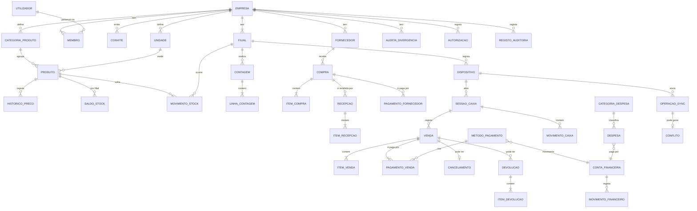

# Nexo — Especificação da Etapa 0 (MVP para lojas)

Versão 0.1 · 30 de Setembro de 2026 · Estado: **rascunho para validação**

Documentos de referência: `Documentos/NEXO_Plano_Plataforma_Gestao_Comercial_Financeira.docx`, `Documentos/Nexo_Etapas_de_Desenvolvimento.docx`, `Documentos/Nexo_Estrutura_Web_Mobile_API.docx`.

---

## Como ler este documento

Cada requisito ou regra tem uma etiqueta de origem:

| Etiqueta | Significado |
|---|---|
| **[D]** Definido | Consta do pedido da Etapa 0 ou dos documentos de visão. Só muda com decisão do proprietário do projecto. |
| **[S]** Sugestão | Proposta desta especificação. Precisa de validação (entrevista à loja piloto ou decisão do proprietário do projecto) antes de ser implementada. |

As sugestões com maior impacto estão reunidas na secção **H — Decisões em aberto**, cada uma com proposta e consequência.

Convenções usadas em todo o documento:

- **[S]** Moeda: metical (MZN), guardado internamente em **centavos inteiros** (1 624,50 MZN = 162 450 centavos) para evitar erros de arredondamento.
- **[S]** Fuso horário de referência: `Africa/Maputo` (UTC+2, sem hora de Verão). "Dia" nos relatórios e no caixa significa 00:00–23:59 neste fuso.
- **[S]** Quantidades com até 3 casas decimais, apenas em unidades fraccionáveis (kg, L, m).
- Termos: **dispositivo** = um navegador preparado para a empresa (computador ou telemóvel); **sessão de caixa** = período entre a abertura e o fecho de uma gaveta/ponto de caixa; **operação** = registo criado localmente e enviado ao servidor (venda, pagamento, movimento de caixa…).

---

## A. Resumo do produto e limites do MVP

### A.1 Produto

O Nexo é uma plataforma multiempresa de gestão comercial, financeira e de stock para pequenos estabelecimentos em Moçambique. **[D]** A primeira versão é uma aplicação web (React + TypeScript, PWA) para **lojas**, apoiada numa API (Node.js + Express) e numa base central PostgreSQL no Supabase. A futura app mobile (React Native + Expo) usará a mesma API e a mesma base. Bares e farmácias entram depois de validar o núcleo comum.

O problema que o MVP resolve: o dono de uma pequena loja precisa de saber, ao fim de cada dia, **quanto vendeu, quanto ganhou, quanto dinheiro deveria ter na gaveta e que produtos estão a acabar** — mesmo quando a internet falha durante o dia.

### A.2 Utilizadores do piloto

| Perfil | Situação típica |
|---|---|
| Proprietário | Dono da loja; pode não estar presente todos os dias; consulta resultados, muitas vezes pelo telemóvel. |
| Gestor | Encarregado da loja; faz compras, contagens, autoriza descontos e fecha o dia. Numa loja muito pequena pode ser o próprio proprietário. |
| Operador | Atende ao balcão; vende, recebe pagamentos e abre/fecha o seu caixa. |

### A.3 Âmbito do MVP

| Módulo | Incluído no MVP | Origem |
|---|---|---|
| Empresas e utilizadores | Registo do proprietário, criação da empresa, convites, funções proprietário/gestor/operador, **uma filial** (modelo preparado para várias), registo de dispositivos | [D] ([S] dispositivos) |
| Produtos e stock | Produtos, categorias, unidades, preço de venda, stock mínimo, entradas, saídas, ajustes, contagem física, histórico com data/motivo/responsável | [D] |
| Compras | Fornecedores, compras, recepção de mercadoria (aumenta stock uma única vez), pagamentos a fornecedores | [D] |
| Vendas | Carrinho, descontos autorizados, pagamentos (vários métodos, registo manual), histórico, devolução e cancelamento que preservam o original | [D] |
| Caixa e despesas | Abertura, reforço, retirada, fecho, comparação esperado vs contado, despesas por categoria | [D] |
| Relatórios | Vendas, CMV, margens, despesas, resultado; lucro, fluxo de caixa e saldos separados; indicação de valores pendentes de sincronização | [D] |
| Offline | Catálogo local e vendas sem rede, fila de operações idempotente, estados pendente/confirmado/conflito, divergências de stock para o gestor | [D] |

### A.4 Fora do MVP

| Fora do âmbito | Nota |
|---|---|
| Factura fiscal, certificação de software, comunicação com a Autoridade Tributária | **[D]** O documento emitido é um **comprovativo interno** e diz isso de forma visível. |
| Integração automática com M-Pesa, e-Mola, mKesh, POS ou bancos | **[D]** Os métodos são registados manualmente, com referência opcional. |
| Várias filiais em funcionamento, transferências entre filiais | **[D]** O modelo de dados já tem filial; a interface mostra só uma. |
| App mobile nativa | **[D]** Etapa posterior; a PWA funciona no navegador do telemóvel. |
| Módulos de bares (mesas, comandas, receitas) e farmácias (lotes, validade) | **[D]** |
| Vendas a crédito / contas de clientes | **[S]** Ver H-07. |
| Clientes identificados, fidelização, promoções automáticas | **[S]** |
| Lotes, validades, números de série, variantes (tamanho/cor) | **[S]** |
| Conversão de embalagens (comprar à caixa, vender à unidade) | **[S]** Ver H-10. |
| Devolução de mercadoria ao fornecedor como documento próprio | **[S]** No MVP resolve-se com ajuste de stock com motivo específico. |
| Discriminação de IVA nos preços e relatórios fiscais | **[S]** Ver H-05. |
| Leitura de código de barras pela câmara | **[S]** Leitores USB funcionam como teclado e ficam suportados. |
| Anexos (fotos de facturas de fornecedor, recibos de despesa) | **[S]** |

### A.5 Princípios do MVP

1. **[D]** Nenhum registo financeiro ou de stock é apagado. Correcções fazem-se com novos registos que referenciam o original.
2. **[D]** O servidor é a fonte de verdade e revalida tudo o que recebe, incluindo operações feitas offline.
3. **[D]** Dados isolados por empresa, com autorização na API **e** políticas na base de dados.
4. **[S]** O stock é o resultado da soma dos movimentos. O saldo guardado é uma cache que se pode recalcular a qualquer momento.
5. **[S]** Uma venda física feita offline nunca é rejeitada por falta de stock. A venda aconteceu, por isso regista-se e sinaliza-se a diferença.
6. **[S]** Em caso de dúvida, o sistema preserva o registo e pede decisão humana (conflito) em vez de o descartar.

---

## B. Matriz de permissões por função

Legenda: ✅ permitido · 🔑 permitido com autorização de gestor/proprietário no momento (PIN no mesmo dispositivo) · ⚙️ permitido até um limite configurável · ❌ não permitido · 📴 funciona offline.

Funções **[D]**; distribuição das permissões **[S]** (a confirmar na entrevista).

### B.1 Empresa, utilizadores e dispositivos

| Acção | Proprietário | Gestor | Operador | Offline |
|---|---|---|---|---|
| Editar dados da empresa (nome, NUIT, contactos, recibo) | ✅ | ❌ | ❌ | ❌ |
| Editar dados da filial | ✅ | ❌ | ❌ | ❌ |
| Convidar/desactivar gestores | ✅ | ❌ | ❌ | ❌ |
| Convidar/desactivar operadores | ✅ | ✅ | ❌ | ❌ |
| Alterar função de um utilizador | ✅ | ❌ | ❌ | ❌ |
| Transferir a propriedade da empresa | ✅ | ❌ | ❌ | ❌ |
| Preparar (registar) um dispositivo | ✅ | ✅ | ❌ | ❌ |
| Revogar um dispositivo | ✅ | ✅ | ❌ | ❌ |
| Definir limites de desconto e política de stock | ✅ | ❌ | ❌ | ❌ |
| Configurar métodos de pagamento e contas financeiras | ✅ | ❌ | ❌ | ❌ |
| Consultar registo de auditoria | ✅ | ✅ (só operações, sem administração) | ❌ | ❌ |
| Alterar o próprio PIN e palavra-passe | ✅ | ✅ | ✅ | PIN ❌ / passe ❌ |

### B.2 Produtos e stock

| Acção | Proprietário | Gestor | Operador | Offline |
|---|---|---|---|---|
| Consultar catálogo, preços e stock | ✅ | ✅ | ✅ (sem custo) | 📴 |
| Ver preço de custo e margem | ✅ | ✅ | ❌ | 📴 |
| Criar/editar produtos, categorias, unidades | ✅ | ✅ | ❌ | ❌ |
| Alterar preço de venda | ✅ | ✅ | ❌ | ❌ |
| Desactivar produto | ✅ | ✅ | ❌ | ❌ |
| Registar entrada avulsa (sem compra) | ✅ | ✅ | ❌ | ❌ |
| Registar saída avulsa (consumo interno, oferta, perda) | ✅ | ✅ | ❌ | ❌ |
| Registar ajuste de stock | ✅ | ✅ | ❌ | ❌ |
| Introduzir quantidades numa contagem física | ✅ | ✅ | ✅ | ❌ |
| Aprovar contagem (gera ajustes) | ✅ | ✅ | ❌ | ❌ |
| Resolver divergências de stock | ✅ | ✅ | ❌ | ❌ |

### B.3 Compras

| Acção | Proprietário | Gestor | Operador | Offline |
|---|---|---|---|---|
| Gerir fornecedores | ✅ | ✅ | ❌ | ❌ |
| Criar/editar compra (rascunho) | ✅ | ✅ | ❌ | ❌ |
| Registar quantidades recebidas | ✅ | ✅ | ✅ | ❌ |
| Confirmar recepção (entra no stock) | ✅ | ✅ | ❌ | ❌ |
| Registar pagamento a fornecedor | ✅ | ✅ | ❌ | ❌ |
| Cancelar compra sem recepções confirmadas | ✅ | ✅ | ❌ | ❌ |

### B.4 Vendas

| Acção | Proprietário | Gestor | Operador | Offline |
|---|---|---|---|---|
| Registar venda | ✅ | ✅ | ✅ | 📴 |
| Aplicar desconto dentro do limite da função | ⚙️ (sem limite por defeito) | ⚙️ (20% por defeito) | ⚙️ (0% por defeito) | 📴 |
| Aplicar desconto acima do limite | ✅ | 🔑 proprietário | 🔑 | 📴 |
| Vender produto com stock insuficiente | ✅ | ✅ | 🔑 (conforme política, ver D.3) | 📴 |
| Consultar histórico de vendas | ✅ todas | ✅ todas | Só as suas, do dia | 📴 (dados locais) |
| Reimprimir comprovativo | ✅ | ✅ | ✅ (vendas do próprio turno) | 📴 |
| Cancelar venda (mesma sessão de caixa) | ✅ | ✅ | 🔑 | 📴 |
| Registar devolução | ✅ | ✅ | 🔑 | ❌ |

### B.5 Caixa e despesas

| Acção | Proprietário | Gestor | Operador | Offline |
|---|---|---|---|---|
| Abrir sessão de caixa própria | ✅ | ✅ | ✅ | 📴 |
| Reforço de caixa | ✅ | ✅ | 🔑 | 📴 |
| Retirada de caixa | ✅ | ✅ | 🔑 | 📴 |
| Fechar a própria sessão (contagem cega) | ✅ | ✅ | ✅ | 📴 |
| Ver valor esperado antes de contar | ✅ | ✅ | ❌ | 📴 |
| Rever/aceitar fecho e diferença | ✅ | ✅ | ❌ | ❌ |
| Forçar fecho de sessão de outro dispositivo | ✅ | ✅ | ❌ | ❌ |
| Registar despesa paga pelo caixa | ✅ | ✅ | 🔑 | 📴 |
| Registar despesa paga por outra conta | ✅ | ✅ | ❌ | ❌ |
| Gerir categorias de despesa | ✅ | ✅ | ❌ | ❌ |

### B.6 Relatórios e sincronização

| Acção | Proprietário | Gestor | Operador | Offline |
|---|---|---|---|---|
| Painel e relatórios financeiros (lucro, margens, fluxo, saldos) | ✅ | ✅ | ❌ | ❌ (última versão guardada só para consulta, com data) |
| Relatório de vendas do dia (sem custos) | ✅ | ✅ | ✅ (só as suas) | 📴 |
| Ver estado de sincronização do dispositivo | ✅ | ✅ | ✅ | 📴 |
| Ver pendentes/conflitos de todos os dispositivos | ✅ | ✅ | ❌ | ❌ |
| Resolver conflitos | ✅ | ✅ | ❌ | ❌ |
| Exportar dados (CSV) | ✅ | ✅ | ❌ | ❌ |

**Regras transversais**

- **[D]** Todas as permissões são verificadas **na API**. A interface só esconde o que não é permitido; nunca é a única barreira.
- **[D]** As políticas da base de dados impedem o acesso a dados de outra empresa, mesmo que haja um erro na API.
- **[S]** Uma autorização 🔑 regista quem pediu, quem autorizou, o motivo e o valor. O autorizador introduz o **seu PIN pessoal** no dispositivo, o que funciona offline (ver D.8.4).
- **[S]** Um utilizador pertence a uma empresa com **uma única função**. A mesma pessoa pode pertencer a várias empresas no futuro, mas no MVP o dispositivo fica associado a uma só (ver D.8.5).

---

## C. Fluxos

Os fluxos descrevem o comportamento esperado. Os passos marcados com 📴 funcionam sem rede.

### C.1 Cadastro do proprietário e da empresa

**Pré-condição:** internet. **[D]**

1. O proprietário abre a página de registo e indica nome, e-mail (ou telefone, ver H-02) e palavra-passe.
2. O sistema cria a conta e envia um código/ligação de confirmação.
3. O proprietário confirma a conta e entra.
4. **Assistente de configuração** (ecrã a ecrã, com possibilidade de continuar mais tarde):
   1. **Empresa:** nome comercial, NUIT (opcional), telefone, endereço, tipo de estabelecimento = *Loja* (fixo no MVP).
   2. **Filial:** o sistema cria automaticamente a "Filial principal", com nome e endereço editáveis e um código curto (`F01`).
   3. **Métodos de pagamento:** numerário (obrigatório, não desactivável), M-Pesa, e-Mola, mKesh, cartão/POS, transferência bancária. Cada um é ligado a uma conta financeira (ver D.6.5).
   4. **Categorias e unidades:** propostas pré-definidas (un, kg, L, cx, pct) que se podem editar.
   5. **Regras:** limite de desconto por função e política de venda sem stock. São apresentados valores por defeito.
   6. **Produtos:** criar os primeiros produtos ou importar uma folha CSV (ver H-12). Pode saltar este passo.
   7. **PIN pessoal** do proprietário, com 4 a 6 dígitos, para autorizações e troca rápida de utilizador.
5. O sistema pergunta: *"Este aparelho vai ser usado para vender?"* Se sim, segue o fluxo **C.1.1**.
6. O proprietário vai para o Painel e pode convidar utilizadores.

**C.1.1 Preparar dispositivo** (internet obrigatória) **[D]**

1. O utilizador (proprietário ou gestor) dá um nome ao dispositivo, por exemplo "Balcão 1". O sistema atribui um código curto (`C01`).
2. O servidor regista o dispositivo e emite uma **credencial de dispositivo** própria, distinta da sessão do utilizador.
3. A aplicação descarrega o catálogo, os preços, o stock actual, os métodos de pagamento, os utilizadores autorizados (sem palavras-passe, apenas o necessário para validar o PIN offline) e as regras.
4. A aplicação pede ao navegador **armazenamento persistente**, para reduzir o risco de o navegador limpar os dados. **[S]**
5. O ecrã mostra "Dispositivo pronto para funcionar sem internet" e a hora da última actualização.

**C.1.2 Convidar utilizador**

1. O proprietário ou o gestor indica nome, contacto e função (respeitando B.1).
2. O convidado recebe a ligação, cria a palavra-passe e define o PIN.
3. Para vender num dispositivo, o convidado tem de entrar **uma vez online** nesse dispositivo. Só depois pode usar a troca rápida por PIN offline. **[S]**

### C.2 Compra e recepção de mercadoria

1. O gestor cria a compra: fornecedor, data, número do documento do fornecedor (opcional) e linhas com produto, quantidade e custo unitário. Estado: **Rascunho**.
2. O gestor marca a compra como **Encomendada** (opcional). Se a mercadoria chega na hora, passa directamente à recepção.
3. **Recepção:** quando a mercadoria chega, um utilizador abre "Receber" e o sistema propõe as quantidades em falta. O utilizador regista as quantidades realmente recebidas, que podem ser menores (recepção parcial) e, para cada linha, confirma ou corrige o custo.
4. O gestor revê e carrega em **Confirmar recepção**. O sistema pede confirmação: *"Isto vai aumentar o stock de N produtos. Esta acção não pode ser desfeita, só corrigida com ajuste."*
5. Numa **única transacção**, o servidor:
   - marca a recepção como **Confirmada** (imutável a partir daqui);
   - cria um movimento de stock de **entrada por compra** por linha, com referência à recepção;
   - recalcula o custo médio de cada produto (D.2.4);
   - actualiza o estado da compra: **Parcialmente recebida** ou **Recebida**.
6. Se o pedido for repetido (duplo clique, rede lenta, reenvio), o servidor devolve o mesmo resultado **sem criar novos movimentos** (D.4.2).
7. **Pagamento:** a qualquer momento o gestor regista pagamentos (valor, data, conta de origem, referência). Estado de pagamento: **Por pagar**, **Parcialmente paga** ou **Paga**. Um pagamento feito pelo caixa em numerário gera uma saída na sessão de caixa aberta.
8. **Correcção de erros depois de confirmar:** cria-se um **ajuste de stock** com motivo "Correcção de recepção" e referência à recepção. O custo médio é corrigido pelo mesmo ajuste (D.2.5).
9. **Cancelamento:** só é permitido enquanto não houver recepções confirmadas. Depois disso, a compra pode ser **fechada** com a quantidade em falta registada como "não entregue".

### C.3 Venda (online ou 📴 offline)

**Pré-condições:** dispositivo preparado, utilizador com sessão válida (D.8.3) e sessão de caixa aberta nesse dispositivo.

1. 📴 O operador procura produtos por nome, código ou código de barras, ou toca num atalho. Cada produto entra no carrinho com o preço actual do catálogo local.
2. 📴 O operador ajusta quantidades e remove linhas.
3. 📴 Aviso de stock: se a quantidade vendida ultrapassar o stock local conhecido, aplica-se a política de D.3.2.
4. 📴 **Desconto** (opcional), por linha ou sobre o total, em percentagem ou valor. Se ultrapassar o limite da função, o sistema pede o PIN de quem pode autorizar e o motivo.
5. 📴 **Pagamento:** o operador escolhe um ou mais métodos até cobrir o total. No numerário indica o valor entregue e o sistema calcula o troco. Nos outros métodos a referência é opcional (por exemplo o código da transacção M-Pesa).
6. 📴 **Concluir:** numa única transacção local, a aplicação grava a venda, os itens, os pagamentos e a entrada na fila de operações, cada um com identificador único. Só depois disso mostra "Venda concluída".
7. 📴 A aplicação gera o comprovativo interno com o número local (D.4.3), que se pode imprimir ou mostrar no ecrã.
8. 📴 O stock local e o valor esperado do caixa são actualizados de imediato.
9. Estado da venda: **Pendente**. Com rede, o envio é automático e passa a **Confirmada** quando o servidor responde (C.7).

**Venda suspensa [S]:** o operador pode pôr um carrinho em espera para atender outro cliente. Um carrinho suspenso fica só no dispositivo, não é enviado e não mexe no stock. É apagado no fecho de caixa, com aviso.

### C.4 Devolução

**Pré-condição [S]:** online (ver H-08); venda original **Confirmada**; dentro do prazo de devolução.

1. O utilizador encontra a venda original pelo número do comprovativo, pela data ou pelo produto.
2. Escolhe **Devolver** e selecciona as linhas e quantidades. O sistema limita cada quantidade à vendida menos a já devolvida.
3. Para cada linha, indica o destino da mercadoria:
   - **Repor em stock** (produto em bom estado): gera um movimento de entrada por devolução;
   - **Avariado/Perda:** não volta ao stock vendável e fica registado como perda.
4. Indica o motivo (lista mais texto livre).
5. O sistema calcula o valor a reembolsar pelo **preço líquido pago por unidade**, já com a parte proporcional do desconto (D.3.5).
6. O utilizador escolhe como reembolsar: por defeito, o método original. Em numerário, o valor sai da sessão de caixa aberta.
7. O gestor autoriza, ou introduz o PIN se o pedido vier de um operador.
8. O sistema grava a **Devolução** como documento próprio, com número próprio e referência à venda. A venda original **não é alterada**: passa apenas a mostrar "Devolvida parcialmente" ou "Devolvida totalmente".
9. O sistema emite um comprovativo de devolução.

### C.5 Cancelamento de venda (📴 permitido)

Cancelar serve para corrigir um engano **logo a seguir à venda**. Não é uma devolução.

1. Só é possível enquanto a **sessão de caixa em que a venda foi feita estiver aberta** e **no mesmo dispositivo** **[S]**.
2. O utilizador abre a venda e escolhe **Cancelar**. O sistema pede o motivo e o PIN do gestor, se quem cancela for operador.
3. A venda fica **Cancelada**: continua visível, riscada, com motivo, autor e hora do cancelamento.
4. O sistema gera movimentos de stock de **estorno** e movimentos de caixa de **estorno** dos pagamentos. Os registos originais não mudam.
5. Se a venda ainda não tinha sido enviada, **a venda e o cancelamento são enviados os dois**, por ordem. O servidor regista ambos para que haja rasto.

### C.6 Ajuste de stock e contagem física

**C.6.1 Ajuste individual** (online, gestor)

1. O gestor abre o produto e escolhe **Ajustar stock**.
2. Indica a nova quantidade real **ou** a variação (+/−).
3. Escolhe o motivo, que é obrigatório: *Quebra/avaria*, *Furto/perda*, *Consumo interno*, *Oferta*, *Validade expirada*, *Correcção de recepção*, *Correcção de erro de registo*, *Stock inicial*, *Outro* (com texto obrigatório).
4. O sistema mostra o impacto em quantidade e em valor ao custo médio e pede confirmação.
5. Gera-se um movimento de **ajuste** com data, motivo, responsável e quantidade anterior e posterior.

**C.6.2 Contagem física** (online) **[S]**

1. O gestor cria uma contagem: total ou parcial (por categoria ou lista de produtos). Estado: **Em curso**.
2. Um ou mais utilizadores introduzem as **quantidades contadas**, linha a linha. Cada linha guarda quem contou e quando.
3. As vendas **não param** durante a contagem. Para cada linha, o sistema guarda o **stock teórico no momento em que a linha foi contada**, e a diferença calcula-se contra esse valor.
4. O gestor revê as diferenças em quantidade e em valor, ordenadas pela maior perda. Pode pedir recontagem de linhas.
5. **Aprovar** gera um ajuste por cada linha com diferença, com motivo "Contagem física" e referência à contagem. Estado: **Aprovada**. Linhas não contadas não são ajustadas.
6. **Cancelar** uma contagem em curso não gera movimentos.

### C.7 Abertura, movimentos e fecho de caixa (📴 permitido)

1. **Abertura:** o operador abre a sessão de caixa no dispositivo e indica o fundo de maneio contado. O sistema sugere o valor deixado no fecho anterior e, se o valor for diferente, pede uma nota. Só pode haver **uma sessão aberta por dispositivo** **[S]**.
2. **Durante o dia:** vendas, cancelamentos, reembolsos em numerário, **reforços** (entrada com origem e motivo), **retiradas** (saída com destino: cofre, depósito bancário, entrega ao proprietário, pagamento a fornecedor) e **despesas pagas pelo caixa**.
3. **Fecho:**
   1. O operador escolhe **Fechar caixa**.
   2. **Contagem cega [S]:** o operador introduz o numerário contado, com uma ajuda opcional por notas e moedas, **sem ver o valor esperado**.
   3. Indica também os totais dos outros métodos conforme os talões e extractos (M-Pesa, POS…). Estes valores são opcionais no MVP **[S]**.
   4. O sistema calcula o **valor esperado** (D.6.2), mostra a **diferença** (sobra/falta) e pede uma justificação quando esta existe.
   5. A sessão fica **Fechada** e é gerado o resumo imprimível.
   6. Se houver operações pendentes, o resumo diz: *"Valores provisórios: N operações por sincronizar."*
4. **Revisão [S]:** o gestor vê o fecho no servidor e marca-o como **Revisto**, com comentário. Uma diferença não altera nenhum registo, mas fica visível nos relatórios de caixa.
5. **Fecho forçado:** se um dispositivo avariar ou se perder com a sessão aberta, o gestor pode forçar o fecho no servidor. As operações dessa sessão que cheguem mais tarde entram como **conflito** (D.8.6).

### C.8 Sincronização

**C.8.1 Envio (dispositivo → servidor)**

1. Sempre que há rede, e também a intervalos regulares e ao reabrir a aplicação, o dispositivo envia a fila **por ordem de criação**, em lotes.
2. Cada operação leva: identificador único da operação, tipo, empresa, filial, dispositivo, utilizador, número de sequência do dispositivo, data/hora do dispositivo, versão do formato e dados.
3. O servidor processa **cada operação na sua própria transacção** e responde por operação:

| Resposta do servidor | Significado | Acção no dispositivo |
|---|---|---|
| `aplicada` | Gravada agora | Marca **Confirmada** |
| `já_aplicada` | Já tinha sido recebida (reenvio) | Marca **Confirmada**, sem nada duplicado |
| `aplicada_com_alerta` | Gravada, mas gerou divergência (ex.: stock negativo) | Marca **Confirmada** e mostra o alerta ao gestor |
| `conflito` | Recebida e guardada, mas não aplicada automaticamente | Marca **Conflito** e aguarda o gestor |
| erro temporário (rede, servidor indisponível) | Nada foi gravado | Mantém **Pendente** e tenta de novo com espera crescente |

4. Uma operação que depende de outra ainda pendente ou em conflito (por exemplo, o cancelamento de uma venda em conflito) **fica em espera** e não é enviada fora de ordem.

**C.8.2 Recepção (servidor → dispositivo)**

1. Depois de enviar, o dispositivo pede as **alterações desde o último ponto de sincronização**: produtos, preços, stock, utilizadores, regras e revogações.
2. Aplica-as ao catálogo local. As operações locais ainda pendentes continuam a contar no stock local mostrado.

**C.8.3 Resolução de conflitos (gestor, online)**

1. O gestor abre **Sincronização › Conflitos e divergências**, que mostra todos os dispositivos da filial.
2. Cada item mostra a operação original completa, o motivo e as acções possíveis:
   - **Divergência de stock:** fazer contagem do produto; aceitar ajuste; marcar como resolvido com nota.
   - **Operação em conflito:** aceitar (aplicar, por exemplo associando-a a outra sessão de caixa); aplicar com correcção registada; ou **anular** com motivo. Nesse caso a operação fica guardada com o estado "anulada pelo gestor" e **nunca é apagada**.
3. O resultado volta ao dispositivo de origem na próxima sincronização.

---

## D. Regras de negócio

### D.1 Empresa, filial e utilizadores

| # | Regra | Origem |
|---|---|---|
| D.1.1 | Todos os registos operacionais pertencem a uma empresa. Os que acontecem num local (stock, vendas, caixa, compras, despesas) pertencem também a uma filial. | [D] |
| D.1.2 | No piloto cada empresa tem exactamente uma filial. A interface não mostra o selector de filial enquanto só houver uma. | [D] |
| D.1.3 | Cada empresa tem sempre **pelo menos um proprietário activo**. O último proprietário não pode ser desactivado nem despromovido. | [S] |
| D.1.4 | Utilizadores não são apagados, apenas **desactivados**. Os registos antigos continuam a mostrar o nome de quem os fez. | [S] |
| D.1.5 | Desactivar um utilizador invalida as suas sessões online e o seu PIN em todos os dispositivos na sincronização seguinte. | [S] |

### D.2 Produtos e stock

| # | Regra | Origem |
|---|---|---|
| D.2.1 | Produto: nome, categoria, unidade, preço de venda, stock mínimo e estado (activo/inactivo) são obrigatórios. Código interno e código de barras são opcionais e **únicos na empresa**. | [D] campos / [S] unicidade |
| D.2.2 | O stock de um produto numa filial é a **soma dos seus movimentos**. Não existe edição directa da quantidade: toda a mudança é um movimento com data, tipo, motivo, responsável e documento de origem. | [D] histórico / [S] modelo |
| D.2.3 | Tipos de movimento: entrada por compra, entrada avulsa, saída por venda, estorno de venda (cancelamento), entrada por devolução, saída avulsa, ajuste (+/−), ajuste por contagem, stock inicial. | [S] |
| D.2.4 | **Custo médio ponderado**, recalculado em cada entrada com custo (compra, stock inicial). | [S] (H-04) |
| D.2.5 | Cada item de venda guarda o **custo unitário no momento da venda**, que é o que conta para o CMV. Alterações posteriores de custo não mudam vendas passadas. | [S] |
| D.2.6 | Alertas de stock baixo: um produto está em alerta quando stock ≤ stock mínimo. Um stock mínimo de 0 desliga o alerta. | [D] |
| D.2.7 | Um produto inactivo não aparece na procura do balcão mas mantém histórico. Não se pode desactivar um produto com stock ≠ 0 sem ajuste prévio ou confirmação explícita. | [S] |
| D.2.8 | Unidades não fraccionáveis (un, cx, pct) aceitam apenas quantidades inteiras. As fraccionáveis (kg, L, m) aceitam até 3 casas decimais. | [S] |
| D.2.9 | Alterações de preço de venda ficam em histórico (preço anterior, novo, quem, quando). | [S] |

**Exemplo D.2.4 — custo médio**

> Stock: 10 un de *Óleo 1 L* a custo médio 50,00 MZN (valor 500,00).
> Recepção confirmada: 20 un a 56,00 MZN (valor 1 120,00).
> Novo custo médio = (500,00 + 1 120,00) ÷ (10 + 20) = **54,00 MZN**.
> Uma venda posterior de 3 un regista CMV = 3 × 54,00 = **162,00 MZN**.

**Exemplo D.2.4 — custo médio com stock negativo [S]**

> Stock: −2 un (vendas offline acima do stock) a custo médio 50,00.
> Recepção: 10 un a 60,00.
> Regra: quando o stock anterior é ≤ 0, o novo custo médio passa a ser o custo da entrada (**60,00**), porque não há valor positivo para ponderar. O stock fica em 8 un.

### D.3 Vendas, descontos e stock insuficiente

| # | Regra | Origem |
|---|---|---|
| D.3.1 | Uma venda é gravada como **uma única operação lógica**: cabeçalho, itens, pagamentos, movimentos de stock e movimentos de caixa. Grava-se tudo ou nada, localmente e no servidor. | [D] |
| D.3.2 | **Stock insuficiente:** com a política por defeito *"Avisar e pedir autorização"*, o operador precisa de PIN de gestor para vender acima do stock conhecido. Alternativas configuráveis: *"Só avisar"* e *"Bloquear"* (esta só se aplica online). Offline aplica-se a mesma regra sobre o stock local, que é uma estimativa. | [S] (H-06) |
| D.3.3 | **O servidor nunca rejeita uma venda sincronizada por falta de stock.** Grava-a, o stock pode ficar negativo e cria-se uma **divergência de stock** para o gestor. | [D] preservar / [S] mecanismo |
| D.3.4 | Limites de desconto por função, sobre o subtotal da venda. Por defeito: operador 0%, gestor 20%, proprietário sem limite. Um desconto acima do limite exige PIN de quem tem limite suficiente e motivo. | [D] "descontos autorizados" / [S] valores |
| D.3.5 | Um desconto sobre o total é **repartido pelas linhas** proporcionalmente ao seu valor. O arredondamento vai para a linha de maior valor, para que a soma bata ao centavo. Isto define o valor líquido de cada unidade para devoluções e margens. | [S] |
| D.3.6 | O preço de venda nunca pode ficar abaixo de 0. Um preço final abaixo do custo médio gera aviso (não bloqueio) a quem tem permissão para ver custos. | [S] |
| D.3.7 | A soma dos pagamentos tem de ser igual ao total. Só o numerário admite valor entregue superior, com troco. Nos outros métodos o valor tem de ser exacto. | [S] |
| D.3.8 | **Não há venda a crédito no MVP**: uma venda só se conclui totalmente paga. | [S] (H-07) |
| D.3.9 | Se o preço mudou no servidor enquanto o dispositivo esteve offline, a venda é confirmada **com o preço cobrado** e fica marcada "preço diferente do catálogo" para informação do gestor. Não é conflito. | [S] |
| D.3.10 | Se o produto foi desactivado no servidor enquanto o dispositivo esteve offline, a venda é confirmada e gera alerta informativo. | [S] |

**Exemplo D.3 — venda com desconto e dois métodos**

| Linha | Qtd | Preço | Valor | Desconto repartido (5%) | Líquido |
|---|---|---|---|---|---|
| Arroz 5 kg | 3 | 450,00 | 1 350,00 | 67,50 | 1 282,50 |
| Óleo 1 L | 2 | 180,00 | 360,00 | 18,00 | 342,00 |
| **Total** | | | **1 710,00** | **85,50** | **1 624,50** |

> O operador tem limite de 0%. O gestor introduz o PIN e o motivo "Cliente habitual".
> Pagamento: M-Pesa 624,50 (ref. `QJK7XX…`) + numerário. O cliente entrega 1 500,00 em numerário, o sistema regista 1 000,00 de numerário recebido e troco de 500,00.
> Na sessão de caixa: entrada de numerário **1 000,00**. A conta M-Pesa recebe **624,50**.

**Exemplo D.3.3 — dois caixas offline vendem o último artigo**

> O servidor e os dois dispositivos sabem que há **1 un** de *Óleo 1 L*.
> Às 10:02 o Balcão 1 (offline) vende 1 un. Às 10:05 o Balcão 2 (offline) vende 1 un. Cada dispositivo mostra stock local 0.
> Às 11:00 a rede volta. O servidor recebe as duas vendas e **confirma ambas**. O stock no servidor fica **−1**.
> O servidor cria a divergência *"Óleo 1 L: stock negativo (−1) após vendas offline no Balcão 1 e Balcão 2"*.
> O gestor conta e encontra 0 un na prateleira: havia 1 un não registada (por exemplo, uma entrada esquecida). Faz um ajuste de +1 com motivo "Correcção de erro de registo" e marca a divergência como resolvida. O stock fica 0 e o histórico explica tudo.

### D.4 Identificadores, idempotência e numeração

| # | Regra | Origem |
|---|---|---|
| D.4.1 | Todos os registos criados num dispositivo (venda, item, pagamento, movimento, operação) recebem um **identificador único universal gerado no próprio dispositivo** no momento da criação. O servidor usa esse identificador, não gera outro. | [D] |
| D.4.2 | O servidor aceita cada identificador de operação **uma única vez por empresa**. Um reenvio com o mesmo identificador e o mesmo conteúdo responde `já_aplicada`. Um reenvio com o mesmo identificador e **conteúdo diferente** é tratado como `conflito` e investigado, porque indica erro ou adulteração. | [D] não duplicar / [S] conteúdo diferente |
| D.4.3 | Número do comprovativo: `{filial}-{dispositivo}-{ano}-{sequência}`, por exemplo `F01-C02-2026-000153`. A sequência é local, contínua e gerada no dispositivo, por isso funciona offline sem colidir entre dispositivos. | [S] |
| D.4.4 | A recepção de compra, a confirmação de contagem e o fecho de caixa também são pedidos com identificador de operação, para que um duplo clique ou reenvio online não repita o efeito. | [D] (recepção) / [S] (restantes) |
| D.4.5 | Cada dispositivo mantém um número de sequência das suas operações, sempre crescente. Um buraco na sequência recebida pelo servidor (por exemplo, recebe 41 e 43 mas não 42) é sinalizado no estado do dispositivo como possível perda local. | [S] |

### D.5 Devoluções e cancelamentos

| # | Regra | Origem |
|---|---|---|
| D.5.1 | Nem a devolução nem o cancelamento alteram ou apagam a venda original. Ambos são registos novos que a referenciam. | [D] |
| D.5.2 | Cancelamento: só a venda inteira, só na sessão de caixa aberta em que foi feita e no mesmo dispositivo. Estorna stock e pagamentos. | [S] |
| D.5.3 | Devolução: pode ser parcial. A quantidade devolvida acumulada por linha nunca excede a vendida. O prazo é configurável (por defeito **7 dias**). | [S] |
| D.5.4 | O valor reembolsado é o **valor líquido por unidade** (D.3.5) × a quantidade devolvida. | [S] |
| D.5.5 | Uma devolução com destino "Repor em stock" gera entrada ao **custo registado na venda original**, o que reduz o CMV do período da devolução. Com destino "Avariado", não entra stock vendável e o custo conta como **perda de stock**. | [S] |
| D.5.6 | Uma venda cancelada não pode ser devolvida. Uma venda com devoluções não pode ser cancelada. | [S] |
| D.5.7 | Trocas (devolver um artigo e levar outro) fazem-se no MVP como **devolução + nova venda**. | [S] |

**Exemplo D.5**

> Venda `F01-C01-2026-000210`: 2 × *Óleo 1 L* a 180,00 com desconto total de 5%. Líquido por unidade = **171,00**.
> Três dias depois o cliente devolve 1 un intacta. Reembolso = **171,00** em numerário, que sai da sessão de caixa aberta. Stock +1 ao custo de 54,00 registado na venda.
> A venda original continua a mostrar 2 un e total 342,00, agora com a indicação "Devolvida parcialmente (1 de 2)".

### D.6 Caixa, contas e despesas

| # | Regra | Origem |
|---|---|---|
| D.6.1 | Só há vendas com sessão de caixa aberta no dispositivo. Uma sessão pertence a um dispositivo e a um operador responsável. | [S] |
| D.6.2 | **Valor esperado em numerário** = fundo de abertura + vendas em numerário − estornos de cancelamento em numerário − reembolsos em numerário + reforços − retiradas − despesas pagas pelo caixa − pagamentos a fornecedores pelo caixa. | [D] comparar / [S] fórmula |
| D.6.3 | **Diferença** = contado − esperado. Positiva = sobra, negativa = falta. Qualquer diferença ≠ 0 exige justificação. As diferenças nunca se corrigem editando movimentos; ficam registadas no fecho. | [D] / [S] |
| D.6.4 | Para métodos sem numerário, o fecho mostra o total esperado por método para conferir contra os talões e extractos. A conferência é opcional no MVP. | [S] |
| D.6.5 | **Contas financeiras:** cada método de pagamento aponta para uma conta (Caixa da filial, M-Pesa, e-Mola, mKesh, Banco). O saldo de cada conta = saldo inicial + entradas − saídas registadas. É isto que alimenta o relatório de **saldos**. | [S] (H-09) |
| D.6.6 | Uma retirada indica o destino. Se o destino for uma conta (por exemplo, depósito no banco), a mesma quantia **entra** nessa conta, como transferência interna, e não conta como despesa. Uma "entrega ao proprietário" é um levantamento: reduz o saldo, mas **não é despesa** nem afecta o lucro. | [S] |
| D.6.7 | Despesa: data, categoria, descrição, valor, conta de pagamento, responsável. Categorias por defeito: Renda, Energia e água, Salários, Transporte, Comunicações, Manutenção, Impostos e taxas, Outros. | [D] categorias / [S] lista |
| D.6.8 | Uma despesa registada não se edita. Corrige-se com **anulação** (que exige motivo e fica visível) e novo registo. | [S] |

**Exemplo D.6 — fecho de caixa**

| Movimento | Valor (MZN) |
|---|---|
| Fundo de abertura | 2 000,00 |
| Vendas em numerário | + 15 400,00 |
| Reforço (trocos do cofre) | + 1 000,00 |
| Retirada para o cofre | − 5 000,00 |
| Despesa: transporte de mercadoria | − 300,00 |
| Reembolso de devolução em numerário | − 450,00 |
| **Esperado** | **12 650,00** |
| **Contado** | **12 500,00** |
| **Diferença** | **− 150,00 (falta)** — o operador justifica: "troco dado a mais" |

### D.7 Relatórios: lucro, fluxo de caixa e saldos

| # | Regra | Origem |
|---|---|---|
| D.7.1 | **Lucro, fluxo de caixa e saldos são relatórios separados**, com definições visíveis no próprio ecrã. | [D] |
| D.7.2 | **Vendas líquidas** = vendas brutas − descontos − devoluções. Vendas canceladas não contam. A data de referência é a data da venda. | [S] |
| D.7.3 | **CMV** = Σ (quantidade vendida × custo unitário registado na venda) − custo das devoluções repostas em stock. | [S] |
| D.7.4 | **Margem bruta** = vendas líquidas − CMV. **Margem %** = margem bruta ÷ vendas líquidas. | [D] |
| D.7.5 | **Resultado do período** = margem bruta − despesas do período − perdas de stock (ajustes negativos e devoluções avariadas, valorizados a custo) + ganhos de stock (ajustes positivos por contagem). | [S] |
| D.7.6 | **Fluxo de caixa** = dinheiro que entrou menos dinheiro que saiu, por conta financeira, pela **data do pagamento**: recebimentos de vendas, reembolsos, pagamentos a fornecedores, despesas pagas, levantamentos do proprietário. As transferências internas entre contas aparecem mas anulam-se no total. | [S] |
| D.7.7 | **Saldos** numa data: saldo de cada conta financeira, **valor do stock** (Σ quantidade × custo médio), **dívida a fornecedores** (compras recebidas por pagar). | [S] |
| D.7.8 | Todos os relatórios financeiros são calculados **no servidor**, apenas com operações **confirmadas**. | [D] identificar pendentes / [S] mecanismo |
| D.7.9 | **Pendentes de sincronização:** o servidor não pode somar o que ainda não recebeu. Cada relatório mostra (a) para cada dispositivo, a hora da última sincronização e o número e valor de operações pendentes **declaradas** pelo dispositivo no último contacto; (b) um aviso *"Podem existir vendas ainda não sincronizadas depois de HH:MM no Balcão 2"*. No próprio dispositivo, os totais do dia separam **Confirmado** e **Pendente**. | [D] / [S] |

**Exemplo D.7 — porque o lucro não é igual ao fluxo de caixa**

> Mês de Outubro:
> - Vendas líquidas 100 000,00; CMV 70 000,00 → **margem bruta 30 000,00 (30%)**.
> - Despesas 12 000,00; perdas de stock 1 000,00 → **resultado 17 000,00**.
> - Mas a loja **pagou 85 000,00 a fornecedores** (comprou mais do que vendeu, e o stock aumentou) e o proprietário levantou 5 000,00.
> - **Fluxo de caixa** = 100 000 − 85 000 − 12 000 − 5 000 = **−2 000,00**.
> Houve lucro e o dinheiro diminuiu, porque a diferença ficou em stock. O painel mostra os dois números lado a lado, com esta explicação.

### D.8 Regras offline

#### D.8.1 O que funciona offline **[S]** (as operações de venda são [D])

| Funciona offline 📴 | Exige internet |
|---|---|
| Consultar catálogo, preços e stock local | Registo, primeira autenticação, preparação do dispositivo **[D]** |
| Registar venda, pagamentos, desconto autorizado por PIN | Criar/editar produtos, preços, categorias |
| Cancelar venda da sessão aberta | Compras, recepção, pagamentos a fornecedores |
| Abrir/fechar caixa, reforço, retirada | Ajustes e contagens de stock |
| Despesa paga pelo caixa | Devoluções (H-08) |
| Troca rápida de utilizador por PIN | Gestão de utilizadores e dispositivos |
| Histórico local de vendas (últimos 30 dias) e resumo do dia | Relatórios financeiros e resolução de conflitos |

Regra de ouro: o que é **atendimento ao cliente** funciona offline; o que é **gestão** exige rede.

#### D.8.2 Estados visíveis de cada operação **[D]**

| Estado | Ícone/cor sugeridos [S] | Significado |
|---|---|---|
| **Pendente** | relógio, âmbar | Gravada no dispositivo, ainda não confirmada pelo servidor. Inclui "a enviar" e "à espera de dependência". |
| **Confirmado** | visto, verde | O servidor gravou (ou já tinha gravado) a operação. |
| **Conflito** | triângulo, vermelho | O servidor recebeu e **guardou** a operação, mas ela precisa de decisão do gestor. |

O cabeçalho da aplicação mostra sempre: estado da ligação, número de pendentes, número de conflitos e hora da última sincronização.

#### D.8.3 Acesso offline e expiração de sessão **[S]** (H-03)

| Elemento | Regra proposta |
|---|---|
| Sessão online do utilizador | Token de acesso de curta duração, renovado automaticamente enquanto houver rede. |
| Credencial do dispositivo | Válida enquanto não for revogada. É ela que autentica o envio da fila, mesmo que o utilizador já tenha saído. |
| Janela offline | Um dispositivo pode operar offline até **72 horas** desde o último contacto com o servidor. |
| Fim da janela | O dispositivo **bloqueia novas vendas** e mostra "Ligue-se à internet para continuar". Consulta e envio de pendentes continuam possíveis. |
| Aviso | A partir de 48 h sem contacto, aviso permanente no cabeçalho. |
| Bloqueio por inactividade | Após **10 min** sem uso, o ecrã bloqueia e pede o PIN do utilizador. As operações não são afectadas. |
| PIN | Guardado no dispositivo apenas como resumo criptográfico. **5 tentativas erradas** bloqueiam esse utilizador no dispositivo até haver rede. |

#### D.8.4 Troca de conta no mesmo dispositivo **[S]**

1. **Mesma empresa (turnos):** "Trocar utilizador" pede o PIN do utilizador seguinte. Os dados locais mantêm-se. As operações de cada um ficam registadas com o respectivo utilizador. A sessão de caixa aberta **continua a ser do responsável que a abriu**. Para mudar de responsável, fecha-se a sessão e abre-se outra.
2. **Terminar sessão:** remove os tokens do utilizador neste dispositivo. **Não apaga** a fila de operações pendentes **[D]**, que continua a ser enviada com a credencial do dispositivo, cada operação com o seu autor original.
3. **Outra empresa:** no MVP um dispositivo está associado a **uma única empresa**. Para associá-lo a outra, o proprietário ou gestor tem de **desvincular** o dispositivo, o que só é permitido com **zero operações pendentes**. A desvinculação apaga o catálogo e os dados locais da empresa anterior. Isto cumpre a regra do plano inicial ("os dados locais de uma empresa não devem ficar disponíveis após troca de conta") sem perder operações.

#### D.8.5 Recuperação de falhas **[S]**

| Situação | Comportamento |
|---|---|
| Aplicação fecha ou o aparelho desliga a meio de uma venda | Venda não concluída = carrinho perdido, sem registo parcial. Venda concluída = já está gravada (D.3.1). Ao reabrir, a fila é retomada. |
| Rede cai a meio do envio | O dispositivo não recebeu resposta e reenvia. O servidor responde `já_aplicada` para as que tinha gravado. |
| Servidor indisponível | Tentativas com espera crescente (por exemplo 5 s, 15 s, 1 min, 5 min, máximo 15 min), sem limite de tentativas. |
| Relógio do dispositivo errado | Cada operação guarda a hora do dispositivo **e** a hora de recepção no servidor. Uma diferença > 15 min em relação à hora do servidor na sincronização gera aviso no dispositivo e marca as operações para o gestor. Os relatórios usam a hora do dispositivo. |
| Armazenamento do navegador cheio ou limpo | A aplicação verifica o espaço no arranque e avisa. Se detectar que os dados locais desapareceram, obriga a nova preparação e informa o servidor, que compara a última sequência recebida com a esperada (D.4.5). |
| Actualização da aplicação com operações pendentes | A nova versão tem de conseguir ler e enviar operações no formato antigo (campo "versão do formato"). A migração de dados locais nunca apaga a fila. |
| Dispositivo perdido ou roubado | O proprietário ou gestor **revoga** o dispositivo. O servidor aceita operações desse dispositivo com hora anterior à revogação que ainda cheguem (improvável). As posteriores entram como conflito. As pendentes não enviadas perdem-se, e o painel mostra o último número de pendentes declarado para avaliar a perda. |

#### D.8.6 O que gera conflito (em vez de ser aplicado) **[S]**

1. A operação pertence a uma sessão de caixa **fechada à força** no servidor.
2. O utilizador autor foi **desactivado antes** da hora da operação.
3. A operação vem de um dispositivo **revogado** com hora posterior à revogação.
4. O mesmo identificador foi recebido com **conteúdo diferente** (D.4.2).
5. A operação refere um registo que o servidor não conhece e que não está na fila (por exemplo, o cancelamento de uma venda que nunca chegou).
6. Falha de validação dos dados que não é temporária (valores incoerentes, total ≠ soma dos itens).

**Não são conflito, mas geram alerta:** stock negativo (divergência de stock), preço diferente do catálogo, produto inactivo, diferença de relógio.

#### D.8.7 Protecção das operações pendentes **[S]**

1. A fila só é apagada, entrada a entrada, **depois** de o servidor responder `aplicada`, `já_aplicada`, `aplicada_com_alerta` ou `conflito`. Operações confirmadas ficam ainda **30 dias** no histórico local.
2. Nenhuma acção do utilizador (terminar sessão, trocar utilizador, fechar caixa) apaga a fila **[D]**.
3. Se o utilizador tentar fechar o separador ou terminar a sessão com pendentes, a aplicação avisa: *"Há N operações por enviar. Não limpe os dados do navegador."*
4. **Exportar pendentes:** o gestor pode descarregar um ficheiro com as operações pendentes. O ficheiro pode ser importado noutro dispositivo da mesma empresa para envio, e o servidor aplica a mesma idempotência.
5. Os dados locais não são cifrados no MVP. O risco e a alternativa estão em H-11.

### D.9 Comprovativo interno (não fiscal)

| # | Regra | Origem |
|---|---|---|
| D.9.1 | O documento de venda chama-se **"Comprovativo de venda (documento interno)"** e inclui a frase visível **"Este documento não é uma factura."** | [D] |
| D.9.2 | O comprovativo mostra: nome da empresa e da filial, NUIT se existir, número, data e hora, operador, linhas, descontos, total, métodos de pagamento, troco e estado ("Pendente de sincronização" quando for o caso). | [S] |
| D.9.3 | A aplicação **nunca** usa as palavras "factura", "factura-recibo" ou "recibo fiscal" em documentos do MVP. | [D] |
| D.9.4 | Impressão pelo navegador, com formato para impressora térmica de 58/80 mm e A4. | [S] |

### D.10 Isolamento multiempresa e auditoria

| # | Regra | Origem |
|---|---|---|
| D.10.1 | Cada pedido à API é autenticado e resolvido para (utilizador, empresa, função, filial). A empresa **nunca** é aceite a partir de um campo enviado pelo cliente sem ser confirmada contra a associação do utilizador. | [D] |
| D.10.2 | As políticas de acesso na base de dados restringem cada linha à empresa do utilizador, **por defeito negam tudo**, e estão activas em todas as tabelas com dados de empresa. | [D] |
| D.10.3 | A aplicação web não acede directamente às tabelas do Supabase: todas as leituras e escritas passam pela API. O Supabase é usado directamente só para autenticação. | [S] (H-01) |
| D.10.4 | Acções administrativas (convites, mudanças de função, revogação de dispositivos, alteração de preços, limites, anulações, resolução de conflitos) ficam no **registo de auditoria** com autor, data, valores anterior e novo. | [S] |

---

## E. Páginas da plataforma web

Legenda de acesso: P = proprietário, G = gestor, O = operador. 📴 = disponível offline (com dados locais).

### E.1 Públicas e de acesso

| # | Página | Função | Acesso | 📴 |
|---|---|---|---|---|
| 1 | Entrar | E-mail/telefone + palavra-passe | Todos | ❌ |
| 2 | Criar conta | Registo do proprietário | Público | ❌ |
| 3 | Confirmar conta | Código/ligação de confirmação | Público | ❌ |
| 4 | Recuperar palavra-passe | Pedido e redefinição | Público | ❌ |
| 5 | Aceitar convite | Criar palavra-passe e PIN | Convidado | ❌ |
| 6 | Ecrã de bloqueio / trocar utilizador | Escolher utilizador + PIN | P G O | 📴 |

### E.2 Configuração

| # | Página | Acesso | 📴 |
|---|---|---|---|
| 7 | Assistente de configuração inicial | P | ❌ |
| 8 | Preparar este dispositivo | P G | ❌ |
| 9 | Definições › Empresa e filial | P | ❌ |
| 10 | Definições › Métodos de pagamento e contas | P | ❌ |
| 11 | Definições › Regras (descontos, stock, devoluções, sessão offline) | P | ❌ |
| 12 | Definições › Comprovativo (cabeçalho, rodapé, formato) | P | ❌ |
| 13 | Utilizadores (lista, convidar, desactivar) | P G | ❌ |
| 14 | Dispositivos (lista, último contacto, pendentes declarados, revogar) | P G | ❌ |
| 15 | O meu perfil (dados, palavra-passe, PIN) | P G O | ❌ |

### E.3 Operação

| # | Página | Acesso | 📴 |
|---|---|---|---|
| 16 | Painel (vendas do dia, margem, caixa, stock baixo, pendentes, conflitos) | P G (O vê versão reduzida) | 📴 parcial |
| 17 | **Balcão (ponto de venda)**: procura, carrinho, desconto, pagamento, suspensas | P G O | 📴 |
| 18 | Comprovativo (ver/imprimir) | P G O | 📴 |
| 19 | Histórico de vendas (filtros, estado de sync) | P G O (O: só as suas) | 📴 (local) |
| 20 | Detalhe da venda (cancelar, devolver, reimprimir) | P G O | 📴 (cancelar) |
| 21 | Nova devolução | P G (O com PIN) | ❌ |
| 22 | Caixa › Sessão actual (abrir, reforço, retirada, despesa, fechar) | P G O | 📴 |
| 23 | Caixa › Sessões anteriores e revisão de fechos | P G | ❌ |

### E.4 Produtos e stock

| # | Página | Acesso | 📴 |
|---|---|---|---|
| 24 | Produtos (lista, pesquisa, filtros, stock baixo) | P G (O só consulta) | 📴 consulta |
| 25 | Produto (criar/editar, histórico de preços, movimentos) | P G | ❌ |
| 26 | Categorias e unidades | P G | ❌ |
| 27 | Importar produtos (CSV) | P G | ❌ |
| 28 | Movimentos de stock (histórico com filtros) | P G | ❌ |
| 29 | Novo ajuste / entrada / saída avulsa | P G | ❌ |
| 30 | Contagens físicas (lista) | P G | ❌ |
| 31 | Contagem (introduzir quantidades) | P G O | ❌ |
| 32 | Revisão e aprovação de contagem | P G | ❌ |

### E.5 Compras

| # | Página | Acesso | 📴 |
|---|---|---|---|
| 33 | Fornecedores (lista e ficha, com saldo em dívida) | P G | ❌ |
| 34 | Compras (lista por estado de recepção e de pagamento) | P G | ❌ |
| 35 | Compra (criar/editar rascunho, detalhe) | P G | ❌ |
| 36 | Receber mercadoria | P G O (O não confirma) | ❌ |
| 37 | Registar pagamento a fornecedor | P G | ❌ |

### E.6 Finanças e relatórios

| # | Página | Acesso | 📴 |
|---|---|---|---|
| 38 | Despesas (lista, nova, anular) | P G | ❌ (despesa pelo caixa: via página 22) |
| 39 | Categorias de despesa | P G | ❌ |
| 40 | Relatório de vendas (por dia, produto, categoria, operador, método) | P G | ❌ |
| 41 | Relatório de margens e CMV | P G | ❌ |
| 42 | Resultado do período (lucro) | P G | ❌ |
| 43 | Fluxo de caixa | P G | ❌ |
| 44 | Saldos (contas, valor de stock, dívidas a fornecedores) | P G | ❌ |
| 45 | Relatório de caixa (sessões, diferenças) | P G | ❌ |
| 46 | Relatório de stock (valorizado, stock baixo, perdas) | P G | ❌ |

### E.7 Sincronização e controlo

| # | Página | Acesso | 📴 |
|---|---|---|---|
| 47 | Estado de sincronização deste dispositivo (pendentes, conflitos, última sync, exportar pendentes) | P G O | 📴 |
| 48 | Conflitos e divergências (todos os dispositivos) | P G | ❌ |
| 49 | Registo de auditoria | P (G parcial) | ❌ |

---

## F. Modelo conceptual (entidades e relações)

Modelo conceptual, sem SQL. Os nomes são indicativos. Regras transversais:

- **[D]** Todas as entidades com dados de negócio têm referência à **Empresa**. As entidades que acontecem num local têm também referência à **Filial**.
- **[S]** Todas as entidades têm um identificador universal (gerado no dispositivo quando criadas offline), data de criação e autor. As entidades financeiras e de stock **não se editam nem se apagam**.

### F.1 Diagrama de relações

### F.2 Entidades

#### Empresa e acesso

| Entidade | Atributos principais | Notas |
|---|---|---|
| **Empresa** | nome comercial, NUIT (opcional), telefone, endereço, tipo de estabelecimento (loja), moeda (MZN), fuso horário, regras (limites de desconto, política de stock, prazo de devolução, janela offline) | Raiz do isolamento. |
| **Filial** | empresa, nome, código curto (`F01`), endereço, estado | Uma por empresa no piloto. |
| **Utilizador** | nome, e-mail/telefone, identidade no serviço de autenticação | A pessoa. Pode existir em várias empresas no futuro. |
| **Membro** | utilizador, empresa, função (proprietário/gestor/operador), filiais permitidas, resumo do PIN, estado, datas de activação/desactivação | Liga a pessoa à empresa. **É aqui que vive a função.** |
| **Convite** | empresa, contacto, função, quem convidou, validade, estado | |
| **Dispositivo** | empresa, filial, nome, código curto (`C01`), credencial (resumo), último contacto, última sequência recebida, pendentes declarados (nº e valor), versão da aplicação, estado (activo/revogado), data de revogação | Unidade de sincronização e de numeração. |

#### Catálogo e stock

| Entidade | Atributos principais | Notas |
|---|---|---|
| **Categoria de produto** | empresa, nome, estado | |
| **Unidade** | empresa, nome, abreviatura, fraccionável (sim/não) | |
| **Produto** | empresa, nome, categoria, unidade, código interno, código de barras, preço de venda, stock mínimo, custo médio, estado | O preço e o custo médio são valores actuais. O histórico está noutras entidades. |
| **Histórico de preço** | produto, preço anterior, preço novo, autor, data | |
| **Saldo de stock** | produto, filial, quantidade, data de actualização | Cache recalculável a partir dos movimentos. |
| **Movimento de stock** | empresa, filial, produto, tipo (D.2.3), quantidade (+/−), custo unitário, quantidade antes/depois, motivo, documento de origem (venda, recepção, devolução, ajuste, contagem), autor, dispositivo, data no dispositivo, data no servidor | Imutável. Liga-se ao documento de origem pelo tipo + identificador. |
| **Contagem** | filial, âmbito (total/categoria/lista), estado (em curso/aprovada/cancelada), criador, aprovador, datas | |
| **Linha de contagem** | contagem, produto, stock teórico no momento, quantidade contada, diferença, quem contou, quando | |

#### Compras

| Entidade | Atributos principais | Notas |
|---|---|---|
| **Fornecedor** | empresa, nome, NUIT, telefone, endereço, estado | |
| **Compra** | filial, fornecedor, data, nº documento do fornecedor, estado de recepção (rascunho/encomendada/parcial/recebida/fechada/cancelada), estado de pagamento (por pagar/parcial/paga), total | |
| **Item de compra** | compra, produto, quantidade encomendada, custo unitário | |
| **Recepção** | compra, data, recebido por, confirmado por, estado (rascunho/confirmada), identificador da operação de confirmação | A confirmação é única e imutável. |
| **Item de recepção** | recepção, item de compra, quantidade recebida, custo unitário final | Gera um movimento de stock quando a recepção é confirmada. |
| **Pagamento a fornecedor** | compra, data, valor, conta financeira, referência, autor | Gera movimento financeiro (e movimento de caixa se o pagamento for pelo caixa). |

#### Vendas

| Entidade | Atributos principais | Notas |
|---|---|---|
| **Venda** | filial, dispositivo, sessão de caixa, operador, número do comprovativo, data no dispositivo, data no servidor, subtotal, desconto, total, estado (concluída/cancelada/devolvida parcial/devolvida total), estado de sync, marcas (preço diferente, stock negativo) | |
| **Item de venda** | venda, produto, descrição no momento, quantidade, preço unitário, desconto da linha, desconto repartido, valor líquido, **custo unitário no momento** | Fotografia do momento; não depende de alterações futuras do produto. |
| **Pagamento de venda** | venda, método, valor, valor entregue, troco, referência | |
| **Autorização** | tipo (desconto, venda sem stock, cancelamento, reforço, retirada, devolução, despesa), pedida por, autorizada por, valor, motivo, data, dispositivo | Uma para cada 🔑. |
| **Cancelamento** | venda, motivo, autor, autorização, data | No máximo um por venda. |
| **Devolução** | venda original, número, data, motivo, valor reembolsado, método de reembolso, autor, autorização | |
| **Item de devolução** | devolução, item de venda, quantidade, valor líquido, destino (repor/avariado) | |

#### Caixa e finanças

| Entidade | Atributos principais | Notas |
|---|---|---|
| **Conta financeira** | empresa, filial, nome, tipo (caixa/numerário, carteira móvel, banco), saldo inicial, estado | Base dos saldos e do fluxo de caixa. |
| **Método de pagamento** | empresa, nome, conta financeira associada, exige referência (sim/não), estado | Numerário está sempre presente. |
| **Sessão de caixa** | filial, dispositivo, responsável, abertura (data, valor), fecho (data, contado por método, esperado, diferença, justificação), estado (aberta/fechada/fechada à força/revista), revisto por, comentário | |
| **Movimento de caixa** | sessão, tipo (venda, estorno, reembolso, reforço, retirada, despesa, pagamento a fornecedor), valor, origem/destino, documento de origem, autor | Só numerário da gaveta. |
| **Movimento financeiro** | conta, data, tipo (entrada/saída/transferência), valor, documento de origem, contrapartida (para transferências) | Visão por conta para saldos e fluxo. |
| **Categoria de despesa** | empresa, nome, estado | |
| **Despesa** | filial, data, categoria, descrição, valor, conta financeira, sessão de caixa (se paga pelo caixa), autor, estado (activa/anulada), motivo da anulação | |

#### Sincronização e controlo

| Entidade | Atributos principais | Notas |
|---|---|---|
| **Operação de sincronização** | identificador da operação (único por empresa), empresa, filial, dispositivo, utilizador, sequência do dispositivo, tipo, versão do formato, resumo do conteúdo, conteúdo, data no dispositivo, data de recepção, resultado (aplicada/conflito/anulada), referências aos registos criados | Garante a idempotência e guarda a prova do que foi recebido. |
| **Conflito** | operação, motivo (D.8.6), estado (aberto/aceite/corrigido/anulado), resolvido por, decisão, nota, data | |
| **Alerta de divergência** | filial, produto, tipo (stock negativo, preço diferente, produto inactivo, relógio), operações envolvidas, estado, resolvido por, nota | |
| **Registo de auditoria** | empresa, autor, acção, entidade, identificador, valor anterior, valor novo, data, origem (dispositivo/IP) | |

### F.3 Dados guardados no dispositivo (IndexedDB) **[S]**

Tudo separado por empresa e dispositivo:

- **Referência** (vem do servidor, pode ser substituída): empresa e regras, filial, produtos, categorias, unidades, métodos de pagamento, utilizadores autorizados (nome, função, resumo do PIN), stock e ponto de sincronização.
- **Operações locais** (criadas no dispositivo e **nunca apagadas antes da confirmação**): fila de operações, vendas, itens, pagamentos, cancelamentos, sessão de caixa e movimentos, despesas pelo caixa, autorizações, sequências (comprovativo e operações).
- **Estado:** carrinhos suspensos, última sincronização, conflitos recebidos.

---

## G. Critérios de aceitação

Cada critério deve poder ser verificado por um teste manual ou automático. Formato: *Dado… Quando… Então…*

### G.1 Empresas, utilizadores e dispositivos

1. Dado um visitante, quando conclui o registo e o assistente, então existe uma empresa com uma filial, numerário activo e ele como proprietário.
2. Dado um operador autenticado da empresa A, quando pede à API um produto, venda ou relatório da empresa B (mesmo sabendo o identificador), então recebe "não encontrado/proibido" e nenhum dado de B.
3. Dado um acesso directo à base de dados com a identidade de um utilizador da empresa A, quando consulta qualquer tabela de negócio, então só obtém linhas da empresa A.
4. Dado um gestor, quando tenta convidar outro gestor ou alterar uma função, então a API recusa (mesmo que a interface seja contornada).
5. Dada uma empresa com um único proprietário, quando se tenta desactivá-lo, então a operação é recusada.
6. Dado um utilizador desactivado, quando o dispositivo sincroniza, então o PIN desse utilizador deixa de funcionar nesse dispositivo.
7. Dado um dispositivo revogado, quando volta a ligar-se, então fica bloqueado para novas operações e o painel mostra quantas pendentes ele tinha declarado.

### G.2 Produtos e stock

1. Dado um produto com movimentos, quando se recalcula o stock a partir de todos os movimentos, então o resultado é igual ao saldo mostrado.
2. Dado qualquer alteração de quantidade, então existe um movimento com data, tipo, motivo, responsável e documento de origem; não existe forma de alterar o stock sem movimento.
3. Dado um ajuste sem motivo, quando se tenta gravar, então é recusado.
4. Dado o exemplo D.2.4, quando se confirma a recepção, então o custo médio fica 54,00 MZN.
5. Dado um produto com stock ≤ mínimo, então aparece nos alertas do painel e na lista filtrada de stock baixo.
6. Dada uma contagem em que se contam 8 un de um produto com stock teórico 10, quando é aprovada, então é criado um único ajuste de −2 com referência à contagem; contagens canceladas não criam movimentos.
7. Dado um código de barras já usado noutro produto da mesma empresa, quando se grava, então é recusado; na empresa B o mesmo código é aceite.
8. Dado um operador, quando consulta produtos, então não vê custos nem margens (nem na resposta da API).

### G.3 Compras

1. Dada uma recepção confirmada, quando o pedido de confirmação é enviado duas vezes (duplo clique ou reenvio com o mesmo identificador), então o stock aumenta **uma única vez** e a segunda resposta indica que já estava confirmada.
2. Dada uma recepção confirmada, quando se tenta editá-la ou apagá-la, então é recusado; a única correcção possível é um ajuste com referência.
3. Dada uma compra de 20 un com recepção de 12, então a compra fica "Parcialmente recebida" e a recepção seguinte propõe 8.
4. Dada uma compra de 10 000,00 com pagamento de 4 000,00, então o estado é "Parcialmente paga" e a dívida ao fornecedor é 6 000,00 nos saldos.
5. Dado um pagamento a fornecedor pelo caixa em numerário, então o valor esperado da sessão de caixa diminui nesse valor.
6. Dada uma compra com recepção confirmada, quando se tenta cancelá-la, então é recusado.

### G.4 Vendas

1. Dada uma venda concluída, então existem itens, pagamentos, movimentos de stock e movimentos de caixa coerentes; se o processamento falhar a meio, nenhum destes registos existe.
2. Dado o exemplo D.3 (desconto de 5% por operador com limite 0%), quando não há PIN de gestor, então a venda não pode ser concluída; com PIN, fica registada a autorização com autor, autorizador e motivo.
3. Dado um desconto sobre o total, então a soma dos valores líquidos das linhas é igual ao total ao centavo.
4. Dados pagamentos cuja soma é diferente do total (excepto troco em numerário), quando se tenta concluir, então é recusado.
5. Dada uma venda cancelada, então continua no histórico com estado "Cancelada", motivo e autor, e o stock e o caixa voltam aos valores anteriores através de movimentos de estorno.
6. Dada uma venda de ontem (sessão fechada), quando se tenta cancelar, então a opção não está disponível e a API recusa; só é possível devolver.
7. Dado o exemplo D.5, quando se devolve 1 de 2 unidades, então o reembolso é 171,00, o stock aumenta 1, a venda original mantém os seus valores e mostra "Devolvida parcialmente".
8. Dada uma linha com 2 un vendidas e 2 já devolvidas, quando se tenta devolver mais, então é recusado.
9. Dado qualquer comprovativo impresso ou mostrado, então contém "Documento interno" e "Este documento não é uma factura" e nunca a palavra "factura" como título.
10. Dados dois dispositivos, então os números de comprovativo nunca colidem.

### G.5 Caixa e despesas

1. Sem sessão de caixa aberta no dispositivo, não é possível concluir vendas.
2. Dado o exemplo D.6, então o valor esperado é 12 650,00 e a diferença com 12 500,00 contados é −150,00, com justificação obrigatória.
3. Dado um operador, quando fecha o caixa, então só vê o valor esperado depois de introduzir o valor contado.
4. Dada uma retirada para depósito bancário, então o caixa diminui, a conta bancária aumenta e o resultado do período não se altera.
5. Dada uma despesa anulada, então continua visível como anulada e deixa de contar nos relatórios.
6. Dado um fecho com operações pendentes, então o resumo mostra que os valores são provisórios e o número de pendentes.
7. Dada uma sessão fechada à força pelo gestor, quando chega uma venda dessa sessão, então entra como conflito e não é perdida.

### G.6 Relatórios

1. Dado um conjunto de dados conhecido (por exemplo o exemplo D.7), então vendas líquidas, CMV, margem, despesas, resultado e fluxo de caixa coincidem com os valores calculados à mão.
2. Lucro, fluxo de caixa e saldos aparecem como números separados, cada um com a sua definição acessível no ecrã.
3. Vendas canceladas não entram nas vendas; devoluções reduzem vendas e CMV no período da devolução.
4. Levantamentos do proprietário e transferências internas não entram como despesa.
5. Dado um dispositivo com pendentes declarados, então os relatórios mostram o aviso com o nome do dispositivo, a hora da última sincronização e o número/valor declarado.
6. Um operador não consegue obter relatórios financeiros nem pela interface nem pela API.
7. Os relatórios usam o fuso `Africa/Maputo`: uma venda às 23:30 de dia 5 aparece no dia 5.

### G.7 Offline e sincronização

1. Dado um dispositivo nunca preparado, quando não há rede, então não é possível entrar nem vender.
2. Dado um dispositivo preparado, quando se desliga a rede, então é possível procurar produtos, vender, cancelar a última venda, abrir e fechar caixa e registar reforço/retirada/despesa pelo caixa.
3. Dada uma venda offline, então aparece como **Pendente**; depois da reconexão passa a **Confirmada** sem intervenção.
4. **Teste de reenvio:** dada uma venda cujo envio é cortado depois de o servidor gravar e antes de o dispositivo receber a resposta, quando o dispositivo reenvia, então existe **exactamente uma** venda, um conjunto de pagamentos e um conjunto de movimentos de stock no servidor.
5. **Teste de dois caixas:** dados dois dispositivos offline que vendem cada um a última unidade do mesmo produto, quando ambos sincronizam, então as duas vendas estão confirmadas, o stock é −1 e existe uma divergência aberta para o gestor.
6. Dada uma operação em conflito, então nunca é apagada; o gestor pode aceitar, corrigir ou anular, e a decisão fica na auditoria.
7. Dadas operações pendentes, quando o utilizador termina a sessão e outro entra com PIN, então as pendentes continuam na fila e são enviadas com o autor original.
8. Dadas operações pendentes, quando se tenta desvincular o dispositivo da empresa, então é recusado.
9. Dado um dispositivo sem contacto há mais de 72 h, então não permite novas vendas, mas permite consultar e sincronizar.
10. Dado que o separador é fechado a meio do envio da fila, quando a aplicação reabre, então o envio é retomado sem perda nem duplicação.
11. Dado um reenvio com o mesmo identificador e conteúdo alterado, então o servidor não aplica e gera conflito.
12. Dada uma falha de rede prolongada, então o cabeçalho mostra continuamente o número de pendentes e a hora da última sincronização.
13. **Ensaio de duração [S]:** um dia inteiro de operação simulada offline (200 vendas) sincroniza sem erros e os totais coincidem com os do dispositivo.

---

## H. Decisões em aberto

Cada decisão tem uma **proposta** (usada nesta especificação) e a sua **consequência**. Prioridade: 🔴 bloqueia o modelo de dados ou a Etapa 1 · 🟡 decidir antes do módulo correspondente · 🟢 pode ficar para o piloto.

| # | Pri. | Decisão | Proposta | Consequência |
|---|---|---|---|---|
| H-01 | 🔴 | Como a API acede ao Supabase e como as políticas de acesso se aplicam | A web só fala com a API. A API executa as consultas **com a identidade do utilizador**, de modo que as políticas da base também se aplicam. A credencial de serviço (que ignora as políticas) fica restrita a tarefas administrativas registadas. | Dupla barreira real, conforme o requisito. Exige cuidado na forma de passar a identidade em cada consulta e um pouco mais de trabalho do que usar só a credencial de serviço. |
| H-02 | 🔴 | Forma de entrar: e-mail ou telefone; operadores sem e-mail | Proprietário e gestor com e-mail e palavra-passe. Operadores **também com conta própria** (e-mail ou telefone). No balcão usam o PIN. Entrada por SMS fica para depois. | Mantém cada acção atribuída a uma pessoa real. Se muitos operadores não tiverem e-mail, será preciso SMS (custo por mensagem) ou contas de operador criadas pelo gestor com nome de utilizador. **Confirmar na entrevista.** |
| H-03 | 🔴 | Janela offline e bloqueio | 72 h sem contacto; bloqueio de ecrã após 10 min; PIN de 4–6 dígitos; 5 tentativas. | Cobre um fim-de-semana sem rede. Uma janela maior aumenta o risco de uso indevido de um dispositivo perdido; uma menor pode parar a loja em zonas com rede fraca. |
| H-04 | 🔴 | Método de custo | Custo médio ponderado. | Simples de explicar e calcular com stock negativo. Não há custo por lote (FIFO), que seria necessário para farmácias. Mudar de método mais tarde obriga a recalcular o histórico. |
| H-05 | 🔴 | IVA e factura fiscal | Preços de venda **finais** (IVA incluído, não discriminado). Nenhum documento fiscal no MVP; só comprovativo interno. Consultar um contabilista ou técnico da AT antes do lançamento comercial. | Suficiente para gestão interna e para o piloto. A loja continua a emitir facturas pelo meio que já usa. Discriminar IVA mais tarde exige guardar a taxa por produto; **sugere-se já prever o campo "taxa de IVA" no produto, sem a usar**. |
| H-06 | 🟡 | Política de venda com stock insuficiente | Por defeito "Avisar e pedir PIN do gestor". Configurável para "Só avisar" ou "Bloquear" (só online). | Protege contra erros sem parar a venda. Numa loja em que o stock inicial esteja mal lançado haverá muitos pedidos de PIN nas primeiras semanas; nesse caso usar "Só avisar" até à primeira contagem. |
| H-07 | 🟡 | Vendas a crédito ("fiado") | **Fora do MVP.** | Modelo mais simples, sem contas de clientes nem cobranças. Se a loja piloto vender muito a crédito, o Nexo não reflectirá essa realidade e será a primeira funcionalidade a acrescentar. **Confirmar na entrevista.** |
| H-08 | 🟡 | Devoluções offline | Só online. | Evita reembolsos de vendas que o dispositivo não conhece ou já devolvidas noutro. Sem rede, o cliente tem de voltar mais tarde, ou regista-se uma saída de caixa com nota para regularizar depois. |
| H-09 | 🟡 | Contas financeiras (saldos por M-Pesa, banco, etc.) | Incluir no MVP, de forma simples: uma conta por método com saldo inicial e movimentos. Sem reconciliação com extractos. | Permite o relatório de saldos pedido. O saldo mostrado só é tão bom quanto os registos: os levantamentos pessoais de M-Pesa não registados vão criar diferenças. |
| H-10 | 🟡 | Conversão de embalagens (comprar caixa de 12, vender à unidade) | Fora do MVP: compra registada na unidade de venda (12 un), e o custo unitário é introduzido ou calculado à mão. | Menos entidades. A recepção leva mais tempo e é mais propensa a erros se a loja comprar quase tudo à caixa. **Confirmar na entrevista**; se for crítico, acrescentar um "factor de embalagem" simples no produto. |
| H-11 | 🟡 | Cifrar os dados locais | Não cifrar no MVP. Mitigar com bloqueio por PIN, revogação remota e dados mínimos (sem custos para operadores, sem palavras-passe). | Menos complexidade e risco de perder a chave (e com ela as pendentes). Quem tiver acesso técnico ao navegador pode ler catálogo e vendas locais. Reavaliar antes do lançamento comercial (Etapa 10). |
| H-12 | 🟡 | Importação inicial de produtos | Importação CSV com modelo descarregável e pré-visualização de erros; o stock inicial entra como movimento "Stock inicial" com custo. | Acelera a entrada em funcionamento. O stock inicial raramente é exacto: recomenda-se uma contagem física na primeira semana. |
| H-13 | 🟡 | Vários dispositivos a vender na mesma loja | Suportado desde o MVP (cada um com a sua sessão de caixa e numeração). | Necessário para testar o requisito de vendas concorrentes. Uma loja com uma única gaveta partilhada por vários aparelhos não encaixa no modelo "uma sessão por dispositivo". **Confirmar como a loja trabalha.** |
| H-14 | 🟡 | Prazo de devolução e quem autoriza | 7 dias, com autorização do gestor. | Regra clara para o balcão. Lojas com políticas diferentes (sem devoluções, só troca) podem querer desligar a função; deixar configurável. |
| H-15 | 🟡 | Contagem cega no fecho de caixa | Activada para operadores. | Reduz a tentação de "acertar" o contado pelo esperado. Pode parecer desconfiança; o proprietário pode desactivá-la nas regras. |
| H-16 | 🟢 | Formato de impressão | Impressão pelo navegador em 58/80 mm e A4. | Não exige software adicional. Depende do controlador da impressora térmica no Windows/Android; testar com a impressora da loja piloto. Envio por WhatsApp/PDF fica para depois. |
| H-17 | 🟢 | Retenção local | Operações confirmadas ficam 30 dias no dispositivo; catálogo sempre completo. | Histórico útil ao balcão sem encher o armazenamento. Consultas mais antigas exigem rede. |
| H-18 | 🟢 | Limites de desconto por defeito | Operador 0%, gestor 20%, proprietário sem limite. | Valores seguros; ajustáveis nas regras. |
| H-19 | 🟢 | Arredondamento do numerário | Sem arredondamento: valores ao centavo. | Correcto contabilisticamente. Se a loja arredonda na prática por falta de moedas, surgirão pequenas diferenças no fecho; pode acrescentar-se "arredondamento" como linha explícita. |
| H-20 | 🟢 | Idioma e formatos | Português (Moçambique), `1 624,50 MZN`, datas `dd/mm/aaaa`. | Sem suporte a outras línguas no MVP; os textos devem ficar centralizados para permitir traduzir depois. |

### H.1 Perguntas para a entrevista à loja piloto

Para fechar a Etapa 0, conforme o roteiro ("sem decisões críticas em aberto"):

1. Quantas pessoas vendem ao mesmo tempo? Há uma gaveta por pessoa ou uma partilhada? (H-13)
2. Os operadores têm e-mail? Têm telemóvel próprio? (H-02)
3. Vende a crédito a clientes conhecidos? Com que frequência? (H-07)
4. Compra à caixa e vende à unidade? Em que percentagem dos produtos? (H-10)
5. Como são feitos hoje os descontos e quem os autoriza? (H-18)
6. Aceita devoluções? Em que prazo e condições? (H-14)
7. Quais os métodos de pagamento mais usados e em que proporção? (H-09)
8. Emite hoje facturas? Com que meio? Algum cliente exige factura? (H-05)
9. Com que frequência e durante quanto tempo falha a internet? (H-03)
10. Tem impressora? Qual o modelo? (H-16)
11. Como faz hoje o fecho do dia e a contagem de stock? Com que frequência conta o stock?
12. Quantos produtos tem aproximadamente? Tem códigos de barras?

---

## Anexo — Resumo de estados

| Entidade | Estados |
|---|---|
| Operação (no dispositivo) | Pendente → Confirmado \| Conflito |
| Conflito | Aberto → Aceite \| Corrigido \| Anulado |
| Venda | Concluída → Cancelada \| Devolvida parcialmente → Devolvida totalmente |
| Compra (recepção) | Rascunho → Encomendada → Parcialmente recebida → Recebida → Fechada; ou Cancelada (sem recepções) |
| Compra (pagamento) | Por pagar → Parcialmente paga → Paga |
| Recepção | Rascunho → Confirmada (final) |
| Contagem | Em curso → Aprovada \| Cancelada |
| Sessão de caixa | Aberta → Fechada \| Fechada à força → Revista |
| Despesa | Activa → Anulada |
| Dispositivo | Activo → Revogado \| Desvinculado |
| Membro | Convidado → Activo → Desactivado |
