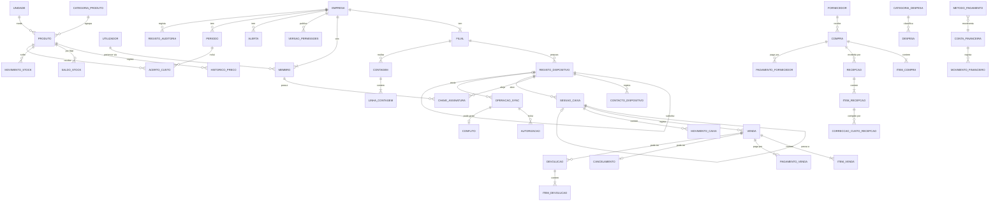

# Nexo — Especificação da Etapa 0 (MVP para lojas)

Versão 0.2 · 30 de Setembro de 2026 · Estado: **rascunho para validação — Etapa 0 não concluída**

Documentos de referência: `Documentos/NEXO_Plano_Plataforma_Gestao_Comercial_Financeira.docx`, `Documentos/Nexo_Etapas_de_Desenvolvimento.docx`, `Documentos/Nexo_Estrutura_Web_Mobile_API.docx`. Versão anterior: `docs/versoes/Nexo_Especificacao_Etapa_0_v0.1.md`.

---

## Estado da Etapa 0

A Etapa 0 **não está concluída**. O roteiro exige "um documento de requisitos sem decisões críticas em aberto para a primeira loja", e continuam abertas as decisões críticas 🔴 da secção H. A lista está em **H.1**, e algumas só se fecham com a entrevista à loja piloto:

- janela offline de 72 horas (H-03);
- vendas a crédito (H-07);
- gaveta partilhada / modo de caixa (H-13);
- conversão de embalagens (H-10, não crítica, mas também depende da loja).

## Alterações da versão 0.2

| # | Tema | O que mudou | Onde |
|---|---|---|---|
| 1 | Credencial do dispositivo | Passa a servir **apenas** para transportar operações assinadas e receber avisos de segurança. Não dá acesso a dados da empresa. A autoria prova-se com uma **chave de assinatura por utilizador e dispositivo**, desbloqueada pelo PIN. O servidor processa cada operação com a identidade do autor verificado e com as políticas de isolamento activas. | C.1.1, C.1.3, C.8, D.12, F |
| 2 | Revogação e relógio | Operações de um dispositivo revogado recebidas depois da revogação **nunca** são aplicadas automaticamente, qualquer que seja a hora que declarem. Ficam preservadas para revisão. Distinguem-se quatro datas: hora declarada, hora de recepção, data de referência e data contabilística. | D.10, D.11.6, D.13 |
| 3 | Custo das vendas | Três níveis: custo local estimado (dispositivo, nunca enviado), custo provisório (servidor) e CMV definitivo (período fechado). Custeio pela ordem de aplicação no servidor, acertos de custo explícitos para stock negativo e correcções, períodos mensais fechados. | D.3, C.9 |
| 4 | Devoluções e perdas | Corrigida a **dupla contagem** das devoluções avariadas. Toda a devolução estorna o CMV, e a avariada gera uma perda explícita. Exemplos completos. | D.6 |
| 5 | Contagens físicas | Hora de corte por linha, barreira de sincronização antes da aprovação e reconciliação automática de movimentos que chegam atrasados. | C.6.2, D.7 |
| 6 | Numeração | Cada preparação cria um **novo registo de dispositivo com código nunca reutilizado**. O servidor verifica unicidade e detecta clonagem. | D.5 |
| 7 | Caixa e utilizadores | Distinção entre responsável da sessão, autor (vendedor) e autorizador. Passagem de turno com dupla confirmação. Modo "caixa pessoal" proposto; gaveta partilhada em aberto. | C.7, D.8 |
| 8 | PIN e permissões offline | Distinção entre autenticação online e desbloqueio local. Versões de permissões. Regras para permissões retiradas durante a desconexão. | D.13 |
| — | Critérios de aceitação | Actualizados e reorganizados (G.1–G.10), com a nova secção **G.11 Cenários de falha**. | G |
| — | Estrutura | A secção D foi renumerada. Na 0.1, as regras de vendas, identificadores, devoluções, caixa, relatórios, offline, comprovativo e isolamento eram D.3–D.10; agora são D.4, D.5, D.6, D.8, D.9, D.11, D.14 e D.15. | D |

---

## Como ler este documento

| Etiqueta | Significado |
|---|---|
| **[D]** Definido | Consta do pedido da Etapa 0 (incluindo as correcções pedidas para a 0.2) ou dos documentos de visão. Só muda com decisão do proprietário do projecto. |
| **[S]** Sugestão | Proposta desta especificação. Precisa de validação (entrevista à loja piloto, decisão do proprietário do projecto ou protótipo técnico) antes de ser implementada. |

Convenções:

- **[S]** Moeda: metical (MZN). Os valores monetários guardam-se em **centavos inteiros** (1 624,50 MZN = 162 450 centavos). O custo médio guarda-se com precisão superior ao centavo (4 casas decimais) e os valores resultantes arredondam-se ao centavo.
- **[S]** Fuso horário: `Africa/Maputo` (UTC+2, sem hora de Verão).
- **[S]** Quantidades com até 3 casas decimais, só em unidades fraccionáveis.
- **Termos:**
  - **Dispositivo** (ou registo de dispositivo): uma preparação de um navegador para uma filial. Cada preparação é um registo novo.
  - **Sessão de caixa:** o período entre a abertura e o fecho da gaveta de um dispositivo.
  - **Operação:** um registo criado no dispositivo e enviado ao servidor.
  - **Autor:** o utilizador que criou uma operação.
  - **Autorizador:** quem introduziu o PIN para permitir uma excepção.
  - **Responsável da sessão:** quem responde pelo dinheiro da gaveta.

---

## A. Resumo do produto e limites do MVP

### A.1 Produto

O Nexo é uma plataforma multiempresa de gestão comercial, financeira e de stock para pequenos estabelecimentos em Moçambique. **[D]** A primeira versão é uma aplicação web (React + TypeScript, PWA) para **lojas**, com uma API (Node.js + Express) e uma base central PostgreSQL no Supabase. A futura app mobile (React Native + Expo) usará a mesma API e a mesma base. Bares e farmácias entram depois de validado o núcleo comum.

O problema que o MVP resolve: o dono de uma pequena loja precisa de saber, ao fim de cada dia, **quanto vendeu, quanto ganhou, quanto dinheiro deveria ter na gaveta e que produtos estão a acabar**, mesmo quando a internet falha durante o dia.

### A.2 Utilizadores do piloto

| Perfil | Situação típica |
|---|---|
| Proprietário | Dono da loja. Pode não estar presente todos os dias e consulta resultados, muitas vezes pelo telemóvel. |
| Gestor | Encarregado da loja. Faz compras e contagens, autoriza excepções e revê o fecho do dia. Numa loja muito pequena pode ser o próprio proprietário. |
| Operador | Atende ao balcão, vende, recebe pagamentos e responde pela sua sessão de caixa. |

### A.3 Âmbito do MVP

| Módulo | Incluído no MVP | Origem |
|---|---|---|
| Empresas e utilizadores | Registo do proprietário, criação da empresa, convites, funções proprietário/gestor/operador, **uma filial** (modelo preparado para várias), registo de dispositivos | [D] ([S] dispositivos) |
| Produtos e stock | Produtos, categorias, unidades, preço de venda, stock mínimo, entradas, saídas, ajustes, contagem física, histórico com data/motivo/responsável | [D] |
| Compras | Fornecedores, compras, recepção de mercadoria (aumenta o stock uma única vez), pagamentos a fornecedores | [D] |
| Vendas | Carrinho, descontos autorizados, pagamentos (vários métodos, registo manual), histórico, devoluções e cancelamentos que preservam o original | [D] |
| Caixa e despesas | Abertura, reforço, retirada, fecho, comparação entre esperado e contado, despesas por categoria | [D] |
| Relatórios | Vendas, CMV, margens, despesas e resultado; lucro, fluxo de caixa e saldos separados; valores pendentes de sincronização | [D] |
| Offline | Catálogo local e vendas sem rede; fila idempotente; estados pendente/confirmado/conflito; divergências de stock resolvidas pelo gestor | [D] |

### A.4 Fora do MVP

| Fora do âmbito | Nota |
|---|---|
| Factura fiscal, certificação de software, comunicação com a Autoridade Tributária | **[D]** O documento emitido é um **comprovativo interno**. |
| Integração automática com M-Pesa, e-Mola, mKesh, POS ou bancos | **[D]** Os pagamentos registam-se manualmente. |
| Várias filiais em funcionamento, transferências entre filiais | **[D]** O modelo já tem filial. |
| App mobile nativa | **[D]** Etapa posterior. |
| Bares e farmácias | **[D]** |
| Vendas a crédito / contas de clientes | **[S]** Decisão em aberto, a validar com a loja (H-07). |
| Conversão de embalagens | **[S]** Decisão em aberto, a validar com a loja (H-10). |
| Clientes identificados, fidelização, promoções automáticas | **[S]** |
| Lotes, validades, números de série, variantes | **[S]** |
| Devolução ao fornecedor como documento próprio | **[S]** No MVP faz-se com ajuste de stock com motivo específico. |
| Discriminação de IVA | **[S]** H-05. |
| Leitura de código de barras pela câmara | **[S]** Os leitores USB são suportados. |
| Anexos (fotos de facturas, recibos) | **[S]** |
| Reabertura de períodos fechados | **[S]** H-22. |

### A.5 Princípios do MVP

1. **[D]** Nenhum registo financeiro ou de stock é apagado. As correcções são registos novos que referenciam o original.
2. **[D]** O servidor é a fonte de verdade e revalida tudo o que recebe, incluindo operações feitas offline.
3. **[D]** Os dados estão isolados por empresa, com autorização na API **e** políticas na base de dados. **Nenhuma credencial, incluindo a do dispositivo, contorna estas políticas.**
4. **[D]** O custo das vendas é calculado **só no servidor**. O custo que o dispositivo conhece é uma estimativa local.
5. **[D]** A hora declarada pelo dispositivo nunca decide sozinha a aceitação de uma operação.
6. **[S]** O stock é a soma dos movimentos, e o saldo guardado é uma cache que se pode recalcular.
7. **[S]** Uma venda física feita offline nunca é rejeitada por falta de stock: regista-se e sinaliza-se a diferença.
8. **[S]** Em caso de dúvida, o sistema preserva o registo e pede decisão humana em vez de o descartar ou aplicar às cegas.

---

## B. Matriz de permissões por função

Legenda:

- ✅ permitido
- 🔑 permitido com autorização no momento: PIN de quem tem a permissão **e já fez autenticação online neste dispositivo** (D.13)
- ⚙️ permitido até um limite configurável
- ❌ não permitido
- 📴 funciona offline

As funções são **[D]**. A distribuição das permissões é **[S]** e deve ser confirmada na entrevista.

### B.1 Empresa, utilizadores, dispositivos e períodos

| Acção | Proprietário | Gestor | Operador | Offline |
|---|---|---|---|---|
| Editar dados da empresa e da filial | ✅ | ❌ | ❌ | ❌ |
| Convidar/desactivar gestores | ✅ | ❌ | ❌ | ❌ |
| Convidar/desactivar operadores | ✅ | ✅ | ❌ | ❌ |
| Alterar função de um utilizador; transferir propriedade | ✅ | ❌ | ❌ | ❌ |
| Preparar um dispositivo | ✅ | ✅ | ❌ | ❌ |
| Revogar um dispositivo; decidir operações em quarentena | ✅ | ✅ | ❌ | ❌ |
| Definir limites de desconto, política de stock e modo de caixa | ✅ | ❌ | ❌ | ❌ |
| Configurar métodos de pagamento e contas financeiras | ✅ | ❌ | ❌ | ❌ |
| **Fechar período** (congela custos e relatórios do mês) | ✅ | ❌ | ❌ | ❌ |
| Consultar registo de auditoria | ✅ | ✅ (só operacional) | ❌ | ❌ |
| Alterar o próprio PIN e palavra-passe | ✅ | ✅ | ✅ | ❌ |

### B.2 Produtos e stock

| Acção | Proprietário | Gestor | Operador | Offline |
|---|---|---|---|---|
| Consultar catálogo, preços e stock | ✅ | ✅ | ✅ | 📴 |
| Ver custo e margem | ✅ | ✅ | ❌ | 📴 só a **estimativa local** (D.3.1) |
| Criar/editar produtos, categorias, unidades, preços | ✅ | ✅ | ❌ | ❌ |
| Desactivar produto | ✅ | ✅ | ❌ | ❌ |
| Entrada/saída avulsa, ajuste de stock | ✅ | ✅ | ❌ | ❌ |
| Criar contagem física | ✅ | ✅ | ❌ | ❌ |
| Introduzir quantidades numa contagem | ✅ | ✅ | ✅ | ❌ |
| Aprovar contagem | ✅ | ✅ | ❌ | ❌ |
| Aprovar contagem sem barreira de sincronização (D.7.5) | ✅ | ✅ | ❌ | ❌ |
| Resolver divergências de stock | ✅ | ✅ | ❌ | ❌ |

### B.3 Compras

| Acção | Proprietário | Gestor | Operador | Offline |
|---|---|---|---|---|
| Gerir fornecedores; criar/editar compra | ✅ | ✅ | ❌ | ❌ |
| Registar quantidades recebidas | ✅ | ✅ | ✅ | ❌ |
| Confirmar recepção | ✅ | ✅ | ❌ | ❌ |
| Corrigir custo de recepção confirmada (D.3.7) | ✅ | ✅ | ❌ | ❌ |
| Registar pagamento a fornecedor | ✅ | ✅ | ❌ | ❌ |
| Cancelar compra sem recepções confirmadas | ✅ | ✅ | ❌ | ❌ |

### B.4 Vendas

| Acção | Proprietário | Gestor | Operador | Offline |
|---|---|---|---|---|
| Registar venda na sessão de que é responsável | ✅ | ✅ | ✅ | 📴 |
| Registar venda na sessão de outro responsável (D.8.3) | ✅ | ✅ | ❌ (modo pessoal) | 📴 |
| Desconto dentro do limite | ⚙️ (sem limite) | ⚙️ (20%) | ⚙️ (0%) | 📴 |
| Desconto acima do limite | ✅ | 🔑 proprietário | 🔑 | 📴 |
| Vender com stock insuficiente | ✅ | ✅ | 🔑 (conforme política) | 📴 |
| Consultar histórico de vendas | ✅ | ✅ | Só as suas, do dia | 📴 (local) |
| Reimprimir comprovativo | ✅ | ✅ | ✅ (sessão actual) | 📴 |
| Cancelar venda (mesma sessão aberta) | ✅ | ✅ | 🔑 | 📴 |
| Registar devolução | ✅ | ✅ | 🔑 | ❌ |

### B.5 Caixa e despesas

| Acção | Proprietário | Gestor | Operador | Offline |
|---|---|---|---|---|
| Abrir sessão de caixa (fica responsável) | ✅ | ✅ | ✅ | 📴 |
| Passagem de turno (D.8.4) | ✅ | ✅ | ✅ (com PIN de quem entra) | 📴 |
| Transferir responsabilidade de sessão com responsável ausente | ✅ | ✅ | ❌ | 📴 |
| Reforço e retirada | ✅ | ✅ | 🔑 | 📴 |
| Fechar a sessão de que é responsável (contagem cega) | ✅ | ✅ | ✅ | 📴 |
| Ver valor esperado antes de contar | ✅ | ✅ | ❌ | 📴 |
| Rever fecho; forçar fecho de sessão de outro dispositivo | ✅ | ✅ | ❌ | ❌ |
| Despesa paga pelo caixa | ✅ | ✅ | 🔑 | 📴 |
| Despesa paga por outra conta; categorias de despesa | ✅ | ✅ | ❌ | ❌ |

### B.6 Relatórios e sincronização

| Acção | Proprietário | Gestor | Operador | Offline |
|---|---|---|---|---|
| Relatórios financeiros (lucro, margens, fluxo, saldos) | ✅ | ✅ | ❌ | ❌ |
| Resumo de vendas do dia (sem custos) | ✅ | ✅ | ✅ (só as suas) | 📴 |
| Estado de sincronização do próprio dispositivo | ✅ | ✅ | ✅ | 📴 |
| Pendentes, conflitos e quarentena de todos os dispositivos | ✅ | ✅ | ❌ | ❌ |
| Resolver conflitos e revisões obrigatórias | ✅ | ✅ | ❌ | ❌ |
| Exportar dados (CSV) | ✅ | ✅ | ❌ | ❌ |

**Regras transversais**

- **[D]** Todas as permissões são verificadas **na API**. As políticas da base de dados impedem o acesso a dados de outra empresa mesmo que a API tenha um erro.
- **[D]** A credencial do dispositivo **não tem função nem permissões próprias** (D.12). Uma operação só é aceite se o seu autor, verificado pela assinatura, tiver a permissão.
- **[S]** Uma autorização 🔑 regista quem pediu, quem autorizou, o motivo e o valor, e é **assinada pelo autorizador** (D.12.4).
- **[S]** No MVP, um utilizador tem uma única função por empresa e um dispositivo pertence a uma única empresa.

---

## C. Fluxos

📴 = o passo funciona sem rede.

### C.1 Cadastro do proprietário e da empresa

**Pré-condição:** internet **[D]**.

1. O proprietário regista-se com nome, e-mail (ou telefone, H-02) e palavra-passe, e confirma a conta.
2. **Assistente de configuração**, que se pode retomar mais tarde:
   1. **Empresa:** nome comercial, NUIT (opcional), telefone, endereço; tipo = *Loja*.
   2. **Filial:** "Filial principal", com código curto `F01`.
   3. **Métodos de pagamento e contas:** numerário (obrigatório), M-Pesa, e-Mola, mKesh, cartão/POS, transferência. Cada método liga-se a uma conta financeira (D.8.9).
   4. **Categorias e unidades** pré-definidas e editáveis.
   5. **Regras:** limites de desconto, política de stock insuficiente, modo de caixa (H-13).
   6. **Produtos:** criar ou importar por CSV (H-12). Este passo é opcional.
   7. **PIN pessoal** (D.13.5).
3. *"Este aparelho vai ser usado para vender?"* Se sim, segue-se **C.1.1**.

**C.1.1 Preparar dispositivo** (internet obrigatória) **[D]**

1. Um proprietário ou gestor autenticado online dá um nome ao dispositivo (ex.: "Balcão 1").
2. O servidor cria um **novo registo de dispositivo** com um código **nunca antes usado na filial** (ex.: `C01`; se este navegador for preparado de novo, receberá `C02`, `C03`…) (D.5.3).
3. O servidor emite a **credencial do dispositivo**, que só serve para transporte (D.12.2). O dispositivo guarda o segredo e o servidor guarda apenas o seu resumo criptográfico.
4. A aplicação descarrega, **com a sessão do utilizador que está a preparar**, os dados de balcão: catálogo, preços, stock, custo de referência (H-28), métodos de pagamento, regras e a versão actual das permissões.
5. Segue **C.1.3** para o utilizador que está a preparar.
6. A aplicação pede armazenamento persistente ao navegador **[S]** e mostra "Dispositivo `C01` pronto".

**C.1.2 Convidar utilizador**

1. O proprietário ou gestor indica nome, contacto e função (respeitando B.1).
2. O convidado aceita, cria a palavra-passe e define o PIN.

**C.1.3 Primeira entrada de um utilizador num dispositivo** (internet obrigatória) **[S]**

1. O utilizador faz **autenticação online** (palavra-passe) no dispositivo já preparado.
2. O servidor confirma que é membro activo da empresa do dispositivo e que a sua filial é a do dispositivo.
3. O dispositivo gera uma **chave de assinatura** para o par utilizador+dispositivo. A parte privada não é exportável; a parte pública é registada no servidor (D.12.4).
4. O dispositivo recebe o verificador do PIN desse utilizador (D.13.5) e a versão actual das permissões.
5. A partir daqui o utilizador pode desbloquear este dispositivo com o PIN, mesmo offline, até que um dos eventos de D.13.2 exija nova autenticação online.

### C.2 Compra e recepção de mercadoria

1. O gestor cria a compra (fornecedor, data, n.º do documento do fornecedor, linhas com produto, quantidade e custo). Estado: **Rascunho**. Opcionalmente passa a **Encomendada**.
2. **Recepção:** regista as quantidades realmente recebidas (a recepção pode ser parcial) e confirma ou corrige o custo de cada linha.
3. O gestor carrega em **Confirmar recepção**. O pedido leva um identificador de operação (D.5.4).
4. Numa **única transacção** o servidor:
   - marca a recepção como **Confirmada** (imutável);
   - cria um movimento de entrada por linha;
   - actualiza o custo médio, com acertos se houver stock negativo (D.3.5);
   - actualiza o estado da compra.
5. Uma repetição do pedido devolve o mesmo resultado **sem novos movimentos**.
6. **Pagamentos** a qualquer momento: *Por pagar*, *Parcialmente paga* ou *Paga*. Um pagamento feito pelo caixa gera uma saída da sessão aberta.
7. **Correcções depois de confirmar:**
   - de **custo**: registo "correcção de custo de recepção" (D.3.7);
   - de **quantidade**: ajuste de stock com motivo "Correcção de recepção", valorizado ao custo dessa recepção (D.3.8).
   - A recepção original nunca muda; passa a mostrar as correcções associadas.
8. **Cancelamento** só sem recepções confirmadas. Com recepções, a compra pode ser **fechada** com o saldo marcado "não entregue".

### C.3 Venda (online ou 📴 offline)

**Pré-condições:** dispositivo activo; utilizador desbloqueado (D.13); sessão de caixa aberta no dispositivo em que o utilizador pode vender (D.8.3).

1. 📴 Procurar produtos (nome, código, código de barras) e adicioná-los ao carrinho com o preço do catálogo local.
2. 📴 Ajustar quantidades. Se ultrapassarem o stock local, aplica-se a política de D.4.2.
3. 📴 Desconto opcional. Acima do limite, pede-se o PIN do autorizador e o motivo.
4. 📴 Pagamento com um ou mais métodos. No numerário calcula-se o troco.
5. 📴 **Concluir:** numa única transacção local grava-se a venda, os itens, os pagamentos, as autorizações e a entrada na fila. A operação é **assinada pelo autor**, e cada autorização pelo respectivo autorizador. Só depois aparece "Venda concluída".
6. 📴 Comprovativo com o número local (D.5.3) e a **hora declarada**.
7. 📴 O stock local, o valor esperado do caixa e a margem estimada (só visível a P/G) são actualizados.
8. Estado **Pendente** → **Confirmado** quando o servidor responde (C.8). O custo da venda é o que o servidor atribuir (D.3).

**Venda suspensa [S]:** o carrinho fica em espera só no dispositivo. Não é enviado nem mexe no stock, e é descartado no fecho da sessão, com aviso.

### C.4 Devolução (online) **[S]**

1. O utilizador encontra a venda original (**Confirmada**, dentro do prazo) e escolhe as linhas e quantidades. Cada quantidade fica limitada ao vendido menos o já devolvido.
2. Para cada linha indica o destino: **Revendável** ou **Avariado**.
3. Indica o motivo. O reembolso é o valor líquido por unidade × quantidade (D.4.5).
4. Método de reembolso: por defeito o original. O numerário sai da sessão aberta.
5. O gestor autoriza, ou introduz o PIN se for um operador a registar.
6. O servidor grava a **Devolução**, com número próprio, e os seus efeitos (D.6.3). A venda original **não é alterada** e passa a mostrar "Devolvida parcialmente/totalmente".
7. Emite-se um comprovativo de devolução.

### C.5 Cancelamento de venda (📴)

1. Só na **sessão de caixa aberta em que a venda foi feita** e no mesmo dispositivo.
2. Motivo obrigatório. É preciso o PIN do gestor se quem cancela for operador.
3. A venda fica **Cancelada** (visível, com motivo, autor e autorizador). Geram-se estornos de stock e de caixa.
4. Se a venda ainda estava pendente, seguem as duas operações, pela ordem certa.

### C.6 Ajuste de stock e contagem física

**C.6.1 Ajuste individual** (online, gestor)

1. O gestor indica a nova quantidade ou a variação, e um motivo obrigatório: *Quebra/avaria*, *Furto/perda*, *Consumo interno*, *Oferta*, *Validade expirada*, *Correcção de recepção*, *Correcção de erro de registo*, *Stock inicial*, *Outro* (com texto).
2. O sistema mostra o impacto em quantidade e em valor ao custo médio actual e pede confirmação.
3. Gera um movimento de ajuste com quantidade anterior e posterior.

**C.6.2 Contagem física** (online) **[S]**

1. O gestor cria a contagem, total ou parcial (categoria ou lista), e escolhe o modo:
   - **Loja fechada (recomendado):** há uma única **hora de corte**, a hora de início da contagem. Não deve haver vendas durante a contagem.
   - **Loja aberta:** cada linha tem a sua hora de corte, que é a hora em que o servidor recebe a quantidade contada.
2. Os utilizadores introduzem as quantidades contadas **no momento em que contam**. Cada linha guarda quem contou e a hora de corte.
3. Durante a contagem, as vendas e outros movimentos continuam a ser registados normalmente.
4. Ao abrir a revisão, para cada linha o sistema calcula o **stock teórico no corte** e a diferença (D.7.3).
5. **Barreira de sincronização:** a aprovação só está disponível quando todos os dispositivos activos da filial tiverem sincronizado **depois** da última hora de corte (D.7.5). Caso contrário, mostra "À espera de: Balcão 2 (última sincronização 09:00)".
6. O gestor revê as diferenças, pede recontagens (que substituem a linha e mantêm o histórico) e **aprova**. Por cada linha com diferença gera-se um ajuste "Contagem física".
7. Um movimento que chegue **depois** da aprovação e pertença a um momento **anterior** ao corte gera uma **reconciliação de contagem** automática e um alerta (D.7.6).
8. **Cancelar** uma contagem em curso não gera movimentos.

### C.7 Sessão de caixa (📴)

1. **Abertura:** um utilizador abre a sessão do dispositivo e passa a ser o **responsável**. Indica o fundo contado; se for diferente do deixado no último fecho, deixa uma nota. Só pode haver uma sessão aberta por dispositivo.
2. **Durante a sessão:** vendas, cancelamentos, reembolsos em numerário, reforços, retiradas (com destino), despesas pagas pelo caixa. Cada operação regista a sessão, o **autor** e, se houver, o **autorizador** (D.8.2).
3. **Troca de utilizador sem mudar de responsável:** o ecrã bloqueia e outro utilizador desbloqueia com PIN. Pode vender se as regras de D.8.3 o permitirem. A sessão e o responsável não mudam.
4. **Passagem de turno** (D.8.4):
   1. o responsável que sai conta o numerário em contagem cega;
   2. o sistema fecha a sessão com diferença e justificação;
   3. o utilizador que entra confirma o valor com o seu PIN e abre nova sessão com esse fundo.
5. **Fecho do dia:**
   1. contagem cega do numerário e, opcionalmente, totais dos outros métodos;
   2. cálculo do esperado (D.8.6) e da diferença;
   3. justificação obrigatória se houver diferença;
   4. resumo imprimível. Se houver operações pendentes, o resumo mostra "Valores provisórios: N operações por sincronizar".
6. **Revisão (online):** o gestor marca o fecho como **Revisto**. Um fecho com operações em conflito dessa sessão só pode ser revisto depois de resolvidas.
7. **Fecho forçado (online):** se o dispositivo se perder ou avariar com a sessão aberta. As operações dessa sessão recebidas depois entram em **conflito** (D.11.6).

### C.8 Sincronização

**C.8.1 Envio (dispositivo → servidor)**

1. Sempre que há rede, periodicamente e ao abrir a aplicação, o dispositivo envia a fila **por ordem de sequência**, em lotes, autenticado **só com a credencial do dispositivo**.
2. Cada operação leva:
   - identificador único e tipo;
   - registo do dispositivo e sequência;
   - autor e autorizadores, com as respectivas assinaturas;
   - hora declarada e desvio do relógio conhecido (D.10.2);
   - versão das permissões usada (D.13.3);
   - versão do formato e conteúdo.
3. O servidor verifica cada operação pela ordem de D.12.5 e responde por operação:

| Resposta | Significado | No dispositivo |
|---|---|---|
| `aplicada` | Gravada agora | **Confirmado** |
| `já_aplicada` | Reenvio de algo já gravado | **Confirmado** |
| `aplicada_com_alerta` | Gravada, com divergência ou revisão obrigatória (stock negativo, hora ajustada, permissões desactualizadas) | **Confirmado** + aviso |
| `conflito` | Recebida e **guardada**, não aplicada; aguarda decisão | **Conflito** |
| erro temporário | Nada gravado | **Pendente**; nova tentativa com espera crescente |
| credencial desconhecida | Não é possível associar a uma empresa; nada gravado | **Pendente**; aviso "Dispositivo não reconhecido"; a fila fica intacta e pode ser exportada (D.11.7) |

4. Uma operação que depende de outra pendente ou em conflito fica **em espera**.
5. No mesmo contacto o dispositivo envia o **estado**: sequência actual, número e valor de pendentes, versão da aplicação e versão de permissões em uso.

**C.8.2 Recepção (servidor → dispositivo)**

1. **Com a credencial do dispositivo** recebe apenas **avisos de segurança**, que só restringem: dispositivo revogado ou suspenso, utilizador desactivado, PIN alterado, nova versão de permissões disponível. Estes avisos aplicam-se de imediato.
2. **Com a sessão online de um utilizador** (renovada automaticamente quando há rede) recebe os dados de balcão: alterações de catálogo, preços, stock, custo de referência e a nova versão das permissões. Ao aplicar uma nova versão de permissões, o dispositivo **confirma a recepção** indicando a sua sequência actual (D.13.3).

**C.8.3 Resolução (gestor, online)**

1. **Sincronização › Conflitos e alertas** mostra, para todos os dispositivos da filial, os conflitos, a quarentena, as revisões obrigatórias e as divergências.
2. Para cada operação: o conteúdo completo, as quatro datas (D.10), as assinaturas verificadas, o motivo e as evidências (ex.: pendentes declarados antes de uma revogação).
3. Acções possíveis:
   - **Aceitar** (aplicar como está, com a data contabilística do período aberto);
   - **Aplicar com correcção** (ex.: associar a outra sessão), registando a correcção;
   - **Anular** com motivo. A operação fica "anulada pelo gestor" e **nunca é apagada**.
4. A decisão fica no registo de auditoria e chega ao dispositivo de origem.

### C.9 Fecho de período (online, proprietário) **[S]**

1. Em **Períodos**, o proprietário escolhe o mês a fechar.
2. O sistema mostra a lista de verificação:
   - conflitos e quarentena do período: 0;
   - contagens em curso: 0;
   - cada dispositivo activo sincronizou depois do fim do período (os que faltam aparecem pelo nome, com os pendentes declarados).
3. Se algum ponto falhar, o fecho exige aceitação explícita do risco, que fica registada.
4. Ao fechar: o CMV, as margens e o resultado do mês ficam **definitivos**; o período fica só de leitura.
5. Operações que cheguem depois e pertençam ao período fechado são lançadas no **primeiro período aberto** (D.10.5), com referência à data original. O relatório do período fechado mostra "N operações tardias lançadas em ‹mês›".

---

## D. Regras de negócio

### D.1 Empresa, filial e utilizadores

| # | Regra | Origem |
|---|---|---|
| D.1.1 | Os registos operacionais pertencem a uma empresa, e os que acontecem num local (stock, vendas, caixa, compras, despesas) também a uma filial. | [D] |
| D.1.2 | Uma filial por empresa no piloto. A interface não mostra o selector de filial. | [D] |
| D.1.3 | Há sempre pelo menos um proprietário activo. | [S] |
| D.1.4 | Os utilizadores são desactivados, nunca apagados. | [S] |
| D.1.5 | Desactivar um utilizador termina as suas sessões online e invalida o seu PIN em todos os dispositivos no **próximo contacto** de cada um (C.8.2). Operações feitas antes desse contacto tratam-se por D.13.6. | [S] |

### D.2 Produtos e stock

| # | Regra | Origem |
|---|---|---|
| D.2.1 | Campos obrigatórios do produto: nome, categoria, unidade, preço de venda, stock mínimo, estado. Código interno e código de barras são opcionais e únicos na empresa. | [D] campos / [S] unicidade |
| D.2.2 | O stock de um produto numa filial é a **soma dos seus movimentos**. Cada movimento tem tipo, quantidade, valor, motivo, autor, documento de origem e as datas de D.10. | [D] / [S] |
| D.2.3 | Tipos de movimento: entrada por compra; entrada avulsa; stock inicial; saída por venda; estorno de venda; entrada por devolução; **perda por devolução avariada**; saída avulsa; ajuste (+/−); ajuste por contagem; **reconciliação de contagem**; **correcção de recepção**. | [S] |
| D.2.4 | Alerta de stock baixo quando stock ≤ mínimo (mínimo 0 = sem alerta). | [D] |
| D.2.5 | Produto inactivo: não aparece no balcão e mantém histórico. Para desactivar com stock ≠ 0 é preciso confirmação explícita. | [S] |
| D.2.6 | Unidades não fraccionáveis só admitem quantidades inteiras. | [S] |
| D.2.7 | Alterações de preço de venda ficam em histórico. | [S] |

### D.3 Custo dos produtos e das vendas

#### D.3.1 Três níveis de custo **[D]** distinção / **[S]** regras

| Nível | Onde | Como se obtém | Para que serve |
|---|---|---|---|
| **Custo local estimado** | Dispositivo | Último custo médio recebido na sincronização (custo de referência). | Mostrar margem **estimada** a proprietário/gestor no dispositivo, marcada "estimativa". **Nunca é enviado.** O servidor **ignora** qualquer campo de custo numa operação. |
| **Custo provisório** | Servidor, por item de venda | Custo médio da filial **no momento em que o servidor aplica** a venda. | Relatórios de períodos abertos, marcados "provisório". |
| **CMV definitivo** | Servidor, por período | Σ custos provisórios das vendas do período + Σ **acertos de custo** lançados no período, congelado no **fecho do período** (C.9). | Relatórios de períodos fechados. |

O custo provisório gravado num item de venda **nunca é reescrito**. Tudo o que o altera depois é um **acerto de custo**: um registo próprio com produto, quantidade, custo usado, custo correcto, valor, causa, período e ligação aos movimentos envolvidos.

#### D.3.2 Regras de custeio **[S]** (H-04, H-21)

| # | Regra |
|---|---|
| D.3.2.1 | Método: **custo médio ponderado** por produto e filial. |
| D.3.2.2 | O custo médio evolui pela **ordem de aplicação no servidor**, não pela hora declarada pelos dispositivos. Não há reavaliação retroactiva de vendas já aplicadas. Cada movimento recebe um número de ordem de aplicação, o que permite recalcular o saldo e o custo de forma reproduzível. |
| D.3.2.3 | Entradas com custo (recepção, stock inicial, entrada avulsa com custo) com stock anterior > 0: novo custo médio = (valor anterior + valor da entrada) ÷ (quantidade anterior + quantidade da entrada). |
| D.3.2.4 | Saídas (venda, perda, ajuste negativo) saem ao custo médio actual e não o alteram. |
| D.3.2.5 | Ajustes positivos sem custo próprio entram ao custo médio actual. Uma devolução revendável entra ao custo do item de venda original (D.6.3). |
| D.3.2.6 | Um produto que nunca teve entrada com custo tem custo médio 0. As vendas desse produto ficam marcadas "**sem custo**" e aparecem em alerta até haver uma entrada, que gera o acerto (D.3.5). |

#### D.3.3 Porque a ordem de aplicação é aceitável

Com custo médio, a ordem em que chegam vendas e compras **muda a repartição** do valor entre o CMV e o stock, mas **não cria nem perde valor**. A regra é determinística, auditável e independente dos relógios dos dispositivos.

**Exemplo — compra aplicada antes de uma venda offline anterior**

> Stock de *Óleo 1 L*: 10 un a 50,00 (valor 500,00).
> 09:00 — O Balcão 1 (offline) vende 5 un. A margem estimada no dispositivo usa 50,00 (custo local estimado).
> 10:00 — O servidor aplica uma recepção de 10 un a 62,00: custo médio = (500 + 620) ÷ 20 = **56,00**.
> 11:00 — Chega a venda das 09:00. Custo provisório = 5 × 56,00 = **280,00**. Stock: 15 un × 56,00 = **840,00**.
> Conservação: entradas 500 + 620 = 1 120 = CMV 280 + stock 840. ✔
> Se a venda tivesse chegado antes da compra: CMV 250 e stock 870. O total é o mesmo (1 120); só muda a repartição (30,00).

#### D.3.4 Custo local não é autoridade

> O dispositivo mostrou margem estimada de (171,00 − 50,00) por unidade. O servidor atribuiu 56,00. O relatório mostra a margem com 56,00. O ecrã do dispositivo actualiza a estimativa na próxima sincronização e nunca alimenta relatórios financeiros.

#### D.3.5 Stock negativo e cobertura **[S]**

1. Uma saída que deixa o stock negativo sai ao custo médio actual (ou 0, "sem custo"). O saldo passa a ter quantidade e **valor negativos**.
2. Quando chega uma entrada com o stock negativo, esta **cobre primeiro** as unidades em falta ao custo da entrada. A diferença entre o valor ao custo da entrada e o valor negativo registado gera um **acerto de custo**, lançado no CMV do período **em que a entrada é aplicada**.
3. As unidades restantes ficam ao custo da entrada, que passa a ser o novo custo médio.

**Exemplo**

> Stock: 2 un a 50,00 (valor 100,00).
> Chegam vendas offline de 5 un: custo provisório 5 × 50,00 = **250,00**. Stock: −3 un, valor −150,00. Gera-se a divergência de stock (D.4.3).
> Recepção de 10 un a 60,00 (valor 600,00):
> — cobertura de 3 un a 60,00 = 180,00; valor registado 150,00 → **acerto de custo +30,00** no CMV;
> — stock: 7 un a **60,00** = 420,00.
> Conservação: entradas 100 + 600 = 700 = CMV (250 + 30) + stock 420. ✔

#### D.3.6 Operações que chegam a um período fechado

Uma venda com data de referência num período fechado é lançada no primeiro período aberto (D.10.5). O seu custo provisório é o custo médio no momento da aplicação, como em qualquer venda. O período fechado não muda.

#### D.3.7 Correcção de custo de uma recepção confirmada **[S]**

1. Regista-se uma **correcção de custo de recepção**: linha, custo antigo, custo novo e motivo (ex.: "factura do fornecedor").
2. Diferença total = quantidade recebida × (custo novo − custo antigo).
3. Repartição:
   - unidades presumivelmente ainda em stock = mínimo(quantidade recebida, stock actual ≥ 0) → a sua parte **ajusta o valor do stock** (e o custo médio);
   - as restantes, presumivelmente já vendidas → a sua parte gera um **acerto de custo** no período aberto.
4. A recepção original não muda.

**Exemplo**

> Recepção de 20 un a 56,00 (1 120,00). A factura final indica 58,00. Diferença = 20 × 2,00 = **40,00**.
> Stock actual: 12 un a 55,00 (660,00).
> — 12 un em stock: +24,00 no valor do stock → 684,00 ÷ 12 = custo médio **57,00**;
> — 8 un já vendidas: **acerto de custo +16,00** no CMV do período aberto.

#### D.3.8 Correcção de quantidade de uma recepção

Faz-se por ajuste de stock com motivo "Correcção de recepção", valorizado ao **custo unitário dessa recepção**. O custo médio é recalculado.

### D.4 Vendas, descontos e stock insuficiente

| # | Regra | Origem |
|---|---|---|
| D.4.1 | A venda é uma operação lógica única (itens, pagamentos, autorizações, movimentos de stock e de caixa). Grava-se tudo ou nada, localmente e no servidor. | [D] |
| D.4.2 | Stock insuficiente, política por defeito "Avisar e pedir autorização": acima do stock local, o operador precisa de 🔑. Alternativas: "Só avisar", ou "Bloquear" (esta só online). | [S] (H-06) |
| D.4.3 | O servidor **nunca rejeita uma venda por falta de stock**: aplica-a e cria uma **divergência de stock**. | [D] / [S] |
| D.4.4 | Limites de desconto por função sobre o subtotal: operador 0%, gestor 20%, proprietário sem limite. Acima do limite é preciso 🔑 e motivo. | [D] / [S] valores |
| D.4.5 | O desconto sobre o total reparte-se pelas linhas na proporção do seu valor. O arredondamento vai para a linha maior. Assim se define o **valor líquido por unidade**. | [S] |
| D.4.6 | Preço final abaixo do custo estimado: aviso (sem bloqueio) a P/G. | [S] |
| D.4.7 | Soma dos pagamentos = total; só o numerário admite troco. | [S] |
| D.4.8 | Não há venda a crédito: a venda só se conclui paga. **Em aberto (H-07).** | [S] |
| D.4.9 | Preço alterado no servidor durante a desconexão: a venda aplica-se **com o preço cobrado** e fica marcada "preço diferente". | [S] |
| D.4.10 | Produto desactivado durante a desconexão: a venda aplica-se e gera alerta. | [S] |

**Exemplo — venda com desconto e dois métodos**

| Linha | Qtd | Preço | Valor | Desconto repartido (5%) | Líquido |
|---|---|---|---|---|---|
| Arroz 5 kg | 3 | 450,00 | 1 350,00 | 67,50 | 1 282,50 |
| Óleo 1 L | 2 | 180,00 | 360,00 | 18,00 | 342,00 |
| **Total** | | | **1 710,00** | **85,50** | **1 624,50** |

> A operadora Ana tem limite de 0%. O gestor Carlos introduz o PIN e o motivo "Cliente habitual". A autorização fica assinada por Carlos e a venda por Ana.
> Pagamento: M-Pesa 624,50 + numerário (entregue 1 500,00, recebido 1 000,00, troco 500,00).

**Exemplo — dois caixas offline vendem o último artigo**

> O stock é 1 un. O Balcão 1 e o Balcão 2, ambos offline, vendem 1 un cada. Os dois sincronizam: **ambas as vendas são aplicadas**, o stock fica −1 e abre-se uma divergência.
> O gestor conta 0 un, conclui que havia 1 un não registada e faz um ajuste de +1 ("Correcção de erro de registo"). O stock fica 0.
> O custo: ver D.3.5 (a próxima entrada cobre a unidade em falta).

### D.5 Identificadores, idempotência e numeração

| # | Regra | Origem |
|---|---|---|
| D.5.1 | Todo o registo criado num dispositivo recebe um **identificador universal único gerado no dispositivo**, e o servidor usa-o. | [D] |
| D.5.2 | Idempotência: cada identificador de operação é aceite **uma vez por empresa**. Mesmo identificador e mesmo conteúdo → `já_aplicada`. Mesmo identificador e conteúdo diferente → `conflito`. | [D] / [S] |
| D.5.3 | **Número do comprovativo:** `{filial}-{registo do dispositivo}-{ano}-{sequência}` (ex.: `F01-C02-2026-000153`). **Cada preparação cria um registo novo com código nunca reutilizado na filial**, mesmo que seja o mesmo navegador ou computador. A sequência recomeça em 1 em cada registo novo e em cada ano. Como o código nunca se repete, limpar os dados ou preparar de novo **não pode reproduzir** um número anterior. | [D] / [S] |
| D.5.4 | Confirmação de recepção, aprovação de contagem, fecho de caixa e fecho de período levam identificador de operação, para que um duplo clique não repita o efeito. | [D] (recepção) / [S] |
| D.5.5 | O servidor garante que são únicos: (empresa, número de comprovativo), (registo, sequência de operação) e (empresa, identificador de operação). | [S] |
| D.5.6 | **Detecção de clonagem ou restauro:** se o servidor recebe, do mesmo registo, uma sequência ou número de comprovativo já usado com outro identificador, **ambas** as operações ficam preservadas. A nova entra em conflito ("numeração duplicada"), o registo passa a **Suspenso** e as operações seguintes ficam em quarentena até decisão do gestor. | [S] |
| D.5.7 | **Lacunas:** quando um registo é substituído (nova preparação) ou revogado, o servidor compara a última sequência recebida com os pendentes declarados no último contacto e mostra "possível perda de N operações (valor V)". | [S] |

**Exemplo — dados do navegador limpos**

> O Balcão 1 (`C01`) emitiu até `F01-C01-2026-000153`. O servidor recebeu até 000150, e no último contacto o dispositivo declarou 3 pendentes (valor 2 340,00). Alguém limpa os dados do navegador.
> A aplicação já não tem credencial e obriga a nova preparação, que cria o registo `C04`. A primeira venda é `F01-C04-2026-000001`, sem colisão possível.
> Em Dispositivos: `C01` fica "Substituído por `C04`", com o aviso "Possível perda: 3 operações, 2 340,00 MZN (000151–000153)".

### D.6 Devoluções, cancelamentos e perdas

#### D.6.1 Regras gerais

| # | Regra | Origem |
|---|---|---|
| D.6.1.1 | A devolução e o cancelamento não alteram nem apagam a venda original. | [D] |
| D.6.1.2 | Cancelamento: venda inteira, só na sessão aberta em que foi feita e no mesmo dispositivo. Estorna receita, CMV, stock e pagamentos. | [S] |
| D.6.1.3 | Devolução: pode ser parcial. O acumulado por linha nunca excede o vendido. Prazo por defeito de 7 dias (H-14). | [S] |
| D.6.1.4 | Reembolso = valor líquido por unidade × quantidade. | [S] |
| D.6.1.5 | Uma venda cancelada não se devolve; uma venda com devoluções não se cancela. | [S] |
| D.6.1.6 | Troca = devolução + nova venda. | [S] |
| D.6.1.7 | Os efeitos contam na **data da devolução**, não na data da venda. | [S] |

#### D.6.2 Correcção em relação à 0.1 **[D]**

Na versão 0.1, a devolução avariada mantinha o custo da unidade no CMV **e** somava-o às perdas, o que contava o mesmo custo duas vezes. A regra passa a ser:

1. **Toda a devolução estorna o CMV** das unidades devolvidas, ao **custo gravado no item de venda** pelo servidor, qualquer que seja o destino.
2. **Revendável:** a unidade entra no stock ao mesmo custo.
3. **Avariada:** a unidade entra (entrada por devolução) e sai logo (perda por devolução avariada) ao mesmo custo. O stock fica igual e o custo aparece **uma única vez**, como **perda**.

#### D.6.3 Exemplos numéricos

Venda de 3/Out: 2 × *Óleo 1 L* a 180,00, desconto total 5% → líquido **171,00/un**. Custo provisório atribuído pelo servidor: **54,00/un**.
No dia da venda: vendas líquidas 342,00; CMV 108,00; margem 234,00; caixa +342,00; stock −2.

A 6/Out o cliente devolve 1 un e recebe o reembolso em numerário. Antes da devolução o stock do produto é 10 un a 56,00 (560,00).

| Efeito a 6/Out | A) Revendável | B) Avariada | Erro da 0.1 (avariada) |
|---|---|---|---|
| Vendas líquidas | −171,00 | −171,00 | −171,00 |
| CMV | −54,00 | −54,00 | 0,00 |
| Margem bruta | −117,00 | −117,00 | −171,00 |
| Perdas de stock | 0,00 | +54,00 | +54,00 |
| **Resultado** | **−117,00** | **−171,00** | **−225,00** ✘ |
| Movimentos de stock | +1 entrada por devolução | +1 entrada por devolução, −1 perda | — |
| Stock (quantidade) | 10 → 11 | 10 → 10 | — |
| Valor do stock | 560,00 → 614,00 (custo médio 55,82) | 560,00 → 560,00 | — |
| Caixa (numerário) | −171,00 | −171,00 | −171,00 |

**Verificação pelo ciclo completo:**

- **A) Revendável:** recebido 342 − reembolso 171 = 171 em caixa; saiu 1 un de custo 54 → lucro real **117**. Pelo sistema: 342 − 108 (3/Out) − 171 + 54 (6/Out) = **117**. ✔
- **B) Avariada:** caixa 171; saíram 2 un de custo 108 (uma ficou com o cliente, outra destruída) → lucro real **63**. Pelo sistema: 342 − 108 − 171 + 54 − 54 = **63**. ✔
- **Erro da 0.1:** 342 − 108 − 171 − 54 = 9, ou seja, 54 a menos do que o real.

### D.7 Contagem física

| # | Regra | Origem |
|---|---|---|
| D.7.1 | A contagem é introduzida online. Cada linha tem **hora de corte**: a hora de início da contagem (modo loja fechada) ou a hora de recepção da linha no servidor (modo loja aberta). | [S] |
| D.7.2 | Os movimentos nunca se bloqueiam nem se descartam por causa de uma contagem. | [D] (não perder movimentos) |
| D.7.3 | **Stock teórico no corte** = soma dos movimentos do produto com **data de referência ≤ corte** (D.10). Os movimentos criados no servidor (recepções, ajustes) têm data de referência igual à hora de recepção. As vendas offline têm a data de referência validada de D.10.4. Diferença = contado − teórico no corte. | [S] |
| D.7.4 | Movimentos depois do corte não entram na diferença, mas contam no stock final: stock após aprovação = contado + movimentos depois do corte. | [S] |
| D.7.5 | **Barreira de sincronização:** a aprovação exige que cada dispositivo activo da filial tenha enviado **todas** as operações até uma sequência que declarou num contacto **posterior ao corte**. Assim, todas as vendas anteriores ao corte já estão no servidor. Um gestor pode aprovar sem barreira; isso fica registado com a lista de dispositivos em falta. | [S] (H-24) |
| D.7.6 | **Reconciliação de contagem:** se, depois da aprovação, chegar um movimento com data de referência ≤ corte de uma linha aprovada, esse movimento já estava reflectido na quantidade contada. O servidor aplica-o, gera automaticamente um movimento de **reconciliação de quantidade oposta** e valor igual, e abre um alerta para o gestor. | [S] |
| D.7.7 | O ajuste da contagem sai ao custo médio no momento da aprovação. Na reconciliação, o valor é o do movimento que chegou atrasado, e o seu efeito compensa a perda ou ganho registado indevidamente. | [S] |
| D.7.8 | Linhas não contadas não são ajustadas. Uma recontagem substitui a quantidade e o corte da linha e mantém o histórico. | [S] |
| D.7.9 | Movimentos com hora ajustada (D.10.4) perto do corte (±15 min) ficam marcados na revisão como "posição incerta". | [S] |

**Exemplo — com barreira**

> *Arroz 5 kg*: stock 20 às 09:00. Modo loja aberta.
> 09:30 — O Balcão 2 (offline) vende 3 un.
> 10:00 — A Ana conta 17 un (corte 10:00). O teórico no servidor às 10:00 é 20, porque a venda ainda não chegou.
> 10:15 — O Balcão 1 (online) vende 1 un, depois do corte.
> 10:30 — O gestor tenta aprovar: bloqueado, "À espera de: Balcão 2 (última sincronização 09:00)".
> 11:00 — O Balcão 2 sincroniza. A venda tem referência 09:30 ≤ corte, por isso teórico no corte = 17 e diferença = **0**. **Nenhum ajuste.** Stock final = 17 − 1 = **16**. ✔

**Exemplo — aprovação sem barreira (cenário de falha)**

> Mesmo caso, mas o gestor aprova às 10:30 sem barreira (fica registado). Ajuste de −3 (perda 3 × custo). Stock: 20 − 1 − 3 = 16.
> 11:00 — Chega a venda das 09:30 (−3). Referência ≤ corte, linha já aprovada → **reconciliação +3** e alerta.
> Stock: 16 − 3 + 3 = **16**. ✔ A perda de 3 fica anulada pela reconciliação; o custo das 3 un aparece como CMV da venda.
> Sem esta regra, o stock teria ficado em 13 (erro de −3).

### D.8 Caixa, operadores, contas e despesas

#### D.8.1 Premissa física

Um dispositivo corresponde a uma gaveta e tem no máximo **uma sessão aberta**. Todo o numerário movimentado nesse dispositivo pertence a essa sessão, seja quem for que opere. **[S]**

#### D.8.2 Três papéis em cada operação **[S]**

| Papel | Quem é | Responde por |
|---|---|---|
| **Responsável da sessão** | Quem abriu a sessão ou a recebeu numa passagem de turno | Diferença entre o esperado e o contado no fecho |
| **Autor** | Utilizador desbloqueado no momento da operação, que a assina | A operação (vendas por vendedor, auditoria) |
| **Autorizador** | Quem introduziu o PIN para uma excepção, e a assina | A excepção autorizada |

O desbloqueio e o bloqueio do ecrã não mudam a sessão nem o responsável. Só mudam o autor das operações seguintes.

#### D.8.3 Quem pode vender numa sessão aberta **[S]** (H-13 em aberto)

| Modo | Regra |
|---|---|
| **Caixa pessoal** (proposta por defeito) | Vendem o **responsável** e qualquer **proprietário/gestor** (a venda fica marcada "vendida por X na sessão de Y"). Outro operador tem de fazer passagem de turno. |
| **Caixa partilhado** (alternativa em validação) | Na abertura, o responsável indica os operadores autorizados a vender na sessão. Todos vendem com o seu PIN; o responsável continua a ser só um. |

#### D.8.4 Passagem de turno e transferência **[S]**

1. **Passagem de turno:** o responsável que sai conta às cegas e fecha a sessão. O que entra confirma o valor contado com o seu PIN e abre nova sessão com esse fundo. As duas confirmações ficam assinadas. Funciona offline.
2. **Responsável ausente** (doença, saída imprevista): um gestor ou proprietário **transfere a responsabilidade**. Conta o numerário, fecha a sessão em nome do ausente (marcada "fechada por transferência") e abre nova. A diferença fica associada à sessão do ausente para revisão.
3. As operações feitas antes da passagem pertencem à sessão anterior; as feitas depois, à nova. A ordem decide-se pela **sequência do dispositivo**, não pela hora declarada.

**Exemplo**

> 08:00 — A Ana abre `C01` com 2 000,00 e é a responsável.
> 10:40 — A Ana bloqueia o ecrã; o gestor Carlos desbloqueia e vende 1 un. Autor: Carlos. Sessão: a da Ana. A venda fica marcada "vendida por Carlos".
> 13:00 — Chega o Bruno. Passagem de turno: a Ana conta 9 800,00 (esperado 9 800,00, diferença 0) e fecha. O Bruno confirma com PIN e abre com 9 800,00.
> 18:00 — O Bruno fecha e responde pela diferença da sua sessão. O relatório de vendas por vendedor mostra Ana, Carlos e Bruno separadamente.

#### D.8.5 Outras regras de caixa

| # | Regra | Origem |
|---|---|---|
| D.8.5.1 | Não há vendas sem sessão aberta no dispositivo. | [S] |
| D.8.5.2 | Uma diferença de fecho ≠ 0 exige justificação e nunca se corrige editando movimentos. | [D] / [S] |
| D.8.5.3 | Nos métodos sem numerário, o fecho mostra o total esperado por método. A conferência é opcional. | [S] |

#### D.8.6 Valor esperado em numerário **[D]** comparar / **[S]** fórmula

Esperado = fundo de abertura + vendas em numerário − estornos em numerário − reembolsos em numerário + reforços − retiradas − despesas pelo caixa − pagamentos a fornecedores pelo caixa.

| Movimento | Valor (MZN) |
|---|---|
| Fundo de abertura | 2 000,00 |
| Vendas em numerário | + 15 400,00 |
| Reforço | + 1 000,00 |
| Retirada para o cofre | − 5 000,00 |
| Despesa: transporte | − 300,00 |
| Reembolso de devolução | − 450,00 |
| **Esperado** | **12 650,00** |
| **Contado** | **12 500,00** |
| **Diferença** | **− 150,00 (falta)**, justificação "troco dado a mais" |

#### D.8.7 Despesas

| # | Regra | Origem |
|---|---|---|
| D.8.7.1 | Despesa: data, categoria, descrição, valor, conta, autor. Categorias por defeito: Renda, Energia e água, Salários, Transporte, Comunicações, Manutenção, Impostos e taxas, Outros. | [D] / [S] |
| D.8.7.2 | Não se edita. Corrige-se com anulação (com motivo, visível) e novo registo. | [S] |

#### D.8.8 Retiradas

Uma retirada indica o destino. Para outra conta é uma **transferência interna**; para o proprietário é um **levantamento**. Nenhuma das duas é despesa. **[S]**

#### D.8.9 Contas financeiras

Cada método de pagamento aponta para uma conta. Saldo = saldo inicial + entradas − saídas. **[S]** (H-09)

### D.9 Relatórios

| # | Regra | Origem |
|---|---|---|
| D.9.1 | Lucro, fluxo de caixa e saldos são relatórios separados, com as definições visíveis. | [D] |
| D.9.2 | **Vendas líquidas** = vendas brutas − descontos − devoluções. As canceladas não contam. | [S] |
| D.9.3 | **CMV** = Σ custos provisórios das vendas − custo das unidades devolvidas (todas, D.6.2) + acertos de custo. | [S] |
| D.9.4 | **Margem bruta** = vendas líquidas − CMV. | [D] |
| D.9.5 | **Resultado** = margem bruta − despesas − perdas de stock (ajustes negativos, perdas por devolução avariada, diferenças negativas de contagem) + ganhos de stock (ajustes positivos, diferenças positivas, reconciliações que anulam perdas). | [S] |
| D.9.6 | **Fluxo de caixa**: entradas − saídas de dinheiro por conta, pela data do pagamento. As transferências internas anulam-se. | [S] |
| D.9.7 | **Saldos**: contas financeiras, valor do stock, dívida a fornecedores. | [S] |
| D.9.8 | Os relatórios são calculados no servidor, **só com operações aplicadas**. Os relatórios financeiros usam a **data contabilística**; os operacionais (vendas por hora, por vendedor) usam a **data de referência** (D.10). | [D] / [S] |
| D.9.9 | Períodos abertos aparecem marcados "**provisório**" e fechados "**definitivo**". O relatório mostra os acertos de custo numa linha própria. | [S] |
| D.9.10 | **Pendentes:** cada relatório mostra, por dispositivo, a hora do último contacto e os pendentes declarados (número e valor), com o aviso "Podem existir vendas ainda não sincronizadas depois de HH:MM no Balcão 2". No dispositivo, os totais separam Confirmado e Pendente. | [D] / [S] |

**Exemplo — lucro ≠ fluxo de caixa**

> Outubro: vendas líquidas 100 000; CMV 70 000 → margem 30 000. Despesas 12 000; perdas 1 000 → **resultado 17 000**.
> Pagamentos a fornecedores 85 000; levantamento do proprietário 5 000 → **fluxo** = 100 000 − 85 000 − 12 000 − 5 000 = **−2 000**.
> Houve lucro e o dinheiro diminuiu, porque a diferença ficou em stock.

### D.10 Datas e relógio **[D]** distinção / **[S]** regras

#### D.10.1 As quatro datas de cada operação

| Data | Origem | Confiança | Usada para |
|---|---|---|---|
| **Hora declarada** | Relógio do dispositivo no momento da criação | Baixa: pode estar errada ou ser manipulada | Comprovativo; indício para a data de referência |
| **Hora de recepção** | Relógio do servidor quando recebe a operação pela primeira vez | Alta | Ordem de aplicação e custo (D.3.2.2), revogação (D.11.6), idempotência |
| **Data de referência** | Calculada pelo servidor (D.10.4) | Validada | "Quando aconteceu": relatórios operacionais, contagens (D.7.3), sessões |
| **Data contabilística** | Data de referência, ou 1.º dia do primeiro período aberto se o seu período estiver fechado (D.10.5) | Alta | Relatórios financeiros e CMV |

#### D.10.2 Desvio do relógio

Em cada contacto o servidor devolve a sua hora e o dispositivo calcula o **desvio** (a diferença entre o seu relógio e o do servidor). Cada operação leva a hora declarada e o desvio conhecido nesse momento. A **hora declarada corrigida** é a hora declarada menos o desvio. Um desvio superior a 15 min mostra um aviso permanente: "Acerte a hora deste aparelho". **[S]**

#### D.10.3 Limites que não dependem do relógio do dispositivo

Em cada contacto o servidor regista a hora do servidor e a **sequência** actual do dispositivo. Para uma operação com sequência *s*:

- **T_antes** = hora do último contacto em que a sequência declarada era menor do que *s* (a operação ainda não existia);
- **T_depois** = hora de recepção da operação.

A operação foi necessariamente criada entre **T_antes** e **T_depois**.

#### D.10.4 Cálculo da data de referência

1. Se T_antes − 5 min ≤ hora declarada corrigida ≤ T_depois + 5 min, e ela não for anterior à data de referência da operação de sequência anterior (menos 5 min): **data de referência = hora declarada corrigida**.
2. Caso contrário: data de referência = o limite mais próximo (T_antes ou T_depois); a operação é aplicada com alerta "**hora ajustada**" (`aplicada_com_alerta`) e o gestor pode revê-la **só dentro de [T_antes, T_depois]**.
3. A data de referência **nunca** decide aceitar operações depois de uma revogação (D.11.6) nem decide o custo (D.3.2.2).

**Exemplo**

> Último contacto do Balcão 2: sexta às 18:00, com sequência 410. Volta a ligar-se segunda às 08:00 e envia as operações 411–470.
> Uma venda declarada domingo às 10:00 fica dentro dos limites → referência = domingo 10:00.
> Uma venda declarada 01/01/2020 (a pilha do relógio falhou) fica fora dos limites → referência = sexta 18:00 (T_antes), com alerta "hora ajustada".

#### D.10.5 Período fechado

Se a data de referência cair num período fechado, a data contabilística passa a ser o 1.º dia do primeiro período aberto. A data de referência mantém-se para consulta.

### D.11 Funcionamento offline

#### D.11.1 O que funciona offline

| Funciona offline 📴 | Exige internet |
|---|---|
| Consultar catálogo, preços, stock local | Registo, autenticação online, preparação do dispositivo **[D]** |
| Venda, pagamentos, desconto e excepções com 🔑 | Produtos, preços, categorias |
| Cancelar venda da sessão aberta | Compras, recepções, pagamentos a fornecedores |
| Abrir/fechar caixa, passagem de turno, reforço, retirada | Ajustes e contagens |
| Despesa paga pelo caixa | Devoluções (H-08) |
| Desbloqueio por PIN de utilizadores já autenticados neste dispositivo | Gestão de utilizadores, PIN, dispositivos, regras |
| Histórico local (30 dias) e resumo do dia | Relatórios financeiros, conflitos, fecho de período |

#### D.11.2 Estados visíveis **[D]**

| Estado | Significado |
|---|---|
| **Pendente** | Gravada no dispositivo, sem resposta definitiva do servidor (inclui "a enviar" e "à espera de dependência"). |
| **Confirmado** | Aplicada pelo servidor. Pode ter aviso (alerta ou revisão obrigatória). |
| **Conflito** | Recebida e guardada pelo servidor, mas não aplicada. Inclui a **quarentena** de dispositivos revogados ou suspensos. |

O cabeçalho mostra sempre: ligação, pendentes, conflitos, último contacto e tempo restante da janela offline.

#### D.11.3 Janela offline **[S]** (H-03, a validar com a loja piloto)

| Elemento | Proposta |
|---|---|
| Janela do dispositivo | **72 h** desde o último contacto bem-sucedido com o servidor |
| Aviso | A partir de 48 h |
| No fim da janela | Não se criam novas operações; consulta e envio continuam possíveis |
| Bloqueio por inactividade | 10 min → é preciso o PIN |

#### D.11.4 Troca de conta e fim de sessão **[S]**

1. **Trocar utilizador (mesma empresa):** bloquear e desbloquear com outro PIN (D.8.2). Nada é apagado.
2. **Terminar sessão:** apaga neste dispositivo os tokens online e a chave de assinatura do utilizador, que terá de voltar a autenticar-se online. **Não apaga** a fila de operações **[D]**: as operações já assinadas continuam válidas e são enviadas. O fim de sessão é comunicado ao servidor no contacto seguinte, com a sequência actual. A partir dessa sequência, qualquer operação com a chave antiga é conflito.
3. **Outra empresa:** para associar o dispositivo a outra empresa é preciso **desvinculá-lo**, o que só se permite com zero pendentes. A desvinculação apaga os dados locais da empresa anterior.

#### D.11.5 Recuperação de falhas **[S]**

| Situação | Comportamento |
|---|---|
| Aparelho desliga a meio de uma venda | Venda não concluída: o carrinho perde-se, sem registo parcial. Venda concluída: fica gravada. |
| Rede cai a meio do envio | O dispositivo reenvia; o servidor responde `já_aplicada`. |
| Servidor indisponível | Novas tentativas: 5 s, 15 s, 1 min, 5 min, depois a cada 15 min, sem limite. |
| Relógio errado | D.10: aviso de desvio; data de referência limitada; custo e revogação não dependem do relógio. |
| Dados do navegador limpos | É preciso nova preparação com um **registo novo** (D.5.3). O servidor mostra a possível perda (D.5.7). |
| Dados restaurados de uma cópia antiga ou navegador clonado | Sequências ou números repetidos → registo **suspenso** e quarentena (D.5.6). |
| Actualização da aplicação com pendentes | A nova versão lê e envia o formato antigo; a migração nunca apaga a fila. |
| Dispositivo perdido ou roubado | Revogação (D.11.6). |

#### D.11.6 O que vai para conflito ou quarentena **[S]**

Nunca se decide pela hora declarada. Critérios:

1. **Registo de dispositivo revogado:** toda a operação com **hora de recepção posterior à revogação** vai para quarentena, **qualquer que seja a hora declarada**. O gestor decide com base em evidências:
   - pendentes declarados antes da revogação (número, valor, sequência máxima);
   - datas de referência dentro dos limites de D.10.3;
   - assinaturas válidas.

   Operações recebidas antes da revogação são tratadas normalmente.
2. **Registo suspenso** por numeração duplicada (D.5.6): quarentena.
3. **Sessão de caixa fechada à força:** operações dessa sessão recebidas depois do fecho forçado.
4. **Assinatura inválida** ou chave desconhecida ou encerrada (D.12).
5. **Conteúdo diferente** com o mesmo identificador (D.5.2).
6. **Empresa ou filial no conteúdo diferentes das da credencial** (D.12.5).
7. **Permissões:** os casos de D.13.6 classificados como conflito.
8. **Referência desconhecida** (ex.: cancelamento de uma venda que o servidor não tem nem está na fila).
9. **Validação não temporária** (ex.: total ≠ soma dos itens).

Aplicam-se **com alerta** (e não como conflito): stock negativo, preço diferente, produto inactivo, hora ajustada, permissões desactualizadas de boa-fé em factos de balcão (D.13.6).

**Exemplo — revogação**

> Às 14:00 o gestor revoga o Balcão 3, dado como roubado. No último contacto, às 12:30, o Balcão 3 declarou sequência 88 e 2 pendentes (valor 650,00).
> Às 16:00 alguém liga o Balcão 3 e ele envia 7 operações (seq. 89–95), todas com hora declarada 12:45 ("antes da revogação").
> **Nenhuma é aplicada.** Ficam em quarentena. O gestor vê que as seq. 89–90 coincidem em número e valor com os pendentes declarados e podem ser aceites; as seq. 91–95 não têm evidência e são anuladas com motivo. Tudo fica na auditoria.

#### D.11.7 Protecção das operações pendentes **[S]**

1. Uma entrada só sai da fila depois de uma resposta definitiva (`aplicada`, `já_aplicada`, `aplicada_com_alerta`, `conflito`). As confirmadas ficam 30 dias no histórico local.
2. Nenhuma acção do utilizador apaga a fila **[D]**.
3. A aplicação avisa ao fechar ou terminar sessão com pendentes.
4. **Exportar pendentes:** ficheiro com as operações **já assinadas**. Pode ser importado noutro dispositivo da mesma empresa só para **transporte**: o servidor verifica as assinaturas e o registo de origem, e aplica as mesmas regras (incluindo quarentena, se a origem estiver revogada).
5. Não há cifra local no MVP (H-11).

### D.12 Credencial do dispositivo e autoria **[D]** limites / **[S]** mecanismo

#### D.12.1 Princípio

A credencial do dispositivo prova **de que registo vem** uma operação, e nada mais. **Quem** a fez prova-se pela assinatura do autor. **Se** pode fazê-lo decide-se pelas permissões do autor na empresa do registo, verificadas no servidor.

#### D.12.2 O que a credencial permite (lista fechada)

1. Enviar operações **assinadas** criadas nesse registo.
2. Enviar o estado do dispositivo (sequência, pendentes declarados, versões).
3. Consultar o resultado **das suas próprias** operações.
4. Receber **avisos de segurança** que só restringem (C.8.2).

#### D.12.3 O que a credencial **não** permite

- Ler catálogo, stock, vendas, relatórios, utilizadores ou qualquer outro dado da empresa. Os dados de balcão só se descarregam com a sessão online de um utilizador.
- Criar ou alterar dados fora do fluxo de operações de balcão (produtos, preços, compras, utilizadores, regras).
- Enviar operações sem autor ou com autor sem chave registada nesse registo.
- Escolher a empresa ou a filial: estas **derivam da credencial**, nunca do conteúdo.
- Contornar as políticas de isolamento (D.12.6).

#### D.12.4 Chave de assinatura por utilizador e dispositivo

1. É criada na primeira autenticação online do utilizador nesse registo (C.1.3). A chave privada fica no dispositivo, **não exportável**; a pública fica no servidor, associada a (membro, registo).
2. Só é usada pela aplicação depois do desbloqueio por PIN desse utilizador.
3. A assinatura cobre: identificador, tipo, registo, sequência, hora declarada, versão de permissões e resumo do conteúdo.
4. As autorizações 🔑 levam **também a assinatura do autorizador**, que por isso tem de ter feito autenticação online nesse dispositivo antes.
5. A chave encerra-se quando o utilizador termina a sessão no dispositivo, quando é desactivado, quando o registo é revogado ou substituído, ou quando o utilizador pede novo PIN.
6. **Limite conhecido:** quem souber o PIN de outra pessoa pode agir em nome dela nesse dispositivo. Por isso o PIN é pessoal, e a auditoria mostra sempre o registo e o autor.

#### D.12.5 Verificação no servidor, por esta ordem

1. **Credencial válida?** Se é desconhecida: rejeitar sem gravar (não se sabe a empresa). Se é de um registo revogado ou suspenso: gravar em quarentena, sem aplicar.
2. **Empresa e filial** derivadas da credencial; se o conteúdo indicar outras, é conflito.
3. **Assinatura do autor** (e dos autorizadores) com chave activa desse registo, ou encerrada numa sequência posterior à da operação.
4. **Idempotência** (D.5.2) e **sequência/numeração** (D.5.5–D.5.6).
5. **Datas** (D.10).
6. **Permissões** do autor e dos autorizadores (D.13.6).
7. **Validação de negócio.**
8. **Aplicação** numa transacção.

#### D.12.6 Isolamento durante a sincronização

A aplicação das operações corre com um **papel próprio de sincronização** na base de dados. O contexto da transacção (empresa, filial, autor) é definido **a partir da credencial verificada e da assinatura verificada**, nunca do conteúdo. As políticas de acesso activas limitam esse papel às linhas da empresa do registo e às inserções nas tabelas operacionais (vendas, pagamentos, movimentos, sessões). Este papel **não** lê nem altera dados de outras empresas, nem tabelas administrativas. A credencial de serviço, que ignora as políticas, não é usada na sincronização. (H-01)

### D.13 PIN e permissões offline **[D]** distinção / **[S]** regras

#### D.13.1 Autenticação online vs desbloqueio local

| | Autenticação online | Desbloqueio local (PIN) |
|---|---|---|
| Onde se verifica | Servidor | Só no dispositivo |
| Prova | Identidade perante o servidor (palavra-passe) | Que a pessoa sabe o PIN registado neste dispositivo |
| Resultado | Sessão online; confirmação de membro activo; registo da chave de assinatura; nova versão de permissões; reinício das tentativas de PIN | Acesso à interface com as permissões da versão local; uso da chave de assinatura |
| Renova a janela offline? | Sim (é um contacto) | **Não** |
| Actualiza permissões? | Sim | **Não** |
| O servidor aceita-o como credencial? | Sim | **Nunca**: o PIN não serve para entrar pela API |

#### D.13.2 Quando é obrigatória a autenticação online

Primeira utilização do utilizador no registo; depois de terminar sessão; depois de 5 PIN errados; depois de mudar o PIN; depois do fim da janela offline; quando a chave foi encerrada; e ao fim de **14 dias** desde a última autenticação online desse utilizador nesse registo (H-26).

#### D.13.3 Versões de permissões

1. O servidor mantém uma **versão de permissões** por empresa. Muda sempre que muda um membro, uma função, um limite ou uma regra.
2. O dispositivo guarda a última versão recebida e **inclui-a em cada operação**.
3. Quando o dispositivo aplica uma versão nova, **confirma-a indicando a sua sequência actual**. O servidor regista (versão V, confirmada na sequência S).

#### D.13.4 Limites da autorização offline

1. Só podem desbloquear ou autorizar utilizadores com chave activa **neste** registo.
2. Os limites aplicados são **os da versão local**; o dispositivo não pode alargá-los.
3. Offline não se pode: criar ou alterar utilizadores, funções, limites ou PIN; desbloquear um utilizador bloqueado por tentativas; aprovar contagens ou devoluções; nem nada que D.11.1 marque como exigindo internet.
4. Toda a excepção autorizada offline é **revalidada no servidor** (D.13.6) e pode acabar em revisão ou conflito.

#### D.13.5 PIN

- **[S]** 6 dígitos (H-26).
- O dispositivo guarda só um verificador com derivação lenta e sal.
- **5 tentativas erradas** bloqueiam esse utilizador nesse dispositivo até à sua autenticação online.
- A alteração do PIN faz-se online e chega aos outros dispositivos no seu próximo contacto. **Até lá, o PIN antigo continua a funcionar nesses dispositivos**; este limite é aceite e conhecido.
- Risco: quem copiar os dados do navegador pode tentar adivinhar o PIN fora da aplicação (H-11).

#### D.13.6 Permissões retiradas durante a desconexão

O servidor avalia cada operação **sem usar a hora declarada**:

| Caso | Condição | Resultado |
|---|---|---|
| 1. Permitida | A operação é válida com as permissões **actuais** | Aplicada |
| 2. Boa-fé | Inválida com as actuais mas válida com a versão declarada, **e** o dispositivo ainda não tinha confirmado uma versão mais recente numa sequência anterior à da operação | Ver abaixo |
| 3. Inconsistente | A operação declara uma versão mais antiga do que uma que o dispositivo já tinha confirmado antes (sequência) | **Conflito** |
| 4. Registo revogado | Recebida depois da revogação | **Quarentena** (D.11.6) |

No caso 2 (boa-fé), o resultado depende do tipo de operação:

- **Factos de balcão** (venda com os seus pagamentos, abertura e fecho de caixa, passagem de turno): **aplicados com revisão obrigatória**, porque a mercadoria saiu e o dinheiro entrou fisicamente. Uma excepção incluída numa venda (desconto acima do limite, venda sem stock) fica marcada para revisão.
- **Excepções autónomas** (cancelamento, reforço, retirada, despesa pelo caixa): **conflito**, preservadas e não aplicadas até decisão.
- **Autor desactivado:** as vendas são aplicadas com revisão obrigatória de **prioridade alta**; tudo o resto é conflito.

**Exemplo**

> Às 09:00 o Balcão 1 confirma a versão de permissões V7 na sequência 120 e fica offline. Às 10:00 o proprietário reduz o limite do gestor Carlos de 20% para 5% (V8).
> Às 11:00, no Balcão 1 (ainda com V7), Carlos autoriza 15% de desconto (seq. 131) e uma retirada de 3 000,00 (seq. 132).
> Às 12:00 o dispositivo sincroniza. Nenhuma confirmação de V8 antes da seq. 131, logo é **boa-fé**:
> — venda 131: **aplicada com revisão obrigatória** ("desconto de 15% acima do limite actual de 5%");
> — retirada 132: **conflito**, até o proprietário aceitar ou anular.
> O dispositivo recebe V8 e confirma-a na seq. 133. Uma operação posterior (seq. 140) que declare V7 cai no **caso 3** e é conflito.

### D.14 Comprovativo interno (não fiscal)

| # | Regra | Origem |
|---|---|---|
| D.14.1 | Título: **"Comprovativo de venda (documento interno)"**, com a frase **"Este documento não é uma factura."** | [D] |
| D.14.2 | Conteúdo: empresa, filial, NUIT se existir, número, hora declarada, vendedor, linhas, descontos, total, pagamentos, troco, "Pendente de sincronização" quando aplicável. | [S] |
| D.14.3 | Nunca se usam "factura", "factura-recibo" ou "recibo fiscal". | [D] |
| D.14.4 | Impressão pelo navegador (58/80 mm e A4). | [S] |

### D.15 Isolamento multiempresa e auditoria

| # | Regra | Origem |
|---|---|---|
| D.15.1 | Pedidos de utilizador: autenticados e resolvidos para (utilizador, empresa, função, filial). A empresa nunca se aceita do cliente sem confirmação. | [D] |
| D.15.2 | Pedidos de sincronização: resolvidos para (registo, empresa, filial) pela credencial e para o autor pela assinatura (D.12). | [D] / [S] |
| D.15.3 | Políticas de acesso na base de dados em todas as tabelas com dados de empresa, **negando tudo por defeito**, também para o papel de sincronização. | [D] |
| D.15.4 | A web não acede directamente às tabelas; só pela API. O Supabase é usado directamente só para autenticação. | [S] (H-01) |
| D.15.5 | Auditoria de actos administrativos e de decisões: convites, funções, limites, preços, revogações, suspensões, anulações, conflitos, quarentena, aprovações sem barreira, fechos de período, aceitações de risco. | [S] |

---

## E. Páginas da plataforma web

P = proprietário, G = gestor, O = operador. 📴 = disponível offline.

### E.1 Acesso

| # | Página | Acesso | 📴 |
|---|---|---|---|
| 1 | Entrar (autenticação online) | Todos | ❌ |
| 2 | Criar conta / Confirmar conta / Recuperar palavra-passe | Público | ❌ |
| 3 | Aceitar convite (palavra-passe e PIN) | Convidado | ❌ |
| 4 | Ecrã de bloqueio / trocar utilizador (PIN) | Utilizadores com chave neste dispositivo | 📴 |

### E.2 Configuração

| # | Página | Acesso | 📴 |
|---|---|---|---|
| 5 | Assistente de configuração inicial | P | ❌ |
| 6 | Preparar este dispositivo | P G | ❌ |
| 7 | Definições: empresa e filial; métodos e contas; regras (descontos, stock, devoluções, modo de caixa, janela offline); comprovativo | P | ❌ |
| 8 | Utilizadores | P G | ❌ |
| 9 | Dispositivos (registos activos, substituídos, suspensos e revogados; último contacto; pendentes declarados; possível perda; revogar) | P G | ❌ |
| 10 | O meu perfil (palavra-passe, PIN) | Todos | ❌ |

### E.3 Operação

| # | Página | Acesso | 📴 |
|---|---|---|---|
| 11 | Painel | P G (O reduzido) | 📴 parcial |
| 12 | **Balcão** (procura, carrinho, desconto, pagamento, suspensas) | P G O | 📴 |
| 13 | Comprovativo | P G O | 📴 |
| 14 | Histórico de vendas | P G O (O: as suas) | 📴 local |
| 15 | Detalhe da venda (cancelar, devolver, reimprimir) | P G O | 📴 cancelar |
| 16 | Nova devolução | P G (O com PIN) | ❌ |
| 17 | Caixa › Sessão actual (abrir, reforço, retirada, despesa, **passagem de turno**, **transferir responsabilidade**, fechar) | P G O | 📴 |
| 18 | Caixa › Sessões anteriores e revisão | P G | ❌ |

### E.4 Produtos e stock

| # | Página | Acesso | 📴 |
|---|---|---|---|
| 19 | Produtos | P G (O consulta) | 📴 consulta |
| 20 | Produto (criar/editar, histórico de preço, movimentos, custo e acertos) | P G | ❌ |
| 21 | Categorias e unidades; Importar CSV | P G | ❌ |
| 22 | Movimentos de stock | P G | ❌ |
| 23 | Ajuste / entrada / saída avulsa | P G | ❌ |
| 24 | Contagens (lista) | P G | ❌ |
| 25 | Contagem (introduzir quantidades) | P G O | ❌ |
| 26 | Revisão da contagem (teórico no corte, barreira, posições incertas, aprovar) | P G | ❌ |

### E.5 Compras

| # | Página | Acesso | 📴 |
|---|---|---|---|
| 27 | Fornecedores | P G | ❌ |
| 28 | Compras (lista e detalhe, correcções associadas) | P G | ❌ |
| 29 | Receber mercadoria | P G O (O não confirma) | ❌ |
| 30 | Pagamento a fornecedor; Correcção de custo de recepção | P G | ❌ |

### E.6 Finanças e relatórios

| # | Página | Acesso | 📴 |
|---|---|---|---|
| 31 | Despesas; Categorias de despesa | P G | ❌ |
| 32 | Relatórios: vendas; margens e CMV (com acertos); resultado; fluxo de caixa; saldos; caixa; stock | P G | ❌ |
| 33 | **Períodos** (estado, lista de verificação, fechar, operações tardias) | P | ❌ |

### E.7 Sincronização e controlo

| # | Página | Acesso | 📴 |
|---|---|---|---|
| 34 | Estado deste dispositivo (pendentes, conflitos, desvio do relógio, janela restante, exportar pendentes) | P G O | 📴 |
| 35 | Conflitos e alertas (conflitos, quarentena, revisões obrigatórias, divergências, horas ajustadas) | P G | ❌ |
| 36 | Registo de auditoria | P (G parcial) | ❌ |

---

## F. Modelo conceptual

Sem SQL. Os nomes são indicativos. **[D]** Todas as entidades de negócio referem a empresa; as que acontecem num local referem também a filial. **[S]** Identificadores universais; as entidades financeiras e de stock não se editam nem se apagam.

### F.1 Diagrama

### F.2 Entidades

#### Empresa e acesso

| Entidade | Atributos principais | Notas |
|---|---|---|
| **Empresa** | nome, NUIT, contactos, tipo (loja), moeda, fuso, regras (limites de desconto, política de stock, prazo de devolução, modo de caixa, janela offline) | Raiz do isolamento |
| **Filial** | empresa, nome, código (`F01`), endereço, estado | |
| **Utilizador** | nome, contacto, identidade no serviço de autenticação | |
| **Membro** | utilizador, empresa, função, filiais, verificador do PIN, tentativas, estado, datas | É aqui que vive a função |
| **Versão de permissões** | empresa, número, data, conteúdo (membros activos, funções, limites, regras) | D.13.3 |
| **Convite** | empresa, contacto, função, validade, estado | |
| **Registo de dispositivo** | empresa, filial, nome, **código nunca reutilizado**, resumo da credencial, estado (activo/suspenso/revogado/substituído/desvinculado), registo que substitui, data de revogação/suspensão, última sequência recebida, última versão de permissões confirmada (e sequência) | Unidade de transporte, numeração e isolamento |
| **Contacto do dispositivo** | registo, hora do servidor, sequência declarada, pendentes declarados (número, valor), desvio do relógio, versão da aplicação | Base de T_antes (D.10.3) e das evidências (D.11.6) |
| **Chave de assinatura** | membro, registo, chave pública, criada em, estado (activa/encerrada), sequência de encerramento, motivo | D.12.4 |

#### Catálogo, stock e custo

| Entidade | Atributos principais | Notas |
|---|---|---|
| **Categoria de produto**, **Unidade** | nome, estado; unidade: fraccionável | |
| **Produto** | nome, categoria, unidade, códigos, preço de venda, stock mínimo, taxa de IVA (prevista, sem uso, H-05), estado | O custo passa para o saldo por filial |
| **Histórico de preço** | produto, preço anterior e novo, autor, data | |
| **Saldo de stock** | produto, filial, quantidade, **valor**, **custo médio**, última ordem de aplicação | Cache recalculável |
| **Movimento de stock** | produto, filial, tipo (D.2.3), quantidade, custo unitário, valor, **ordem de aplicação**, motivo, documento de origem, autor, registo, hora declarada, hora de recepção, data de referência, data contabilística | Imutável |
| **Acerto de custo** | produto, filial, período, quantidade, custo usado, custo correcto, valor, causa (cobertura de stock negativo, correcção de recepção), movimentos ligados | D.3.1 |
| **Período** | empresa, mês, estado (aberto/fechado), fechado por, data, riscos aceites | C.9 |
| **Contagem** | filial, âmbito, **modo** (loja fechada/aberta), corte único (se aplicável), estado, criador, aprovador, **aprovação sem barreira** (sim/não, dispositivos em falta) | |
| **Linha de contagem** | contagem, produto, quantidade contada, **hora de corte**, teórico no corte, diferença, quem contou, histórico de recontagens, posição incerta | |

#### Compras

| Entidade | Atributos principais |
|---|---|
| **Fornecedor** | nome, NUIT, contactos, estado |
| **Compra** | filial, fornecedor, data, documento, estado de recepção, estado de pagamento, total |
| **Item de compra** | compra, produto, quantidade, custo |
| **Recepção** | compra, data, recebido por, confirmado por, estado, identificador da operação de confirmação |
| **Item de recepção** | recepção, item de compra, quantidade, custo unitário |
| **Correcção de custo de recepção** | item de recepção, custo antigo, custo novo, motivo, parte ao stock, parte ao CMV (acerto), autor |
| **Pagamento a fornecedor** | compra, data, valor, conta, referência, autor |

#### Vendas

| Entidade | Atributos principais | Notas |
|---|---|---|
| **Venda** | filial, registo, sessão, **autor (vendedor)**, número, as quatro datas, subtotal, desconto, total, estado, marcas (preço diferente, stock negativo, hora ajustada, revisão obrigatória, vendida fora da própria sessão) | |
| **Item de venda** | venda, produto, descrição, quantidade, preço, descontos, valor líquido, **custo provisório (servidor)** | Nunca reescrito |
| **Pagamento de venda** | venda, método, valor, entregue, troco, referência | |
| **Autorização** | tipo, pedida por, **autorizador**, **assinatura do autorizador**, valor, motivo, versão de permissões, resultado da revalidação (ok/revisão/conflito) | |
| **Cancelamento** | venda, motivo, autor, autorização | |
| **Devolução** | venda, número, data, motivo, reembolso, método, autor, autorização | |
| **Item de devolução** | devolução, item de venda, quantidade, valor líquido, **custo estornado**, destino (revendável/avariado) | |

#### Caixa e finanças

| Entidade | Atributos principais | Notas |
|---|---|---|
| **Conta financeira** | nome, tipo, saldo inicial, estado | |
| **Método de pagamento** | nome, conta, exige referência, estado | |
| **Sessão de caixa** | filial, registo, **responsável**, **operadores autorizados** (modo partilhado), abertura, fecho, esperado, contado, diferença, justificação, estado (aberta/fechada/fechada por passagem/fechada por transferência/fechada à força/revista), sessão anterior e seguinte | |
| **Movimento de caixa** | sessão, tipo, valor, origem/destino, documento, **autor**, **autorizador** | Só numerário |
| **Movimento financeiro** | conta, data contabilística, tipo, valor, documento, contrapartida | |
| **Categoria de despesa**, **Despesa** | categoria, descrição, valor, conta, sessão (se pelo caixa), autor, estado | |

#### Sincronização e controlo

| Entidade | Atributos principais | Notas |
|---|---|---|
| **Operação de sincronização** | identificador (único por empresa), registo, sequência, tipo, autor, assinaturas, versão de permissões, versão do formato, resumo e conteúdo, **hora declarada, desvio, hora de recepção, data de referência, data contabilística**, T_antes, resultado (aplicada/aplicada com alerta/conflito/quarentena/anulada), ordem de aplicação, registos criados | Prova do que foi recebido |
| **Conflito** | operação, motivo (D.11.6), evidências, estado (aberto/aceite/corrigido/anulado), decisão, autor, nota | |
| **Alerta** | tipo (stock negativo, preço diferente, produto inactivo, hora ajustada, revisão obrigatória, reconciliação de contagem, venda sem custo, possível perda, desvio de relógio), referências, estado, resolução | |
| **Registo de auditoria** | autor, acção, entidade, valores anterior e novo, data, origem | |

### F.3 Dados no dispositivo (IndexedDB) **[S]**

- **Credenciais:** segredo da credencial do registo; tokens online por utilizador; chaves de assinatura privadas (não exportáveis); verificadores de PIN.
- **Referência** (substituível): empresa e regras, filial, catálogo, stock, custo de referência (H-28), métodos, versão de permissões e membros com chave neste registo, desvio do relógio, último contacto.
- **Operações locais** (nunca apagadas antes de resposta definitiva): fila assinada, vendas, itens, pagamentos, autorizações, cancelamentos, sessões e movimentos de caixa, despesas pelo caixa, sequências.
- **Estado:** carrinhos suspensos, conflitos e alertas recebidos.

---

## G. Critérios de aceitação

Formato *Dado… Quando… Então…*. Os critérios alterados ou novos nesta versão estão marcados com **(0.2)**.

### G.1 Empresas, utilizadores e dispositivos

1. Dado um visitante que conclui o registo e o assistente, então existe uma empresa, uma filial, numerário activo e o visitante como proprietário.
2. Dado um utilizador da empresa A, quando pede à API dados da empresa B (mesmo com o identificador certo), então não obtém nenhum dado de B.
3. Dado um acesso directo à base com a identidade de A, então só obtém linhas de A.
4. Dado um gestor que tenta convidar um gestor ou alterar uma função pela API, então é recusado.
5. O último proprietário não pode ser desactivado.
6. **(0.2)** Dado um navegador preparado duas vezes para a mesma filial, então os dois registos têm códigos diferentes, e nenhum código de registo substituído ou revogado volta a ser atribuído.

### G.2 Credencial, autoria e PIN (0.2)

1. Dada a credencial de um dispositivo, quando é usada para ler produtos, vendas, relatórios ou utilizadores, então a API recusa.
2. Dada a credencial de um dispositivo da empresa A, quando envia uma operação com a empresa B no conteúdo, então a operação entra em conflito e nada é gravado em B.
3. Dada uma operação sem assinatura, ou assinada com a chave de um utilizador sem chave nesse registo, então entra em conflito.
4. Dada uma venda assinada por Ana e uma autorização assinada por Carlos, então o servidor regista Ana como autor e Carlos como autorizador, depois de verificar as duas assinaturas.
5. Dado um utilizador que nunca fez autenticação online neste dispositivo, então não consegue desbloquear nem autorizar com PIN, mesmo sabendo o PIN.
6. Dado um PIN usado para chamar a API directamente, então é recusado.
7. Dadas 5 tentativas erradas de PIN, então esse utilizador fica bloqueado nesse dispositivo até se autenticar online. Os outros utilizadores não são afectados.
8. Dado um utilizador que termina a sessão com operações pendentes assinadas por ele, então essas operações são enviadas e aplicadas. Qualquer operação posterior com a sua chave antiga é conflito.
9. Dado um desbloqueio por PIN, então a janela offline e a versão de permissões não mudam.

### G.3 Produtos, stock e custo

1. O stock recalculado a partir dos movimentos (pela ordem de aplicação) é igual ao saldo, em quantidade e em valor.
2. Não há alteração de stock sem movimento. Ajustes sem motivo são recusados.
3. Custo médio com o exemplo 10 un a 50,00 + 20 un a 56,00: resultado **54,00**.
4. **(0.2)** Dada uma operação com um campo de custo, então o servidor ignora-o e grava o custo médio da filial no momento da aplicação.
5. **(0.2)** Exemplo D.3.3: CMV da venda = **280,00**, stock = **840,00**, e entradas = CMV + stock (1 120,00).
6. **(0.2)** Exemplo D.3.5: acerto de custo **+30,00** lançado no período da recepção, stock 7 un a **60,00**, e conservação verificada (700,00).
7. **(0.2)** Exemplo D.3.7: +24,00 no stock (custo médio 57,00) e acerto +16,00 no CMV. A recepção original fica inalterada.
8. **(0.2)** Dada uma venda de um produto sem custo, então fica marcada "sem custo" e é acertada na primeira entrada.
9. **(0.2)** O custo provisório gravado num item de venda nunca é alterado depois de gravado.
10. Um operador não recebe custos nem margens da API. **(0.2)** No dispositivo, a estimativa local só aparece a P/G e marcada "estimativa".

### G.4 Compras

1. A confirmação de recepção repetida com o mesmo identificador aumenta o stock **uma única vez**.
2. Uma recepção confirmada não se edita. As correcções são registos associados (custo ou quantidade).
3. Recepção parcial: 20 encomendadas, 12 recebidas → "Parcialmente recebida" e a seguinte propõe 8.
4. Compra de 10 000,00 com 4 000,00 pagos → "Parcialmente paga" e dívida de 6 000,00.
5. Um pagamento pelo caixa reduz o esperado da sessão.

### G.5 Vendas, devoluções e cancelamentos

1. Uma venda grava tudo ou nada.
2. Um desconto acima do limite sem PIN impede concluir a venda. Com PIN fica a autorização assinada.
3. A soma dos valores líquidos das linhas é igual ao total ao centavo.
4. Uma venda cancelada mantém-se no histórico e os estornos repõem o stock e o caixa.
5. Uma venda de uma sessão fechada não se cancela.
6. **(0.2)** Devolução revendável (D.6.3 A): vendas líquidas −171,00; CMV −54,00; perdas 0; resultado −117,00; stock +1 (+54,00); caixa −171,00.
7. **(0.2)** Devolução avariada (D.6.3 B): vendas líquidas −171,00; CMV −54,00; perdas +54,00; resultado −171,00; stock inalterado (dois movimentos); caixa −171,00. **O custo não aparece simultaneamente no CMV e nas perdas.**
8. **(0.2)** No ciclo completo dos exemplos, o resultado acumulado é 117,00 (revendável) e 63,00 (avariada).
9. Não se devolve mais do que o vendido.
10. Os comprovativos dizem "Este documento não é uma factura".

### G.6 Numeração (0.2)

1. Dois registos nunca produzem o mesmo número de comprovativo.
2. Dado um navegador com os dados limpos e preparado de novo, então a primeira venda usa o código do novo registo e sequência 000001, e nenhum número anterior se repete.
3. Dado um registo que envia um número de comprovativo ou sequência já usado com outro identificador, então as duas operações ficam preservadas, a nova entra em conflito e o registo fica suspenso.
4. Dado um registo substituído com pendentes declarados não recebidos, então a página Dispositivos mostra a possível perda (número, valor, intervalo de números).

### G.7 Caixa e despesas

1. Sem sessão aberta não se vende.
2. Exemplo D.8.6: esperado **12 650,00**, diferença **−150,00**, justificação obrigatória.
3. Contagem cega: o operador só vê o esperado depois de introduzir o contado.
4. Retirada para o banco: o caixa diminui, o banco aumenta e o resultado não muda.
5. Uma despesa anulada deixa de contar e continua visível.
6. **(0.2)** Dada uma sessão aberta pela Ana (modo pessoal), quando o operador Bruno desbloqueia, então não consegue vender sem fazer passagem de turno. Quando o gestor Carlos desbloqueia e vende, então a venda fica com autor Carlos, na sessão da Ana, marcada "vendida por Carlos".
7. **(0.2)** Passagem de turno offline: a sessão da Ana fecha com a contagem dela, a do Bruno abre com esse valor, e há duas confirmações assinadas.
8. **(0.2)** As operações antes e depois da passagem ficam nas sessões certas pela ordem de sequência, mesmo com o relógio do dispositivo errado.
9. Uma operação de uma sessão fechada à força entra em conflito.

### G.8 Contagem física (0.2)

1. Exemplo D.7 com barreira: a aprovação fica bloqueada até o Balcão 2 sincronizar; depois, diferença **0**, nenhum ajuste, stock final **16**.
2. Exemplo D.7 sem barreira: ajuste −3, reconciliação +3 quando a venda chega, stock final **16**, alerta aberto, aprovação sem barreira registada na auditoria.
3. Movimentos depois do corte não entram na diferença e contam no stock final.
4. Nenhum movimento é bloqueado ou descartado por causa de uma contagem.

### G.9 Relatórios

1. Com o exemplo D.9: resultado **17 000** e fluxo **−2 000**.
2. Lucro, fluxo e saldos são separados, com as definições no ecrã.
3. **(0.2)** Períodos abertos marcados "provisório", fechados "definitivo"; acertos de custo numa linha própria.
4. **(0.2)** Depois de fechar Outubro, uma venda tardia com referência em Outubro aparece em Novembro (data contabilística), com a data original visível. Os totais de Outubro não mudam.
5. Pendentes declarados aparecem com o nome do dispositivo e a hora do último contacto.
6. Operador sem acesso a relatórios financeiros.
7. Fuso `Africa/Maputo`.

### G.10 Offline e sincronização

1. Um dispositivo nunca preparado não funciona offline.
2. Um dispositivo preparado vende, cancela, abre e fecha caixa e regista reforço, retirada e despesa pelo caixa sem rede.
3. Uma venda offline passa de Pendente a Confirmada sem intervenção.
4. **Reenvio:** corte depois de o servidor gravar → exactamente uma venda, um conjunto de pagamentos e um conjunto de movimentos.
5. **Dois caixas:** ambas as vendas aplicadas, stock −1, divergência aberta.
6. Um conflito nunca é apagado; as decisões ficam na auditoria.
7. As pendentes sobrevivem à troca de utilizador e ao fim de sessão.
8. Não se desvincula um dispositivo com pendentes.
9. **(0.2)** Mais de 72 h sem contacto → sem novas operações; consulta e envio possíveis. Desbloquear por PIN não prolonga a janela.
10. Fechar o separador a meio do envio não causa perda nem duplicação.
11. O mesmo identificador com conteúdo diferente dá conflito.
12. **(0.2)** Exemplo D.10.4: a venda de domingo fica com referência domingo 10:00; a venda de 2020 fica com referência sexta 18:00 e alerta "hora ajustada".
13. **(0.2)** Exemplo D.11.6: as 7 operações recebidas depois da revogação ficam em quarentena, **nenhuma aplicada**, apesar da hora declarada anterior. As evidências mostram a coincidência das seq. 89–90.
14. **(0.2)** Exemplo D.13.6: venda 131 aplicada com revisão obrigatória, retirada 132 em conflito, operação 140 com V7 em conflito.
15. **Ensaio de duração [S]:** 200 vendas offline sincronizam e os totais coincidem.

### G.11 Cenários de falha (0.2)

| # | Cenário | Resultado esperado |
|---|---|---|
| F1 | Rede cai depois de o servidor gravar e antes de o dispositivo receber a resposta | Reenvio → `já_aplicada`; sem duplicação |
| F2 | Duplo clique em "Confirmar recepção" | Um só aumento de stock |
| F3 | Aparelho desliga durante o pagamento, antes de "Concluir" | Nenhum registo; o carrinho perde-se |
| F4 | Aparelho desliga logo depois de "Venda concluída" | Venda na fila ao reabrir; envio retomado |
| F5 | Dados do navegador limpos com 3 pendentes | Nova preparação com código novo; numeração sem colisão; possível perda mostrada com número e valor |
| F6 | Cópia antiga dos dados restaurada, ou perfil do navegador clonado | Numeração/sequência duplicada → registo suspenso; operações preservadas em conflito ou quarentena |
| F7 | Dispositivo roubado e revogado; o ladrão envia operações com hora antiga | Quarentena; nada aplicado automaticamente; decisão do gestor com evidências |
| F8 | Relógio do dispositivo em 2020 | Aviso de desvio; data de referência limitada a [T_antes, T_depois]; custo e revogação inalterados |
| F9 | Limite de desconto reduzido enquanto o dispositivo estava offline | Venda aplicada com revisão obrigatória; excepções autónomas em conflito |
| F10 | Utilizador desactivado vende offline antes de o dispositivo saber | Vendas aplicadas com revisão de prioridade alta; outras operações em conflito; PIN invalidado no contacto seguinte |
| F11 | Operação forjada só com a credencial do dispositivo (sem assinatura válida) | Conflito; nada aplicado |
| F12 | Credencial da empresa A a enviar conteúdo com a empresa B | Conflito; nenhum dado gravado em B |
| F13 | Compra aplicada antes de uma venda offline anterior | Custo pela ordem de aplicação; valor conservado (D.3.3) |
| F14 | Vendas offline deixam o stock negativo; depois chega a compra | Acerto de custo explícito; stock ao custo da entrada (D.3.5) |
| F15 | Venda atrasada chega depois da aprovação de uma contagem sem barreira | Reconciliação automática; stock correcto; alerta |
| F16 | Devolução avariada | Custo só uma vez, como perda (D.6.3 B) |
| F17 | Operador tenta vender na sessão de outro (modo pessoal) | Bloqueado; é proposta a passagem de turno |
| F18 | Responsável ausente com a sessão aberta | Transferência pelo gestor com contagem; diferença atribuída à sessão do ausente |
| F19 | Venda tardia de um período já fechado | Lançada no primeiro período aberto; o período fechado não muda |
| F20 | Credencial desconhecida (registo apagado ou inválido) | Nada gravado; fila intacta; exportação disponível; aviso "Dispositivo não reconhecido" |
| F21 | Actualização da aplicação com pendentes no formato antigo | Enviadas e aplicadas; fila intacta |
| F22 | Janela offline esgotada a meio do dia | Novas vendas bloqueadas; pendentes preservadas; envio assim que houver rede |

---

## H. Decisões em aberto

Prioridade: 🔴 crítica (bloqueia o modelo de dados ou o fecho da Etapa 0) · 🟡 decidir antes do módulo · 🟢 pode ficar para o piloto.
Quem valida: **Loja** = entrevista à loja piloto · **Proj.** = proprietário do projecto · **Téc.** = prova no protótipo da Etapa 1 · **Contab.** = contabilista/AT.

| # | Pri. | Valida | Decisão | Proposta | Consequência |
|---|---|---|---|---|---|
| H-01 | 🔴 | Proj./Téc. | Acesso da API ao Supabase e políticas | A web só fala com a API. Pedidos de utilizador correm com a identidade do utilizador; a sincronização corre com um papel próprio limitado à empresa do registo (D.12.6). A credencial de serviço não é usada em fluxos de utilizador nem de sincronização. | Dupla barreira real. Exige passar o contexto em cada transacção e testes específicos de isolamento. |
| H-02 | 🔴 | Loja | Entrada de operadores sem e-mail | Conta própria (e-mail ou telefone); PIN no balcão. | Autoria pessoal. Sem e-mail será preciso SMS (custo) ou contas criadas pelo gestor com nome de utilizador. |
| H-03 | 🔴 | **Loja** | **Janela offline** | **72 h**, aviso às 48 h. | Cobre um fim-de-semana. Mais tempo aumenta o risco de um dispositivo perdido; menos tempo pode parar a loja. **Validar com a frequência real de falhas de rede.** |
| H-04 | 🔴 | Proj. | Método de custo | Custo médio ponderado por filial. | Simples. Não serve para farmácias (lotes). Mudar mais tarde obriga a recalcular. |
| H-05 | 🔴 | Contab. | IVA e documento fiscal | Preços finais com IVA incluído, não discriminado; só comprovativo interno; prever o campo da taxa de IVA. | Serve o piloto. O lançamento comercial depende de parecer fiscal. |
| H-06 | 🟡 | Loja | Stock insuficiente | "Avisar e pedir PIN". | Muitos pedidos de PIN enquanto o stock inicial estiver errado. |
| H-07 | 🔴 | **Loja** | **Vendas a crédito** | Fora do MVP. | Modelo mais simples. Se a loja vender muito a crédito, o Nexo não reflecte a realidade e o crédito passa a primeira prioridade; incluí-lo muda a conclusão da venda, o caixa e os saldos. |
| H-08 | 🟡 | Loja | Devoluções offline | Só online. | O cliente espera se não houver rede. |
| H-09 | 🟡 | Loja | Contas financeiras | Uma conta por método, sem reconciliação. | O saldo depende da disciplina de registo. |
| H-10 | 🟡 | **Loja** | **Conversão de embalagens** | Fora do MVP: compra na unidade de venda. | Recepção mais lenta se a loja comprar quase tudo à caixa; alternativa: factor de embalagem no produto. |
| H-11 | 🟡 | Proj. | Protecção dos dados locais | Sem cifra no MVP. Chaves não exportáveis, PIN com derivação lenta, dados mínimos, revogação remota. | Quem copiar os dados do navegador lê o catálogo, as vendas locais e os custos de referência, e pode tentar adivinhar PIN. Reavaliar na Etapa 10. |
| H-12 | 🟡 | Loja | Importação inicial | CSV com pré-visualização; stock inicial com custo. | Recomenda-se contagem na primeira semana. |
| H-13 | 🔴 | **Loja** | **Gaveta partilhada / modo de caixa** | Modo "caixa pessoal" por defeito (D.8.3); "caixa partilhado" como alternativa. | Define quem responde pelas diferenças. Se a loja usar uma gaveta para várias pessoas sem passagem de turno, as diferenças deixam de ser atribuíveis a uma só pessoa. |
| H-14 | 🟡 | Loja | Prazo de devolução | 7 dias, gestor autoriza, configurável. | |
| H-15 | 🟡 | Loja | Contagem cega | Activada para operadores. | Pode parecer desconfiança; é desactivável. |
| H-16 | 🟢 | Loja | Impressão | Navegador, 58/80 mm e A4. | Testar com a impressora da loja. |
| H-17 | 🟢 | Proj. | Retenção local | 30 dias. | |
| H-18 | 🟢 | Loja | Limites de desconto por defeito | 0% / 20% / sem limite. | |
| H-19 | 🟢 | Loja | Arredondamento do numerário | Sem arredondamento. | Pequenas diferenças no fecho se a loja arredondar. |
| H-20 | 🟢 | Proj. | Idioma e formatos | pt-MZ, `1 624,50 MZN`, `dd/mm/aaaa`. | |
| H-21 | 🔴 | Proj. | **Ordem de custeio** | Ordem de aplicação no servidor, sem reavaliação retroactiva; acertos explícitos (D.3). | Determinístico e auditável. Com vendas muito atrasadas, a repartição entre CMV e stock difere da ordem física, sem perda de valor. A alternativa (reavaliação pela data de referência) depende de relógios e reescreve custos. |
| H-22 | 🔴 | Proj./Contab. | **Períodos** | Mensais, fechados pelo proprietário, sem reabertura no MVP; operações tardias no primeiro período aberto. | Relatórios fechados estáveis. Um erro detectado depois do fecho só se corrige no mês seguinte. |
| H-23 | 🔴 | Téc. | **Assinatura por utilizador e dispositivo** | Chave não exportável gerada no navegador, desbloqueada pelo PIN na aplicação (D.12.4). | Autoria verificável sem dar poder à credencial. Validar no protótipo o suporte nos navegadores e telemóveis da loja; se falhar, a alternativa (autoria declarada) é mais fraca. |
| H-24 | 🟡 | Loja | Barreira nas contagens | Obrigatória, com excepção registada. | Uma contagem pode ficar à espera de um dispositivo desligado; a reconciliação cobre a excepção. |
| H-25 | 🟡 | Proj. | Permissões retiradas offline | Factos de balcão aplicados com revisão; excepções autónomas em conflito (D.13.6). | Não se esconde a realidade física; exige revisão diária do gestor. |
| H-26 | 🟡 | Loja | PIN e sessão local | PIN de 6 dígitos; nova autenticação online a cada 14 dias por utilizador e dispositivo. | Mais seguro do que 4 dígitos; operadores sem rede durante 14 dias ficam impedidos. |
| H-27 | 🟢 | Téc. | Tolerâncias de relógio | 5 min nos limites; aviso com desvio > 15 min. | Ajustar depois do piloto. |
| H-28 | 🟡 | Proj. | Custos no dispositivo | Guardar o custo de referência para a estimativa de margem (só visível a P/G). | Margem estimada offline; custos legíveis por quem copiar os dados locais (H-11). Alternativa: não guardar custos e mostrar margem só online. |

### H.1 Condição para concluir a Etapa 0

A Etapa 0 só pode ser declarada concluída quando:

1. Todas as decisões 🔴 estiverem fechadas:
   - H-01, H-02, H-03, H-04, H-05, H-07, H-13, H-21, H-22 e H-23;
   - H-23 depende de uma prova técnica curta, que pode ser feita no início da Etapa 1 sem bloquear o resto, se o proprietário do projecto o aceitar explicitamente.
2. A entrevista à loja piloto tiver sido feita e as respostas incorporadas (H.2), incluindo as decisões 🟡 marcadas "Loja".
3. O documento tiver sido revisto e aprovado como versão 1.0.

**Estado actual:** 10 decisões 🔴 em aberto. A Etapa 0 **não está concluída**.

### H.2 Perguntas para a entrevista à loja piloto

1. Quantas pessoas vendem ao mesmo tempo? Há uma gaveta por pessoa ou uma partilhada? Como se faz hoje a troca de turno? (H-13)
2. Os operadores têm e-mail? Telemóvel próprio? (H-02)
3. Vende a crédito? A quem, com que frequência e com que valores? (H-07)
4. Compra à caixa e vende à unidade? Em que percentagem dos produtos? (H-10)
5. Com que frequência e durante quanto tempo falha a internet? Já ficou mais de 3 dias sem rede? (H-03)
6. Quem autoriza descontos hoje, e até quanto? (H-18)
7. Aceita devoluções? Em que prazo e condições? (H-14)
8. Métodos de pagamento mais usados e proporção. (H-09)
9. Emite facturas? Com que meio? Algum cliente exige factura? (H-05)
10. Tem impressora? Qual o modelo? (H-16)
11. Como e quando conta o stock? Consegue contar com a loja fechada? (H-24)
12. Quantos produtos tem? Têm código de barras? (H-12)
13. Que aparelhos vai usar no balcão (computador, telemóvel, modelo, navegador)? (H-23)

---

## Anexo — Resumo de estados

| Entidade | Estados |
|---|---|
| Operação (dispositivo) | Pendente → Confirmado (com ou sem aviso) \| Conflito |
| Operação (servidor) | Aplicada \| Aplicada com alerta \| Conflito \| Quarentena → Aceite \| Corrigida \| Anulada |
| Registo de dispositivo | Activo → Suspenso → Activo \| Revogado; Activo → Substituído \| Revogado \| Desvinculado |
| Chave de assinatura | Activa → Encerrada |
| Venda | Concluída → Cancelada \| Devolvida parcialmente → Devolvida totalmente |
| Compra (recepção) | Rascunho → Encomendada → Parcialmente recebida → Recebida → Fechada; ou Cancelada |
| Compra (pagamento) | Por pagar → Parcialmente paga → Paga |
| Recepção | Rascunho → Confirmada |
| Contagem | Em curso → Aprovada (com ou sem barreira) \| Cancelada |
| Sessão de caixa | Aberta → Fechada \| Fechada por passagem \| Fechada por transferência \| Fechada à força → Revista |
| Período | Aberto → Fechado |
| Despesa | Activa → Anulada |
| Membro | Convidado → Activo → Desactivado |
